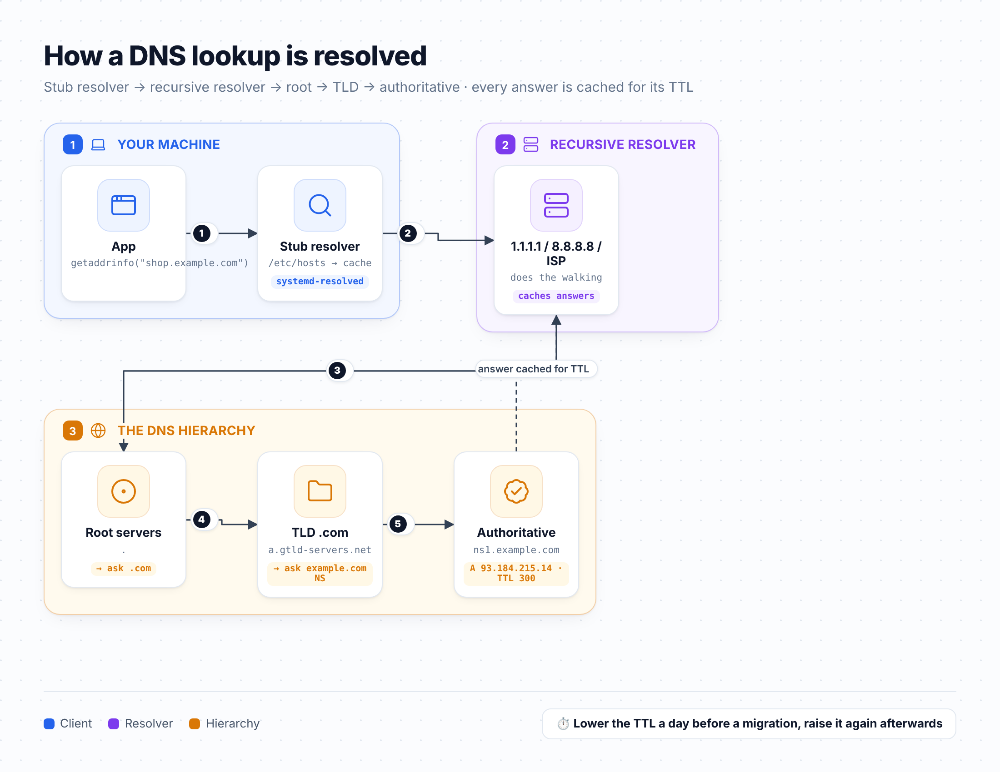
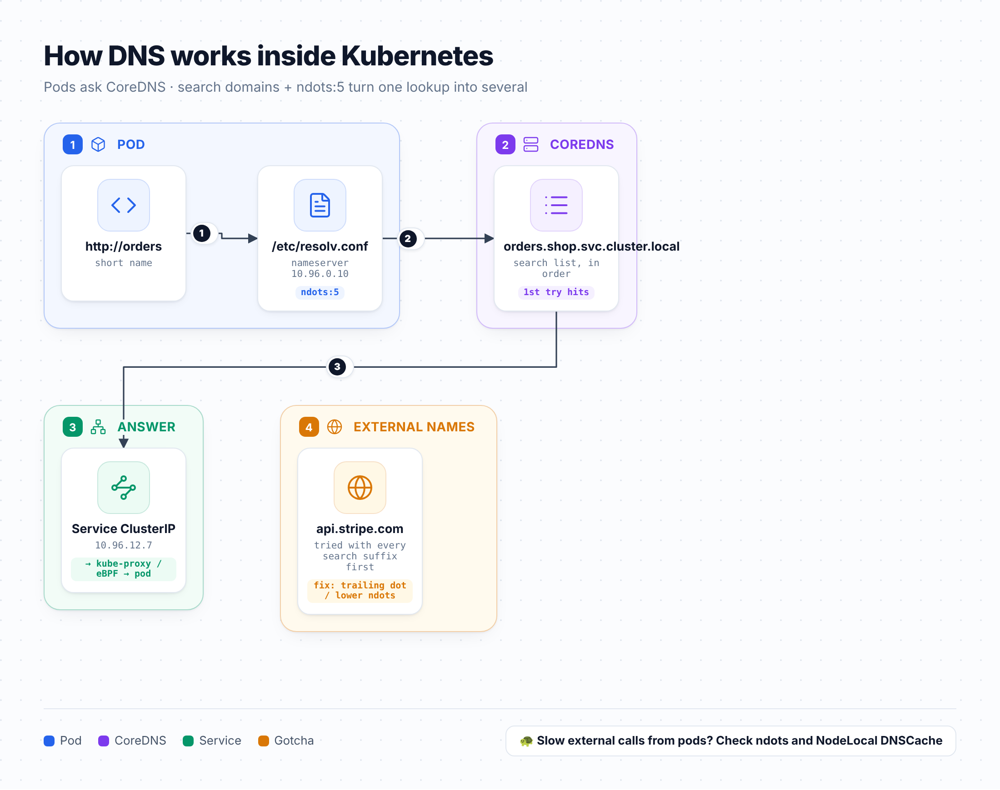

# 6.2 — DNS'e derin dalış

!!! abstract "Kısaca"
    **DNS** internetin dağıtık telefon rehberidir: bir **özyinelemeli çözücü** (recursive resolver) **kökten**
    **TLD**'ye, oradan alan adının **yetkili** sunucularına giderek bir ismi kayıtlara (IP adresleri, takma adlar, mail
    sunucuları, metinler) çevirir ve her cevap **TTL süresince önbellekte tutulur**. DNS'i hızlı yapan da bu, DNS
    değişikliklerinin "zaman almasının" sebebi de.

## 📖 Temel terimler ve kısaltmalar

| Terim | Açılımı | Nedir | Nasıl çalışır (tek satır) |
|---|---|---|---|
| **DNS** | Domain Name System | İsimlerin dağıtık veritabanı | Her biri kendi isim sunucularında duran zone hiyerarşisi |
| **Zone** | — | Ağacın tek bir operatörün yönettiği kısmı | `example.com` zone'u kendi kayıtlarını ve yetki devirlerini tutar |
| **Stub çözücü** | Stub resolver | İşletim sistemindeki küçük çözücü | Tek bir özyinelemeli çözücüye sorar, cevapları önbelleğe alır |
| **Özyinelemeli çözücü** | Recursive resolver | Sorguyu senin yerine yapan sunucu | Kök → TLD → yetkili yolunu yürür, her şeyi önbelleğe alır |
| **Yetkili sunucu** | Authoritative server | Zone'un gerçek cevaplarını tutan sunucu | AA (authoritative answer) bayrağıyla cevaplar |
| **Kök / TLD** | Top-Level Domain | Ağacın tepesi / `.com`, `.org`, `.tr` | Kök TLD sunucularını, TLD alan adının NS'ini gösterir |
| **Kayıt (RR)** | Resource Record | Tek bir girdi: ad, tip, TTL, değer | `shop.example.com. 300 IN A 93.184.215.14` |
| **TTL** | Time To Live | Bir cevabın önbellekte kalabileceği saniye | Düşük TTL = hızlı değişiklik, daha çok sorgu |
| **Negatif önbellek** | Negative caching | "Bu isim yok" (NXDOMAIN) cevabını önbelleğe almak | Zone'un SOA minimum TTL'i kadar sürer |
| **Glue kaydı** | Glue record | Bir isim sunucusunun IP'si, üst zone'da saklanır | NS kendi zone'unun içindeyse döngüyü kırar |
| **DNSSEC** | DNS Security Extensions | DNS kayıtlarına imza | Çözücü kökten başlayan anahtar zincirini doğrular |
| **DoH / DoT** | DNS over HTTPS / DNS over TLS | Şifreli DNS | Sorguları ağ yolundan gizler |
| **CoreDNS** | — | Kubernetes'in cluster DNS sunucusu | `*.svc.cluster.local`'ı cevaplar, gerisini iletir |
| **ndots** | — | resolv.conf seçeneği | Bundan az noktalı isimler önce search domain'leriyle denenir |

## 🗺️ Büyük resim



---

## 1 · Çözümleme nasıl çalışır?

1. Uygulaman `getaddrinfo("shop.example.com")` çağırır. İşletim sistemi önce `/etc/hosts`'a, sonra kendi önbelleğine bakar (`systemd-resolved`, macOS'ta `mDNSResponder`).
2. Bulamazsa `/etc/resolv.conf`'ta tanımlı **özyinelemeli çözücüye** sorar (router'ın, ISP, `1.1.1.1`, `8.8.8.8` ya da bulutta VPC çözücüsü).
3. Çözücünün önbelleğinde bir şey yoksa bir **kök sunucuya** sorar: "`.com` nerede?" Kök, `.com` TLD sunucularına bir **yönlendirme** (referral) ile cevap verir.
4. **TLD sunucusuna** sorar: "`example.com` nerede?" `ns1.example.com`'a (ve glue IP'lerine) yönlendirilir.
5. **Yetkili sunucuya** sorar ve son cevabı alır: `A 93.184.215.14, TTL 300`.
6. Her adım önbelleğe alınır. `.com` altındaki bir sonraki sorgu kökü atlar; 300 sn içinde `shop.example.com` için gelen sorgu bir milisaniyenin altında önbellekten cevaplanır.

DNS çoğunlukla **UDP 53** kullanır (her yöne bir paket). Büyük cevaplar ve zone transferleri **TCP 53** kullanır.

## 2 · Kayıt tipleri

| Tip | Ne tutar | Örnek | Ne için |
|---|---|---|---|
| `A` / `AAAA` | IPv4 / IPv6 adresi | `93.184.215.14` / `2606:2800::1` | Temel isim → IP |
| `CNAME` | Başka bir isme takma ad | `www → shop.example.com.` | Bir CDN ya da LB host adına yönlendirme. Zone tepesinde (apex) kullanılamaz |
| `ALIAS` / `ANAME` | Sağlayıcıya özel apex takma adı | `example.com → lb-123.elb.amazonaws.com` | Apex'te CNAME benzeri davranış (Route 53 alias) |
| `NS` | Zone'un isim sunucuları | `ns1.example.com.` | Yetki devri |
| `SOA` | Zone üst verisi | seri, yenileme, negatif TTL | Zone yönetimi |
| `MX` | Mail sunucuları + öncelik | `10 mx1.example.com.` | E-posta teslimi |
| `TXT` | Serbest metin | `v=spf1 …`, `google-site-verification=…` | SPF, DKIM, DMARC, alan adı doğrulama, ACME DNS-01 |
| `SRV` | Bir servisin host + portu | `_sip._tcp 10 5 5060 sip.example.com.` | Servis keşfi (Kubernetes'te de) |
| `CAA` | Hangi CA'ların sertifika verebileceği | `0 issue "letsencrypt.org"` | Sertifika güvenliği |
| `HTTPS` / `SVCB` | Bağlantı ipuçları | `alpn="h3,h2"` | HTTP/3 ve ECH (Encrypted Client Hello) duyurmak |
| `PTR` | IP → isim | `14.215.184.93.in-addr.arpa.` | Ters DNS, mail sunucusu itibarı |

## 3 · TTL ve önbellek: "DNS neden zaman alır"

### Nasıl çalışır?

Her çözücü ve stub her cevabı **TTL**'i kadar önbellekte tutar. Bir kaydın `TTL 86400` ise ve onu değiştirirsen bazı kullanıcılar bir güne kadar eski IP'yi görmeye devam eder. "Yayılma" (propagation) diye bir şey yok; eski kopyaların sadece **süresi dolar**.

- **Taşımadan önce** TTL'i (ör. 60'a) en az bir eski-TTL süresi kadar önceden düşür. Geçişi yap, kontrol et, sonra tekrar yükselt.
- **Negatif cevaplar** (`NXDOMAIN`) da önbelleğe alınır. Bir ismi oluşturmadan *önce* sorgularsan, SOA'nın negatif TTL'i boyunca "yok" görmeye devam edebilirsin.
- **Uygulamalar da önbellek tutar.** JVM (`networkaddress.cache.ttl`), bazı HTTP istemcileri ve bağlantı havuzları IP'leri TTL'den çok daha uzun tutar. "Failover yaptık ama trafik hâlâ eski IP'ye gidiyor" sorununun klasik sebebi bu.

## 4 · Kubernetes içinde DNS



- Her Service bir isim alır: `<service>.<namespace>.svc.cluster.local` → ClusterIP'si. Headless Service'ler (`clusterIP: None`) doğrudan pod IP'lerini döner.
- Pod'lar `nameserver <kube-dns IP>`, bir search listesi (`<ns>.svc.cluster.local svc.cluster.local cluster.local`) ve **`ndots:5`** içeren bir `/etc/resolv.conf` alır.
- **`ndots:5`** 5'ten az noktalı her ismin önce tüm search ekleriyle denenmesi demek. `api.stripe.com` (2 nokta) asıl sorgudan önce `api.stripe.com.shop.svc.cluster.local`, `api.stripe.com.svc.cluster.local` … olarak denenir; tek bir sorgu 4–5 gidiş-dönüşe (A ve AAAA için ×2) mal olur.
- **Çözümler:** sonunda nokta olan tam isimler kullan (`api.stripe.com.`), pod'da `dnsConfig.options: ndots: "2"` ayarla ve sorguları node üzerinde cevaplamak için **NodeLocal DNSCache** çalıştır.
- Ara sıra gelen 5 saniyelik gecikmeler genelde UDP conntrack yarışlarına ya da CoreDNS'e giden paket kaybına işaret eder. CoreDNS metriklerine ve loglarına bak.

## 5 · Güvenlik: DNSSEC ve şifreli DNS

- **DNSSEC** kayıtları imzalar. Her zone'un anahtarına üst zone'u (`DS` kaydı) kefil olur, köke kadar. Doğrulama yapan bir çözücü sahte cevapları reddeder. **Gerçekliği** kanıtlar, gizlilik sağlamaz.
- **DoT (TCP 853)** ve **DoH (HTTPS 443)** seninle çözücü arasındaki sorguyu şifreler; ağ yolu onu okuyamaz ya da değiştiremez. Tarayıcılar ve telefonlar giderek varsayılan olarak bunları kullanıyor.
- **DNS bir saldırı yüzeyidir:** silinmiş bulut kaynaklarına işaret eden sahipsiz CNAME'ler **subdomain takeover**'a izin verir; açık çözücüler amplifikasyon saldırılarında kullanılır; registrar ve DNS sağlayıcı hesapları MFA'yı hak eder.

## 🔧 DevOps bağlantısı

- **Bulut:** private hosted zone'lar ve VPC çözücüsü (AWS `.2` adresi, hibrit için Route 53 Resolver endpoint'leri), split-horizon DNS (içeride ve dışarıda farklı cevaplar).
- **ExternalDNS** Service ve Ingress'leri izler ve kayıtları Route 53, Cloud DNS, Cloudflare gibi sağlayıcılara yazar; böylece DNS de GitOps'un parçası olur.
- **Health-check'li / ağırlıklı / coğrafi DNS** ucuz bir global load balancer'dır, ama istemciler değişiklikleri ancak TTL'lerin (ve uygulama önbelleklerinin) izin verdiği hızda fark eder.
- **"Her zaman DNS'tir"**: bir şey ara sıra bozuluyorsa önce çözümlemeyi kontrol et (laptoptan değil, pod'un içinden `dig`).

## 🧪 Kendin dene

```bash
dig shop.example.com +short             # sadece cevap
dig example.com +trace                  # kök → TLD → yetkili yolunu kendin yürü
dig example.com NS +short               # yetkili kim
dig example.com MX TXT CAA              # birkaç kayıt tipi
dig @1.1.1.1 example.com +stats         # belirli bir çözücüye sor, sorgu süresini gör
dig cloudflare.com HTTPS +short         # DNS'teki HTTP/3 ipuçları
dig -x 1.1.1.1 +short                   # ters sorgu (PTR)
resolvectl status                       # Linux makinen hangi çözücüyü kullanıyor

# Kubernetes içinde
kubectl run -it --rm dnstest --image=busybox:1.36 --restart=Never -- sh -c \
  'cat /etc/resolv.conf; nslookup kubernetes.default'
```

## 🃏 Hatırlatma kartı

| Belirti | Muhtemel sebep | Kontrol |
|---|---|---|
| Değişiklik görünmüyor | Eski TTL hâlâ önbellekte | `dig +ttlid`, doğrudan yetkili NS'e sor |
| Laptopta çalışıyor, pod'da değil | Search domain / ndots / CoreDNS | Pod'da `cat /etc/resolv.conf` |
| Kaydı oluşturduktan hemen sonra `NXDOMAIN` | Negatif önbellek | SOA minimum TTL |
| Failover sonrası trafik hâlâ eski IP'de | Uygulama düzeyi DNS önbelleği | JVM TTL, bağlantı havuzları |
| Rastgele 5 sn gecikmeler | UDP kaybı / conntrack yarışı | CoreDNS metrikleri, NodeLocal DNSCache |
| `example.com`'a CNAME konamıyor | Apex kısıtı | ALIAS/ANAME ya da A kayıtları |

## ❓ Kendini test et

??? question "1. Kök → TLD → yetkili zincirini aslında kim yürür: laptopun mu, çözücü mü?"
    Özyinelemeli çözücü. Laptopundaki stub çözücü tek bir sorgu gönderir ve son cevabı alır.

??? question "2. On dakika önce TTL'i 3600 olan bir A kaydını değiştirdin. Bazı kullanıcılar neden hâlâ eski IP'yi görüyor?"
    Değişiklikten önce önbelleğe alan çözücüler kopyalarının TTL'i dolana kadar (bir saate kadar) onu tutar; bazı uygulamalar daha da uzun tutar.

??? question "3. Bir pod'un `api.stripe.com` sorgusu neden yavaş olabilir, iki çözüm nedir?"
    `ndots:5` önce her search ekini, A ve AAAA için ayrı ayrı denetir. Sonunda nokta olan tam ismi kullan, `ndots`'u düşür ve/veya NodeLocal DNSCache çalıştır.

??? question "4. DNSSEC neye karşı korur, neye karşı korumaz?"
    Sahte ya da değiştirilmiş cevaplara karşı (gerçeklik ve bütünlük). Hangi isimleri sorguladığını gizlemez; o iş DoH/DoT'nin.

??? question "5. Subdomain takeover nedir?"
    Bir CNAME hâlâ silinmiş bir bulut kaynağını (bucket, uygulama, CDN) gösteriyordur. Saldırgan o kaynak adını alır ve artık senin subdomain'inde içerik sunar.

---

## 📚 Kaynaklar

- [RFC 1034](https://www.rfc-editor.org/rfc/rfc1034) · [RFC 1035](https://www.rfc-editor.org/rfc/rfc1035) — DNS kavramları ve protokolü
- [Cloudflare Learning — What is DNS?](https://www.cloudflare.com/learning/dns/what-is-dns/)
- [Kubernetes — DNS for Services and Pods](https://kubernetes.io/docs/concepts/services-networking/dns-pod-service/)
- [Kubernetes — NodeLocal DNSCache](https://kubernetes.io/docs/tasks/administer-cluster/nodelocaldns/)
- [ExternalDNS](https://kubernetes-sigs.github.io/external-dns/)

## ✍️ Notlarım

> Şirketinin ana alan adı için `dig +trace` çalıştır ve cevap veren her sunucuyu not et.
