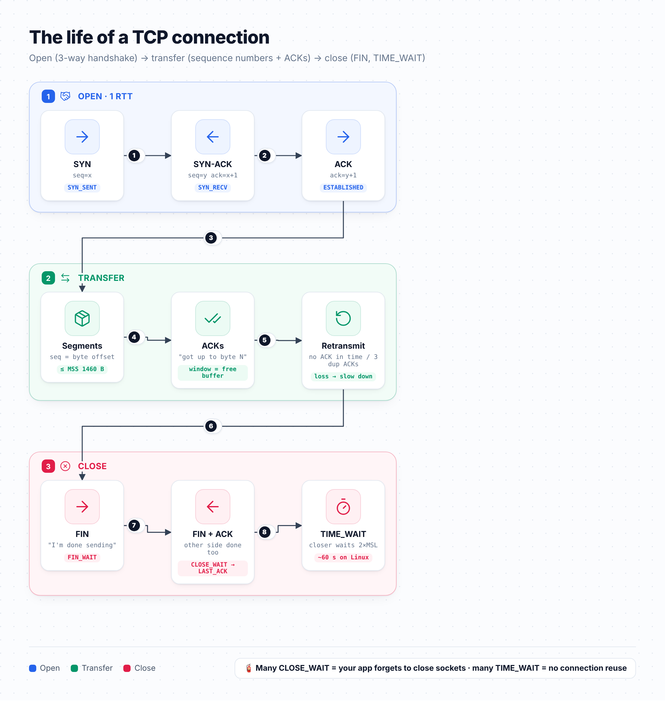
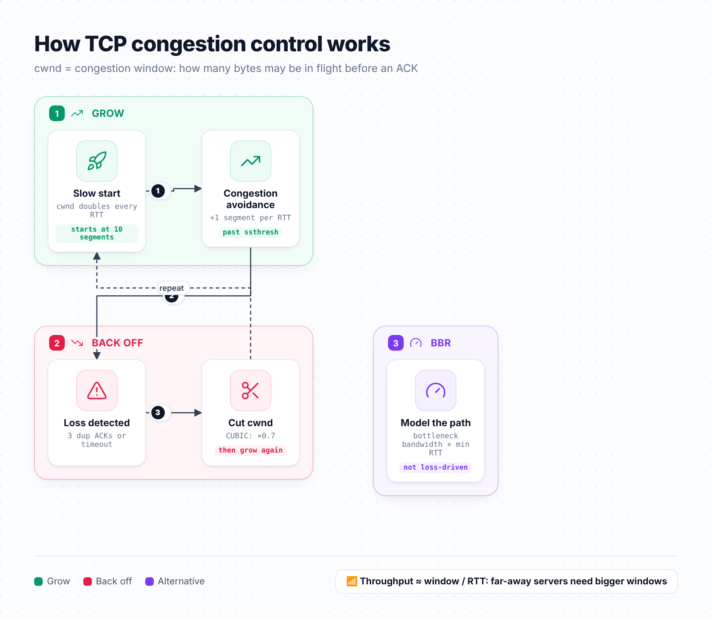

# 6.3 — TCP deep dive

!!! abstract "In one sentence"
    **TCP** turns an unreliable stream of IP packets into a **reliable, ordered byte stream** between two sockets: it opens
    with a **3-way handshake**, numbers every byte, resends what isn't **ACKed**, slows the sender down when the receiver
    (**flow control**) or the network (**congestion control**) can't keep up, and closes with **FIN** packets.

## 📖 Key terms & abbreviations

| Term | Stands for | What it is | How it works (one line) |
|---|---|---|---|
| **TCP** | Transmission Control Protocol | Reliable byte stream over IP | Handshake, sequence numbers, ACKs, retransmits |
| **Socket** | — | An endpoint: IP + port (+ protocol) | A connection = 4-tuple (src IP, src port, dst IP, dst port) |
| **Segment** | — | One TCP packet | Header (20+ bytes) + payload |
| **SYN / ACK / FIN / RST** | synchronize / acknowledge / finish / reset | Header flags | Open / confirm / close politely / abort |
| **Sequence number** | — | Byte offset of the segment's data | Lets the receiver reorder and detect gaps |
| **MSS** | Maximum Segment Size | Largest payload per segment | Usually 1460 bytes (1500 MTU − 40 bytes of headers) |
| **rwnd** | receive window | Free buffer space at the receiver | Flow control: sender may not exceed it |
| **cwnd** | congestion window | Sender's estimate of what the network can take | Grows on ACKs, shrinks on loss |
| **RTT / RTO** | Round-Trip Time / Retransmission TimeOut | Measured delay / timer for resends | RTO adapts to the measured RTT |
| **CUBIC / BBR** | — / Bottleneck Bandwidth and RTT | Congestion control algorithms | Loss-based (Linux default) / model-based |
| **TIME_WAIT** | — | State after an active close | Keeps the 4-tuple reserved ~60 s on Linux |
| **Keep-alive** | — | Reusing a connection for many requests (HTTP) or probing idle ones (TCP) | Saves handshakes / detects dead peers |
| **Backlog** | — | Queue of connections waiting for `accept()` | Full queue → dropped SYNs, slow connects |
| **Ephemeral port** | — | Random client-side port | Range `32768–60999` on Linux |

## 🗺️ Big picture



---

## 1 · Opening: the 3-way handshake

### How does it work?

1. The client sends **SYN** with a random initial sequence number `x`.
2. The server answers **SYN-ACK**: its own number `y`, and `ack = x+1`.
3. The client sends **ACK** with `ack = y+1`. Both sides are now `ESTABLISHED`.

It costs **one RTT** before any data can flow. On the server, the kernel completes handshakes by itself and puts finished connections in the **accept queue** (the backlog) until the app calls `accept()`. If the app is too slow, the queue fills and new SYNs are dropped, which looks like "random 1 s / 3 s connect delays".

## 2 · Sending data: sequence numbers, ACKs and windows

- Every byte has a **sequence number**. The receiver ACKs "I have everything up to byte N", and reorders out-of-order segments.
- **Retransmission:** if an ACK doesn't arrive before the **RTO**, or three duplicate ACKs say "still waiting for byte N", the segment is resent.
- **Flow control:** each ACK carries the receiver's free buffer (`rwnd`). A slow reader shrinks it to zero and the sender pauses.
- **Throughput limit:** at most `window / RTT`. A 64 KB window over a 100 ms path gives only ~5 Mbit/s, which is why **window scaling** exists and why long-distance transfers need big buffers.

## 3 · Congestion control



The network has no "slow down" message, so the sender guesses:

- **Slow start:** begin with ~10 segments and double `cwnd` every RTT.
- **Congestion avoidance:** past a threshold, grow more carefully.
- **Loss = congestion:** on loss, cut `cwnd` (CUBIC multiplies by 0.7) and grow again.
- **BBR** (Google) instead measures the bottleneck bandwidth and minimum RTT and paces packets to match, which works better on lossy or long paths. Enable it with `net.ipv4.tcp_congestion_control=bbr`.

## 4 · Closing: FIN, TIME_WAIT and CLOSE_WAIT

- The side that closes first sends **FIN** and later enters **TIME_WAIT** for 2×MSL (~60 s on Linux), so late packets from the old connection can't confuse a new one with the same 4-tuple.
- **RST** aborts immediately: sent when a port is closed, by firewalls, or by apps that close with unread data.
- **Many `TIME_WAIT`** on a client = it opens a new connection per request. Use keep-alive/pooling; otherwise you can run out of ephemeral ports.
- **Many `CLOSE_WAIT`** = the peer closed but **your app never called `close()`**. That's a bug (leaked sockets), not a kernel setting.

## 5 · Keep-alive and connection reuse

- **HTTP keep-alive / connection pools** reuse one TCP (and TLS) connection for many requests: no handshake per request. This is the biggest easy win for service-to-service latency.
- **TCP keepalive probes** (`SO_KEEPALIVE`) detect dead peers on idle connections. Default is after 2 hours; many apps tune it.
- **Idle timeouts must line up:** if the load balancer drops idle connections after 60 s but the client pool keeps them for 90 s, the client sends on a dead connection and gets a reset (`connection reset by peer`, 502s). Keep the **client idle timeout shorter than the server/LB's**.

## 🔧 DevOps connection

- **502 / 504 behind an LB** often come from idle-timeout mismatches or backends closing keep-alive connections that the LB still uses.
- **Load balancing long-lived connections:** gRPC/HTTP/2 keep one TCP connection, so an L4 balancer sends all requests from a client to one pod. Use L7 (per-request) balancing or client-side balancing.
- **SNAT port exhaustion** (cloud NAT gateways, many connections to one destination) shows up as connection timeouts. Reuse connections, or add NAT IPs.
- **Useful sysctls:** `net.core.somaxconn` (accept backlog), `net.ipv4.ip_local_port_range`, `net.ipv4.tcp_congestion_control`.

## 🧪 Try it yourself

```bash
ss -tan state established | head           # current connections
ss -tan | awk '{print $1}' | sort | uniq -c # count connections per state
ss -ltn                                     # listening sockets + backlog (Recv-Q / Send-Q)
ss -ti dst 1.1.1.1                          # per-connection details: rtt, cwnd, retrans

sudo tcpdump -ni any 'tcp port 443 and host example.com' -c 12 &   # watch the handshake
curl -s -o /dev/null https://example.com

curl -so /dev/null -w 'tcp=%{time_connect}s tls=%{time_appconnect}s ttfb=%{time_starttransfer}s\n' https://example.com
sysctl net.ipv4.tcp_congestion_control net.core.somaxconn
```

## 🃏 Cheat sheet

| Symptom | Likely cause |
|---|---|
| Connects take exactly +1 s / +3 s | SYN dropped and retried (full backlog, firewall) |
| `connection refused` | Nothing listening → RST |
| `connection timed out` | SYN lost: firewall, security group, routing, NAT |
| `connection reset by peer` | Peer/LB closed it (idle timeout, crash, proxy) |
| Thousands of `CLOSE_WAIT` | App doesn't close sockets |
| Thousands of `TIME_WAIT` (client) | No connection reuse |
| Slow transfers over long distance | Small windows, loss → try BBR, tune buffers |

## ❓ Test yourself

??? question "1. Why does TCP need a handshake before sending data?"
    Both sides must agree on starting sequence numbers and confirm the other side is reachable and willing.

??? question "2. What's the difference between flow control and congestion control?"
    Flow control protects the **receiver** (rwnd, its buffer). Congestion control protects the **network** (cwnd, estimated from loss or bandwidth/RTT).

??? question "3. Your service has 20,000 sockets in CLOSE_WAIT. What do you fix?"
    The application: it receives the peer's FIN but never closes its socket (leaked connections, missing `close()` / response body not closed).

??? question "4. Why do you get intermittent 502s when the LB idle timeout is 60 s and the backend's keep-alive timeout is 30 s?"
    The backend closes idle connections first; the LB may send a new request on a connection the backend just closed. Make the backend's timeout longer than the LB's.

??? question "5. Why can one gRPC client overload a single pod behind a Kubernetes Service?"
    kube-proxy balances per TCP connection, and gRPC sends all requests over one long-lived HTTP/2 connection. Use L7 load balancing (mesh, gateway) or client-side balancing.

---

## 📚 Sources

- [RFC 9293 — TCP](https://www.rfc-editor.org/rfc/rfc9293)
- [RFC 9438 — CUBIC](https://www.rfc-editor.org/rfc/rfc9438) · [BBR (Google)](https://research.google/pubs/bbr-congestion-based-congestion-control-2/)
- [Cloudflare — This is strictly a violation of the TCP specification (CLOSE_WAIT)](https://blog.cloudflare.com/this-is-strictly-a-violation-of-the-tcp-specification/)
- [`ss` man page](https://man7.org/linux/man-pages/man8/ss.8.html)

## ✍️ My notes

> Run `ss -tan | awk '{print $1}' | sort | uniq -c` on one of your servers. Explain each state you see.

-
