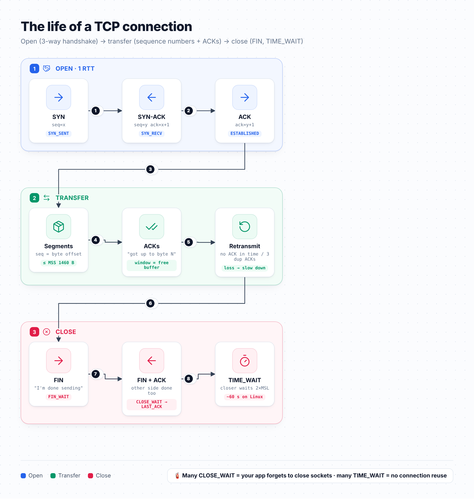
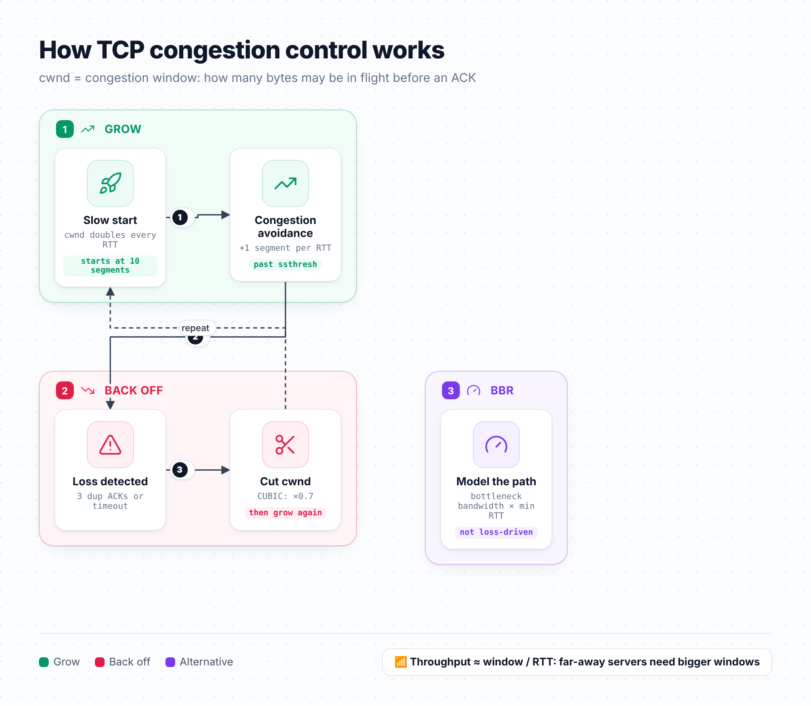

# 6.3 — TCP'ye derin dalış

!!! abstract "Tek cümlede"
    **TCP**, güvenilmez IP paketlerini iki soket arasında **güvenilir ve sıralı bir byte akışına** çevirir: **3 adımlı el
    sıkışma** ile açılır, her byte'ı numaralar, **ACK** gelmeyeni yeniden gönderir, alıcı (**akış kontrolü**) ya da ağ
    (**tıkanıklık kontrolü**) yetişemediğinde göndereni yavaşlatır ve **FIN** paketleriyle kapanır.

## 📖 Temel terimler ve kısaltmalar

| Terim | Açılımı | Nedir | Nasıl çalışır (tek satır) |
|---|---|---|---|
| **TCP** | Transmission Control Protocol | IP üzerinde güvenilir byte akışı | El sıkışma, sıra numaraları, ACK, yeniden gönderim |
| **Soket** | Socket | Bir uç: IP + port (+ protokol) | Bağlantı = 4'lü (kaynak IP, kaynak port, hedef IP, hedef port) |
| **Segment** | — | Tek bir TCP paketi | Başlık (20+ byte) + yük |
| **SYN / ACK / FIN / RST** | synchronize / acknowledge / finish / reset | Başlık bayrakları | Aç / onayla / kibarca kapat / iptal et |
| **Sıra numarası** | Sequence number | Segment verisinin byte konumu | Alıcının sıralamasını ve boşlukları bulmasını sağlar |
| **MSS** | Maximum Segment Size | Segment başına en büyük yük | Genelde 1460 byte (1500 MTU − 40 byte başlık) |
| **rwnd** | receive window | Alıcıdaki boş tampon alanı | Akış kontrolü: gönderen bunu aşamaz |
| **cwnd** | congestion window | Gönderenin ağın kaldırabileceği miktar tahmini | ACK'lerle büyür, kayıpta küçülür |
| **RTT / RTO** | Round-Trip Time / Retransmission TimeOut | Ölçülen gecikme / yeniden gönderim zamanlayıcısı | RTO ölçülen RTT'ye göre ayarlanır |
| **CUBIC / BBR** | — / Bottleneck Bandwidth and RTT | Tıkanıklık kontrol algoritmaları | Kayıp tabanlı (Linux varsayılanı) / model tabanlı |
| **TIME_WAIT** | — | Aktif kapanıştan sonraki durum | 4'lüyü Linux'ta ~60 sn ayrılmış tutar |
| **Keep-alive** | — | Bir bağlantıyı çok istek için kullanmak (HTTP) ya da boştakileri yoklamak (TCP) | El sıkışmadan tasarruf / ölü karşı tarafı bulur |
| **Backlog** | — | `accept()` bekleyen bağlantı kuyruğu | Kuyruk dolu → SYN'ler düşer, bağlanma yavaşlar |
| **Ephemeral port** | — | İstemci tarafında rastgele port | Linux'ta `32768–60999` aralığı |

## 🗺️ Büyük resim



---

## 1 · Açılış: 3 adımlı el sıkışma

### Nasıl çalışır?

1. İstemci rastgele bir başlangıç sıra numarası `x` ile **SYN** gönderir.
2. Sunucu **SYN-ACK** ile cevaplar: kendi numarası `y` ve `ack = x+1`.
3. İstemci `ack = y+1` ile **ACK** gönderir. İki taraf da artık `ESTABLISHED`.

Veri akmadan önce **bir RTT** harcanır. Sunucuda el sıkışmaları kernel kendisi tamamlar ve hazır bağlantıları uygulama `accept()` çağırana kadar **accept kuyruğuna** (backlog) koyar. Uygulama çok yavaşsa kuyruk dolar ve yeni SYN'ler düşer; bu "rastgele 1 sn / 3 sn bağlanma gecikmesi" gibi görünür.

## 2 · Veri gönderme: sıra numaraları, ACK'ler ve pencereler

- Her byte'ın bir **sıra numarası** var. Alıcı "N. byte'a kadar her şey bende" diye ACK'ler ve sırası karışan segmentleri düzeltir.
- **Yeniden gönderim:** **RTO** dolmadan ACK gelmezse ya da üç tekrar ACK "hâlâ N. byte'ı bekliyorum" derse segment yeniden gönderilir.
- **Akış kontrolü:** her ACK alıcının boş tamponunu (`rwnd`) taşır. Yavaş okuyan bir uygulama bunu sıfıra indirir ve gönderen durur.
- **Throughput limiti:** en fazla `pencere / RTT`. 100 ms'lik bir yolda 64 KB pencere sadece ~5 Mbit/s verir; **window scaling** bu yüzden var, uzak mesafeli aktarımlar bu yüzden büyük tampon ister.

## 3 · Tıkanıklık kontrolü



Ağda "yavaşla" mesajı yoktur, gönderen tahmin eder:

- **Yavaş başlangıç (slow start):** ~10 segmentle başla, `cwnd`'yi her RTT'de ikiye katla.
- **Tıkanıklıktan kaçınma:** bir eşikten sonra daha dikkatli büyü.
- **Kayıp = tıkanıklık:** kayıpta `cwnd`'yi düşür (CUBIC 0,7 ile çarpar) ve tekrar büyü.
- **BBR** (Google) ise darboğaz bant genişliğini ve en düşük RTT'yi ölçer, paketleri buna göre gönderir; kayıplı ya da uzun yollarda daha iyi çalışır. `net.ipv4.tcp_congestion_control=bbr` ile açılır.

## 4 · Kapanış: FIN, TIME_WAIT ve CLOSE_WAIT

- Önce kapatan taraf **FIN** gönderir, sonra 2×MSL (Linux'ta ~60 sn) **TIME_WAIT**'e girer; böylece eski bağlantının geç kalan paketleri aynı 4'lüyü kullanan yeni bir bağlantıyı karıştıramaz.
- **RST** hemen iptal eder: kapalı bir porta bağlanınca, firewall'lardan ya da okunmamış veriyle kapatan uygulamalardan gelir.
- **İstemcide çok `TIME_WAIT`** = her istekte yeni bağlantı açılıyor. Keep-alive/havuz kullan; yoksa ephemeral port'lar tükenebilir.
- **Çok `CLOSE_WAIT`** = karşı taraf kapattı ama **uygulaman hiç `close()` çağırmadı**. Bu bir hata (sızan soketler), kernel ayarı değil.

## 5 · Keep-alive ve bağlantı yeniden kullanımı

- **HTTP keep-alive / bağlantı havuzları** tek bir TCP (ve TLS) bağlantısını çok istek için kullanır: istek başına el sıkışma yok. Servisler arası gecikmede en büyük kolay kazanç budur.
- **TCP keepalive yoklamaları** (`SO_KEEPALIVE`) boştaki bağlantılarda ölü karşı tarafı bulur. Varsayılan 2 saat sonra; birçok uygulama bunu ayarlar.
- **Boşta kalma süreleri uyumlu olmalı:** load balancer boştaki bağlantıları 60 sn'de keserken istemci havuzu 90 sn tutarsa istemci ölü bir bağlantıya yazar ve reset alır (`connection reset by peer`, 502'ler). **İstemcinin boşta süresi sunucunun/LB'ninkinden kısa olsun.**

## 🔧 DevOps bağlantısı

- **LB arkasında 502 / 504** genelde boşta süre uyumsuzluğundan ya da LB'nin hâlâ kullandığı keep-alive bağlantılarını backend'in kapatmasından gelir.
- **Uzun ömürlü bağlantıları dağıtmak:** gRPC/HTTP/2 tek bir TCP bağlantısını tutar; L4 bir dağıtıcı bir istemcinin tüm isteklerini tek pod'a yollar. L7 (istek başına) dağıtım ya da istemci tarafı dağıtım kullan.
- **SNAT port tükenmesi** (bulut NAT gateway'leri, tek bir hedefe çok bağlantı) bağlantı zaman aşımı olarak görünür. Bağlantıları yeniden kullan ya da NAT IP'si ekle.
- **İşe yarar sysctl'ler:** `net.core.somaxconn` (accept backlog), `net.ipv4.ip_local_port_range`, `net.ipv4.tcp_congestion_control`.

## 🧪 Kendin dene

```bash
ss -tan state established | head           # mevcut bağlantılar
ss -tan | awk '{print $1}' | sort | uniq -c # duruma göre bağlantı sayısı
ss -ltn                                     # dinleyen soketler + backlog (Recv-Q / Send-Q)
ss -ti dst 1.1.1.1                          # bağlantı detayları: rtt, cwnd, retrans

sudo tcpdump -ni any 'tcp port 443 and host example.com' -c 12 &   # el sıkışmayı izle
curl -s -o /dev/null https://example.com

curl -so /dev/null -w 'tcp=%{time_connect}s tls=%{time_appconnect}s ttfb=%{time_starttransfer}s\n' https://example.com
sysctl net.ipv4.tcp_congestion_control net.core.somaxconn
```

## 🃏 Hatırlatma kartı

| Belirti | Muhtemel sebep |
|---|---|
| Bağlanmalar tam +1 sn / +3 sn sürüyor | SYN düştü ve yeniden denendi (dolu backlog, firewall) |
| `connection refused` | Dinleyen yok → RST |
| `connection timed out` | SYN kayboldu: firewall, security group, routing, NAT |
| `connection reset by peer` | Karşı taraf/LB kapattı (boşta süre, çökme, proxy) |
| Binlerce `CLOSE_WAIT` | Uygulama soketleri kapatmıyor |
| Binlerce `TIME_WAIT` (istemci) | Bağlantı yeniden kullanılmıyor |
| Uzak mesafede yavaş aktarım | Küçük pencere, kayıp → BBR dene, tamponları ayarla |

## ❓ Kendini test et

??? question "1. TCP neden veri göndermeden önce el sıkışmaya ihtiyaç duyar?"
    İki taraf başlangıç sıra numaralarında anlaşmalı ve karşı tarafın ulaşılabilir ve istekli olduğunu doğrulamalıdır.

??? question "2. Akış kontrolü ile tıkanıklık kontrolü arasındaki fark ne?"
    Akış kontrolü **alıcıyı** korur (rwnd, tamponu). Tıkanıklık kontrolü **ağı** korur (cwnd, kayıptan ya da bant genişliği/RTT'den tahmin edilir).

??? question "3. Servisinde CLOSE_WAIT'te 20.000 soket var. Neyi düzeltirsin?"
    Uygulamayı: karşı tarafın FIN'ini alıyor ama soketini hiç kapatmıyor (sızan bağlantılar, eksik `close()` / kapatılmamış response body).

??? question "4. LB boşta süresi 60 sn, backend keep-alive süresi 30 sn iken neden ara sıra 502 alırsın?"
    Backend boştaki bağlantıları önce kapatır; LB az önce kapanan bir bağlantıya yeni istek yollayabilir. Backend'in süresini LB'ninkinden uzun yap.

??? question "5. Tek bir gRPC istemcisi neden bir Kubernetes Service arkasındaki tek pod'u boğabilir?"
    kube-proxy TCP bağlantısı başına dağıtır, gRPC ise tüm istekleri tek bir uzun ömürlü HTTP/2 bağlantısından yollar. L7 dağıtım (mesh, gateway) ya da istemci tarafı dağıtım kullan.

---

## 📚 Kaynaklar

- [RFC 9293 — TCP](https://www.rfc-editor.org/rfc/rfc9293)
- [RFC 9438 — CUBIC](https://www.rfc-editor.org/rfc/rfc9438) · [BBR (Google)](https://research.google/pubs/bbr-congestion-based-congestion-control-2/)
- [Cloudflare — This is strictly a violation of the TCP specification (CLOSE_WAIT)](https://blog.cloudflare.com/this-is-strictly-a-violation-of-the-tcp-specification/)
- [`ss` man sayfası](https://man7.org/linux/man-pages/man8/ss.8.html)

## ✍️ Notlarım

> Sunucularından birinde `ss -tan | awk '{print $1}' | sort | uniq -c` çalıştır. Gördüğün her durumu açıkla.

-
