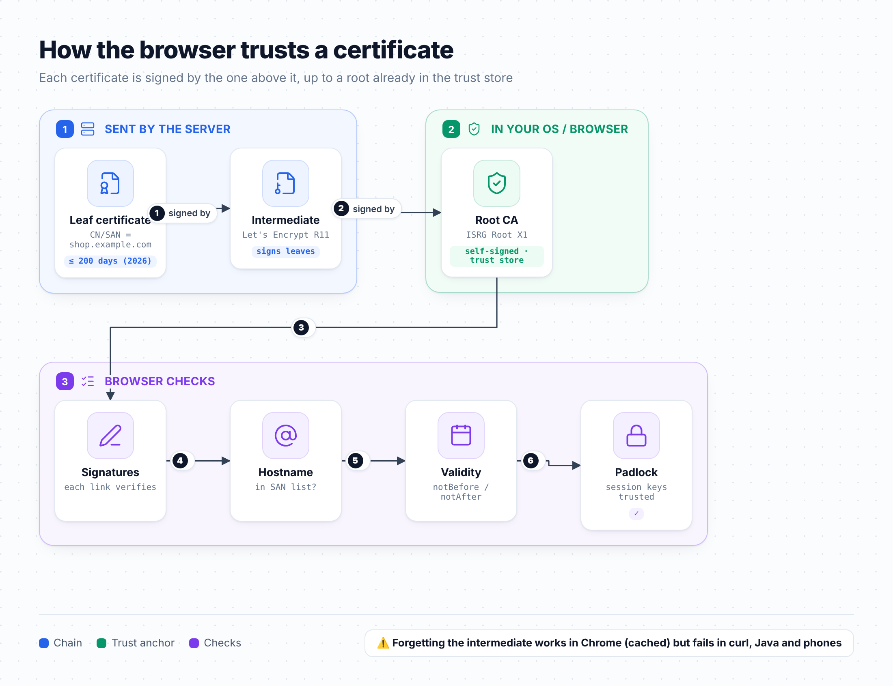
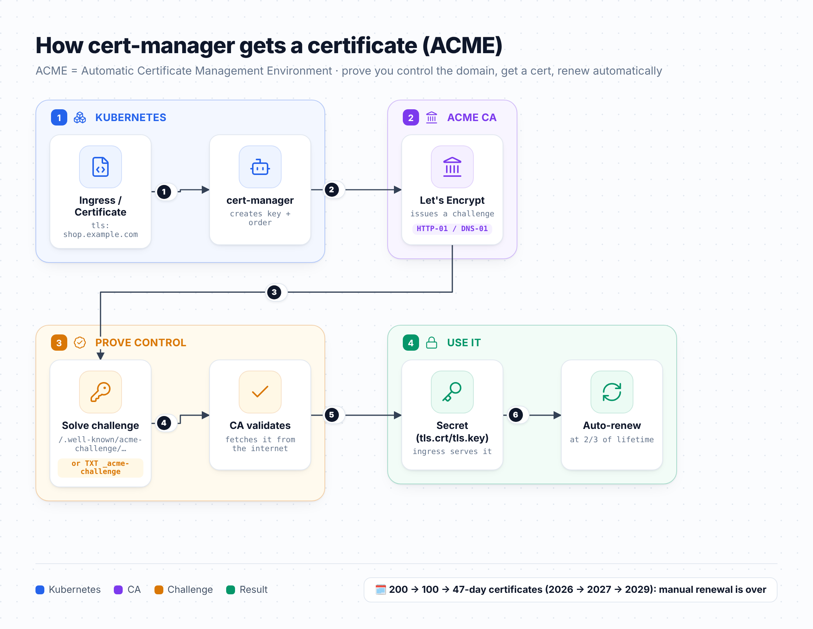

# 6.4 — TLS & certificates deep dive

!!! abstract "In short"
    **TLS** gives a connection three things: **confidentiality** (nobody can read it), **integrity** (nobody can change
    it) and **authentication** (you're really talking to `shop.example.com`). The two sides agree on fresh keys with
    **ECDHE**, the server proves its identity with a **certificate** that chains up to a **root CA** your device already
    trusts, and from then on everything is encrypted with fast **symmetric** ciphers.

## 📖 Key terms & abbreviations

| Term | Stands for | What it is | How it works (one line) |
|---|---|---|---|
| **TLS** | Transport Layer Security | Encryption + authentication for a connection | Handshake agrees keys, then records are encrypted |
| **SSL** | Secure Sockets Layer | TLS's obsolete predecessor | Name survives in "SSL certificate"; protocol is dead |
| **Symmetric cipher** | — | Same key encrypts and decrypts | AES-GCM, ChaCha20-Poly1305: fast, used for data |
| **Asymmetric crypto** | — | Public/private key pair | Used only to agree keys and sign |
| **ECDHE** | Elliptic Curve Diffie-Hellman Ephemeral | Key exchange | Both sides combine key shares into the same secret |
| **Forward secrecy** | — | Old traffic stays safe if the server key leaks later | Fresh (ephemeral) keys per connection |
| **Certificate (X.509)** | — | Signed statement "this public key belongs to these names" | Contains SAN, issuer, validity, public key |
| **SAN** | Subject Alternative Name | List of hostnames in a certificate | Browser checks the hostname is in it |
| **CA** | Certificate Authority | Organisation that signs certificates | Must verify you control the domain first |
| **Chain / intermediate** | — | Leaf ← intermediate ← root | Server sends leaf + intermediates |
| **Trust store** | — | Root CAs your OS/browser trusts | `/etc/ssl/certs`, Java `cacerts`, browser stores |
| **ACME** | Automatic Certificate Management Environment | Protocol to get certificates automatically | Prove control (HTTP-01/DNS-01), receive cert |
| **OCSP / CRL** | Online Certificate Status Protocol / Certificate Revocation List | Ways to say "this cert is revoked" | Being replaced by short-lived certificates |
| **mTLS** | mutual TLS | Both sides present certificates | Service identity in meshes and zero-trust |
| **SNI / ECH** | Server Name Indication / Encrypted Client Hello | Hostname in the handshake / encrypted version of it | Lets one IP host many sites / hides which one |

## 🗺️ Big picture



---

## 1 · What does TLS protect, and how does the handshake work?

### How does it work?

Chapter 6 showed the 1-RTT TLS 1.3 handshake. Here is what each part achieves:

1. **ClientHello:** supported ciphers, an **ECDHE key share**, **SNI** (hostname) and **ALPN** (`h2`, `http/1.1`).
2. **ServerHello:** the server's key share. Both sides now compute the **same shared secret** without ever sending it, and derive the session keys. Everything after this point is encrypted.
3. **Certificate + CertificateVerify:** the certificate chain, plus a **signature** over the handshake made with the certificate's private key. That signature proves the server *owns* the key, not just a copy of the public certificate.
4. **Finished:** a MAC over the whole handshake, so a tampered handshake is detected.

Because the key shares are **ephemeral**, recorded traffic can't be decrypted later even if the server's private key leaks (**forward secrecy**). TLS 1.3 removed old, weak options (RSA key transport, CBC, SHA-1, renegotiation).

**Post-quantum:** major browsers, Cloudflare and Go/OpenSSL now offer a **hybrid key exchange** (`X25519MLKEM768`) by default, combining classical ECDHE with ML-KEM so recorded traffic stays safe against future quantum computers.

## 2 · Certificates and the chain of trust

### What is in a certificate?

```text
Subject Alternative Name: shop.example.com, www.shop.example.com
Issuer:                   Let's Encrypt R11
Validity:                 2026-11-01 → 2027-01-30
Public key:               EC P-256
Signature:                (made by the issuer's private key)
```

### How does the browser decide to trust it?

It builds a path **leaf → intermediate(s) → root**, verifies each signature, checks the **hostname** is in the SAN, checks the **dates**, and requires the root to be in its **trust store**. The server must send the **intermediates**. If it forgets them, browsers may still work (they cache intermediates) but curl, Java, Python and mobile apps fail with "unable to get local issuer certificate".

**Types:** DV (domain validated, what almost everyone uses), OV/EV (organisation checks; browsers no longer show them differently), **wildcard** (`*.example.com`, one level only).

## 3 · Lifetimes, revocation and automation

- **Lifetimes are shrinking.** Under CA/Browser Forum ballot SC-081, the maximum validity of public certificates dropped from 398 to **200 days on 15 March 2026**, will drop to **100 days in March 2027** and to **47 days in March 2029**. Manual renewal no longer works; automation is mandatory.
- **Revocation** (CRL, OCSP) has always been unreliable: browsers soft-fail. The industry answer is short-lived certificates; Let's Encrypt has stopped running OCSP.
- **ACME** automates everything: prove domain control with **HTTP-01** (a file at `/.well-known/acme-challenge/`) or **DNS-01** (a `TXT` record, required for wildcards), get the certificate, renew at ~2/3 of its lifetime.



## 4 · mTLS: certificates for services

In normal TLS only the server proves who it is. In **mutual TLS** the client presents a certificate too. That's how service meshes (Istio, Linkerd), SPIFFE/SPIRE and zero-trust networks give every workload an identity: short-lived certs (hours), rotated automatically, used both for encryption and authorization ("only `orders` may call `payments`").

## 5 · Where TLS terminates

| Pattern | TLS ends at | Trade-off |
|---|---|---|
| **Edge termination** | CDN / LB / ingress | Simple; traffic inside is plain unless re-encrypted |
| **Re-encryption** | LB, then new TLS to backend | Encrypted end to end, two certificates |
| **Passthrough** | The pod itself (L4 LB) | LB can't see HTTP (no path routing, no WAF) |
| **Mesh mTLS** | Sidecar / node proxy | Encrypted pod-to-pod without app changes |

## 🔧 DevOps connection

- **cert-manager** + an `Issuer`/`ClusterIssuer` + annotations on Ingress/Gateway = certificates that renew themselves. Alert on `certmanager_certificate_expiration_timestamp_seconds`.
- **Expiry monitoring:** blackbox exporter `probe_ssl_earliest_cert_expiry` or your synthetic checks. Expired certs are still a top cause of outages.
- **Private CAs** for internal services (cert-manager CA issuer, Vault PKI, cloud private CA); distribute the root to clients' trust stores (and Java's separate `cacerts`!).
- **CAA records** limit which CAs may issue for your domain; **Certificate Transparency** logs (crt.sh) show every certificate issued for it.

## 🧪 Try it yourself

```bash
# Handshake details: protocol, cipher, key exchange, chain
openssl s_client -connect example.com:443 -servername example.com </dev/null 2>/dev/null | \
  grep -E 'Protocol|Cipher|Server Temp Key|Negotiated|s:|i:'

# The certificate itself
openssl s_client -connect example.com:443 -servername example.com </dev/null 2>/dev/null | \
  openssl x509 -noout -subject -issuer -dates -ext subjectAltName

# Days left
echo | openssl s_client -connect example.com:443 -servername example.com 2>/dev/null | \
  openssl x509 -noout -enddate

# Every certificate ever issued for a domain
curl -s 'https://crt.sh/?q=example.com&output=json' | head -c 600; echo

# In Kubernetes with cert-manager
kubectl get certificates,certificaterequests,orders,challenges -A
```

## 🃏 Cheat sheet

| Error | Meaning / fix |
|---|---|
| `certificate has expired` | Renewal failed → check ACME challenges, cert-manager logs |
| `unable to get local issuer certificate` | Missing intermediate on server, or root not in client trust store |
| `hostname mismatch` / `ERR_CERT_COMMON_NAME_INVALID` | Name not in SAN (wildcards cover one level) |
| `self-signed certificate in chain` | Private CA not trusted by this client (or a TLS-inspecting proxy) |
| `handshake failure` / `no shared cipher` | Old client (TLS 1.0/1.1) or wrong SNI |
| HTTP-01 challenge fails | Port 80 blocked, redirect loop, wrong ingress class |

## ❓ Test yourself

??? question "1. Why doesn't TLS just use RSA/ECDSA to encrypt all the data?"
    Asymmetric crypto is slow. It's used once to agree keys and prove identity; the data uses fast symmetric ciphers.

??? question "2. What does the CertificateVerify signature prove that the certificate alone doesn't?"
    That the server has the private key. Anyone can copy a public certificate; only the owner can sign with its key.

??? question "3. Your site works in Chrome but `curl` says 'unable to get local issuer certificate'. Why?"
    The server isn't sending the intermediate certificate. Chrome had it cached; curl didn't. Serve the full chain.

??? question "4. Why is the industry moving to 47-day certificates?"
    Revocation doesn't work reliably, so short lifetimes limit how long a stolen or mis-issued certificate is useful, and force automation.

??? question "5. Which ACME challenge do you need for `*.example.com`?"
    DNS-01: wildcard certificates require a TXT record under `_acme-challenge.example.com`.

---

## 📚 Sources

- [RFC 8446 — TLS 1.3](https://www.rfc-editor.org/rfc/rfc8446) · [RFC 8555 — ACME](https://www.rfc-editor.org/rfc/rfc8555)
- [CA/Browser Forum ballot SC-081v3](https://cabforum.org/2025/04/11/ballot-sc081v3-introduce-schedule-of-reducing-validity-and-data-reuse-periods/)
- [The Illustrated TLS 1.3 Connection](https://tls13.xargs.org/)
- [cert-manager docs](https://cert-manager.io/docs/) · [Let's Encrypt — How it works](https://letsencrypt.org/how-it-works/)
- [Cloudflare — Post-quantum cryptography](https://blog.cloudflare.com/pq-2024/)

## ✍️ My notes

> Pick your company's main domain: who issued its certificate, how many days are left, and how is it renewed?
