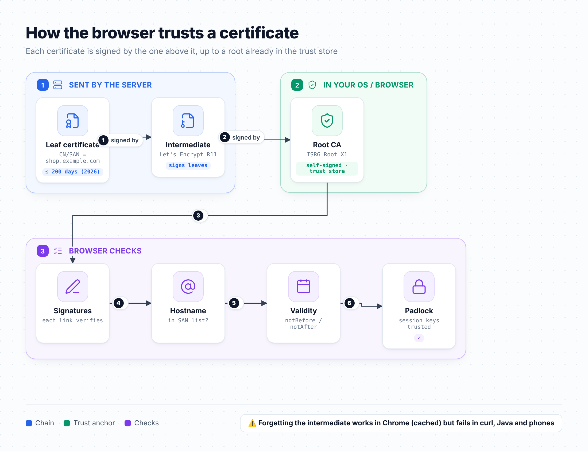
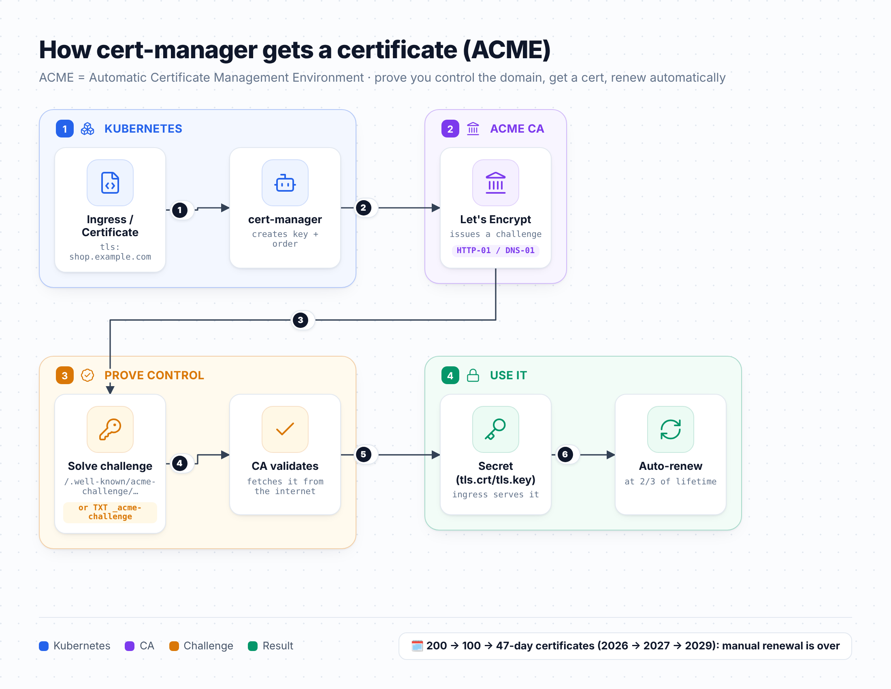

# 6.4 — TLS ve sertifikalara derin dalış

!!! abstract "Kısaca"
    **TLS** bir bağlantıya üç şey verir: **gizlilik** (kimse okuyamaz), **bütünlük** (kimse değiştiremez) ve **kimlik
    doğrulama** (gerçekten `shop.example.com` ile konuşuyorsun). İki taraf **ECDHE** ile taze anahtarlarda anlaşır,
    sunucu kimliğini cihazının zaten güvendiği bir **kök CA**'ya bağlanan bir **sertifika** ile kanıtlar ve bundan sonra
    her şey hızlı **simetrik** şifrelerle şifrelenir.

## 📖 Temel terimler ve kısaltmalar

| Terim | Açılımı | Nedir | Nasıl çalışır (tek satır) |
|---|---|---|---|
| **TLS** | Transport Layer Security | Bir bağlantı için şifreleme + kimlik doğrulama | El sıkışma anahtarlarda anlaşır, sonra kayıtlar şifrelenir |
| **SSL** | Secure Sockets Layer | TLS'in eskimiş atası | Adı "SSL sertifikası"nda yaşıyor; protokol öldü |
| **Simetrik şifre** | — | Aynı anahtar şifreler ve çözer | AES-GCM, ChaCha20-Poly1305: hızlı, veri için |
| **Asimetrik kripto** | — | Açık/özel anahtar çifti | Sadece anahtar anlaşması ve imza için |
| **ECDHE** | Elliptic Curve Diffie-Hellman Ephemeral | Anahtar değişimi | İki taraf anahtar paylarını aynı sırra birleştirir |
| **Forward secrecy** | — | Sunucu anahtarı sonradan sızsa da eski trafik güvende | Bağlantı başına taze (geçici) anahtarlar |
| **Sertifika (X.509)** | — | "Bu açık anahtar şu isimlere ait" diyen imzalı belge | SAN, yayıncı, geçerlilik, açık anahtar içerir |
| **SAN** | Subject Alternative Name | Sertifikadaki host adı listesi | Tarayıcı host adının içinde olup olmadığına bakar |
| **CA** | Certificate Authority | Sertifika imzalayan kurum | Önce alan adını kontrol ettiğini doğrulamalı |
| **Zincir / ara sertifika** | — | Yaprak ← ara ← kök | Sunucu yaprak + ara sertifikaları gönderir |
| **Trust store** | — | İşletim sisteminin/tarayıcının güvendiği kök CA'lar | `/etc/ssl/certs`, Java `cacerts`, tarayıcı depoları |
| **ACME** | Automatic Certificate Management Environment | Otomatik sertifika alma protokolü | Kontrolü kanıtla (HTTP-01/DNS-01), sertifikayı al |
| **OCSP / CRL** | Online Certificate Status Protocol / Certificate Revocation List | "Bu sertifika iptal" deme yolları | Yerini kısa ömürlü sertifikalara bırakıyor |
| **mTLS** | mutual TLS | İki taraf da sertifika sunar | Mesh'lerde ve zero-trust'ta servis kimliği |
| **SNI / ECH** | Server Name Indication / Encrypted Client Hello | El sıkışmadaki host adı / şifreli hali | Tek IP'de çok site / hangisi olduğunu gizler |

## 🗺️ Büyük resim



---

## 1 · TLS neyi korur, el sıkışma nasıl çalışır?

### Nasıl çalışır?

6. bölümde 1 RTT'lik TLS 1.3 el sıkışmasını gördük. Her parçanın ne sağladığı:

1. **ClientHello:** desteklenen şifreler, bir **ECDHE anahtar payı**, **SNI** (host adı) ve **ALPN** (`h2`, `http/1.1`).
2. **ServerHello:** sunucunun anahtar payı. İki taraf artık **aynı ortak sırrı** hiç göndermeden hesaplar ve oturum anahtarlarını türetir. Bu noktadan sonra her şey şifreli.
3. **Certificate + CertificateVerify:** sertifika zinciri ve sertifikanın özel anahtarıyla el sıkışma üzerine atılmış bir **imza**. Bu imza sunucunun açık sertifikanın sadece bir kopyasına değil, anahtarın kendisine *sahip* olduğunu kanıtlar.
4. **Finished:** tüm el sıkışma üzerinde bir MAC; değiştirilmiş bir el sıkışma yakalanır.

Anahtar payları **geçici** olduğu için, sunucunun özel anahtarı sonradan sızsa bile kaydedilmiş trafik çözülemez (**forward secrecy**). TLS 1.3 eski ve zayıf seçenekleri kaldırdı (RSA ile anahtar taşıma, CBC, SHA-1, yeniden pazarlık).

**Kuantum sonrası:** büyük tarayıcılar, Cloudflare ve Go/OpenSSL artık varsayılan olarak **hibrit bir anahtar değişimi** (`X25519MLKEM768`) sunuyor; klasik ECDHE'yi ML-KEM ile birleştirerek kaydedilen trafiği gelecekteki kuantum bilgisayarlara karşı da korur.

## 2 · Sertifikalar ve güven zinciri

### Bir sertifikada ne var?

```text
Subject Alternative Name: shop.example.com, www.shop.example.com
Issuer:                   Let's Encrypt R11
Validity:                 2026-11-01 → 2027-01-30
Public key:               EC P-256
Signature:                (yayıncının özel anahtarıyla atılmış)
```

### Tarayıcı ona güvenmeye nasıl karar verir?

**yaprak → ara sertifika(lar) → kök** yolunu kurar, her imzayı doğrular, **host adının** SAN'da olduğuna, **tarihlere** bakar ve kökün **trust store**'unda olmasını şart koşar. Sunucu **ara sertifikaları** göndermek zorundadır. Unutursa tarayıcılar yine çalışabilir (ara sertifikaları önbelleğe alırlar) ama curl, Java, Python ve mobil uygulamalar "unable to get local issuer certificate" hatası verir.

**Tipler:** DV (alan adı doğrulamalı, neredeyse herkesin kullandığı), OV/EV (kurum kontrolü; tarayıcılar artık farklı göstermiyor), **wildcard** (`*.example.com`, sadece bir seviye).

## 3 · Ömür, iptal ve otomasyon

- **Ömürler kısalıyor.** CA/Browser Forum'un SC-081 kararıyla açık sertifikaların azami geçerliliği **15 Mart 2026'da** 398 günden **200 güne** indi; **Mart 2027'de 100 güne**, **Mart 2029'da 47 güne** inecek. Elle yenileme artık işlemez; otomasyon zorunlu.
- **İptal** (CRL, OCSP) hep güvenilmezdi: tarayıcılar hata olursa geçer (soft-fail). Sektörün cevabı kısa ömürlü sertifikalar; Let's Encrypt OCSP çalıştırmayı bıraktı.
- **ACME** her şeyi otomatikleştirir: alan adı kontrolünü **HTTP-01** (`/.well-known/acme-challenge/` altında bir dosya) ya da **DNS-01** (bir `TXT` kaydı, wildcard için zorunlu) ile kanıtla, sertifikayı al, ömrünün ~2/3'ünde yenile.



## 4 · mTLS: servisler için sertifikalar

Normal TLS'te sadece sunucu kim olduğunu kanıtlar. **Mutual TLS**'te istemci de bir sertifika sunar. Service mesh'ler (Istio, Linkerd), SPIFFE/SPIRE ve zero-trust ağları her iş yüküne böyle kimlik verir: kısa ömürlü (saatlik), otomatik yenilenen sertifikalar; hem şifreleme hem yetkilendirme için kullanılır ("`payments`'ı sadece `orders` çağırabilir").

## 5 · TLS nerede sonlanır

| Desen | TLS nerede biter | Ödünleşim |
|---|---|---|
| **Uçta sonlandırma** | CDN / LB / ingress | Basit; içerideki trafik yeniden şifrelenmezse düz metin |
| **Yeniden şifreleme** | LB, sonra backend'e yeni TLS | Uçtan uca şifreli, iki sertifika |
| **Passthrough** | Pod'un kendisi (L4 LB) | LB HTTP'yi göremez (yol bazlı yönlendirme yok, WAF yok) |
| **Mesh mTLS** | Sidecar / node proxy'si | Uygulamaya dokunmadan pod'dan pod'a şifreli |

## 🔧 DevOps bağlantısı

- **cert-manager** + bir `Issuer`/`ClusterIssuer` + Ingress/Gateway üzerindeki anotasyonlar = kendi kendini yenileyen sertifikalar. `certmanager_certificate_expiration_timestamp_seconds` üzerine alarm kur.
- **Bitiş izleme:** blackbox exporter `probe_ssl_earliest_cert_expiry` ya da sentetik kontrollerin. Süresi dolan sertifikalar hâlâ en yaygın kesinti sebeplerinden.
- **İç servisler için özel CA'lar** (cert-manager CA issuer, Vault PKI, bulut private CA); kökü istemcilerin trust store'larına dağıt (ve Java'nın ayrı `cacerts`'ine!).
- **CAA kayıtları** alan adın için hangi CA'ların sertifika verebileceğini sınırlar; **Certificate Transparency** logları (crt.sh) alan adın için verilmiş her sertifikayı gösterir.

## 🧪 Kendin dene

```bash
# El sıkışma detayları: protokol, şifre, anahtar değişimi, zincir
openssl s_client -connect example.com:443 -servername example.com </dev/null 2>/dev/null | \
  grep -E 'Protocol|Cipher|Server Temp Key|Negotiated|s:|i:'

# Sertifikanın kendisi
openssl s_client -connect example.com:443 -servername example.com </dev/null 2>/dev/null | \
  openssl x509 -noout -subject -issuer -dates -ext subjectAltName

# Kalan gün
echo | openssl s_client -connect example.com:443 -servername example.com 2>/dev/null | \
  openssl x509 -noout -enddate

# Bir alan adı için verilmiş tüm sertifikalar
curl -s 'https://crt.sh/?q=example.com&output=json' | head -c 600; echo

# cert-manager ile Kubernetes'te
kubectl get certificates,certificaterequests,orders,challenges -A
```

## 🃏 Hatırlatma kartı

| Hata | Anlamı / çözümü |
|---|---|
| `certificate has expired` | Yenileme başarısız → ACME challenge'ları, cert-manager logları |
| `unable to get local issuer certificate` | Sunucuda ara sertifika eksik ya da kök istemcinin trust store'unda yok |
| `hostname mismatch` / `ERR_CERT_COMMON_NAME_INVALID` | İsim SAN'da yok (wildcard tek seviyeyi kapsar) |
| `self-signed certificate in chain` | Özel CA bu istemcide güvenilir değil (ya da TLS inceleyen bir proxy var) |
| `handshake failure` / `no shared cipher` | Eski istemci (TLS 1.0/1.1) ya da yanlış SNI |
| HTTP-01 challenge başarısız | 80 portu kapalı, yönlendirme döngüsü, yanlış ingress class |

## ❓ Kendini test et

??? question "1. TLS neden tüm veriyi RSA/ECDSA ile şifrelemiyor?"
    Asimetrik kripto yavaştır. Bir kez anahtar anlaşması ve kimlik kanıtı için kullanılır; veri hızlı simetrik şifrelerle şifrelenir.

??? question "2. CertificateVerify imzası, sertifikanın tek başına kanıtlamadığı neyi kanıtlar?"
    Sunucunun özel anahtara sahip olduğunu. Açık sertifikayı herkes kopyalayabilir; anahtarla sadece sahibi imza atabilir.

??? question "3. Siten Chrome'da çalışıyor ama `curl` 'unable to get local issuer certificate' diyor. Neden?"
    Sunucu ara sertifikayı göndermiyor. Chrome onu önbellekte tutuyordu, curl tutmuyordu. Tam zinciri sun.

??? question "4. Sektör neden 47 günlük sertifikalara geçiyor?"
    İptal mekanizmaları güvenilir çalışmıyor; kısa ömür, çalınmış ya da hatalı verilmiş bir sertifikanın ne kadar süre işe yarayacağını sınırlar ve otomasyonu zorunlu kılar.

??? question "5. `*.example.com` için hangi ACME challenge'ı gerekir?"
    DNS-01: wildcard sertifikalar `_acme-challenge.example.com` altında bir TXT kaydı ister.

---

## 📚 Kaynaklar

- [RFC 8446 — TLS 1.3](https://www.rfc-editor.org/rfc/rfc8446) · [RFC 8555 — ACME](https://www.rfc-editor.org/rfc/rfc8555)
- [CA/Browser Forum ballot SC-081v3](https://cabforum.org/2025/04/11/ballot-sc081v3-introduce-schedule-of-reducing-validity-and-data-reuse-periods/)
- [The Illustrated TLS 1.3 Connection](https://tls13.xargs.org/)
- [cert-manager docs](https://cert-manager.io/docs/) · [Let's Encrypt — How it works](https://letsencrypt.org/how-it-works/)
- [Cloudflare — Post-quantum cryptography](https://blog.cloudflare.com/pq-2024/)

## ✍️ Notlarım

> Şirketinin ana alan adını seç: sertifikasını kim verdi, kaç gün kaldı ve nasıl yenileniyor?
