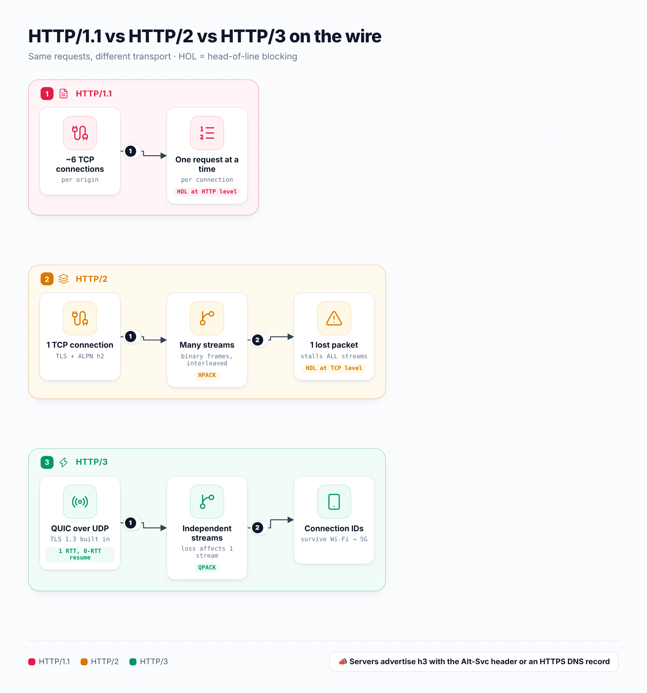

# 6.5 — HTTP/2 & HTTP/3 deep dive

!!! abstract "In one sentence"
    HTTP's **meaning** (methods, headers, status codes) hasn't changed since 1.1; what changed is **how it travels**.
    **HTTP/2** splits messages into binary **frames** and runs many **streams** in parallel over one TCP connection, and
    **HTTP/3** moves that onto **QUIC** over UDP so a lost packet only stalls one stream, handshakes are faster, and
    connections survive network changes.

## 📖 Key terms & abbreviations

| Term | Stands for | What it is | How it works (one line) |
|---|---|---|---|
| **HOL blocking** | Head-Of-Line blocking | One slow/lost item delays everything behind it | At HTTP level in 1.1, at TCP level in h2 |
| **Frame** | — | Smallest unit in HTTP/2 and HTTP/3 | HEADERS, DATA, SETTINGS, … with a stream id |
| **Stream** | — | One request/response pair inside a connection | Many streams interleave on one connection |
| **Multiplexing** | — | Many streams over one connection | Frames from different streams mixed on the wire |
| **HPACK / QPACK** | — | Header compression for h2 / h3 | Tables of previously sent headers |
| **ALPN** | Application-Layer Protocol Negotiation | Picks `h2` or `http/1.1` during TLS | Listed in ClientHello |
| **h2c** | HTTP/2 cleartext | HTTP/2 without TLS | Used inside clusters (gRPC) |
| **QUIC** | — (originally "Quick UDP Internet Connections") | Transport over UDP with TLS 1.3 built in | Streams, loss recovery, congestion control in user space |
| **Connection ID** | — | QUIC's connection identifier | Survives IP/port changes (connection migration) |
| **0-RTT** | zero round-trip time | Sending data in the first flight on resumption | Faster, but replayable → only for safe requests |
| **Alt-Svc** | Alternative Service | Header advertising another protocol/endpoint | `Alt-Svc: h3=":443"; ma=86400` |
| **Server push** | — | h2 feature to send unrequested resources | Removed from browsers; use `103 Early Hints` |

## 🗺️ Big picture



---

## 1 · Why HTTP/1.1 wasn't enough

- A connection carries **one request at a time**. Pipelining existed but never worked well, so browsers opened **~6 TCP+TLS connections per origin**.
- Headers are **plain text and repeated** on every request (cookies, user agent): kilobytes of overhead.
- Developers worked around it with **domain sharding, sprites and bundling**. Many of those hacks are now harmful.

## 2 · HTTP/2: one connection, many streams

### How does it work?

1. TLS negotiates `h2` via **ALPN**. Both sides exchange **SETTINGS** (max concurrent streams, window sizes).
2. Each request gets an odd **stream id**. Its headers go in a **HEADERS** frame (HPACK-compressed), its body in **DATA** frames.
3. Frames from many streams are **interleaved** on the one connection, so a big download doesn't block a small API call.
4. **Per-stream flow control** and **priorities** let both sides control who gets the bandwidth.

**The remaining problem:** all streams share one TCP byte stream. If one TCP packet is lost, TCP holds back *everything after it* until it's resent, so all streams stall (**TCP-level HOL blocking**). On lossy mobile networks h2 can be slower than 1.1 with 6 connections.

## 3 · HTTP/3 and QUIC

### How does it work?

- **QUIC runs on UDP** and implements reliability, ordering and congestion control itself, **per stream**. A lost packet only delays the streams whose data was in it.
- **TLS 1.3 is built into QUIC**: transport and crypto handshakes are combined into **1 RTT** (0-RTT on resumption). Almost the whole header is encrypted.
- **Connection IDs** instead of the IP/port 4-tuple: switching from Wi-Fi to 5G keeps the connection alive.
- **Discovery:** the first visit uses h2 over TCP; the server says `Alt-Svc: h3=":443"` (or publishes an `HTTPS` DNS record), and the browser races QUIC on the next connection. If UDP 443 is blocked, it silently falls back to TCP.

## 4 · What changes for infrastructure

| Area | Impact |
|---|---|
| **Load balancers** | h2/h3 terminate at the edge; backends often still get HTTP/1.1 or h2. H3 needs **UDP 443** open and a UDP-capable LB |
| **L4 balancing of h2/gRPC** | One long connection per client → uneven load. Use L7 balancing or client-side balancing |
| **Timeouts** | Long-lived connections + streaming need idle and stream timeouts tuned separately |
| **Observability** | QUIC is encrypted; tcpdump shows little. Use qlog, server logs, or `SSLKEYLOGFILE` in tests |
| **Old hacks** | Domain sharding and huge bundles hurt h2/h3; prefer fewer origins and sensible splitting |
| **`103 Early Hints`** | Replaces server push: tells the browser to preload CSS/JS while the server is still thinking |

## 🔧 DevOps connection

- **gRPC is HTTP/2.** Inside the cluster it's often `h2c`; through an ingress you need h2 to the backend (`backend-protocol: GRPC` on ingress-nginx, `appProtocol: kubernetes.io/h2c` on Gateway API).
- **Enable HTTP/3** at the CDN or edge first (Cloudflare, CloudFront, Google LB); it's the cheapest win for mobile users.
- **Max concurrent streams** (`SETTINGS_MAX_CONCURRENT_STREAMS`, often 100) caps parallel requests per connection; clients open more connections when they hit it.
- Watch for **HTTP/2 DoS classes** (Rapid Reset, CONTINUATION floods): keep proxies patched.

## 🧪 Try it yourself

```bash
curl -sI --http2 https://www.cloudflare.com -o /dev/null -w '%{http_version}\n'   # → 2
curl -sI https://www.cloudflare.com | grep -i alt-svc                              # h3 advertised?
curl -sI --http3-only https://www.cloudflare.com -o /dev/null -w '%{http_version}\n' 2>/dev/null \
  || echo "your curl has no HTTP/3 support"
dig www.cloudflare.com HTTPS +short                                                # h3 hint in DNS
# Chrome: DevTools → Network → right-click columns → enable "Protocol" (h2 / h3)
```

## 🃏 Cheat sheet

| | HTTP/1.1 | HTTP/2 | HTTP/3 |
|---|---|---|---|
| Transport | TCP | TCP | QUIC (UDP) |
| Format | Text | Binary frames | Binary frames |
| Parallelism | ~6 connections | Streams on 1 connection | Independent streams |
| Header compression | none | HPACK | QPACK |
| HOL blocking | HTTP level | TCP level | none across streams |
| Handshake (new) | TCP + TLS = 2 RTT | 2 RTT | 1 RTT (0-RTT resume) |
| Negotiation | default | ALPN `h2` | Alt-Svc / HTTPS record |

## ❓ Test yourself

??? question "1. HTTP/2 multiplexes streams. Why can it still suffer from head-of-line blocking?"
    Streams share one TCP connection; a lost TCP segment blocks delivery of all later bytes, so every stream waits.

??? question "2. How does a browser find out a site supports HTTP/3?"
    `Alt-Svc: h3=":443"` on an earlier response, or an `HTTPS` DNS record. Then it tries QUIC and falls back to TCP if UDP is blocked.

??? question "3. Why is 0-RTT data restricted to safe requests?"
    An attacker can replay the first flight. Replaying a GET is harmless; replaying a payment POST is not.

??? question "4. Your gRPC service behind a Kubernetes Service has one hot pod. Why?"
    gRPC keeps one long-lived HTTP/2 connection; kube-proxy balances connections, not requests.

??? question "5. What happens to a QUIC connection when the phone switches from Wi-Fi to 5G?"
    The IP changes but the Connection ID doesn't, so the connection migrates instead of reconnecting.

---

## 📚 Sources

- [RFC 9113 — HTTP/2](https://www.rfc-editor.org/rfc/rfc9113) · [RFC 9114 — HTTP/3](https://www.rfc-editor.org/rfc/rfc9114) · [RFC 9000 — QUIC](https://www.rfc-editor.org/rfc/rfc9000)
- [HTTP/3 explained (Daniel Stenberg)](https://http3-explained.haxx.se/)
- [web.dev — Introduction to HTTP/2](https://web.dev/articles/performance-http2)
- [MDN — 103 Early Hints](https://developer.mozilla.org/en-US/docs/Web/HTTP/Status/103)

## ✍️ My notes

> Open your company's site in Chrome DevTools with the Protocol column. Which resources use h2, h3, or http/1.1, and why?

-
