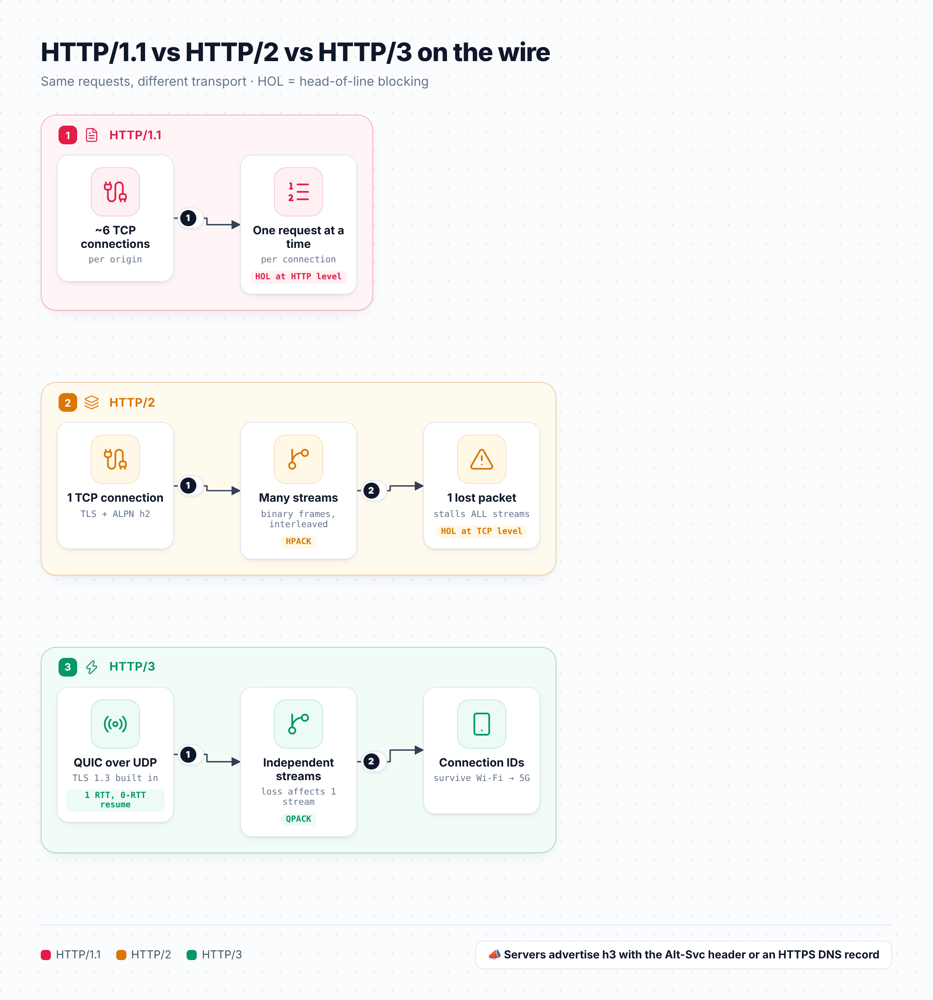

# 6.5 — HTTP/2 ve HTTP/3'e derin dalış

!!! abstract "Tek cümlede"
    HTTP'nin **anlamı** (metotlar, header'lar, durum kodları) 1.1'den beri değişmedi; değişen **nasıl taşındığı**.
    **HTTP/2** mesajları ikili **çerçevelere** böler ve tek bir TCP bağlantısında çok sayıda **akışı** paralel çalıştırır;
    **HTTP/3** bunu UDP üzerinde **QUIC**'e taşır: kayıp bir paket sadece tek akışı durdurur, el sıkışmalar hızlanır ve
    bağlantılar ağ değişikliklerinde yaşamaya devam eder.

## 📖 Temel terimler ve kısaltmalar

| Terim | Açılımı | Nedir | Nasıl çalışır (tek satır) |
|---|---|---|---|
| **HOL blocking** | Head-Of-Line blocking | Yavaş/kayıp tek parça arkasındaki her şeyi bekletir | 1.1'de HTTP düzeyinde, h2'de TCP düzeyinde |
| **Çerçeve** | Frame | HTTP/2 ve HTTP/3'te en küçük birim | HEADERS, DATA, SETTINGS … akış kimliğiyle |
| **Akış** | Stream | Bağlantı içinde tek bir istek/cevap çifti | Çok akış tek bağlantıda iç içe geçer |
| **Çoklama** | Multiplexing | Tek bağlantıda çok akış | Farklı akışların çerçeveleri kabloda karışık |
| **HPACK / QPACK** | — | h2 / h3 için header sıkıştırma | Daha önce gönderilen header'ların tabloları |
| **ALPN** | Application-Layer Protocol Negotiation | TLS sırasında `h2` ya da `http/1.1` seçer | ClientHello'da listelenir |
| **h2c** | HTTP/2 cleartext | TLS'siz HTTP/2 | Cluster içinde kullanılır (gRPC) |
| **QUIC** | — (eskiden "Quick UDP Internet Connections") | İçinde TLS 1.3 olan UDP üstü taşıma | Akışlar, kayıp kurtarma, tıkanıklık kontrolü user space'te |
| **Connection ID** | — | QUIC'in bağlantı kimliği | IP/port değişse de yaşar (bağlantı göçü) |
| **0-RTT** | zero round-trip time | Devam eden oturumda ilk uçuşta veri göndermek | Daha hızlı ama tekrar oynatılabilir → sadece güvenli istekler |
| **Alt-Svc** | Alternative Service | Başka bir protokol/uç nokta duyuran header | `Alt-Svc: h3=":443"; ma=86400` |
| **Server push** | — | İstenmemiş kaynakları gönderen h2 özelliği | Tarayıcılardan kaldırıldı; `103 Early Hints` kullan |

## 🗺️ Büyük resim



---

## 1 · HTTP/1.1 neden yetmedi

- Bir bağlantı **aynı anda tek istek** taşır. Pipelining vardı ama hiç iyi çalışmadı; tarayıcılar **origin başına ~6 TCP+TLS bağlantısı** açtı.
- Header'lar **düz metin ve her istekte tekrar** gider (cookie'ler, user agent): kilobaytlarca ek yük.
- Geliştiriciler **domain sharding, sprite ve bundling** ile etrafından dolaştı. Bu hilelerin çoğu artık zararlı.

## 2 · HTTP/2: tek bağlantı, çok akış

### Nasıl çalışır?

1. TLS, **ALPN** ile `h2`'yi seçer. İki taraf **SETTINGS** değiştirir (azami eşzamanlı akış, pencere boyutları).
2. Her istek tek sayılı bir **akış kimliği** alır. Header'ları bir **HEADERS** çerçevesinde (HPACK ile sıkıştırılmış), gövdesi **DATA** çerçevelerinde gider.
3. Çok sayıda akışın çerçeveleri tek bağlantıda **iç içe** gider; büyük bir indirme küçük bir API çağrısını bloklamaz.
4. **Akış başına akış kontrolü** ve **öncelikler** bant genişliğini kimin alacağını iki tarafın da kontrol etmesini sağlar.

**Kalan sorun:** tüm akışlar tek bir TCP byte akışını paylaşır. Bir TCP paketi kaybolursa TCP o paket yeniden gelene kadar *arkasındaki her şeyi* bekletir; tüm akışlar durur (**TCP düzeyinde HOL blocking**). Kayıplı mobil ağlarda h2, 6 bağlantılı 1.1'den yavaş olabilir.

## 3 · HTTP/3 ve QUIC

### Nasıl çalışır?

- **QUIC UDP üzerinde çalışır** ve güvenilirlik, sıralama, tıkanıklık kontrolünü kendisi, **akış başına** yapar. Kayıp bir paket sadece verisi içinde olan akışları geciktirir.
- **TLS 1.3 QUIC'in içindedir**: taşıma ve kripto el sıkışmaları **1 RTT**'de birleşir (devamda 0-RTT). Başlığın neredeyse tamamı şifrelidir.
- IP/port 4'lüsü yerine **Connection ID**: Wi-Fi'dan 5G'ye geçmek bağlantıyı koparmaz.
- **Keşif:** ilk ziyaret TCP üzerinde h2 kullanır; sunucu `Alt-Svc: h3=":443"` der (ya da bir `HTTPS` DNS kaydı yayınlar) ve tarayıcı bir sonraki bağlantıda QUIC'i dener. UDP 443 kapalıysa sessizce TCP'ye döner.

## 4 · Altyapı için ne değişir

| Alan | Etkisi |
|---|---|
| **Load balancer'lar** | h2/h3 uçta sonlanır; backend'ler çoğu zaman hâlâ HTTP/1.1 ya da h2 alır. H3 için **UDP 443** açık ve UDP destekli bir LB gerekir |
| **h2/gRPC'nin L4 dağıtımı** | İstemci başına tek uzun bağlantı → dengesiz yük. L7 ya da istemci tarafı dağıtım kullan |
| **Zaman aşımları** | Uzun ömürlü bağlantılar + streaming, boşta ve akış zaman aşımlarının ayrı ayarlanmasını ister |
| **Gözlemlenebilirlik** | QUIC şifreli; tcpdump az şey gösterir. qlog, sunucu logları ya da testte `SSLKEYLOGFILE` kullan |
| **Eski hileler** | Domain sharding ve dev bundle'lar h2/h3'e zarar verir; az origin ve makul bölme tercih et |
| **`103 Early Hints`** | Server push'un yerini alır: sunucu hâlâ düşünürken tarayıcıya CSS/JS'i önceden yüklemesini söyler |

## 🔧 DevOps bağlantısı

- **gRPC HTTP/2'dir.** Cluster içinde çoğu zaman `h2c`; ingress üzerinden backend'e h2 gerekir (emekliye ayrılan ingress-nginx'te `backend-protocol: GRPC`, Gateway API'de `appProtocol: kubernetes.io/h2c`).
- **HTTP/3'ü** önce CDN'de ya da uçta aç (Cloudflare, CloudFront, Google LB); mobil kullanıcılar için en ucuz kazanç.
- **Azami eşzamanlı akış** (`SETTINGS_MAX_CONCURRENT_STREAMS`, çoğu zaman 100) bağlantı başına paralel isteği sınırlar; istemciler sınıra ulaşınca daha fazla bağlantı açar.
- **HTTP/2 DoS sınıflarına** (Rapid Reset, CONTINUATION flood) dikkat: proxy'leri güncel tut.

## 🧪 Kendin dene

```bash
curl -sI --http2 https://www.cloudflare.com -o /dev/null -w '%{http_version}\n'   # → 2
curl -sI https://www.cloudflare.com | grep -i alt-svc                              # h3 duyuruluyor mu?
curl -sI --http3-only https://www.cloudflare.com -o /dev/null -w '%{http_version}\n' 2>/dev/null \
  || echo "curl'ünde HTTP/3 desteği yok"
dig www.cloudflare.com HTTPS +short                                                # DNS'te h3 ipucu
# Chrome: DevTools → Network → sütunlara sağ tık → "Protocol"ü aç (h2 / h3)
```

## 🃏 Hatırlatma kartı

| | HTTP/1.1 | HTTP/2 | HTTP/3 |
|---|---|---|---|
| Taşıma | TCP | TCP | QUIC (UDP) |
| Format | Metin | İkili çerçeveler | İkili çerçeveler |
| Paralellik | ~6 bağlantı | Tek bağlantıda akışlar | Bağımsız akışlar |
| Header sıkıştırma | yok | HPACK | QPACK |
| HOL blocking | HTTP düzeyinde | TCP düzeyinde | akışlar arası yok |
| El sıkışma (yeni) | TCP + TLS = 2 RTT | 2 RTT | 1 RTT (devamda 0-RTT) |
| Pazarlık | varsayılan | ALPN `h2` | Alt-Svc / HTTPS kaydı |

## ❓ Kendini test et

??? question "1. HTTP/2 akışları çokluyor. Neden yine de head-of-line blocking yaşayabilir?"
    Akışlar tek bir TCP bağlantısını paylaşır; kayıp bir TCP segmenti sonraki tüm byte'ların teslimini bekletir, her akış bekler.

??? question "2. Tarayıcı bir sitenin HTTP/3 desteklediğini nasıl öğrenir?"
    Önceki bir cevaptaki `Alt-Svc: h3=":443"` ya da bir `HTTPS` DNS kaydıyla. Sonra QUIC'i dener, UDP kapalıysa TCP'ye döner.

??? question "3. 0-RTT verisi neden güvenli isteklerle sınırlı?"
    Saldırgan ilk uçuşu tekrar oynatabilir. Bir GET'i tekrarlamak zararsızdır; bir ödeme POST'unu tekrarlamak değildir.

??? question "4. Bir Kubernetes Service arkasındaki gRPC servisinde tek bir pod sıcak. Neden?"
    gRPC tek bir uzun ömürlü HTTP/2 bağlantısı tutar; kube-proxy istekleri değil bağlantıları dağıtır.

??? question "5. Telefon Wi-Fi'dan 5G'ye geçince bir QUIC bağlantısına ne olur?"
    IP değişir ama Connection ID değişmez; bağlantı yeniden kurulmak yerine göç eder.

---

## 📚 Kaynaklar

- [RFC 9113 — HTTP/2](https://www.rfc-editor.org/rfc/rfc9113) · [RFC 9114 — HTTP/3](https://www.rfc-editor.org/rfc/rfc9114) · [RFC 9000 — QUIC](https://www.rfc-editor.org/rfc/rfc9000)
- [HTTP/3 explained (Daniel Stenberg)](https://http3-explained.haxx.se/)
- [web.dev — Introduction to HTTP/2](https://web.dev/articles/performance-http2)
- [MDN — 103 Early Hints](https://developer.mozilla.org/en-US/docs/Web/HTTP/Status/103)

## ✍️ Notlarım

> Şirketinin sitesini Protocol sütunu açık Chrome DevTools'ta aç. Hangi kaynaklar h2, h3 ya da http/1.1 kullanıyor ve neden?

-
