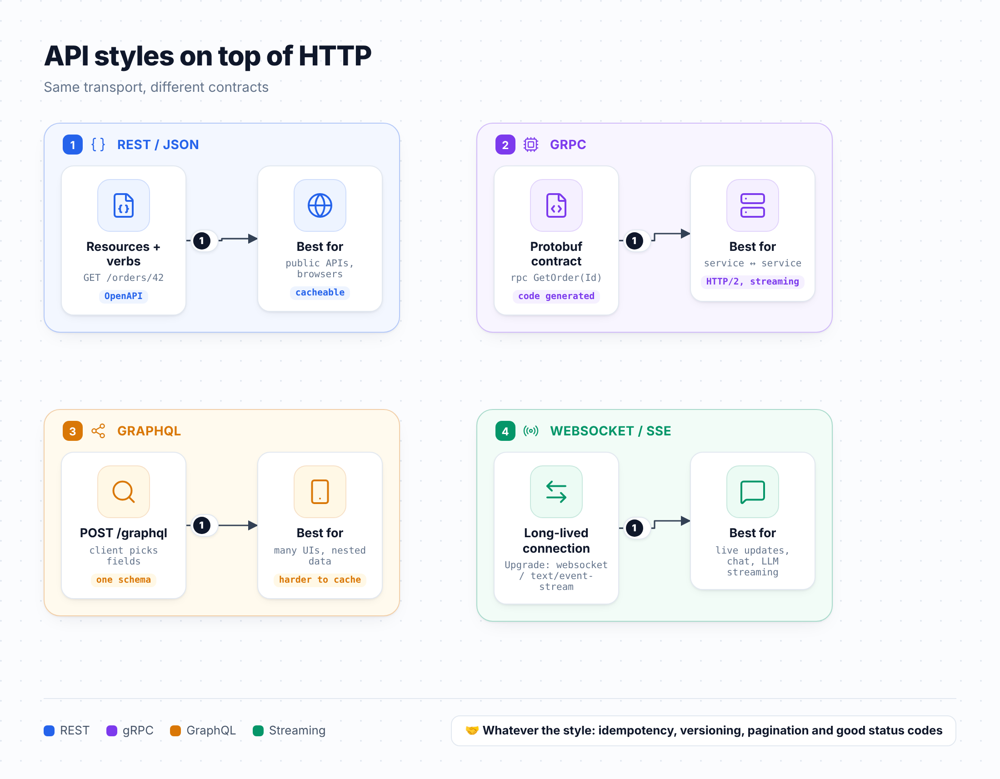

# 6.6 — Methods, status codes & API styles

!!! abstract "In one sentence"
    Every HTTP exchange is a **method** ("what do you want to do?") on a **URL** ("to what?") answered with a
    **status code** ("how did it go?"). Knowing which methods are **safe** and **idempotent** tells you what can be
    retried and cached, and knowing the status codes tells you **whose fault** an error is. API styles like **REST,
    gRPC, GraphQL and WebSockets** are different contracts built on these same pieces.

## 📖 Key terms & abbreviations

| Term | Stands for | What it is | How it works (one line) |
|---|---|---|---|
| **Method (verb)** | — | The action of a request | `GET`, `POST`, `PUT`, `PATCH`, `DELETE`, … |
| **Safe** | — | Doesn't change server state | `GET`, `HEAD`, `OPTIONS` |
| **Idempotent** | — | Doing it twice = doing it once | `GET`, `PUT`, `DELETE` (not `POST`, `PATCH`) |
| **Status code** | — | 3-digit result of a request | 1xx info · 2xx ok · 3xx redirect · 4xx client · 5xx server |
| **REST** | REpresentational State Transfer | Resource-oriented API style | URLs are nouns, methods are verbs, JSON bodies |
| **OpenAPI** | — | Machine-readable REST contract | Generates docs, clients, validation |
| **gRPC** | gRPC Remote Procedure Calls | RPC framework over HTTP/2 | Protobuf contract, generated stubs, streaming |
| **Protobuf** | Protocol Buffers | Compact binary serialization | Schema with numbered fields |
| **GraphQL** | — | Query language over one endpoint | Client asks for exactly the fields it needs |
| **WebSocket** | — | Full-duplex connection upgraded from HTTP | `Upgrade: websocket`, then frames both ways |
| **SSE** | Server-Sent Events | One-way stream from server over HTTP | `text/event-stream`; used for LLM token streaming |
| **Idempotency key** | — | Client-chosen id for a non-idempotent request | Server stores the result; a retry returns the same result |
| **Rate limiting** | — | Capping requests per client | `429` + `Retry-After` |

## 🗺️ Big picture



---

## 1 · Methods

| Method | Meaning | Safe | Idempotent | Body | Cacheable |
|---|---|---|---|---|---|
| `GET` | Read a resource | ✅ | ✅ | no | ✅ |
| `HEAD` | Like GET, headers only | ✅ | ✅ | no | ✅ |
| `OPTIONS` | What's allowed? (CORS preflight) | ✅ | ✅ | no | — |
| `POST` | Create / run an action | ❌ | ❌ | yes | rarely |
| `PUT` | Replace a resource completely | ❌ | ✅ | yes | — |
| `PATCH` | Change part of a resource | ❌ | ❌ (can be) | yes | — |
| `DELETE` | Remove a resource | ❌ | ✅ | optional | — |

### Why does idempotency matter?

Networks fail **after** the server did the work but **before** the response arrived. The client can't know whether it happened. Retrying an idempotent request is safe; retrying a `POST /payments` charges twice. That's why proxies, meshes and SDKs only **auto-retry idempotent methods**, and why payment APIs (Stripe and others) use an **`Idempotency-Key`** header.

## 2 · Status codes that matter in operations

| Code | Meaning | Usually means |
|---|---|---|
| `200` / `201` / `204` | OK / Created / No Content | Success |
| `301` / `308` | Moved permanently | Old URL, follow `Location`. 308 keeps the method |
| `302` / `307` | Found / temporary redirect | Login redirects. 307 keeps the method |
| `304` | Not Modified | Cache revalidation worked |
| `400` | Bad Request | Invalid input, or headers/cookies too large |
| `401` | Unauthorized (= unauthenticated) | Missing / expired token |
| `403` | Forbidden | Authenticated but not allowed (RBAC, WAF, IP rule) |
| `404` | Not Found | Wrong path, or wrong `Host` reaching the default backend |
| `405` | Method Not Allowed | `POST` to a GET-only route |
| `408` / `499` | Request timeout / client closed (nginx) | Client gave up or was too slow |
| `409` / `412` | Conflict / Precondition Failed | Concurrent edit; `If-Match` didn't match |
| `413` | Content Too Large | Body bigger than proxy limit (`client_max_body_size`) |
| `429` | Too Many Requests | Rate limited; honour `Retry-After` |
| `500` | Internal Server Error | Bug / unhandled exception in the app |
| `502` | Bad Gateway | Proxy got a bad/no response: backend crashed, reset, wrong port |
| `503` | Service Unavailable | No healthy backends, overloaded, maintenance |
| `504` | Gateway Timeout | Backend too slow for the proxy's timeout |

!!! tip "Who returned it?"
    A `502/503/504` is usually generated by the **proxy** (ingress, LB, mesh), not your app. Check the response
    headers (`Server: envoy`, `via`) and the proxy's own logs before searching the application logs.

## 3 · API styles

### REST

Resources as URLs (`/orders/42`), methods as verbs, JSON bodies, HTTP status codes and caching used as designed. Described with **OpenAPI**. Best for public APIs and anything a browser calls.

### gRPC

A `.proto` file defines services and messages; tooling **generates** client and server code. Runs on **HTTP/2**, binary Protobuf, supports **streaming** in both directions, uses its own status codes (in `grpc-status` trailers, HTTP status is usually 200). Best for service-to-service calls. Needs L7 load balancing (see 6.3/6.5).

### GraphQL

One endpoint (`POST /graphql`), a typed schema, and the client asks for exactly the fields it needs, avoiding many round trips. Harder to cache (POST, one URL) and to rate-limit (one query can be very expensive), so use query cost limits.

### WebSockets and SSE

- **WebSocket:** starts as HTTP `GET` with `Upgrade: websocket`, server answers `101 Switching Protocols`, then both sides send messages freely. Chat, collaboration, games.
- **SSE:** a normal HTTP response that never ends (`Content-Type: text/event-stream`), the server writes `data: …` lines. One direction only, works through most proxies, auto-reconnects. This is how most **LLM APIs stream tokens**.

## 4 · Good API habits

- **Versioning:** in the path (`/v2/orders`) or a header; never break existing clients silently.
- **Pagination:** cursor-based (`?cursor=…&limit=50`) scales better than `?page=500`.
- **Errors:** one JSON error format everywhere (RFC 9457 "problem details": `type`, `title`, `status`, `detail`).
- **Timeouts, retries, backoff:** every client call needs a timeout; retries only for idempotent requests, with exponential backoff and jitter, and a retry budget so retries don't multiply load during an outage.
- **Rate limits:** return `429` with `Retry-After`; clients must respect it.

## 🔧 DevOps connection

- **SLOs and alerts** are built from status codes: error rate = 5xx / all (4xx are usually the client's fault, but a spike in `401`/`404` can mean a bad deploy).
- **Ingress limits** produce errors that look like app bugs: `413` (body size), `400` (header size), `504` (`proxy-read-timeout` too short for slow endpoints or streaming).
- **Streaming (SSE, gRPC streams, WebSockets)** needs proxy buffering off and long read timeouts, or users see responses arrive all at once or get cut after 60 s.
- **Retries in the mesh plus retries in the app** multiply. Configure them in one place.

## 🧪 Try it yourself

```bash
# Methods and codes against a test API
curl -s -o /dev/null -w '%{http_code}\n' https://httpbin.org/status/503
curl -s -X PUT https://httpbin.org/put -H 'Content-Type: application/json' -d '{"a":1}' | head -15
curl -sI -X DELETE https://httpbin.org/get | head -1          # → 405

# Follow redirects and show each hop
curl -sIL http://github.com | grep -E '^HTTP|^location'

# Server-Sent Events: watch a stream arrive line by line
curl -sN https://httpbin.org/stream/3

# gRPC (if you have grpcurl and a server with reflection)
# grpcurl -plaintext localhost:50051 list
```

## 🃏 Cheat sheet

| Situation | Code |
|---|---|
| Created a resource | `201` + `Location` |
| Success, nothing to return | `204` |
| Not logged in / token expired | `401` |
| Logged in but not allowed | `403` |
| Validation error | `400` or `422` |
| Someone else changed it first | `409` / `412` |
| Too many requests | `429` + `Retry-After` |
| Backend crashed / refused | `502` (from proxy) |
| No healthy backend | `503` |
| Backend too slow | `504` (from proxy) |

## ❓ Test yourself

??? question "1. Which methods can a proxy safely retry automatically, and why?"
    Idempotent ones (`GET`, `HEAD`, `PUT`, `DELETE`, `OPTIONS`): repeating them doesn't change the result. `POST` may create a duplicate.

??? question "2. What's the difference between 401 and 403?"
    401: we don't know who you are (missing/invalid credentials). 403: we know who you are and you're not allowed.

??? question "3. Users get 504 on a report endpoint that takes 90 s. Where do you look first?"
    The proxy/ingress/LB read timeout (often 60 s). Raise it for that route, or make the endpoint asynchronous (202 + polling).

??? question "4. Why do LLM chat UIs often use SSE rather than WebSockets?"
    The stream is one-directional (server → client), SSE is plain HTTP, works through proxies and CDNs, and reconnects automatically.

??? question "5. Why does gRPC return HTTP 200 even when the call failed?"
    gRPC reports its own status in the `grpc-status` trailer at the end of the stream; HTTP status only says the transport worked.

---

## 📚 Sources

- [RFC 9110 — HTTP Semantics (methods, status codes)](https://www.rfc-editor.org/rfc/rfc9110)
- [RFC 9457 — Problem Details for HTTP APIs](https://www.rfc-editor.org/rfc/rfc9457)
- [MDN — HTTP response status codes](https://developer.mozilla.org/en-US/docs/Web/HTTP/Status)
- [gRPC — Core concepts](https://grpc.io/docs/what-is-grpc/core-concepts/) · [GraphQL — Learn](https://graphql.org/learn/)
- [MDN — Server-sent events](https://developer.mozilla.org/en-US/docs/Web/API/Server-sent_events)
- [Stripe — Idempotent requests](https://docs.stripe.com/api/idempotent_requests)

## ✍️ My notes

> Look at last week's 5xx errors in one service. Which were generated by the proxy and which by the app?

-
