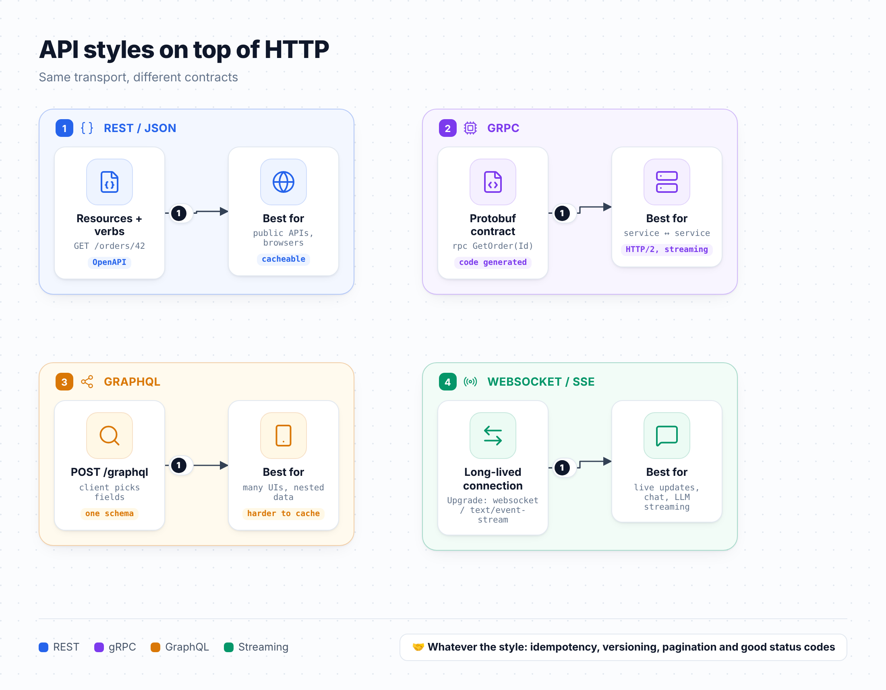

# 6.6 — Metotlar, durum kodları ve API stilleri

!!! abstract "Kısaca"
    Her HTTP alışverişi bir **URL** ("neye?") üzerinde bir **metottur** ("ne yapmak istiyorsun?") ve bir **durum
    koduyla** ("nasıl gitti?") cevaplanır. Hangi metotların **güvenli** ve **idempotent** olduğunu bilmek neyin yeniden
    denenip önbelleğe alınabileceğini, durum kodlarını bilmek bir hatanın **kimin suçu** olduğunu söyler. **REST, gRPC,
    GraphQL ve WebSocket** gibi API stilleri aynı parçalar üzerine kurulmuş farklı sözleşmelerdir.

## 📖 Temel terimler ve kısaltmalar

| Terim | Açılımı | Nedir | Nasıl çalışır (tek satır) |
|---|---|---|---|
| **Metot (fiil)** | Method | Bir isteğin eylemi | `GET`, `POST`, `PUT`, `PATCH`, `DELETE`, … |
| **Güvenli** | Safe | Sunucu durumunu değiştirmez | `GET`, `HEAD`, `OPTIONS` |
| **Idempotent** | — | İki kez yapmak = bir kez yapmak | `GET`, `PUT`, `DELETE` (`POST`, `PATCH` değil) |
| **Durum kodu** | Status code | İsteğin 3 haneli sonucu | 1xx bilgi · 2xx tamam · 3xx yönlendirme · 4xx istemci · 5xx sunucu |
| **REST** | REpresentational State Transfer | Kaynak odaklı API stili | URL'ler isim, metotlar fiil, JSON gövdeler |
| **OpenAPI** | — | Makinenin okuyabildiği REST sözleşmesi | Doküman, istemci, doğrulama üretir |
| **gRPC** | gRPC Remote Procedure Calls | HTTP/2 üzerinde RPC framework'ü | Protobuf sözleşmesi, üretilen stub'lar, streaming |
| **Protobuf** | Protocol Buffers | Kompakt ikili serileştirme | Numaralı alanlı şema |
| **GraphQL** | — | Tek uç nokta üzerinde sorgu dili | İstemci tam ihtiyacı olan alanları ister |
| **WebSocket** | — | HTTP'den yükseltilmiş çift yönlü bağlantı | `Upgrade: websocket`, sonra iki yönlü çerçeveler |
| **SSE** | Server-Sent Events | HTTP üzerinden sunucudan tek yönlü akış | `text/event-stream`; LLM token akışında kullanılır |
| **Idempotency anahtarı** | Idempotency key | İdempotent olmayan istek için istemcinin seçtiği kimlik | Sunucu sonucu saklar; yeniden deneme aynı sonucu döner |
| **Hız sınırı** | Rate limiting | İstemci başına istek sınırı | `429` + `Retry-After` |

## 🗺️ Büyük resim



---

## 1 · Metotlar

| Metot | Anlamı | Güvenli | Idempotent | Gövde | Önbelleklenebilir |
|---|---|---|---|---|---|
| `GET` | Bir kaynağı oku | ✅ | ✅ | yok | ✅ |
| `HEAD` | GET gibi, sadece header'lar | ✅ | ✅ | yok | ✅ |
| `OPTIONS` | Neye izin var? (CORS preflight) | ✅ | ✅ | yok | — |
| `POST` | Oluştur / bir eylem çalıştır | ❌ | ❌ | var | nadiren |
| `PUT` | Bir kaynağı tamamen değiştir | ❌ | ✅ | var | — |
| `PATCH` | Kaynağın bir kısmını değiştir | ❌ | ❌ (olabilir) | var | — |
| `DELETE` | Bir kaynağı sil | ❌ | ✅ | isteğe bağlı | — |

### Idempotency neden önemli?

Ağlar sunucu işi **yaptıktan sonra** ama cevap **ulaşmadan önce** çöker. İstemci işin olup olmadığını bilemez. İdempotent bir isteği yeniden denemek güvenlidir; `POST /payments`'ı yeniden denemek iki kez ücret alır. Bu yüzden proxy'ler, mesh'ler ve SDK'lar **sadece idempotent metotları otomatik yeniden dener**, ödeme API'leri (Stripe ve diğerleri) de **`Idempotency-Key`** header'ı kullanır.

## 2 · Operasyonda önemli durum kodları

| Kod | Anlamı | Genelde şu demek |
|---|---|---|
| `200` / `201` / `204` | OK / Created / No Content | Başarılı |
| `301` / `308` | Kalıcı taşındı | Eski URL, `Location`'ı takip et. 308 metodu korur |
| `302` / `307` | Geçici yönlendirme | Giriş yönlendirmeleri. 307 metodu korur |
| `304` | Not Modified | Önbellek yeniden doğrulaması çalıştı |
| `400` | Bad Request | Geçersiz girdi ya da çok büyük header/cookie |
| `401` | Unauthorized (= kimlik doğrulanmamış) | Eksik / süresi dolmuş token |
| `403` | Forbidden | Kimlik doğrulandı ama izin yok (RBAC, WAF, IP kuralı) |
| `404` | Not Found | Yanlış yol ya da default backend'e düşen yanlış `Host` |
| `405` | Method Not Allowed | Sadece GET olan bir route'a `POST` |
| `408` / `499` | İstek zaman aşımı / istemci kapattı (nginx) | İstemci vazgeçti ya da çok yavaştı |
| `409` / `412` | Conflict / Precondition Failed | Eşzamanlı düzenleme; `If-Match` tutmadı |
| `413` | Content Too Large | Gövde proxy limitinden büyük (`client_max_body_size`) |
| `429` | Too Many Requests | Hız sınırına takıldı; `Retry-After`'a uy |
| `500` | Internal Server Error | Uygulamada hata / yakalanmamış exception |
| `502` | Bad Gateway | Proxy kötü cevap aldı ya da hiç almadı: backend çöktü, reset, yanlış port |
| `503` | Service Unavailable | Sağlıklı backend yok, aşırı yük, bakım |
| `504` | Gateway Timeout | Backend proxy'nin zaman aşımı için fazla yavaş |

!!! tip "Kim döndürdü?"
    `502/503/504` genelde uygulamanın değil **proxy'nin** (ingress, LB, mesh) ürettiği bir cevaptır. Uygulama
    loglarına dalmadan önce cevap header'larına (`Server: envoy`, `via`) ve proxy'nin kendi loglarına bak.

## 3 · API stilleri

### REST

URL olarak kaynaklar (`/orders/42`), fiil olarak metotlar, JSON gövdeler, HTTP durum kodları ve önbelleğin tasarlandığı gibi kullanılması. **OpenAPI** ile tarif edilir. Açık API'ler ve tarayıcının çağırdığı her şey için en iyisi.

### gRPC

Bir `.proto` dosyası servisleri ve mesajları tanımlar; araçlar istemci ve sunucu kodunu **üretir**. **HTTP/2** üzerinde ikili Protobuf ile çalışır, iki yönlü **streaming** destekler, kendi durum kodlarını kullanır (`grpc-status` trailer'ında; HTTP durumu genelde 200'dür). Servisler arası çağrılar için en iyisi. L7 yük dağıtımı ister (bkz. 6.3/6.5).

### GraphQL

Tek uç nokta (`POST /graphql`), tipli bir şema; istemci tam ihtiyacı olan alanları ister ve çok sayıda gidiş-dönüşten kurtulur. Önbelleğe almak (POST, tek URL) ve hız sınırlamak (tek sorgu çok pahalı olabilir) daha zor; sorgu maliyet limitleri kullan.

### WebSocket ve SSE

- **WebSocket:** `Upgrade: websocket` ile HTTP `GET` olarak başlar, sunucu `101 Switching Protocols` döner, sonra iki taraf serbestçe mesaj yollar. Sohbet, ortak düzenleme, oyunlar.
- **SSE:** hiç bitmeyen normal bir HTTP cevabı (`Content-Type: text/event-stream`); sunucu `data: …` satırları yazar. Tek yönlü, proxy'lerin çoğundan geçer, otomatik yeniden bağlanır. Çoğu **LLM API'sinin token akıttığı yol** bu.

## 4 · İyi API alışkanlıkları

- **Sürümleme:** yolda (`/v2/orders`) ya da bir header'da; mevcut istemcileri asla sessizce kırma.
- **Sayfalama:** imleç tabanlı (`?cursor=…&limit=50`), `?page=500`'den iyi ölçeklenir.
- **Hatalar:** her yerde tek bir JSON hata formatı (RFC 9457 "problem details": `type`, `title`, `status`, `detail`).
- **Zaman aşımı, yeniden deneme, backoff:** her istemci çağrısında zaman aşımı olmalı; yeniden deneme sadece idempotent isteklerde, üstel backoff ve jitter ile; bir kesinti sırasında yükü katlamasın diye yeniden deneme bütçesiyle.
- **Hız sınırı:** `Retry-After` ile `429` dön; istemciler buna uymalı.

## 🔧 DevOps bağlantısı

- **SLO'lar ve alarmlar** durum kodlarından kurulur: hata oranı = 5xx / tümü (4xx genelde istemcinin suçu, ama `401`/`404`'te ani artış kötü bir deploy olabilir).
- **Ingress limitleri** uygulama hatası gibi görünen hatalar üretir: `413` (gövde boyutu), `400` (header boyutu), `504` (yavaş uç noktalar ya da streaming için fazla kısa `proxy-read-timeout`).
- **Streaming (SSE, gRPC akışları, WebSocket)** proxy buffering'inin kapalı olmasını ve uzun okuma zaman aşımlarını ister; yoksa kullanıcılar cevabın birden geldiğini ya da 60 sn'de kesildiğini görür.
- **Mesh'teki yeniden denemeler + uygulamadaki yeniden denemeler** katlanır. Tek bir yerde ayarla.

## 🧪 Kendin dene

```bash
# Bir test API'sine karşı metotlar ve kodlar
curl -s -o /dev/null -w '%{http_code}\n' https://httpbin.org/status/503
curl -s -X PUT https://httpbin.org/put -H 'Content-Type: application/json' -d '{"a":1}' | head -15
curl -sI -X DELETE https://httpbin.org/get | head -1          # → 405

# Yönlendirmeleri takip et, her durağı göster
curl -sIL http://github.com | grep -E '^HTTP|^location'

# Server-Sent Events: akışın satır satır gelişini izle
curl -sN https://httpbin.org/stream/3

# gRPC (grpcurl ve reflection açık bir sunucu varsa)
# grpcurl -plaintext localhost:50051 list
```

## 🃏 Hatırlatma kartı

| Durum | Kod |
|---|---|
| Bir kaynak oluşturuldu | `201` + `Location` |
| Başarılı, dönecek bir şey yok | `204` |
| Giriş yapılmamış / token süresi dolmuş | `401` |
| Giriş yapılmış ama izin yok | `403` |
| Doğrulama hatası | `400` ya da `422` |
| Başkası önce değiştirdi | `409` / `412` |
| Çok fazla istek | `429` + `Retry-After` |
| Backend çöktü / reddetti | `502` (proxy'den) |
| Sağlıklı backend yok | `503` |
| Backend çok yavaş | `504` (proxy'den) |

## ❓ Kendini test et

??? question "1. Bir proxy hangi metotları otomatik olarak güvenle yeniden deneyebilir, neden?"
    İdempotent olanları (`GET`, `HEAD`, `PUT`, `DELETE`, `OPTIONS`): tekrarlamak sonucu değiştirmez. `POST` bir kopya oluşturabilir.

??? question "2. 401 ile 403 arasındaki fark ne?"
    401: kim olduğunu bilmiyoruz (eksik/geçersiz kimlik bilgisi). 403: kim olduğunu biliyoruz ve iznin yok.

??? question "3. 90 sn süren bir rapor uç noktasında kullanıcılar 504 alıyor. Önce nereye bakarsın?"
    Proxy/ingress/LB okuma zaman aşımına (çoğu zaman 60 sn). O route için artır ya da uç noktayı asenkron yap (202 + yoklama).

??? question "4. LLM sohbet arayüzleri neden çoğu zaman WebSocket yerine SSE kullanır?"
    Akış tek yönlü (sunucu → istemci); SSE düz HTTP'dir, proxy ve CDN'lerden geçer, otomatik yeniden bağlanır.

??? question "5. gRPC çağrı başarısız olsa bile neden HTTP 200 döner?"
    gRPC kendi durumunu akışın sonundaki `grpc-status` trailer'ında bildirir; HTTP durumu sadece taşımanın çalıştığını söyler.

---

## 📚 Kaynaklar

- [RFC 9110 — HTTP Semantics (metotlar, durum kodları)](https://www.rfc-editor.org/rfc/rfc9110)
- [RFC 9457 — Problem Details for HTTP APIs](https://www.rfc-editor.org/rfc/rfc9457)
- [MDN — HTTP response status codes](https://developer.mozilla.org/en-US/docs/Web/HTTP/Status)
- [gRPC — Core concepts](https://grpc.io/docs/what-is-grpc/core-concepts/) · [GraphQL — Learn](https://graphql.org/learn/)
- [MDN — Server-sent events](https://developer.mozilla.org/en-US/docs/Web/API/Server-sent_events)
- [Stripe — Idempotent requests](https://docs.stripe.com/api/idempotent_requests)

## ✍️ Notlarım

> Bir servisin geçen haftaki 5xx hatalarına bak. Hangilerini proxy, hangilerini uygulama üretti?
