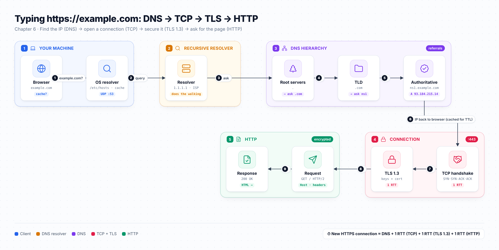
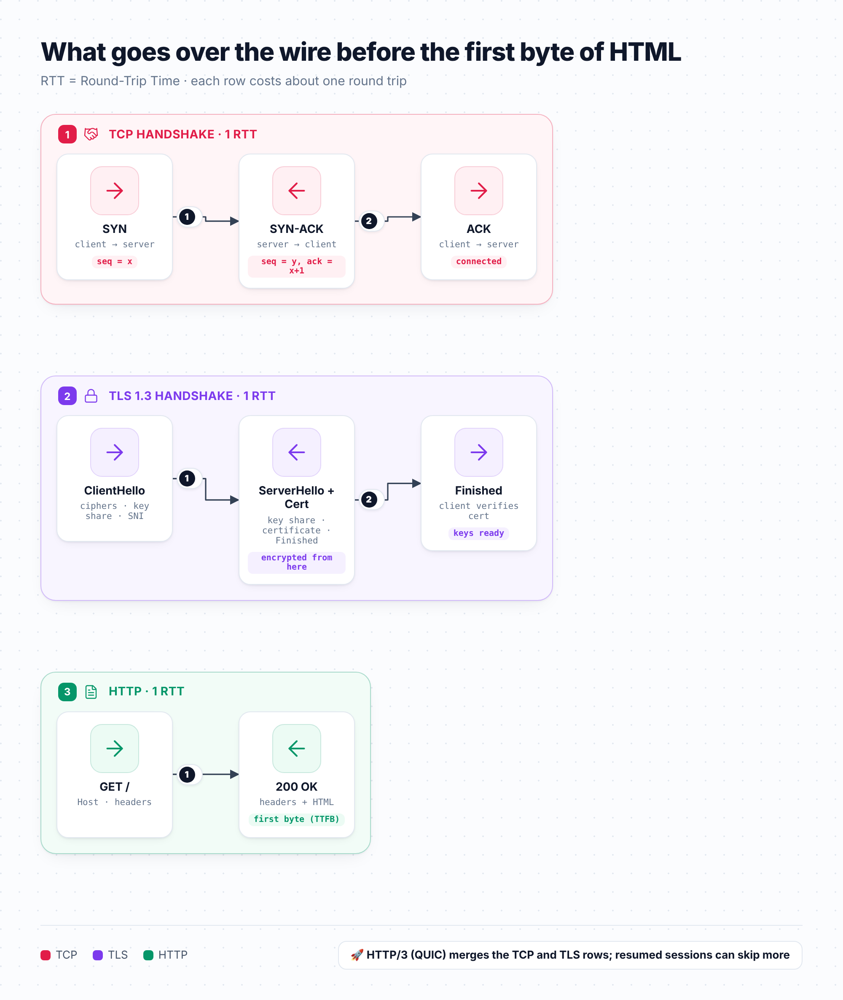

# Chapter 6 — Reaching the internet: DNS, TCP, TLS, HTTP

!!! abstract "In one sentence"
    The browser turns a **name** into an **IP** with DNS, opens a reliable **TCP** connection to that IP,
    wraps it in **TLS** so nobody can read or change it, and then speaks **HTTP** over it:
    "GET / please" → "200 OK, here's the HTML". Each of these steps costs round trips, and round trips are what you feel as latency.

## 📖 Key terms & abbreviations

| Term | Stands for | What it is | How it works (one line) |
|---|---|---|---|
| **URL** | Uniform Resource Locator | Address of a resource | scheme://host:port/path?query |
| **DNS** | Domain Name System | Turns names into IP addresses | Recursive resolver walks root → TLD → authoritative |
| **TLD** | Top-Level Domain | The last label of a name (.com, .org, .tr) | TLD servers point to each domain's authoritative servers |
| **TTL (DNS)** | Time To Live | How long a DNS answer may be cached | Lower it before migrations |
| **TCP** | Transmission Control Protocol | Reliable, ordered byte stream | 3-way handshake, ACKs, retransmits, flow + congestion control |
| **UDP** | User Datagram Protocol | Fire-and-forget datagrams | No handshake, no retransmits; base of DNS and QUIC |
| **RTT** | Round-Trip Time | Time for a message to go and come back | Every handshake step costs about one RTT |
| **TLS** | Transport Layer Security | Encryption + server authentication | Key exchange (ECDHE) + certificate check, then symmetric encryption |
| **CA / certificate** | Certificate Authority | Trusted issuer / signed proof of a domain's key | Browser checks the chain up to a trusted root CA |
| **SNI / ALPN** | Server Name Indication / Application-Layer Protocol Negotiation | TLS extensions | Which hostname / which protocol (h2, h3) inside ClientHello |
| **HTTP** | HyperText Transfer Protocol | Request/response protocol of the web | Method + path + headers → status + headers + body |
| **HTTP/2 / HTTP/3 / QUIC** | — / — / Quick UDP Internet Connections | Multiplexed HTTP over TCP / over QUIC (UDP) | Many streams on one connection; QUIC removes TCP head-of-line blocking |
| **TTFB** | Time To First Byte | Time until the first response byte arrives | DNS + TCP + TLS + server processing |

## 🗺️ Big picture



---

## 0 · Before anything: parse the URL

`https://example.com/` → **scheme** `https` (so port **443** and TLS), **host** `example.com`, **path** `/`.
The browser first checks its own caches: a cached DNS answer, an open connection it can reuse, or an HSTS rule that forces HTTPS.

## 1 · DNS: from name to IP

| # | Who | What happens |
|---|---|---|
| 1 | Browser → OS | "What's the IP of `example.com`?" The OS checks `/etc/hosts` and its own cache. |
| 2 | OS → **recursive resolver** | Asks your configured resolver (your ISP's, or `1.1.1.1` / `8.8.8.8`) over **UDP port 53**. |
| 3 | Resolver → **root servers** | "Who handles `.com`?" The root replies with a **referral** to the `.com` servers. |
| 4 | Resolver → **TLD** (`.com`) | "Who handles `example.com`?" Another referral: `ns1.example.com`. |
| 5 | Resolver → **authoritative** server | "What is `example.com`?" Final answer: `A 93.184.215.14`, valid for its **TTL** (e.g. 300 s). |
| 6 | Back down the chain | Every layer **caches** the answer for the TTL, so the next lookup is usually instant. |

| Record | Meaning |
|---|---|
| `A` / `AAAA` | Name → IPv4 / IPv6 address |
| `CNAME` | Name → another name (an alias) |
| `NS` | Which servers are authoritative for this zone |
| `MX` | Mail servers for the domain |
| `TXT` | Free text: domain verification, SPF, DKIM |

> DevOps connection: lower the TTL **before** a migration, so clients pick up the new IP quickly. "It's always DNS" is a joke because it's so often true.

## 2 · TCP: a reliable pipe

| Step | Packet | Meaning |
|---|---|---|
| 1 | Client → `SYN` | "I want to talk. My sequence numbers start at *x*." |
| 2 | Server → `SYN-ACK` | "OK. Mine start at *y*, and I got your *x*." |
| 3 | Client → `ACK` | "Got your *y*." The connection is open. |

That costs **1 round trip (RTT)** before any data is sent. After that, TCP gives you:

- **Reliability:** every byte is acknowledged. Lost packets are retransmitted.
- **Ordering:** sequence numbers put bytes back in the right order.
- **Flow control:** the receiver advertises how much it can accept (the *window*).
- **Congestion control:** the sender speeds up slowly and backs off when packets are lost, so the network isn't flooded.

A connection is identified by its **4-tuple**: `client IP : client port ↔ server IP : server port`. The client port is a random **ephemeral** port.

**UDP** has none of this: no handshake, no retransmission, no ordering. It's just "send this datagram". That makes it good for DNS, video and games, and it's the base for QUIC.

## 3 · TLS 1.3: make the pipe private and authentic

| Step | What happens |
|---|---|
| **ClientHello** | Supported cipher suites, a **key share** (an ephemeral public key, ECDHE), and **SNI** (which hostname you want, so one IP can host many sites). |
| **ServerHello** | The server picks a cipher, sends its key share. Both sides can now compute the same **session key**. Everything after this is encrypted. |
| **Certificate + CertificateVerify** | The server proves it is `example.com`: a certificate signed by a CA, and a signature made with the matching private key. |
| **Client verifies** | Is the chain signed by a **trusted root CA** in my trust store? Is the hostname in the certificate? Is it still valid? |
| **Finished** | Both sides confirm the handshake wasn't tampered with. |

- **Asymmetric** crypto (ECDHE, RSA/ECDSA signatures) is used only to **agree on keys** and **prove identity**. It's slow, so it's used once.
- **Symmetric** crypto (AES-GCM or ChaCha20-Poly1305) encrypts the actual data. It's fast.
- TLS 1.3 needs **1 RTT** (TLS 1.2 needed 2). Resumed connections can even send data in 0-RTT.

## 4 · HTTP: the conversation

```http
GET / HTTP/1.1
Host: example.com
User-Agent: curl/8.5.0
Accept: */*
```

```http
HTTP/1.1 200 OK
Content-Type: text/html; charset=UTF-8
Cache-Control: max-age=604800
Content-Length: 1256

<!doctype html> …
```

| Status | Meaning | Examples |
|---|---|---|
| 2xx | Success | `200 OK`, `201 Created`, `204 No Content` |
| 3xx | Go elsewhere | `301` permanent redirect, `304 Not Modified` (use your cache) |
| 4xx | **You** made a mistake | `400`, `401` unauthenticated, `403` forbidden, `404`, `429` rate-limited |
| 5xx | **The server** failed | `500`, `502` bad gateway, `503` unavailable, `504` gateway timeout |

| Version | Transport | Key idea |
|---|---|---|
| **HTTP/1.1** | TCP | Text. One request at a time per connection, so browsers open ~6 connections per site. |
| **HTTP/2** | TCP | Binary, **many parallel streams on one connection**, header compression. Negotiated during TLS via **ALPN** (`h2`). One lost TCP packet still stalls *all* streams (TCP head-of-line blocking). |
| **HTTP/3** | **QUIC over UDP** | TLS 1.3 built into the transport, streams are independent (no head-of-line blocking), faster set-up, connections survive network changes (Wi-Fi → 4G). |

---

## Where the time goes

With a 50 ms round trip to the server and nothing cached:

| Step | Cost |
|---|---|
| DNS (resolver walks root → TLD → authoritative) | 0 to several RTTs, cached afterwards |
| TCP handshake | 1 RTT = 50 ms |
| TLS 1.3 handshake | 1 RTT = 50 ms |
| HTTP request → first byte | 1 RTT + server time = 50 ms + |

That's ~150–200 ms **before the first byte of HTML**, which is why **connection reuse**, **HTTP/2 / HTTP/3** and **CDNs** (putting servers close to users, Chapter 7) matter so much.

> DevOps connection: TLS is often **terminated** at the load balancer or ingress, using certificates from **Let's Encrypt** via **cert-manager**. Behind it, traffic may be plain HTTP or re-encrypted (mTLS in a service mesh).

### How do the handshakes add up?

Before the first byte of HTML: one RTT for the **TCP** handshake, one for the **TLS 1.3** handshake, one for the **HTTP** request/response (plus DNS if not cached). On a 50 ms RTT link that is already ~150 ms. HTTP/3 over QUIC merges the transport and TLS handshakes.



---

## 🧭 Go deeper

| Page | What's inside |
|---|---|
| **[6.1 — HTTP headers deep dive](01-headers.md)** | What an HTTP header is, how a message is built, and what headers do for routing, content negotiation, caching, authentication, cookies, security, CORS, proxies and tracing. |
| **[6.2 — DNS deep dive](02-dns.md)** | How DNS resolution works, record types, TTL and caching, DNS in Kubernetes, DNSSEC, encrypted DNS and the DNS problems DevOps engineers meet most. |
| **[6.3 — TCP deep dive](03-tcp.md)** | TCP connection lifecycle and states, sequence numbers and ACKs, flow control and congestion control (CUBIC, BBR), keep-alive and connection reuse, and the TCP problems seen in production. |
| **[6.4 — TLS & certificates deep dive](04-tls.md)** | What TLS protects, how the TLS 1.3 handshake and key exchange work, certificates and chains of trust, revocation, short-lived certificates and automation with ACME and cert-manager, mTLS, and post-quantum TLS. |
| **[6.5 — HTTP/2 & HTTP/3 deep dive](05-http2-http3.md)** | Why HTTP/1.1 needed replacing, how HTTP/2 multiplexes streams over one TCP connection, how QUIC and HTTP/3 remove TCP head-of-line blocking, and what this means for load balancers, gRPC and Kubernetes. |
| **[6.6 — Methods, status codes & API styles](06-apis.md)** | HTTP methods and their safety and idempotency, every status code family that matters in operations, and how REST, gRPC, GraphQL, WebSockets and SSE use HTTP, plus versioning, pagination, retries and rate limits. |

## 🧪 Try it yourself

```bash
# 1) DNS
dig example.com                 # answer + TTL
dig +short AAAA example.com     # IPv6
dig +trace example.com          # walk root → .com → authoritative yourself
resolvectl status 2>/dev/null | head   # which resolver your Linux uses

# 2) The whole conversation, verbose
curl -v https://example.com -o /dev/null

# 3) Timing of each phase
curl -o /dev/null -s -w 'dns:%{time_namelookup} tcp:%{time_connect} tls:%{time_appconnect} ttfb:%{time_starttransfer} total:%{time_total}\n' https://example.com

# 4) TLS details: certificate chain, protocol, cipher
openssl s_client -connect example.com:443 -servername example.com </dev/null 2>/dev/null | head -25

# 5) Watch the TCP handshake on the wire
sudo tcpdump -n -i any 'tcp port 443 and (tcp[tcpflags] & (tcp-syn) != 0)'   # then run curl in another terminal
```

**Exercise:** run the timing command twice in a row against the same site. Which phases get faster the second time, and why?

---

## 🃏 Cheat sheet

```text
URL → scheme/host/port/path
DNS: browser → OS (/etc/hosts, cache) → recursive resolver → root → TLD → authoritative → A record (TTL cached)
TCP: SYN → SYN-ACK → ACK (1 RTT) · reliable, ordered, flow + congestion control · 4-tuple
TLS 1.3: ClientHello (key share, SNI) → ServerHello + cert + Finished (1 RTT) → symmetric keys
HTTP: request line + headers → status + headers + body · 2xx/3xx/4xx/5xx
HTTP/1.1 (text, 1 req/conn) → HTTP/2 (streams on 1 TCP) → HTTP/3 (QUIC on UDP)
```

---

## ❓ Test yourself

??? question "1. Your recursive resolver already knows `.com`'s servers. Does it still ask the root for `example.com`?"
    No. It caches the root's referral (the `.com` NS records) for their TTL and goes straight to the `.com` servers. The root is only asked when that cache has expired.

??? question "2. Why does a new HTTPS request cost at least 2 RTTs before any HTTP data flows (TLS 1.3 over TCP)?"
    1 RTT for the TCP handshake, then 1 RTT for the TLS 1.3 handshake. Only then can the HTTP request be sent. HTTP/3 merges the transport and TLS handshakes to save one of them.

??? question "3. How does the browser know the server really is `example.com` and not an attacker?"
    The server sends a certificate for `example.com` signed by a CA the browser trusts, and proves it holds the matching private key (CertificateVerify). The browser checks the chain, the hostname and the validity dates.

??? question "4. What is SNI and why is it needed?"
    Server Name Indication: the hostname sent in ClientHello. One IP (a load balancer, a CDN) can serve thousands of sites, so it needs to know which certificate to present before encryption starts.

??? question "5. `502` vs `504` from your load balancer: what's the difference?"
    `502 Bad Gateway`: the LB got an invalid or no response from the backend (crashed, connection refused). `504 Gateway Timeout`: the backend didn't answer in time.

---

## 📚 Sources

- [How DNS works (Cloudflare Learning)](https://www.cloudflare.com/learning/dns/what-is-dns/)
- [RFC 9293: TCP](https://www.rfc-editor.org/rfc/rfc9293) · [RFC 8446: TLS 1.3](https://www.rfc-editor.org/rfc/rfc8446) · [RFC 9110: HTTP semantics](https://www.rfc-editor.org/rfc/rfc9110) · [RFC 9114: HTTP/3](https://www.rfc-editor.org/rfc/rfc9114)
- [The Illustrated TLS 1.3 Connection](https://tls13.xargs.org/)
- [High Performance Browser Networking (free book)](https://hpbn.co/)

## ✍️ My notes

> Explain what happens between pressing Enter and receiving the first byte of HTML, in your own words in 5 lines.

-
