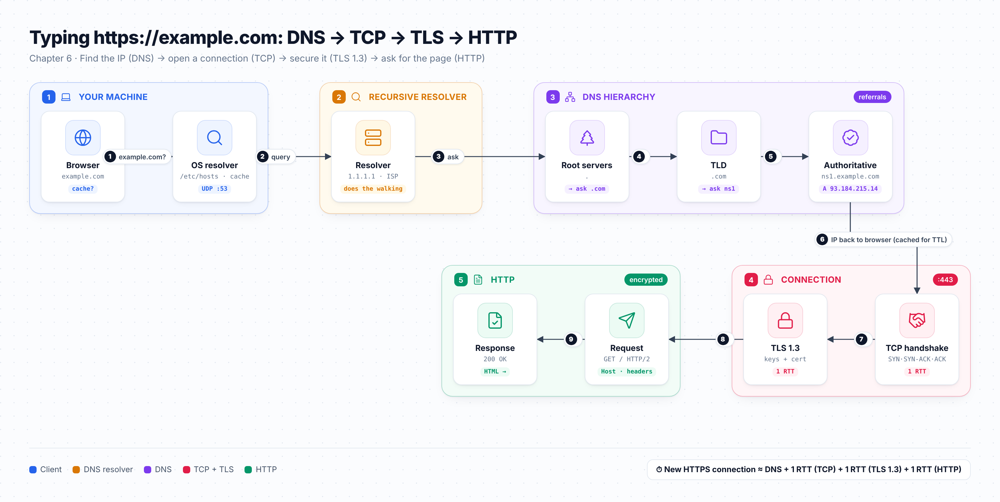
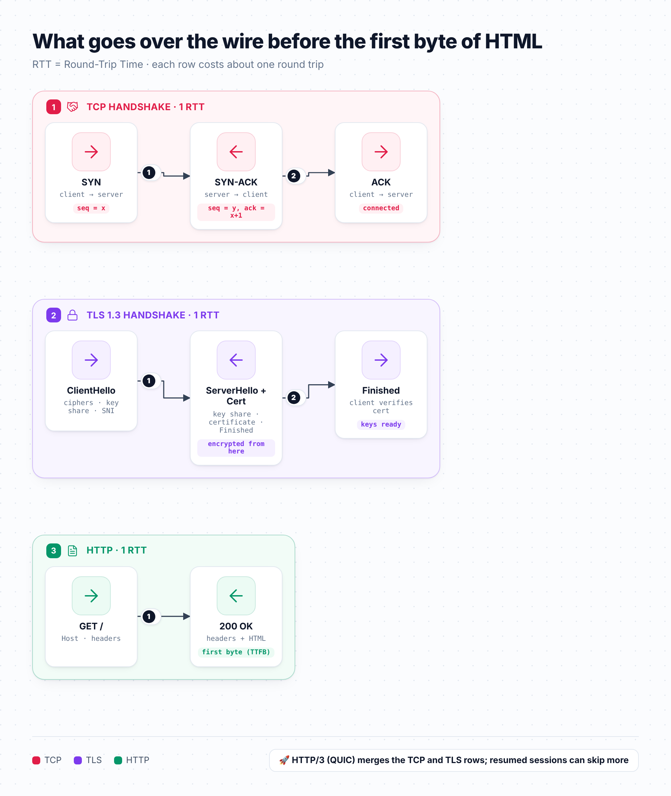

# Bölüm 6 — İnternete çıkış: DNS, TCP, TLS, HTTP

!!! abstract "Kısaca"
    Tarayıcı DNS ile bir **ismi** bir **IP**'ye çevirir, o IP'ye güvenilir bir **TCP** bağlantısı açar, kimse okuyamasın
    ve değiştiremesin diye bağlantıyı **TLS** ile sarar, sonra üzerinden **HTTP** konuşur: "GET / lütfen" → "200 OK,
    işte HTML". Bu adımların her biri gidiş-dönüşe (round trip) mal olur. Gecikme olarak hissettiğin şey bu
    gidiş-dönüşlerdir.

## 📖 Temel terimler ve kısaltmalar

| Terim | Açılımı | Nedir | Nasıl çalışır (tek satır) |
|---|---|---|---|
| **URL** | Uniform Resource Locator | Bir kaynağın adresi | `şema://host:port/yol?sorgu` |
| **DNS** | Domain Name System | İsimleri IP adreslerine çevirir | Özyinelemeli çözücü kök → TLD → yetkili yolunu yürür |
| **TLD** | Top-Level Domain | Bir ismin son etiketi (.com, .org, .tr) | TLD sunucuları her alan adının yetkili sunucularını gösterir |
| **TTL (DNS)** | Time To Live | Bir DNS cevabının ne kadar önbellekte tutulabileceği | Taşımalardan önce düşür |
| **TCP** | Transmission Control Protocol | Güvenilir, sıralı byte akışı | 3 adımlı el sıkışma, ACK, yeniden gönderim, akış + tıkanıklık kontrolü |
| **UDP** | User Datagram Protocol | Gönder ve unut datagramları | El sıkışma ve yeniden gönderim yok; DNS ve QUIC'in temeli |
| **RTT** | Round-Trip Time | Bir mesajın gidip gelme süresi | Her el sıkışma adımı yaklaşık bir RTT'ye mal olur |
| **TLS** | Transport Layer Security | Şifreleme + sunucu kimlik doğrulama | Anahtar değişimi (ECDHE) + sertifika kontrolü, sonra simetrik şifreleme |
| **CA / certificate** | Certificate Authority | Güvenilir yayıncı / bir alan adının anahtarının imzalı kanıtı | Tarayıcı zinciri güvenilir bir kök CA'ya kadar kontrol eder |
| **SNI / ALPN** | Server Name Indication / Application-Layer Protocol Negotiation | TLS eklentileri | ClientHello içinde hangi hostname / hangi protokol (h2, h3) |
| **HTTP** | HyperText Transfer Protocol | Web'in istek/cevap protokolü | Metot + yol + başlıklar → durum + başlıklar + gövde |
| **HTTP/2 / HTTP/3 / QUIC** | — / — / Quick UDP Internet Connections | TCP üzerinde / QUIC (UDP) üzerinde çoklanmış HTTP | Tek bağlantıda çok akış; QUIC TCP head-of-line blocking'i kaldırır |
| **TTFB** | Time To First Byte | İlk cevap byte'ı gelene kadar geçen süre | DNS + TCP + TLS + sunucu işleme |

## 🗺️ Büyük resim



---

## 0 · Her şeyden önce: URL'yi ayrıştır

`https://example.com/` → **şema** `https` (yani port **443** ve TLS), **host** `example.com`, **yol** `/`.
Tarayıcı önce kendi önbelleklerine bakar: önbellekte bir DNS cevabı var mı, yeniden kullanabileceği açık bir bağlantı var mı, HTTPS'i zorunlu kılan bir HSTS kuralı var mı?

## 1 · DNS: isimden IP'ye

| # | Kim | Ne oluyor |
|---|---|---|
| 1 | Tarayıcı → OS | "`example.com`'un IP'si ne?" OS önce `/etc/hosts`'a ve kendi önbelleğine bakar. |
| 2 | OS → **özyinelemeli çözücü** | Ayarlı çözücüne (ISP'ninki ya da `1.1.1.1` / `8.8.8.8`) **UDP port 53** üzerinden sorar. |
| 3 | Çözücü → **kök sunucular** | "`.com`'dan kim sorumlu?" Kök, `.com` sunucularına bir **yönlendirmeyle (referral)** cevap verir. |
| 4 | Çözücü → **TLD** (`.com`) | "`example.com`'dan kim sorumlu?" Bir yönlendirme daha: `ns1.example.com`. |
| 5 | Çözücü → **yetkili (authoritative)** sunucu | "`example.com` ne?" Son cevap: `A 93.184.215.14`, **TTL** süresince geçerli (ör. 300 sn). |
| 6 | Zincir boyunca geri | Her katman cevabı TTL kadar **önbelleğe alır**, bir sonraki sorgu genelde anında cevaplanır. |

| Kayıt | Anlamı |
|---|---|
| `A` / `AAAA` | İsim → IPv4 / IPv6 adresi |
| `CNAME` | İsim → başka bir isim (takma ad) |
| `NS` | Bu alan (zone) için yetkili sunucular |
| `MX` | Alan adının e-posta sunucuları |
| `TXT` | Serbest metin: alan adı doğrulama, SPF, DKIM |

> DevOps bağlantısı: bir taşıma (migration) **öncesinde** TTL'i düşür ki istemciler yeni IP'yi hızlı alsın. "It's always DNS" esprisinin sebebi, çoğu zaman gerçekten DNS olması.

## 2 · TCP: güvenilir bir boru

| Adım | Paket | Anlamı |
|---|---|---|
| 1 | İstemci → `SYN` | "Konuşmak istiyorum. Sıra numaralarım *x*'ten başlıyor." |
| 2 | Sunucu → `SYN-ACK` | "Tamam. Benimkiler *y*'den başlıyor, senin *x*'ini aldım." |
| 3 | İstemci → `ACK` | "Senin *y*'ni aldım." Bağlantı açıldı. |

Herhangi bir veri gönderilmeden önce bu **1 gidiş-dönüşe (RTT)** mal olur. Sonrasında TCP sana şunları verir:

- **Güvenilirlik:** her byte onaylanır, kaybolan paketler yeniden gönderilir.
- **Sıralama:** sıra numaraları byte'ları doğru sıraya koyar.
- **Akış kontrolü:** alıcı ne kadar kabul edebileceğini bildirir (*window*).
- **Tıkanıklık kontrolü:** gönderen yavaş yavaş hızlanır, paket kaybında geri çekilir ki ağ boğulmasın.

Bir bağlantı **4'lüsüyle** tanımlanır: `istemci IP : istemci port ↔ sunucu IP : sunucu port`. İstemci portu rastgele seçilen geçici (**ephemeral**) bir porttur.

**UDP**'de bunların hiçbiri yoktur: el sıkışma yok, yeniden gönderim yok, sıralama yok. Sadece "bu datagramı gönder" vardır. Bu yüzden DNS, video ve oyunlar için iyidir, QUIC de onun üzerine kuruludur.

## 3 · TLS 1.3: boruyu gizli ve doğrulanmış yap

| Adım | Ne oluyor |
|---|---|
| **ClientHello** | Desteklenen şifre takımları, bir **anahtar payı** (geçici bir genel anahtar, ECDHE) ve **SNI** (hangi hostname'i istediğin; böylece tek bir IP birçok siteye ev sahipliği yapabilir). |
| **ServerHello** | Sunucu bir şifre takımı seçer ve kendi anahtar payını gönderir. Artık iki taraf da aynı **oturum anahtarını** hesaplayabilir. Bundan sonraki her şey şifrelidir. |
| **Certificate + CertificateVerify** | Sunucu `example.com` olduğunu kanıtlar: bir CA'nın imzaladığı sertifika ve eşleşen özel anahtarla atılmış bir imza. |
| **İstemci doğrular** | Zincir, güven deposumdaki **güvenilir bir kök CA** tarafından imzalanmış mı? Hostname sertifikada var mı? Sertifika hâlâ geçerli mi? |
| **Finished** | İki taraf da el sıkışmanın kurcalanmadığını teyit eder. |

- **Asimetrik** kriptografi (ECDHE, RSA/ECDSA imzaları) sadece **anahtarda anlaşmak** ve **kimliği kanıtlamak** için kullanılır. Yavaştır, o yüzden bir kez kullanılır.
- **Simetrik** kriptografi (AES-GCM ya da ChaCha20-Poly1305) asıl veriyi şifreler. Hızlıdır.
- TLS 1.3 **1 RTT** ister (TLS 1.2 için 2 RTT gerekiyordu). Yeniden kurulan bağlantılar 0-RTT ile veri bile gönderebilir.

## 4 · HTTP: konuşmanın kendisi

```http
GET / HTTP/1.1
Host: example.com
User-Agent: curl/8.5.0
Accept: */*
```

```http
HTTP/1.1 200 OK
Content-Type: text/html; charset=UTF-8
Cache-Control: max-age=604800
Content-Length: 1256

<!doctype html> …
```

| Durum | Anlamı | Örnekler |
|---|---|---|
| 2xx | Başarılı | `200 OK`, `201 Created`, `204 No Content` |
| 3xx | Başka yere git | `301` kalıcı yönlendirme, `304 Not Modified` (önbelleğini kullan) |
| 4xx | Hata **sende** | `400`, `401` kimlik doğrulanmadı, `403` yasak, `404`, `429` hız sınırı |
| 5xx | Hata **sunucuda** | `500`, `502` bad gateway, `503` hizmet dışı, `504` gateway timeout |

| Versiyon | Taşıma | Ana fikir |
|---|---|---|
| **HTTP/1.1** | TCP | Metin tabanlı. Bağlantı başına aynı anda tek istek, bu yüzden tarayıcılar site başına ~6 bağlantı açar. |
| **HTTP/2** | TCP | İkili (binary), **tek bağlantı üzerinde çok sayıda paralel akış**, başlık sıkıştırma. TLS sırasında **ALPN** ile anlaşılır (`h2`). Kaybolan tek bir TCP paketi yine de *tüm* akışları durdurur (TCP head-of-line blocking). |
| **HTTP/3** | **UDP üzerinde QUIC** | TLS 1.3 taşıma katmanına gömülü, akışlar birbirinden bağımsız (head-of-line blocking yok), daha hızlı kurulum, bağlantılar ağ değişikliğine dayanır (Wi-Fi → 4G). |

---

## Zaman nereye gidiyor?

Sunucuya 50 ms gidiş-dönüş süresi varsa ve hiçbir şey önbellekte değilse:

| Adım | Maliyet |
|---|---|
| DNS (çözücü kök → TLD → yetkili yolunu yürür) | 0 ile birkaç RTT arası, sonra önbellekte |
| TCP el sıkışması | 1 RTT = 50 ms |
| TLS 1.3 el sıkışması | 1 RTT = 50 ms |
| HTTP isteği → ilk byte | 1 RTT + sunucu süresi = 50 ms + |

Bu, **HTML'in ilk byte'ından önce** ~150–200 ms demek. **Bağlantının yeniden kullanılması**, **HTTP/2 / HTTP/3** ve **CDN**'lerin (sunucuları kullanıcıya yakın koymak, Bölüm 7) bu kadar önemli olmasının sebebi bu.

> DevOps bağlantısı: TLS genelde load balancer'da ya da ingress'te **sonlandırılır** (terminate). Sertifikalar çoğunlukla **cert-manager** ile **Let's Encrypt**'ten alınır. Arkasındaki trafik düz HTTP olabilir ya da yeniden şifrelenebilir (service mesh'te mTLS).

### El sıkışmalar nasıl toplanır?

HTML'in ilk byte'ından önce: **TCP** el sıkışması için bir RTT, **TLS 1.3** için bir RTT, **HTTP** istek/cevabı için bir RTT (önbellekte değilse artı DNS). 50 ms RTT'li bir hatta bu zaten ~150 ms. QUIC üzerinde HTTP/3 taşıma ve TLS el sıkışmalarını birleştirir.



---

## 🚨 Olay hikâyesi: gizemli +5 saniye

!!! failure "Alarm"
    Pod'lardan harici bir ödeme API'sine yapılan çağrılar bazen normalden **tam 5 saniye daha uzun** sürüyor. Rastgele, yaklaşık 50 istekte bir, ve geliştiricilerin laptoplarından hiç olmuyor.

Önce kendin teşhis etmeye çalış, sonra ipuçlarını tek tek aç.

??? info "🔍 İpucu 1"
    Ek süre TCP bağlantısından önce harcanıyor: DNS. Pod'daki `/etc/resolv.conf`: `options ndots:5`, `timeout:5` çözücü varsayılanı.

??? info "🔍 İpucu 2"
    Node'larda `conntrack -S`, `insert_failed`'ın arttığını gösteriyor. Çözücü A ve AAAA sorgularını aynı UDP soketinden paralel gönderiyor.

??? success "🎯 Kök neden"
    Aynı 5'liye sahip iki paralel UDP DNS paketi conntrack'te yarışır; biri düşer ve istemci yeniden denemeden önce 5 sn'lik zaman aşımının tamamını bekler. `ndots:5` sorgu sayısını katladığı için yarış sık olur.

??? tip "🛠️ Çözüm ve ders"
    **NodeLocal DNSCache** çalıştır, sonunda nokta olan tam isimler kullan ya da `ndots`'u düşür ve/veya `single-request-reopen`. **Ders:** bir zaman aşımının tam katları (5 sn, 1 sn, 3 sn) bir parmak izidir: zaman aşımını bul, sonra neyin düştüğünü bul.

## 🧭 Daha derine in

| Sayfa | Neler var |
|---|---|
| **[6.1 — HTTP header'larına derin dalış](01-headers.md)** | HTTP header'ı nedir, bir mesaj nasıl kurulur, header'lar yönlendirme, içerik pazarlığı, önbellek, kimlik doğrulama, cookie, güvenlik, CORS, proxy ve trace için ne işe yarar. |
| **[6.2 — DNS'e derin dalış](02-dns.md)** | DNS çözümlemesi nasıl çalışır, kayıt tipleri, TTL ve önbellek, Kubernetes'te DNS, DNSSEC, şifreli DNS ve DevOps mühendislerinin en sık karşılaştığı DNS sorunları. |
| **[6.3 — TCP'ye derin dalış](03-tcp.md)** | TCP bağlantı yaşam döngüsü ve durumları, sıra numaraları ve ACK'ler, akış kontrolü ve tıkanıklık kontrolü (CUBIC, BBR), keep-alive ve bağlantı yeniden kullanımı, üretimde görülen TCP sorunları. |
| **[6.4 — TLS ve sertifikalara derin dalış](04-tls.md)** | TLS neyi korur, TLS 1.3 el sıkışması ve anahtar değişimi nasıl çalışır, sertifikalar ve güven zinciri, iptal, kısa ömürlü sertifikalar, ACME ve cert-manager ile otomasyon, mTLS ve kuantum sonrası TLS. |
| **[6.5 — HTTP/2 ve HTTP/3'e derin dalış](05-http2-http3.md)** | HTTP/1.1 neden yetmedi, HTTP/2 tek TCP bağlantısında akışları nasıl çoklar, QUIC ve HTTP/3 TCP head-of-line blocking'i nasıl kaldırır, load balancer'lar, gRPC ve Kubernetes için ne anlama gelir. |
| **[6.6 — Metotlar, durum kodları ve API stilleri](06-apis.md)** | HTTP metotları ve güvenli/idempotent olmaları, operasyonda önemli tüm durum kodu aileleri, REST, gRPC, GraphQL, WebSocket ve SSE'nin HTTP'yi nasıl kullandığı; sürümleme, sayfalama, yeniden deneme ve hız sınırları. |

## 🧪 Kendin dene

!!! example "🧪 Hazır lab"
    Bu bölümün deneyleri tek komutla: `./labs/run.sh 06-internet` ([script'ler](https://github.com/gaskinimbuspro/silicon-to-cloud/tree/main/labs/06-internet/)). Kurulum istemiyorsan [Codespaces'te aç](https://codespaces.new/gaskinimbuspro/silicon-to-cloud). <!-- s2c-lab -->


```bash
# 1) DNS
dig example.com                 # cevap + TTL
dig +short AAAA example.com     # IPv6
dig +trace example.com          # kök → .com → yetkili yolunu kendin yürü
resolvectl status 2>/dev/null | head   # Linux'un hangi çözücüyü kullandığı

# 2) Tüm konuşma, ayrıntılı
curl -v https://example.com -o /dev/null

# 3) Her aşamanın süresi
curl -o /dev/null -s -w 'dns:%{time_namelookup} tcp:%{time_connect} tls:%{time_appconnect} ttfb:%{time_starttransfer} total:%{time_total}\n' https://example.com

# 4) TLS detayları: sertifika zinciri, protokol, şifre takımı
openssl s_client -connect example.com:443 -servername example.com </dev/null 2>/dev/null | head -25

# 5) TCP el sıkışmasını kabloda izle
sudo tcpdump -n -i any 'tcp port 443 and (tcp[tcpflags] & (tcp-syn) != 0)'   # sonra başka terminalde curl çalıştır
```

**Görev:** aynı siteye zamanlama komutunu art arda iki kez çalıştır. İkincisinde hangi aşamalar hızlandı ve neden?

---

## 🃏 Hatırlatma kartı

```text
URL → şema/host/port/yol
DNS: tarayıcı → OS (/etc/hosts, önbellek) → özyinelemeli çözücü → kök → TLD → yetkili → A kaydı (TTL kadar önbellek)
TCP: SYN → SYN-ACK → ACK (1 RTT) · güvenilir, sıralı, akış + tıkanıklık kontrolü · 4'lü
TLS 1.3: ClientHello (anahtar payı, SNI) → ServerHello + sertifika + Finished (1 RTT) → simetrik anahtarlar
HTTP: istek satırı + başlıklar → durum + başlıklar + gövde · 2xx/3xx/4xx/5xx
HTTP/1.1 (metin, bağlantı başına 1 istek) → HTTP/2 (tek TCP'de akışlar) → HTTP/3 (UDP'de QUIC)
```

---

## ❓ Kendini test et

??? question "1. Özyinelemeli çözücün `.com` sunucularını zaten biliyor. `example.com` için yine de köke sorar mı?"
    Hayır. Kökün yönlendirmesini (`.com` NS kayıtlarını) TTL'leri boyunca önbellekte tutar ve doğrudan `.com` sunucularına gider. Köke sadece o önbelleğin süresi dolduğunda sorulur.

??? question "2. Yeni bir HTTPS isteği (TCP üzerinde TLS 1.3) neden HTTP verisi akmadan önce en az 2 RTT'ye mal olur?"
    TCP el sıkışması için 1 RTT, ardından TLS 1.3 el sıkışması için 1 RTT. HTTP isteği ancak bundan sonra gönderilebilir. HTTP/3, taşıma ve TLS el sıkışmalarını birleştirerek bunlardan birini kazandırır.

??? question "3. Tarayıcı, sunucunun gerçekten `example.com` olduğunu ve bir saldırgan olmadığını nereden bilir?"
    Sunucu, tarayıcının güvendiği bir CA tarafından imzalanmış `example.com` sertifikası gönderir ve eşleşen özel anahtara sahip olduğunu kanıtlar (CertificateVerify). Tarayıcı zinciri, hostname'i ve geçerlilik tarihlerini kontrol eder.

??? question "4. SNI nedir ve neden gerekir?"
    Server Name Indication: ClientHello içinde gönderilen hostname. Tek bir IP (bir load balancer, bir CDN) binlerce siteye hizmet verebilir, şifreleme başlamadan hangi sertifikayı sunacağını bilmesi gerekir.

??? question "5. Load balancer'ından gelen `502` ile `504` arasındaki fark ne?"
    `502 Bad Gateway`: LB arka uçtan geçersiz bir cevap aldı ya da hiç cevap alamadı (çöktü, bağlantı reddedildi). `504 Gateway Timeout`: arka uç zamanında cevap vermedi.

---

## 📚 Kaynaklar

- [DNS nasıl çalışır (Cloudflare Learning)](https://www.cloudflare.com/learning/dns/what-is-dns/)
- [RFC 9293: TCP](https://www.rfc-editor.org/rfc/rfc9293) · [RFC 8446: TLS 1.3](https://www.rfc-editor.org/rfc/rfc8446) · [RFC 9110: HTTP semantiği](https://www.rfc-editor.org/rfc/rfc9110) · [RFC 9114: HTTP/3](https://www.rfc-editor.org/rfc/rfc9114)
- [The Illustrated TLS 1.3 Connection](https://tls13.xargs.org/)
- [High Performance Browser Networking (ücretsiz kitap)](https://hpbn.co/)

## ✍️ Kendi notlarım

> Enter'a basmakla HTML'in ilk byte'ını almak arasında ne olduğunu kendi cümlelerinle 5 satırda anlat.
