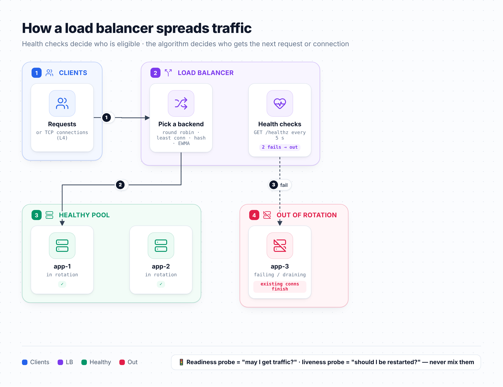

# 7.1 — Load balancing

!!! abstract "In short"
    A **load balancer** sits in front of many identical backends, uses **health checks** to know which ones may get
    traffic, and an **algorithm** to choose one for each new connection (**L4**) or request (**L7**). Done right, it
    lets you add servers, deploy without downtime and survive failures, and in Kubernetes this job is split between
    **Services** (L4 inside the cluster) and **Ingress/Gateway** (L7 at the edge).

## 📖 Key terms & abbreviations

| Term | Stands for | What it is | How it works (one line) |
|---|---|---|---|
| **LB** | Load Balancer | Spreads traffic over backends | Hardware, software (nginx, HAProxy, Envoy) or cloud |
| **L4 LB** | Layer 4 | Balances TCP/UDP connections | Sees IP:port only, very fast |
| **L7 LB** | Layer 7 | Balances HTTP requests | Routes by host/path/header, TLS, retries |
| **Round robin** | — | Next backend in turn | Simple, ignores load |
| **Least connections / least request** | — | Backend with fewest active | Better for uneven request costs |
| **Consistent hashing** | — | Same key → same backend | Cache affinity; few keys move when pool changes |
| **EWMA / P2C** | Exponentially Weighted Moving Average / Power of Two Choices | Latency-aware picking | Pick 2 random, choose the faster |
| **Health check** | — | Probe deciding if a backend gets traffic | Active (LB probes) or passive (watch errors) |
| **Readiness / liveness** | — | K8s: may get traffic / should be restarted | Different questions, different probes |
| **Draining** | — | Stop new traffic, let existing finish | During deploys and scale-in |
| **Sticky sessions** | — | Pin a client to one backend | Cookie or source-IP affinity |
| **Anycast / GSLB** | — / Global Server Load Balancing | Route users to the nearest region | Same IP from many places / DNS-based |
| **Gateway API** | — | Kubernetes' successor to Ingress | Gateway + HTTPRoute/GRPCRoute, role-oriented |

## 🗺️ Big picture



---

## 1 · L4 vs L7

| | L4 (TCP/UDP) | L7 (HTTP/gRPC) |
|---|---|---|
| Balances | Connections | Requests |
| Sees | IPs, ports | Host, path, headers, cookies, body |
| Features | Fast, protocol-agnostic, keeps client IP (NLB) | TLS termination, routing, retries, rate limits, WAF |
| Examples | AWS NLB, kube-proxy, IPVS, MetalLB | ALB, nginx, HAProxy, Envoy, Traefik, Ingress/Gateway |
| Gotcha | Long-lived connections (gRPC, HTTP/2, WebSockets) stick to one backend | More CPU, one more TLS hop |

## 2 · Algorithms

- **Round robin**: fine when every request costs the same.
- **Least connections / least outstanding requests**: better when some requests are slow.
- **Power of two choices with EWMA latency** (Envoy, Linkerd): picks two at random and sends to the faster; avoids herding onto one "least loaded" node.
- **Consistent hashing** (`hash $request_uri`, ring hash, Maglev): same key always lands on the same backend; good for caches and stateful shards; only ~1/N keys move when a node joins/leaves.
- **Weighted**: send 5% to a new version (canary).

## 3 · Health checks and graceful deploys

### How does it work?

1. The LB probes each backend (`GET /healthz` every few seconds). After N failures it's removed; after M successes it's added back.
2. **Passive checks / outlier detection** eject backends that return many 5xx even if the probe passes.
3. On deploy or scale-in, a backend is first marked **draining**: no new connections, existing ones get time to finish; then it's stopped.

In Kubernetes: the **readiness probe** decides whether a pod is in the Service's EndpointSlice; the **liveness probe** restarts a stuck container. A liveness probe that checks the database will restart **every** pod when the DB blips — keep it shallow. Combine with `preStop` sleep + graceful SIGTERM handling (3.1) for zero-downtime rollouts.

## 4 · Sessions and state

Sticky sessions (cookie affinity) work but make scaling and deploys uneven and break when a node dies. Prefer **stateless** app servers with sessions in Redis/DB or a signed token; use stickiness only for real per-node state (WebSockets, local caches).

## 5 · Kubernetes and global load balancing

- **Service (ClusterIP)**: L4, per connection, via kube-proxy/eBPF (5.3).
- **Service type LoadBalancer**: cloud L4 LB → NodePorts or pod IPs.
- **Ingress / Gateway API**: L7 controllers (ingress-nginx, Envoy Gateway, Istio, Cilium, cloud controllers). Gateway API adds HTTPRoute/GRPCRoute, traffic splitting, header matching and clean role separation (infra owns Gateways, teams own Routes). The community **ingress-nginx** controller was retired in March 2026 (no more releases or security fixes), so plan migrations and use Gateway API for new setups.
- **Global**: DNS-based (Route 53 latency/failover routing) or **anycast** L7 LBs (Cloudflare, GCP global LB) send users to the nearest healthy region.

## 🔧 DevOps connection

- **502s during deploys** = pods killed before the LB stopped sending to them; fix with readiness + `preStop` sleep + graceful shutdown, and LB deregistration delay.
- **gRPC hot pod** = L4 balancing of long-lived HTTP/2; use an L7 proxy, a mesh, or client-side balancing (headless Service).
- **Idle timeouts must line up** (client < LB < backend keep-alive), see 6.3.
- **Watch per-backend metrics**: one slow pod can dominate p99; outlier detection helps.

## 🧪 Try it yourself

```bash
# A tiny L7 load balancer with nginx in front of 3 echo servers
docker network create lbdemo
for i in 1 2 3; do docker run -d --rm --name app$i --network lbdemo hashicorp/http-echo -text="app$i"; done
cat > /tmp/nginx.conf <<'EOF'
events {}
http {
  upstream apps { server app1:5678; server app2:5678; server app3:5678; }   # try: least_conn;  hash $remote_addr;
  server { listen 80; location / { proxy_pass http://apps; } }
}
EOF
docker run -d --rm --name lb --network lbdemo -p 8080:80 -v /tmp/nginx.conf:/etc/nginx/nginx.conf:ro nginx:alpine
for i in $(seq 6); do curl -s localhost:8080; done          # app1 app2 app3 app1 …
docker stop app2; for i in $(seq 4); do curl -s localhost:8080; done   # passive failover
docker stop lb app1 app3; docker network rm lbdemo

kubectl get endpointslices -l kubernetes.io/service-name=<svc> -o wide 2>/dev/null   # who is "ready"
```

## 🃏 Cheat sheet

| Need | Choose |
|---|---|
| Raw TCP/UDP, keep client IP | L4 (NLB, MetalLB) |
| Path/host routing, TLS, retries | L7 (ALB, Envoy, Gateway API) |
| Uneven request cost | Least request / P2C EWMA |
| Cache affinity | Consistent hashing |
| Canary 5% | Weighted routing (HTTPRoute weights) |
| Zero-downtime deploy | Readiness + preStop + draining |

## ❓ Test yourself

??? question "1. Why can an L4 load balancer leave gRPC traffic unbalanced?"
    It balances connections; gRPC multiplexes all requests over one long-lived HTTP/2 connection, so one backend gets everything from that client.

??? question "2. What's the difference between readiness and liveness probes?"
    Readiness: should this pod receive traffic now? Liveness: is it stuck and should be restarted?

??? question "3. Why is a deep liveness check (that queries the DB) dangerous?"
    A DB hiccup fails every pod's liveness and Kubernetes restarts them all at once, turning a blip into an outage.

??? question "4. When is consistent hashing useful?"
    When the same key should hit the same backend (cache locality, shards) and you want few keys to move when backends change.

??? question "5. Users see 502s for a few seconds during every rollout. What do you check?"
    Graceful shutdown: readiness turning false before exit, a preStop sleep so endpoints update, SIGTERM handling, and LB deregistration delay.

---

## 📚 Sources

- [Envoy — Load balancing overview](https://www.envoyproxy.io/docs/envoy/latest/intro/arch_overview/upstream/load_balancing/overview)
- [Kubernetes — Gateway API](https://gateway-api.sigs.k8s.io/)
- [Kubernetes — Liveness, readiness and startup probes](https://kubernetes.io/docs/concepts/configuration/liveness-readiness-startup-probes/)
- [Kubernetes — Ingress NGINX statement (2026)](https://kubernetes.io/blog/2026/01/29/ingress-nginx-statement/)
- [Google — Maglev: a fast and reliable software network load balancer](https://research.google/pubs/maglev-a-fast-and-reliable-software-network-load-balancer/)

## ✍️ My notes

> For one service: which LB layers does a request pass (CDN, cloud LB, ingress, Service)? Which algorithm and health check does each use?
