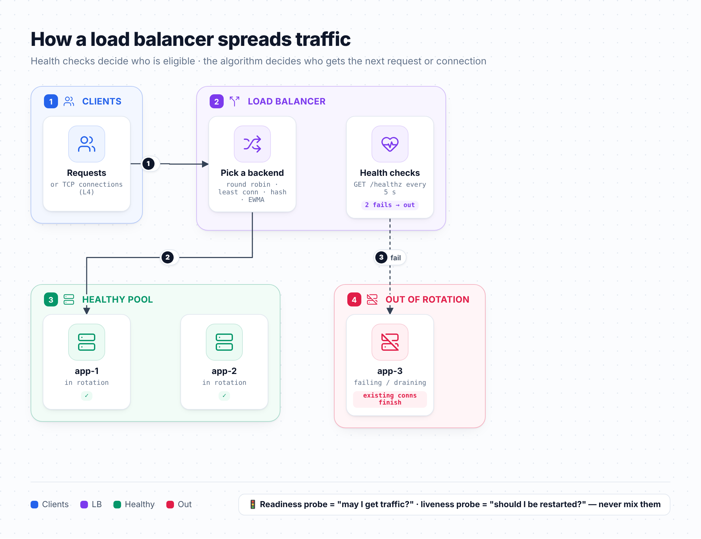

# 7.1 — Yük dengeleme

!!! abstract "Tek cümlede"
    Bir **load balancer** çok sayıda özdeş backend'in önünde durur; hangilerinin trafik alabileceğini bilmek için
    **health check**'ler, her yeni bağlantı (**L4**) ya da istek (**L7**) için birini seçmek için bir **algoritma** kullanır;
    doğru yapılınca sunucu eklemeni, kesintisiz deploy etmeni ve hatalardan sağ çıkmanı sağlar. Kubernetes'te bu iş
    **Service**'ler (cluster içinde L4) ve **Ingress/Gateway** (uçta L7) arasında bölünür.

## 📖 Temel terimler ve kısaltmalar

| Terim | Açılımı | Nedir | Nasıl çalışır (tek satır) |
|---|---|---|---|
| **LB** | Load Balancer | Trafiği backend'lere dağıtır | Donanım, yazılım (nginx, HAProxy, Envoy) ya da bulut |
| **L4 LB** | Layer 4 | TCP/UDP bağlantılarını dengeler | Sadece IP:port görür, çok hızlı |
| **L7 LB** | Layer 7 | HTTP isteklerini dengeler | Host/yol/header'a göre yönlendirir, TLS, yeniden deneme |
| **Round robin** | — | Sırayla sıradaki backend | Basit, yükü umursamaz |
| **Least connections / least request** | — | En az aktif olan backend | Maliyeti eşit olmayan istekler için daha iyi |
| **Consistent hashing** | — | Aynı anahtar → aynı backend | Önbellek yakınlığı; havuz değişince az anahtar taşınır |
| **EWMA / P2C** | Exponentially Weighted Moving Average / Power of Two Choices | Gecikmeye duyarlı seçim | Rastgele 2 seç, hızlı olanı al |
| **Health check** | — | Bir backend'in trafik alıp almayacağına karar veren yoklama | Aktif (LB yoklar) ya da pasif (hataları izler) |
| **Readiness / liveness** | — | K8s: trafik alabilir / yeniden başlatılmalı | Farklı sorular, farklı probe'lar |
| **Boşaltma** | Draining | Yeni trafiği durdur, mevcut olanın bitmesine izin ver | Deploy ve küçültme sırasında |
| **Yapışkan oturumlar** | Sticky sessions | Bir istemciyi tek backend'e sabitle | Cookie ya da kaynak IP yakınlığı |
| **Anycast / GSLB** | — / Global Server Load Balancing | Kullanıcıları en yakın bölgeye yönlendir | Birçok yerden aynı IP / DNS tabanlı |
| **Gateway API** | — | Kubernetes'te Ingress'in halefi | Gateway + HTTPRoute/GRPCRoute, rol odaklı |

## 🗺️ Büyük resim



---

## 1 · L4 ve L7

| | L4 (TCP/UDP) | L7 (HTTP/gRPC) |
|---|---|---|
| Dengelediği | Bağlantılar | İstekler |
| Gördüğü | IP'ler, portlar | Host, yol, header'lar, cookie'ler, gövde |
| Özellikler | Hızlı, protokolden bağımsız, istemci IP'sini korur (NLB) | TLS sonlandırma, yönlendirme, yeniden deneme, hız sınırı, WAF |
| Örnekler | AWS NLB, kube-proxy, IPVS, MetalLB | ALB, nginx, HAProxy, Envoy, Traefik, Ingress/Gateway |
| Tuzak | Uzun ömürlü bağlantılar (gRPC, HTTP/2, WebSocket) tek backend'e yapışır | Daha çok CPU, bir TLS durağı daha |

## 2 · Algoritmalar

- **Round robin**: her istek aynı maliyetteyse yeterli.
- **Least connections / least outstanding requests**: bazı istekler yavaşsa daha iyi.
- **EWMA gecikmeli power of two choices** (Envoy, Linkerd): rastgele ikisini seçip hızlı olana gönderir; herkesin tek bir "en az yüklü" node'a yığılmasını önler.
- **Consistent hashing** (`hash $request_uri`, ring hash, Maglev): aynı anahtar hep aynı backend'e düşer; önbellekler ve durumlu shard'lar için iyi; bir node katılınca/ayrılınca anahtarların sadece ~1/N'i taşınır.
- **Ağırlıklı**: yeni sürüme %5 gönder (canary).

## 3 · Health check'ler ve düzgün deploy'lar

### Nasıl çalışır?

1. LB her backend'i yoklar (birkaç saniyede bir `GET /healthz`). N hatadan sonra çıkarılır; M başarıdan sonra geri eklenir.
2. **Pasif kontroller / outlier detection** probe geçse bile çok 5xx dönen backend'leri dışarı atar.
3. Deploy ya da küçültmede bir backend önce **boşaltılıyor** olarak işaretlenir: yeni bağlantı yok, mevcutlara bitmeleri için süre verilir; sonra durdurulur.

Kubernetes'te: **readiness probe** bir pod'un Service'in EndpointSlice'ında olup olmayacağına karar verir; **liveness probe** takılmış bir container'ı yeniden başlatır. Veritabanını kontrol eden bir liveness probe'u DB bir an takılınca **her** pod'u yeniden başlatır; sığ tut. Kesintisiz rollout için `preStop` sleep + düzgün SIGTERM işlemeyle (3.1) birleştir.

## 4 · Oturumlar ve durum

Yapışkan oturumlar (cookie yakınlığı) çalışır ama ölçeklemeyi ve deploy'ları dengesizleştirir, bir node ölünce bozulur. Oturumları Redis/DB'de ya da imzalı bir token'da tutan **durumsuz** uygulama sunucularını tercih et; yapışkanlığı sadece gerçek node başı durum için kullan (WebSocket'ler, yerel önbellekler).

## 5 · Kubernetes ve global yük dengeleme

- **Service (ClusterIP)**: L4, bağlantı başına, kube-proxy/eBPF ile (5.3).
- **LoadBalancer tipi Service**: bulut L4 LB → NodePort'lar ya da pod IP'leri.
- **Ingress / Gateway API**: L7 controller'lar (Envoy Gateway, Istio, Cilium, bulut controller'ları). Gateway API HTTPRoute/GRPCRoute, trafik bölme, header eşleştirme ve temiz rol ayrımı ekler (altyapı Gateway'lerin, ekipler Route'ların sahibi). Topluluk **ingress-nginx** controller'ı Mart 2026'da emekliye ayrıldı (artık sürüm ve güvenlik düzeltmesi yok); geçişleri planla, yeni kurulumlar için Gateway API kullan.
- **Global**: DNS tabanlı (Route 53 gecikme/failover yönlendirme) ya da **anycast** L7 LB'ler (Cloudflare, GCP global LB) kullanıcıları en yakın sağlıklı bölgeye gönderir.

## 🔧 DevOps bağlantısı

- **Deploy sırasında 502'ler** = pod'lar LB onlara göndermeyi bırakmadan öldürülüyor; readiness + `preStop` sleep + düzgün kapanış ve LB deregistration gecikmesiyle düzelt.
- **gRPC'de sıcak pod** = uzun ömürlü HTTP/2'nin L4 dengelemesi; L7 proxy, mesh ya da istemci tarafı dengeleme (headless Service) kullan.
- **Boşta zaman aşımları uyumlu olmalı** (istemci < LB < backend keep-alive), bkz. 6.3.
- **Backend başına metrikleri izle**: tek bir yavaş pod p99'a hükmedebilir; outlier detection yardımcı olur.

## 🧪 Kendin dene

```bash
# 3 echo sunucusunun önünde nginx ile minik bir L7 load balancer
docker network create lbdemo
for i in 1 2 3; do docker run -d --rm --name app$i --network lbdemo hashicorp/http-echo -text="app$i"; done
cat > /tmp/nginx.conf <<'EOF'
events {}
http {
  upstream apps { server app1:5678; server app2:5678; server app3:5678; }   # dene: least_conn;  hash $remote_addr;
  server { listen 80; location / { proxy_pass http://apps; } }
}
EOF
docker run -d --rm --name lb --network lbdemo -p 8080:80 -v /tmp/nginx.conf:/etc/nginx/nginx.conf:ro nginx:alpine
for i in $(seq 6); do curl -s localhost:8080; done          # app1 app2 app3 app1 …
docker stop app2; for i in $(seq 4); do curl -s localhost:8080; done   # pasif failover
docker stop lb app1 app3; docker network rm lbdemo

kubectl get endpointslices -l kubernetes.io/service-name=<svc> -o wide 2>/dev/null   # kim "ready"
```

## 🃏 Hatırlatma kartı

| İhtiyaç | Seç |
|---|---|
| Ham TCP/UDP, istemci IP'sini koru | L4 (NLB, MetalLB) |
| Yol/host yönlendirme, TLS, yeniden deneme | L7 (ALB, Envoy, Gateway API) |
| Eşit olmayan istek maliyeti | Least request / P2C EWMA |
| Önbellek yakınlığı | Consistent hashing |
| %5 canary | Ağırlıklı yönlendirme (HTTPRoute ağırlıkları) |
| Kesintisiz deploy | Readiness + preStop + boşaltma |

## ❓ Kendini test et

??? question "1. L4 bir load balancer gRPC trafiğini neden dengesiz bırakabilir?"
    Bağlantıları dengeler; gRPC tüm istekleri tek bir uzun ömürlü HTTP/2 bağlantısında çoklar, o istemciden gelen her şeyi tek backend alır.

??? question "2. Readiness ve liveness probe'ları arasındaki fark ne?"
    Readiness: bu pod şu an trafik almalı mı? Liveness: takıldı mı, yeniden başlatılmalı mı?

??? question "3. Derin bir liveness kontrolü (DB'yi sorgulayan) neden tehlikeli?"
    DB'deki bir aksaklık her pod'un liveness'ını düşürür ve Kubernetes hepsini aynı anda yeniden başlatır; küçük bir sorun kesintiye dönüşür.

??? question "4. Consistent hashing ne zaman işe yarar?"
    Aynı anahtarın aynı backend'e gitmesi gerektiğinde (önbellek yakınlığı, shard'lar) ve backend'ler değişince az anahtarın taşınmasını istediğinde.

??? question "5. Kullanıcılar her rollout'ta birkaç saniye 502 görüyor. Neyi kontrol edersin?"
    Düzgün kapanışı: çıkıştan önce readiness'ın false olması, endpoint'ler güncellensin diye preStop sleep, SIGTERM işleme ve LB deregistration gecikmesi.

---

## 📚 Kaynaklar

- [Envoy — Load balancing overview](https://www.envoyproxy.io/docs/envoy/latest/intro/arch_overview/upstream/load_balancing/overview)
- [Kubernetes — Gateway API](https://gateway-api.sigs.k8s.io/)
- [Kubernetes — Liveness, readiness and startup probes](https://kubernetes.io/docs/concepts/configuration/liveness-readiness-startup-probes/)
- [Kubernetes — Ingress NGINX statement (2026)](https://kubernetes.io/blog/2026/01/29/ingress-nginx-statement/)
- [Google — Maglev: a fast and reliable software network load balancer](https://research.google/pubs/maglev-a-fast-and-reliable-software-network-load-balancer/)

## ✍️ Notlarım

> Bir servis için: bir istek hangi LB katmanlarından geçiyor (CDN, bulut LB, ingress, Service)? Her biri hangi algoritmayı ve health check'i kullanıyor?

-
