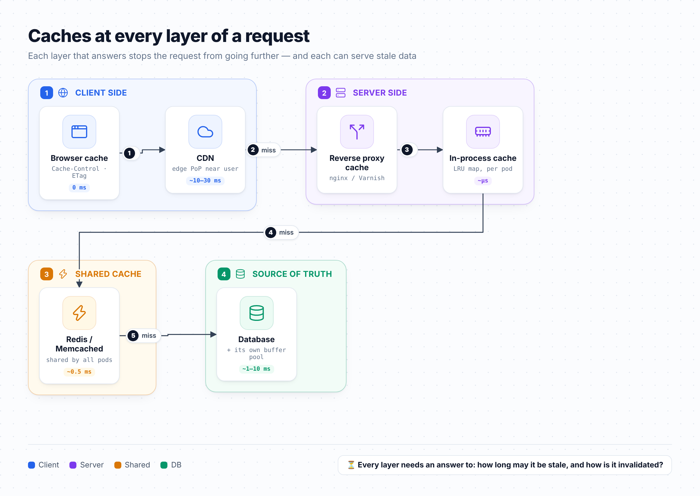
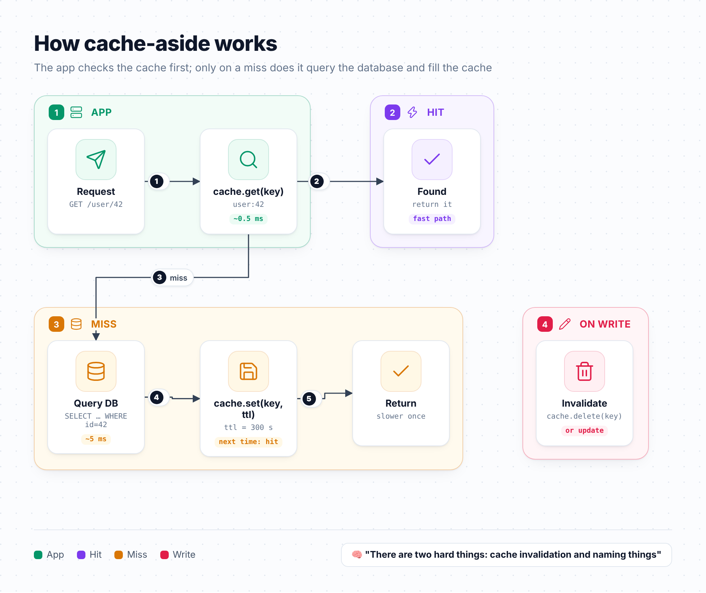

# 7.2 — Caching patterns

!!! abstract "In one sentence"
    A **cache** keeps a copy of expensive results somewhere faster and closer; every layer from the **browser** and
    **CDN** to an **in-process map** and **Redis** can answer before the database, and the hard parts are always the same:
    choosing a **pattern** (cache-aside, write-through…), deciding **how stale** data may be (**TTL**, invalidation), and
    surviving **stampedes**, **hot keys** and cache **outages**.

## 📖 Key terms & abbreviations

| Term | Stands for | What it is | How it works (one line) |
|---|---|---|---|
| **Hit / miss / hit ratio** | — | Found / not found / % of hits | 95% vs 99% hit ratio = 5× fewer DB calls |
| **TTL** | Time To Live | How long an entry is valid | Expires → next read is a miss |
| **Cache-aside** | lazy loading | App reads cache, fills on miss | Most common pattern |
| **Read-through** | — | Cache library loads from DB itself | App only talks to the cache |
| **Write-through** | — | Write to cache and DB together | Cache always fresh, slower writes |
| **Write-behind** | write-back | Write to cache, DB later | Fast, risk of loss |
| **Invalidation** | — | Removing/updating stale entries | Delete on write, events, versioned keys |
| **Eviction (LRU/LFU)** | Least Recently / Frequently Used | What to drop when full | Redis `maxmemory-policy` |
| **Stampede / thundering herd** | — | Many misses for one key at once | All hit the DB simultaneously |
| **Hot key** | — | One key with huge traffic | Overloads one cache shard |
| **Negative caching** | — | Caching "not found" | Protects DB from repeated misses |
| **Redis** | REmote DIctionary Server | In-memory data store | Strings, hashes, sets, sorted sets, streams |
| **Memcached** | — | Simple distributed memory cache | Multi-threaded, key/value only |
| **CDN** | Content Delivery Network | Edge caches near users | Cache-Control from your origin |

## 🗺️ Big picture



---

## 1 · Patterns



| Pattern | Read | Write | Good for | Watch out |
|---|---|---|---|---|
| **Cache-aside** | Cache → miss → DB → fill | Write DB, **delete** key | Most apps | Race: stale value re-filled after a delete |
| **Read-through** | Cache loads from DB | — | Libraries/CDNs | Same staleness questions |
| **Write-through** | From cache | Cache + DB synchronously | Read-heavy, need fresh | Every write slower |
| **Write-behind** | From cache | Cache now, DB async | Counters, analytics | Data loss if cache dies |

**Delete, don't update, on writes** (in cache-aside): updating the cache from two concurrent writers can leave the older value; deleting forces the next read to load the truth.

## 2 · TTLs and invalidation

- **Short TTL** = fresher, more DB load. **Long TTL** = cheaper, staler. Add **jitter** (±10%) so thousands of keys don't expire in the same second.
- **Event-driven invalidation**: publish "user 42 changed" (outbox/CDC, 7.4) and delete the key everywhere.
- **Versioned keys**: `product:42:v17`; bump the version on change, old keys simply expire.
- **CDN**: long TTL + purge API, or hashed asset names (6.1).

## 3 · Failure modes

| Problem | What happens | Fix |
|---|---|---|
| **Stampede** | A hot key expires, 1,000 requests all miss and hit the DB | Request coalescing / single-flight, lock per key, stale-while-revalidate, early refresh |
| **Hot key** | One key gets 100K req/s, one Redis shard melts | Local in-process cache in front, key replication, read replicas |
| **Cache down** | Everything falls through to the DB, DB dies too | Circuit breaker, rate-limit fallthrough, cache with replicas, warm-up |
| **Penetration** | Requests for non-existent IDs always miss | Negative caching, Bloom filter |
| **Big values** | Slow network, memory fragmentation | Keep values small, compress, split |

## 4 · Redis essentials

- Single-threaded command execution (I/O threads help networking): **one slow command blocks everyone** (`KEYS *`, big `SMEMBERS`, huge Lua). Use `SCAN`.
- **Persistence**: RDB snapshots and/or AOF log; as a pure cache you may turn them off.
- **Eviction**: set `maxmemory` + `maxmemory-policy allkeys-lru` (or `allkeys-lfu`) for caches; `noeviction` makes writes fail when full.
- **HA**: replicas + Sentinel, or **Redis Cluster** (16,384 hash slots across shards); managed: ElastiCache/MemoryDB, Memorystore, Azure Cache. Valkey is the open-source fork many providers now ship.
- Also useful for: rate limiting, distributed locks (carefully), sessions, leaderboards (sorted sets), queues/streams.

## 🔧 DevOps connection

- **Measure** hit ratio, latency, evictions, memory, connected clients (`INFO stats`, `keyspace_hits/misses`, `evicted_keys`).
- **Size memory** for the working set plus overhead (~1.5–2× raw data); alert well before `maxmemory`.
- **A cache is not a database**: data must be rebuildable. If losing Redis loses business data, it's a database and needs backups and replication.
- **Plan for cold starts**: after a flush or failover, the DB sees full load; warm critical keys or ramp traffic.

## 🧪 Try it yourself

```bash
docker run -d --rm --name redis -p 6379:6379 redis:7-alpine
redis-cli SET user:42 '{"name":"Jane"}' EX 300     # value with 300 s TTL
redis-cli TTL user:42; redis-cli GET user:42
redis-cli CONFIG SET maxmemory 50mb
redis-cli CONFIG SET maxmemory-policy allkeys-lru
redis-cli --latency -i 1 2>/dev/null & sleep 3; kill $!
redis-cli INFO stats | grep -E 'keyspace_(hits|misses)|evicted_keys'
redis-benchmark -q -n 20000 -t get,set
docker stop redis
```

## 🃏 Cheat sheet

| Need | Do |
|---|---|
| Default pattern | Cache-aside, delete on write, TTL with jitter |
| Avoid stampede | Single-flight / lock / stale-while-revalidate |
| Hot key | In-process cache + short TTL in front of Redis |
| Cache eviction policy | `allkeys-lru` / `allkeys-lfu` |
| Never in production | `KEYS *`, unbounded values |
| Health metrics | Hit ratio, p99 latency, evictions, memory |

## ❓ Test yourself

??? question "1. Why delete the key on write instead of updating it in cache-aside?"
    Concurrent writers can update the cache in the wrong order, leaving an old value; deleting makes the next read fetch the current one.

??? question "2. What is a cache stampede and how do you prevent it?"
    Many requests miss the same expired hot key at once and all hit the DB. Use request coalescing/locks, stale-while-revalidate or early refresh with jittered TTLs.

??? question "3. Your Redis is at 100% CPU on one core while others are idle. Possible causes?"
    A slow command (KEYS, huge sets, Lua) or a hot key; Redis executes commands on one thread.

??? question "4. When is write-behind acceptable?"
    When losing the last few writes is tolerable (counters, metrics) and write speed matters more than durability.

??? question "5. What happens to the database when the cache cluster restarts empty, and how do you prepare?"
    It gets the full read load (cold cache). Warm critical keys, ramp traffic, and protect the DB with rate limits/circuit breakers.

---

## 📚 Sources

- [AWS — Caching best practices](https://aws.amazon.com/caching/best-practices/)
- [Redis docs — Eviction policies](https://redis.io/docs/latest/develop/reference/eviction/) · [Redis Cluster spec](https://redis.io/docs/latest/operate/oss_and_stack/reference/cluster-spec/)
- [Facebook — Scaling Memcache at Facebook (paper)](https://research.facebook.com/publications/scaling-memcache-at-facebook/)
- [Valkey](https://valkey.io/)

## ✍️ My notes

> For your busiest endpoint: which cache layers does it use, what's the hit ratio, and what happens if Redis disappears for 5 minutes?

-
