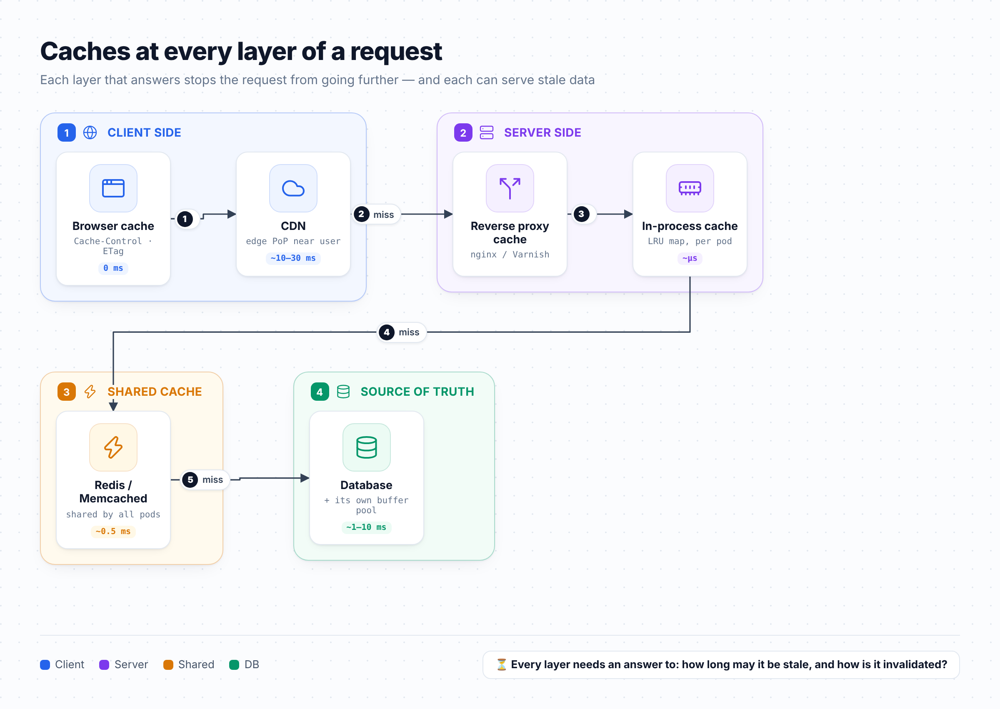
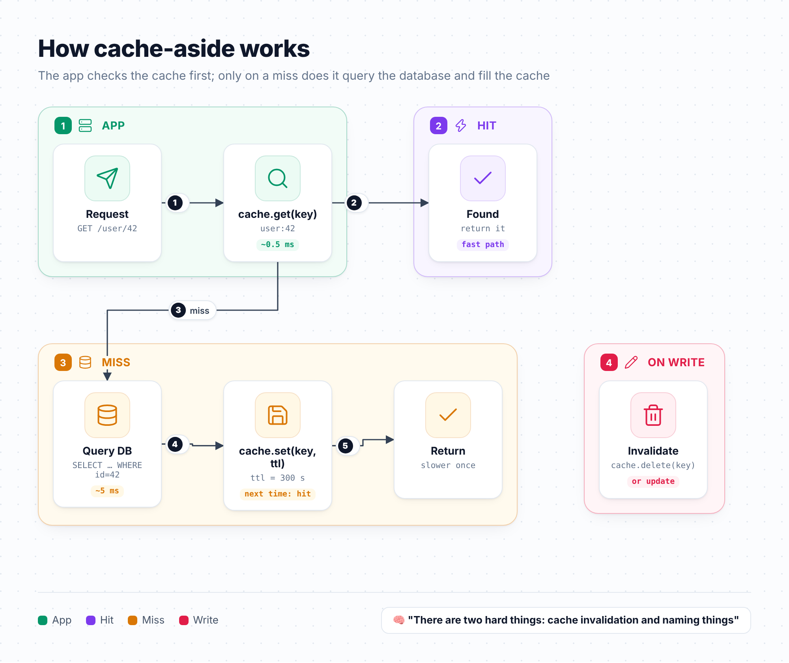

# 7.2 — Önbellek desenleri

!!! abstract "Kısaca"
    Bir **önbellek** pahalı sonuçların bir kopyasını daha hızlı ve daha yakın bir yerde tutar. **Tarayıcı** ve
    **CDN**'den **process içi bir map**'e ve **Redis**'e kadar her katman veritabanından önce cevap verebilir. Zor
    kısımlar hep aynıdır: bir **desen** seçmek (cache-aside, write-through…), verinin **ne kadar eski** olabileceğine
    karar vermek (**TTL**, geçersiz kılma) ve **izdihamlardan**, **sıcak anahtarlardan** ve önbellek **kesintilerinden**
    sağ çıkmak.

## 📖 Temel terimler ve kısaltmalar

| Terim | Açılımı | Nedir | Nasıl çalışır (tek satır) |
|---|---|---|---|
| **İsabet / ıska / isabet oranı** | Hit / miss / hit ratio | Bulundu / bulunamadı / isabet % | %95 ve %99 isabet oranı = 5× daha az DB çağrısı |
| **TTL** | Time To Live | Bir girdinin ne kadar geçerli olduğu | Dolunca → bir sonraki okuma ıskadır |
| **Cache-aside** | lazy loading | Uygulama önbelleği okur, ıskada doldurur | En yaygın desen |
| **Read-through** | — | Önbellek kütüphanesi DB'den kendisi yükler | Uygulama sadece önbellekle konuşur |
| **Write-through** | — | Önbelleğe ve DB'ye birlikte yaz | Önbellek hep taze, yazmalar yavaş |
| **Write-behind** | write-back | Önbelleğe yaz, DB'ye sonra | Hızlı, kayıp riski |
| **Geçersiz kılma** | Invalidation | Eski girdileri silmek/güncellemek | Yazmada sil, olaylar, sürümlü anahtarlar |
| **Tahliye (LRU/LFU)** | Least Recently / Frequently Used | Dolunca neyin atılacağı | Redis `maxmemory-policy` |
| **İzdiham / thundering herd** | Stampede | Tek bir anahtar için aynı anda çok ıska | Hepsi DB'ye aynı anda gider |
| **Sıcak anahtar** | Hot key | Dev trafiği olan tek anahtar | Tek bir önbellek shard'ını boğar |
| **Negatif önbellek** | Negative caching | "Bulunamadı"yı önbelleğe almak | DB'yi tekrarlanan ıskalardan korur |
| **Redis** | REmote DIctionary Server | Bellek içi veri deposu | String, hash, set, sorted set, stream |
| **Memcached** | — | Basit dağıtık bellek önbelleği | Çok thread'li, sadece anahtar/değer |
| **CDN** | Content Delivery Network | Kullanıcılara yakın uç önbellekler | Origin'inden gelen Cache-Control |

## 🗺️ Büyük resim



---

## 1 · Desenler



| Desen | Okuma | Yazma | İyi olduğu yer | Dikkat |
|---|---|---|---|---|
| **Cache-aside** | Önbellek → ıska → DB → doldur | DB'ye yaz, anahtarı **sil** | Çoğu uygulama | Yarış: silmeden sonra eski değer tekrar dolabilir |
| **Read-through** | Önbellek DB'den yükler | — | Kütüphaneler/CDN'ler | Aynı eskime soruları |
| **Write-through** | Önbellekten | Önbellek + DB senkron | Okuma yoğun, taze gerekli | Her yazma daha yavaş |
| **Write-behind** | Önbellekten | Önbellek şimdi, DB asenkron | Sayaçlar, analitik | Önbellek ölürse veri kaybı |

**Yazmalarda güncelleme değil silme yap** (cache-aside'da): iki eşzamanlı yazanın önbelleği güncellemesi eski değeri bırakabilir; silmek bir sonraki okumayı gerçeği yüklemeye zorlar.

## 2 · TTL'ler ve geçersiz kılma

- **Kısa TTL** = daha taze, daha çok DB yükü. **Uzun TTL** = daha ucuz, daha eski. Binlerce anahtar aynı saniyede dolmasın diye **jitter** (±%10) ekle.
- **Olay güdümlü geçersiz kılma**: "42 numaralı kullanıcı değişti" yayınla (outbox/CDC, 7.4) ve anahtarı her yerde sil.
- **Sürümlü anahtarlar**: `product:42:v17`; değişince sürümü artır, eski anahtarlar kendiliğinden dolar.
- **CDN**: uzun TTL + purge API'si ya da hash'li dosya adları (6.1).

## 3 · Hata modları

| Sorun | Ne olur | Çözüm |
|---|---|---|
| **İzdiham** | Sıcak bir anahtarın süresi dolar, 1.000 istek ıskalayıp DB'ye gider | İstek birleştirme / single-flight, anahtar başına kilit, stale-while-revalidate, erken yenileme |
| **Sıcak anahtar** | Bir anahtar saniyede 100K istek alır, tek bir Redis shard'ı erir | Önde yerel process içi önbellek, anahtar replikasyonu, okuma replikaları |
| **Önbellek çöktü** | Her şey DB'ye düşer, DB de ölür | Circuit breaker, düşen trafiğe hız sınırı, replikalı önbellek, ısıtma |
| **Penetrasyon** | Var olmayan ID'ler için istekler hep ıskalar | Negatif önbellek, Bloom filtresi |
| **Büyük değerler** | Yavaş ağ, bellek parçalanması | Değerleri küçük tut, sıkıştır, böl |

## 4 · Redis temelleri

- Tek thread'li komut çalıştırma (I/O thread'leri ağa yardım eder): **yavaş bir komut herkesi bloklar** (`KEYS *`, büyük `SMEMBERS`, dev Lua). `SCAN` kullan.
- **Kalıcılık**: RDB snapshot'ları ve/veya AOF log'u; saf önbellek olarak kapatabilirsin.
- **Tahliye**: önbellekler için `maxmemory` + `maxmemory-policy allkeys-lru` (ya da `allkeys-lfu`) ayarla; `noeviction` dolunca yazmaları başarısız yapar.
- **HA**: replikalar + Sentinel ya da **Redis Cluster** (shard'lara dağıtılmış 16.384 hash slot'u); yönetilen: ElastiCache/MemoryDB, Memorystore, Azure Cache. Valkey, birçok sağlayıcının artık sunduğu açık kaynak fork.
- Şunlar için de işe yarar: hız sınırlama, dağıtık kilitler (dikkatle), oturumlar, liderlik tabloları (sorted set'ler), kuyruklar/stream'ler.

## 🔧 DevOps bağlantısı

- **Ölç**: isabet oranı, gecikme, tahliyeler, bellek, bağlı istemciler (`INFO stats`, `keyspace_hits/misses`, `evicted_keys`).
- **Belleği** çalışma kümesi artı ek yük (ham verinin ~1,5–2×'i) için boyutla; `maxmemory`'den çok önce alarm kur.
- **Önbellek veritabanı değildir**: veri yeniden üretilebilir olmalı. Redis'i kaybetmek iş verisini kaybettiriyorsa o bir veritabanıdır; yedek ve replikasyon ister.
- **Soğuk başlangıçları planla**: bir flush ya da failover sonrası DB tam yükü görür; kritik anahtarları ısıt ya da trafiği kademeli artır.

## 🧪 Kendin dene

```bash
docker run -d --rm --name redis -p 6379:6379 redis:7-alpine
redis-cli SET user:42 '{"name":"Jane"}' EX 300     # 300 sn TTL'li değer
redis-cli TTL user:42; redis-cli GET user:42
redis-cli CONFIG SET maxmemory 50mb
redis-cli CONFIG SET maxmemory-policy allkeys-lru
redis-cli --latency -i 1 2>/dev/null & sleep 3; kill $!
redis-cli INFO stats | grep -E 'keyspace_(hits|misses)|evicted_keys'
redis-benchmark -q -n 20000 -t get,set
docker stop redis
```

## 🃏 Hatırlatma kartı

| İhtiyaç | Yap |
|---|---|
| Varsayılan desen | Cache-aside, yazmada sil, jitter'lı TTL |
| İzdihamdan kaçın | Single-flight / kilit / stale-while-revalidate |
| Sıcak anahtar | Redis'in önünde process içi önbellek + kısa TTL |
| Önbellek tahliye politikası | `allkeys-lru` / `allkeys-lfu` |
| Production'da asla | `KEYS *`, sınırsız değerler |
| Sağlık metrikleri | İsabet oranı, p99 gecikme, tahliyeler, bellek |

## ❓ Kendini test et

??? question "1. Cache-aside'da yazmada anahtarı güncellemek yerine neden silersin?"
    Eşzamanlı yazanlar önbelleği yanlış sırayla güncelleyip eski bir değer bırakabilir; silmek bir sonraki okumanın güncel değeri getirmesini sağlar.

??? question "2. Önbellek izdihamı nedir, nasıl önlenir?"
    Çok sayıda istek süresi dolmuş aynı sıcak anahtarı aynı anda ıskalayıp DB'ye gider. İstek birleştirme/kilitler, stale-while-revalidate ya da jitter'lı TTL'lerle erken yenileme kullan.

??? question "3. Redis'in bir çekirdeği %100 CPU'da, diğerleri boş. Olası sebepler?"
    Yavaş bir komut (KEYS, dev set'ler, Lua) ya da sıcak bir anahtar; Redis komutları tek thread'de çalıştırır.

??? question "4. Write-behind ne zaman kabul edilebilir?"
    Son birkaç yazmayı kaybetmek tolere edilebiliyorsa (sayaçlar, metrikler) ve yazma hızı kalıcılıktan önemliyse.

??? question "5. Önbellek cluster'ı boş olarak yeniden başlayınca veritabanına ne olur, nasıl hazırlanırsın?"
    Tüm okuma yükünü alır (soğuk önbellek). Kritik anahtarları ısıt, trafiği kademeli artır ve DB'yi hız sınırları/circuit breaker'larla koru.

---

## 📚 Kaynaklar

- [AWS — Caching best practices](https://aws.amazon.com/caching/best-practices/)
- [Redis docs — Eviction policies](https://redis.io/docs/latest/develop/reference/eviction/) · [Redis Cluster spec](https://redis.io/docs/latest/operate/oss_and_stack/reference/cluster-spec/)
- [Facebook — Scaling Memcache at Facebook (makale)](https://research.facebook.com/publications/scaling-memcache-at-facebook/)
- [Valkey](https://valkey.io/)

## ✍️ Notlarım

> En yoğun uç noktan için: hangi önbellek katmanlarını kullanıyor, isabet oranı ne ve Redis 5 dakika kaybolursa ne olur?
