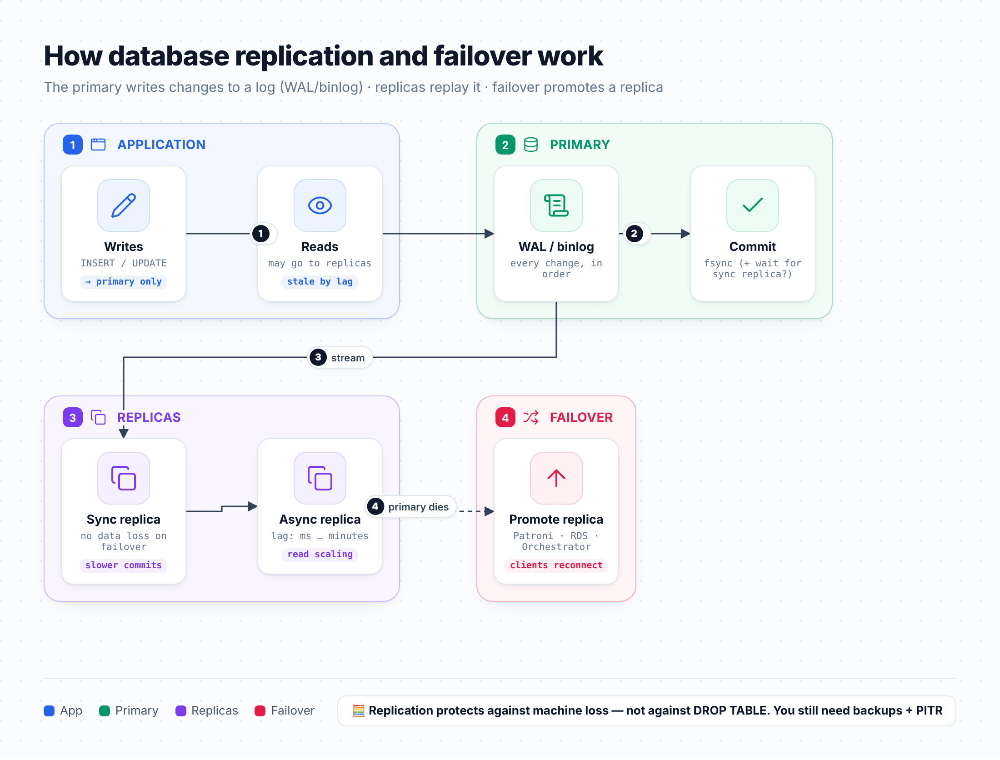
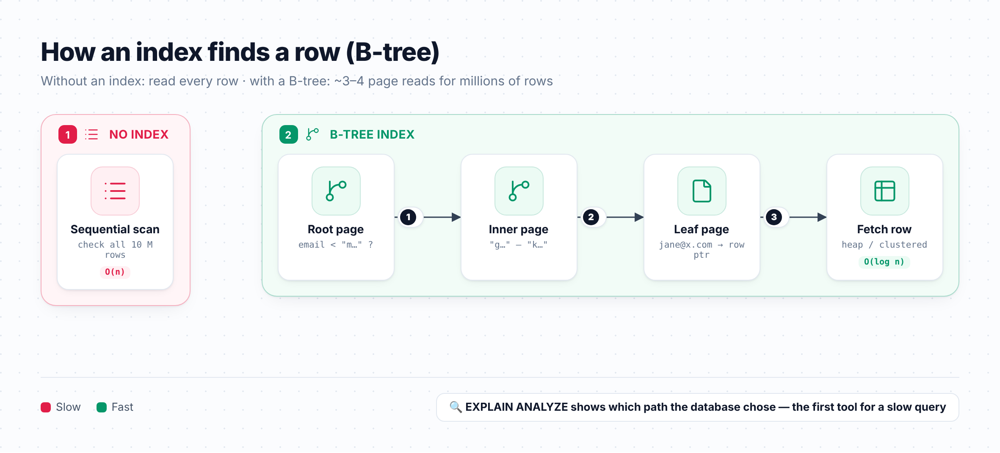

# 7.3 — Databases: storage, transactions & replication

!!! abstract "In short"
    A database keeps data in **pages** on disk and finds rows quickly with **indexes**, usually **B-trees**. It makes
    every change durable by writing it to a **write-ahead log (WAL)** first, and isolates concurrent **transactions**
    with **MVCC** and locks. It scales and survives failures by **replicating** that log to other servers. You still
    need **backups**, because replication copies mistakes too.

## 📖 Key terms & abbreviations

| Term | Stands for | What it is | How it works (one line) |
|---|---|---|---|
| **RDBMS / SQL** | Relational DB Management System / Structured Query Language | Tables + relations + queries | PostgreSQL, MySQL, SQL Server, Oracle |
| **Page** | — | Unit of storage (8 KB Postgres, 16 KB InnoDB) | Cached in the buffer pool |
| **Index (B-tree)** | — | Sorted tree for fast lookups | O(log n) page reads instead of a full scan |
| **WAL / redo log / binlog** | Write-Ahead Log | Append-only log of changes | Written + fsynced before data pages |
| **Transaction** | — | Group of changes that succeed or fail together | `BEGIN … COMMIT / ROLLBACK` |
| **ACID** | Atomicity, Consistency, Isolation, Durability | Transaction guarantees | All-or-nothing, rules hold, no interference, survives crash |
| **Isolation level** | — | How much concurrent transactions see each other | Read committed, repeatable read, serializable |
| **MVCC** | Multi-Version Concurrency Control | Readers see a snapshot, writers create new versions | Readers don't block writers |
| **Deadlock** | — | Two transactions wait for each other | DB kills one |
| **Query plan / EXPLAIN** | — | How the DB will execute a query | Index scan vs seq scan, joins |
| **Connection pool** | — | Reusing DB connections | PgBouncer, HikariCP, RDS Proxy |
| **Replication (sync / async)** | — | Copying the WAL to replicas | Durability vs latency trade-off |
| **PITR** | Point-In-Time Recovery | Restore to any second | Base backup + archived WAL |
| **Sharding** | — | Splitting data across databases by key | Horizontal write scaling |
| **RPO / RTO** | Recovery Point / Time Objective | Max data loss / max downtime | Drives backup and HA design |

## 🗺️ Big picture



---

## 1 · Storage and indexes



- Tables live in fixed-size **pages**; hot pages are kept in the **buffer pool** (shared_buffers / innodb_buffer_pool_size), the database's own cache.
- Without an index, `WHERE email = …` reads every page (**sequential scan**). A **B-tree index** keeps keys sorted in a shallow tree: ~3–4 page reads find one row among millions.
- Indexes cost: every write updates every index, and they use memory/disk. Index what you filter, join and sort on; check with `EXPLAIN ANALYZE`.
- **Composite indexes** follow left-to-right order: an index on `(tenant_id, created_at)` helps `WHERE tenant_id = ? ORDER BY created_at`, not `WHERE created_at > ?` alone.

## 2 · Transactions, WAL and durability

### How does a commit work?

1. Changes are made to pages in memory and described in **WAL records**.
2. On `COMMIT`, the WAL is **fsynced** to disk (6.3/3.4: that's the slow part). Now the transaction is durable.
3. Dirty data pages are written to disk later (checkpoints). After a crash, the DB **replays the WAL** to recover.

That's why **disk fsync latency** limits commit rate, and why batching writes in one transaction is much faster than thousands of autocommits.

## 3 · Isolation and MVCC

| Level | Prevents | Default in |
|---|---|---|
| Read committed | Dirty reads | PostgreSQL, SQL Server, Oracle |
| Repeatable read | + non-repeatable reads (snapshot) | MySQL InnoDB |
| Serializable | + all anomalies (as if one at a time) | Opt-in; may abort with serialization errors → retry |

**MVCC**: an update writes a new row version; readers keep seeing the version from their snapshot. Old versions must be cleaned up (**VACUUM** in Postgres, purge in InnoDB). **Long-running transactions** block cleanup → table bloat and slowdowns; watch them.

## 4 · Replication, failover and backups

- **Async replication**: commits don't wait for replicas → fast, but a failover can lose the last seconds (RPO > 0). Replicas lag; reads from them may be stale.
- **Sync replication**: commit waits for at least one replica → no loss, higher latency.
- **Failover**: promote a replica (Patroni, RDS Multi-AZ, Aurora, Orchestrator) and move the endpoint/DNS; apps must reconnect and retry.
- **Backups**: replication copies `DROP TABLE` instantly. Keep **base backups + WAL archiving** for **PITR**, and **test restores** regularly. Define RPO/RTO first.

## 5 · Scaling and choosing

- **Vertical first** (bigger instance, better indexes, fewer queries), then **read replicas**, **caching** (7.2), **partitioning** (by time), and finally **sharding** by tenant/user (Citus, Vitess, application-level) or a distributed SQL DB (CockroachDB, Spanner, YugabyteDB, TiDB).
- **NoSQL** when the access pattern fits: key-value (DynamoDB, Redis), document (MongoDB), wide-column (Cassandra), search (OpenSearch), time series (Prometheus, TimescaleDB), vector (pgvector, 10.7). Usually you trade joins/transactions for scale or flexibility.
- **Connections are expensive** (Postgres: one process each). Hundreds of pods × pool size can exhaust `max_connections` → use **PgBouncer**/RDS Proxy and small app pools.

## 🔧 DevOps connection

- **Databases on Kubernetes**: possible with operators (CloudNativePG, Percona, Zalando), local or block PVs, anti-affinity, PodDisruptionBudgets — but managed services (RDS, Cloud SQL, Aurora) remove most of the operational risk.
- **Migrations** in CI/CD: backward-compatible schema changes (expand → migrate → contract), online index builds (`CREATE INDEX CONCURRENTLY`), lock timeouts.
- **Key metrics**: connections, replication lag, transaction rate, cache hit ratio, slow queries (`pg_stat_statements`), locks/deadlocks, disk IOPS and fsync latency, storage growth.

## 🧪 Try it yourself

```bash
docker run -d --rm --name pg -e POSTGRES_PASSWORD=pw -p 5432:5432 postgres:17
sleep 5; P="docker exec -i pg psql -U postgres -q"
$P -c "CREATE TABLE users(id serial primary key, email text, created_at timestamptz default now());"
$P -c "INSERT INTO users(email) SELECT 'u'||g||'@x.com' FROM generate_series(1,1000000) g;"
$P -c "EXPLAIN ANALYZE SELECT * FROM users WHERE email='u777777@x.com';"   # Seq Scan
$P -c "CREATE INDEX ON users(email);"
$P -c "EXPLAIN ANALYZE SELECT * FROM users WHERE email='u777777@x.com';"   # Index Scan, ~1000x faster
$P -c "SHOW transaction_isolation; SHOW shared_buffers; SELECT pg_current_wal_lsn();"
docker stop pg
```

## 🃏 Cheat sheet

| Symptom | Look at |
|---|---|
| Slow query | `EXPLAIN ANALYZE`, missing index, `pg_stat_statements` |
| Slow commits | fsync latency, disk IOPS limits, too many tiny transactions |
| `too many connections` | Pooling (PgBouncer), smaller app pools |
| Stale reads | Replica lag; read-your-writes from primary |
| Table bloat | Long transactions blocking VACUUM |
| Data deleted by mistake | PITR restore (replicas won't help) |

## ❓ Test yourself

??? question "1. Why is the WAL written before the data pages?"
    So a committed transaction can always be recovered by replaying the log after a crash, while data pages can be flushed lazily.

??? question "2. Why doesn't replication replace backups?"
    It copies every change, including mistakes and malicious deletes, to replicas within seconds; you need point-in-time backups to go back.

??? question "3. A query filters on `created_at` but the only index is on `(tenant_id, created_at)`. Will it be used efficiently?"
    Generally no: B-tree composite indexes are used left-to-right; without `tenant_id` in the filter it can't seek efficiently.

??? question "4. What's the trade-off between sync and async replication?"
    Sync: no data loss on failover but higher commit latency and availability coupling. Async: fast commits but possible loss of recent transactions and stale replica reads.

??? question "5. You scale your app from 10 to 100 pods and Postgres starts refusing connections. Why and what's the fix?"
    Each pod's pool opens N connections; total exceeds max_connections. Use a connection pooler (PgBouncer/RDS Proxy) and smaller per-pod pools.

---

## 📚 Sources

- [PostgreSQL docs — WAL, MVCC, Indexes](https://www.postgresql.org/docs/current/)
- [Use The Index, Luke!](https://use-the-index-luke.com/)
- [Martin Kleppmann — Designing Data-Intensive Applications](https://dataintensive.net/)
- [CloudNativePG](https://cloudnative-pg.io/)

## ✍️ My notes

> For your main database: what's the RPO and RTO, when was the last restore test, and what's the replication lag right now?
