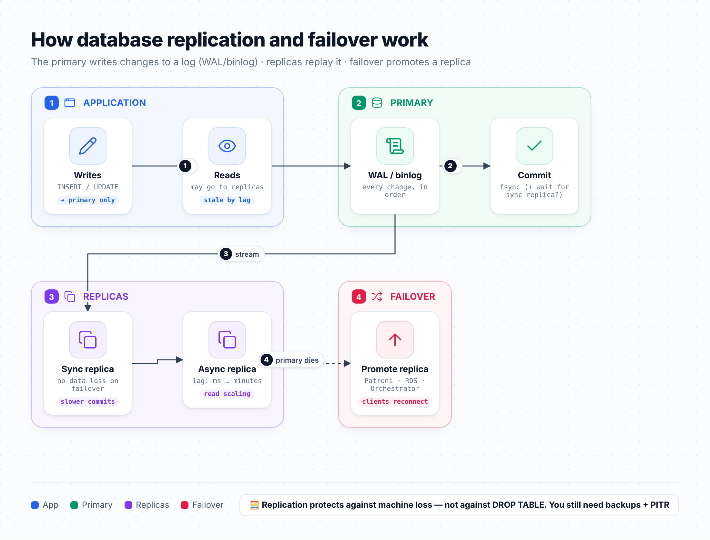
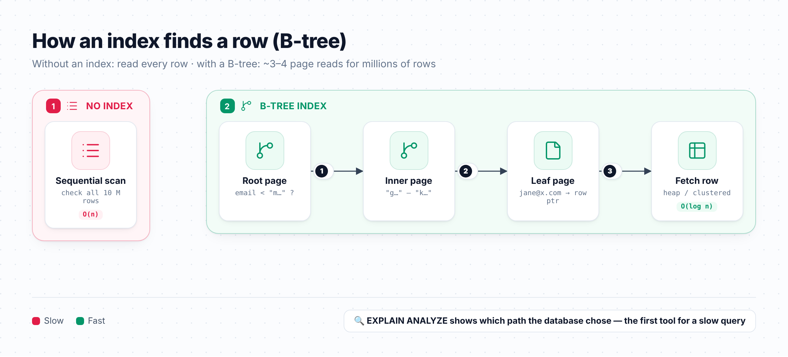

# 7.3 — Veritabanları: depolama, transaction'lar ve replikasyon

!!! abstract "Tek cümlede"
    Bir veritabanı veriyi diskte **sayfalarda** tutar, satırları **indekslerle** (genelde **B-tree**) hızla bulur, her
    değişikliği önce bir **write-ahead log'a (WAL)** yazarak kalıcı yapar, eşzamanlı **transaction**'ları **MVCC** ve
    kilitlerle izole eder, o log'u diğer sunuculara **replike ederek** ölçeklenir ve hatalardan sağ çıkar; yine de
    **yedeğe** ihtiyacın var, çünkü replikasyon hataları da kopyalar.

## 📖 Temel terimler ve kısaltmalar

| Terim | Açılımı | Nedir | Nasıl çalışır (tek satır) |
|---|---|---|---|
| **RDBMS / SQL** | Relational DB Management System / Structured Query Language | Tablolar + ilişkiler + sorgular | PostgreSQL, MySQL, SQL Server, Oracle |
| **Sayfa** | Page | Depolama birimi (Postgres 8 KB, InnoDB 16 KB) | Buffer pool'da önbelleğe alınır |
| **İndeks (B-tree)** | Index | Hızlı arama için sıralı ağaç | Tam tarama yerine O(log n) sayfa okuma |
| **WAL / redo log / binlog** | Write-Ahead Log | Değişikliklerin sadece eklenen logu | Veri sayfalarından önce yazılır + fsync edilir |
| **Transaction** | — | Birlikte başarılı ya da başarısız olan değişiklikler grubu | `BEGIN … COMMIT / ROLLBACK` |
| **ACID** | Atomicity, Consistency, Isolation, Durability | Transaction garantileri | Ya hep ya hiç, kurallar korunur, karışma yok, çökmeden sağ çıkar |
| **İzolasyon seviyesi** | Isolation level | Eşzamanlı transaction'ların birbirini ne kadar gördüğü | Read committed, repeatable read, serializable |
| **MVCC** | Multi-Version Concurrency Control | Okuyanlar snapshot görür, yazanlar yeni sürüm oluşturur | Okuyanlar yazanları bloklamaz |
| **Deadlock** | — | İki transaction birbirini bekler | DB birini öldürür |
| **Sorgu planı / EXPLAIN** | Query plan | DB'nin bir sorguyu nasıl çalıştıracağı | Index scan ya da seq scan, join'ler |
| **Bağlantı havuzu** | Connection pool | DB bağlantılarını yeniden kullanmak | PgBouncer, HikariCP, RDS Proxy |
| **Replikasyon (senkron / asenkron)** | — | WAL'ı replikalara kopyalamak | Kalıcılık ve gecikme ödünleşimi |
| **PITR** | Point-In-Time Recovery | Herhangi bir saniyeye geri dön | Temel yedek + arşivlenmiş WAL |
| **Sharding** | — | Veriyi anahtara göre veritabanlarına bölmek | Yatay yazma ölçekleme |
| **RPO / RTO** | Recovery Point / Time Objective | Azami veri kaybı / azami kesinti | Yedek ve HA tasarımını belirler |

## 🗺️ Büyük resim



---

## 1 · Depolama ve indeksler



- Tablolar sabit boyutlu **sayfalarda** yaşar; sıcak sayfalar veritabanının kendi önbelleği olan **buffer pool**'da (shared_buffers / innodb_buffer_pool_size) tutulur.
- İndeks olmadan `WHERE email = …` her sayfayı okur (**sıralı tarama**). Bir **B-tree indeksi** anahtarları sığ bir ağaçta sıralı tutar: milyonlarca satır arasından birini ~3–4 sayfa okumayla bulur.
- İndekslerin bedeli var: her yazma her indeksi günceller, bellek/disk kullanırlar. Filtrelediğin, join yaptığın ve sıraladığın şeyleri indeksle; `EXPLAIN ANALYZE` ile kontrol et.
- **Bileşik indeksler** soldan sağa sırayı izler: `(tenant_id, created_at)` üzerindeki bir indeks `WHERE tenant_id = ? ORDER BY created_at`'e yardım eder, tek başına `WHERE created_at > ?`'e değil.

## 2 · Transaction'lar, WAL ve kalıcılık

### Bir commit nasıl çalışır?

1. Değişiklikler bellekteki sayfalarda yapılır ve **WAL kayıtlarında** tarif edilir.
2. `COMMIT`'te WAL diske **fsync** edilir (6.3/3.4: yavaş kısım bu). Artık transaction kalıcıdır.
3. Kirli veri sayfaları diske sonra yazılır (checkpoint'ler). Bir çökmeden sonra DB kurtarmak için **WAL'ı yeniden oynatır**.

Commit hızını **disk fsync gecikmesinin** sınırlaması ve yazmaları tek transaction'da gruplamanın binlerce autocommit'ten çok daha hızlı olması bu yüzden.

## 3 · İzolasyon ve MVCC

| Seviye | Önlediği | Varsayılan olduğu yer |
|---|---|---|
| Read committed | Kirli okumalar | PostgreSQL, SQL Server, Oracle |
| Repeatable read | + tekrarlanamayan okumalar (snapshot) | MySQL InnoDB |
| Serializable | + tüm anomaliler (sanki teker teker) | İsteğe bağlı; serileştirme hatasıyla iptal olabilir → yeniden dene |

**MVCC**: bir update yeni bir satır sürümü yazar; okuyanlar kendi snapshot'larındaki sürümü görmeye devam eder. Eski sürümler temizlenmeli (Postgres'te **VACUUM**, InnoDB'de purge). **Uzun süren transaction'lar** temizliği bloklar → tablo şişmesi ve yavaşlamalar; onları izle.

## 4 · Replikasyon, failover ve yedekler

- **Asenkron replikasyon**: commit'ler replikaları beklemez → hızlı, ama bir failover son saniyeleri kaybettirebilir (RPO > 0). Replikalar geride kalır; onlardan okumak eski olabilir.
- **Senkron replikasyon**: commit en az bir replikayı bekler → kayıp yok, daha yüksek gecikme.
- **Failover**: bir replikayı terfi ettir (Patroni, RDS Multi-AZ, Aurora, Orchestrator) ve endpoint'i/DNS'i taşı; uygulamalar yeniden bağlanıp yeniden denemeli.
- **Yedekler**: replikasyon `DROP TABLE`'ı anında kopyalar. **PITR** için **temel yedekler + WAL arşivleme** tut ve **geri yüklemeleri** düzenli **test et**. Önce RPO/RTO'yu tanımla.

## 5 · Ölçekleme ve seçim

- **Önce dikey** (daha büyük instance, daha iyi indeksler, daha az sorgu), sonra **okuma replikaları**, **önbellek** (7.2), **bölümleme** (zamana göre) ve en son kiracı/kullanıcıya göre **sharding** (Citus, Vitess, uygulama düzeyi) ya da dağıtık bir SQL DB (CockroachDB, Spanner, YugabyteDB, TiDB).
- Erişim deseni uyunca **NoSQL**: anahtar-değer (DynamoDB, Redis), doküman (MongoDB), geniş sütun (Cassandra), arama (OpenSearch), zaman serisi (Prometheus, TimescaleDB), vektör (pgvector, 10.7). Genelde ölçek ya da esneklik için join/transaction'lardan vazgeçersin.
- **Bağlantılar pahalıdır** (Postgres: her biri bir process). Yüzlerce pod × havuz boyutu `max_connections`'ı tüketebilir → **PgBouncer**/RDS Proxy ve küçük uygulama havuzları kullan.

## 🔧 DevOps bağlantısı

- **Kubernetes'te veritabanları**: operator'lerle (CloudNativePG, Percona, Zalando), yerel ya da blok PV'ler, anti-affinity, PodDisruptionBudget'larla mümkün; ama yönetilen servisler (RDS, Cloud SQL, Aurora) operasyonel riskin çoğunu kaldırır.
- **CI/CD'de migration'lar**: geriye uyumlu şema değişiklikleri (genişlet → taşı → daralt), çevrimiçi indeks oluşturma (`CREATE INDEX CONCURRENTLY`), kilit zaman aşımları.
- **Temel metrikler**: bağlantılar, replikasyon lag'i, transaction hızı, önbellek isabet oranı, yavaş sorgular (`pg_stat_statements`), kilitler/deadlock'lar, disk IOPS ve fsync gecikmesi, depolama büyümesi.

## 🧪 Kendin dene

```bash
docker run -d --rm --name pg -e POSTGRES_PASSWORD=pw -p 5432:5432 postgres:17
sleep 5; P="docker exec -i pg psql -U postgres -q"
$P -c "CREATE TABLE users(id serial primary key, email text, created_at timestamptz default now());"
$P -c "INSERT INTO users(email) SELECT 'u'||g||'@x.com' FROM generate_series(1,1000000) g;"
$P -c "EXPLAIN ANALYZE SELECT * FROM users WHERE email='u777777@x.com';"   # Seq Scan
$P -c "CREATE INDEX ON users(email);"
$P -c "EXPLAIN ANALYZE SELECT * FROM users WHERE email='u777777@x.com';"   # Index Scan, ~1000x hızlı
$P -c "SHOW transaction_isolation; SHOW shared_buffers; SELECT pg_current_wal_lsn();"
docker stop pg
```

## 🃏 Hatırlatma kartı

| Belirti | Nereye bak |
|---|---|
| Yavaş sorgu | `EXPLAIN ANALYZE`, eksik indeks, `pg_stat_statements` |
| Yavaş commit'ler | fsync gecikmesi, disk IOPS limitleri, çok sayıda minik transaction |
| `too many connections` | Havuzlama (PgBouncer), daha küçük uygulama havuzları |
| Eski okumalar | Replika lag'i; kendi yazdığını primary'den oku |
| Tablo şişmesi | VACUUM'u bloklayan uzun transaction'lar |
| Yanlışlıkla silinen veri | PITR geri yükleme (replikalar yardım etmez) |

## ❓ Kendini test et

??? question "1. WAL neden veri sayfalarından önce yazılır?"
    Commit edilmiş bir transaction çökme sonrası log yeniden oynatılarak her zaman kurtarılabilsin, veri sayfaları da tembelce flush edilebilsin diye.

??? question "2. Replikasyon neden yedeklerin yerini tutmaz?"
    Hatalar ve kötü niyetli silmeler dahil her değişikliği saniyeler içinde replikalara kopyalar; geri dönmek için zaman noktası yedeklerine ihtiyacın var.

??? question "3. Bir sorgu `created_at`'e göre filtreliyor ama tek indeks `(tenant_id, created_at)` üzerinde. Verimli kullanılır mı?"
    Genelde hayır: B-tree bileşik indeksleri soldan sağa kullanılır; filtrede `tenant_id` yoksa verimli arama yapamaz.

??? question "4. Senkron ve asenkron replikasyon arasındaki ödünleşim ne?"
    Senkron: failover'da veri kaybı yok ama daha yüksek commit gecikmesi ve erişilebilirlik bağımlılığı. Asenkron: hızlı commit'ler ama son transaction'ların olası kaybı ve eski replika okumaları.

??? question "5. Uygulamanı 10'dan 100 pod'a çıkardın ve Postgres bağlantı reddetmeye başladı. Neden, çözüm ne?"
    Her pod'un havuzu N bağlantı açar; toplam max_connections'ı aşar. Bir bağlantı havuzlayıcı (PgBouncer/RDS Proxy) ve pod başına daha küçük havuzlar kullan.

---

## 📚 Kaynaklar

- [PostgreSQL docs — WAL, MVCC, Indexes](https://www.postgresql.org/docs/current/)
- [Use The Index, Luke!](https://use-the-index-luke.com/)
- [Martin Kleppmann — Designing Data-Intensive Applications](https://dataintensive.net/)
- [CloudNativePG](https://cloudnative-pg.io/)

## ✍️ Notlarım

> Ana veritabanın için: RPO ve RTO ne, son geri yükleme testi ne zamandı ve şu an replikasyon lag'i ne?

-
