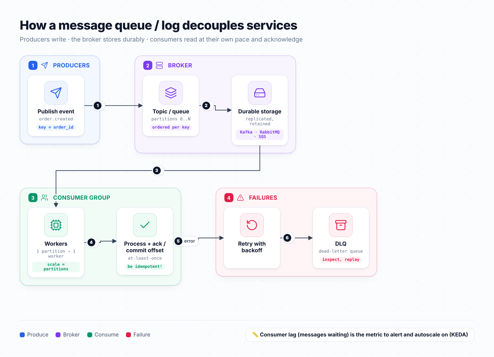
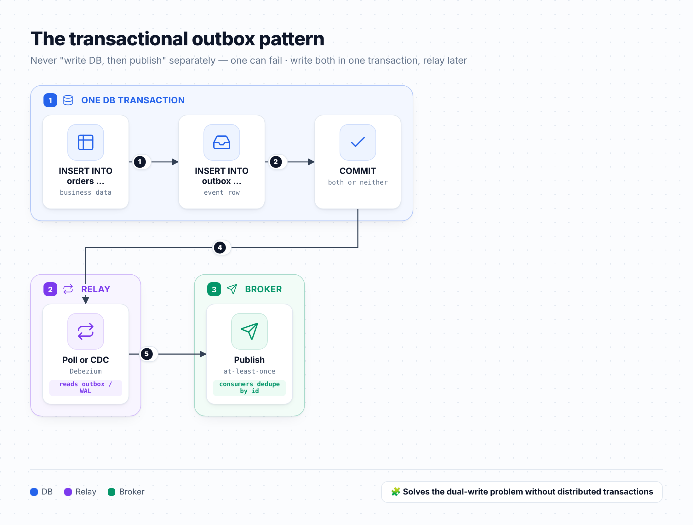

# 7.4 — Queues, streams & event-driven systems

!!! abstract "In short"
    A **message broker** sits between services so a producer can hand off work or announce an **event** and move on,
    while consumers process it later at their own pace. **Queues** (RabbitMQ, SQS) delete messages once handled,
    **logs** (Kafka, Kinesis) keep them for replay, delivery is almost always **at-least-once** — so consumers must be
    **idempotent** — and failures go to **retries** and a **dead-letter queue** instead of being lost.

## 📖 Key terms & abbreviations

| Term | Stands for | What it is | How it works (one line) |
|---|---|---|---|
| **Broker** | — | Server storing and delivering messages | Kafka, RabbitMQ, SQS, Pub/Sub, NATS |
| **Producer / consumer** | — | Writes / reads messages | Decoupled in time and scale |
| **Queue** | — | Each message handled by one consumer, then removed | Work distribution |
| **Log / stream** | — | Append-only, retained, replayable | Many consumer groups read independently |
| **Topic / partition** | — | Named stream / ordered shard of it | Order is guaranteed only within a partition |
| **Consumer group** | — | Consumers sharing a topic's partitions | Max parallelism = number of partitions |
| **Offset / ack** | acknowledgement | Position read / "done with this message" | Commit after processing |
| **At-most / at-least / exactly-once** | — | Delivery guarantees | At-least-once + idempotency is the practical default |
| **Idempotency** | — | Processing twice has the same effect as once | Dedupe by message id, upserts |
| **DLQ** | Dead-Letter Queue | Where poison messages go | Inspect and replay later |
| **Backpressure** | — | Slowing producers when consumers can't keep up | Bounded queues, rate limits |
| **Outbox / CDC** | — / Change Data Capture | Reliable "DB write + event" | Event row in same transaction, relayed later |
| **Saga** | — | Multi-step business process across services | Each step has a compensating action |
| **Consumer lag** | — | Messages waiting to be processed | Key metric; drives autoscaling (KEDA) |

## 🗺️ Big picture



---

## 1 · Why put a queue in between?

- **Absorb spikes**: 10,000 orders arrive in a minute, workers process 500/s steadily.
- **Decouple**: the checkout service doesn't need email, invoicing and analytics to be up.
- **Retry safely**: a failed job goes back instead of failing the user's request.
- **Fan-out**: one `order.created` event feeds many independent consumers.

The cost: **eventual consistency** (things happen "soon", not now), harder debugging (trace across async hops), and new failure modes.

## 2 · Queue vs log

| | Queue (RabbitMQ, SQS) | Log (Kafka, Kinesis, Pulsar, Redpanda) |
|---|---|---|
| After consumption | Message deleted | Message kept (retention: hours…forever) |
| Readers | Competing consumers | Many independent consumer groups, each with its own offset |
| Replay | No | Yes: reset offsets, rebuild state |
| Ordering | Per queue (FIFO variants) | Per partition (by key) |
| Strengths | Task distribution, routing, per-message ack, delays | Event streaming, high throughput, event sourcing, CDC |

## 3 · Delivery guarantees and idempotency

### How does at-least-once work?

1. Consumer reads a message, processes it, **then** acks/commits the offset.
2. If it crashes after processing but before the ack, the message is delivered **again**.
3. So the handler must be **idempotent**: store processed message IDs, use upserts (`INSERT … ON CONFLICT DO NOTHING`), or design operations that are naturally repeatable ("set status = paid", not "add 10 €").

"Exactly-once" exists only inside specific systems (Kafka transactions between topics); across a DB, an email and a payment API, it's **at-least-once + idempotency**.

## 4 · Retries, DLQs and ordering

- Retry transient errors with **exponential backoff** (delay queues, retry topics); don't hot-loop.
- After N attempts move the message to a **DLQ** and alert; one bad message must not block the whole partition (**poison pill**).
- Need order per customer? Use the customer ID as the **partition key**; you get order per key, not globally.
- **More consumers than partitions sit idle** — plan partition counts for future parallelism.

## 5 · Reliable events from a database: outbox and CDC



"Save the order, then publish `order.created`" fails if the app dies between the two steps (or the publish fails). The **outbox**: write the event to an `outbox` table **in the same transaction**; a relay (polling or **CDC** with Debezium reading the WAL, 7.3) publishes it. Consumers dedupe by event ID.

**Sagas** coordinate multi-service workflows (reserve stock → charge card → ship) with compensating steps (release stock, refund) instead of distributed transactions.

## 🔧 DevOps connection

- **Autoscale consumers on lag**, not CPU: **KEDA** scalers for Kafka, SQS, RabbitMQ, Redis Streams, Pub/Sub (scale to zero when idle).
- **Alert on**: consumer lag growing, DLQ size > 0, oldest message age, broker disk usage and under-replicated partitions (Kafka).
- **Run Kafka on Kubernetes** with **Strimzi** (operator) or use managed (MSK, Confluent Cloud, Event Hubs); KRaft mode replaced ZooKeeper.
- **Graceful shutdown for consumers**: stop fetching, finish in-flight messages, commit, then exit (3.1); otherwise every deploy causes redeliveries.

## 🧪 Try it yourself

```bash
# RabbitMQ with the management UI on http://localhost:15672 (guest/guest)
docker run -d --rm --name rmq -p 5672:5672 -p 15672:15672 rabbitmq:4-management

# Kafka (KRaft, single node) and its CLI
docker run -d --rm --name kafka -p 9092:9092 apache/kafka:latest
sleep 15; K="docker exec -i kafka /opt/kafka/bin"
$K/kafka-topics.sh --bootstrap-server localhost:9092 --create --topic orders --partitions 3
printf 'cust1:order-1\ncust2:order-2\ncust1:order-3\n' | \
  $K/kafka-console-producer.sh --bootstrap-server localhost:9092 --topic orders --property parse.key=true --property key.separator=:
$K/kafka-console-consumer.sh --bootstrap-server localhost:9092 --topic orders --from-beginning \
  --group billing --property print.key=true --property print.partition=true --timeout-ms 5000
$K/kafka-consumer-groups.sh --bootstrap-server localhost:9092 --describe --group billing   # offsets + LAG
docker stop kafka rmq
```

## 🃏 Cheat sheet

| Need | Use |
|---|---|
| Background jobs | Queue (SQS, RabbitMQ) + workers |
| Many consumers, replay, high volume | Log (Kafka) |
| Order per entity | Partition key = entity id |
| Survive duplicates | Idempotent handlers (dedupe ids, upserts) |
| DB write + event | Outbox / CDC |
| Poison message | Retries with backoff → DLQ |
| Scale workers | KEDA on lag |

## ❓ Test yourself

??? question "1. Why must consumers be idempotent?"
    With at-least-once delivery, a crash between processing and ack causes redelivery; the handler must produce the same result twice.

??? question "2. You have a topic with 6 partitions and scale consumers to 10. What happens?"
    Only 6 consumers get partitions; 4 sit idle. Parallelism is capped by the partition count.

??? question "3. What's the problem with 'write to DB, then publish to Kafka' in application code?"
    The two aren't atomic: a crash or publish failure after the commit loses the event (or the reverse order publishes events for data that was rolled back). Use an outbox/CDC.

??? question "4. What does a growing consumer lag tell you, and what do you do?"
    Consumers process slower than producers write. Scale consumers (up to partitions), fix slow handlers, or add partitions.

??? question "5. Queue or log for 'replay the last 7 days of events into a new analytics service'?"
    A log (Kafka) with ≥ 7 days retention; a queue deletes messages once consumed.

---

## 📚 Sources

- [Apache Kafka documentation](https://kafka.apache.org/documentation/)
- [RabbitMQ — Reliability guide](https://www.rabbitmq.com/docs/reliability)
- [microservices.io — Transactional outbox](https://microservices.io/patterns/data/transactional-outbox.html) · [Saga](https://microservices.io/patterns/data/saga.html)
- [KEDA scalers](https://keda.sh/docs/latest/scalers/) · [Strimzi](https://strimzi.io/)

## ✍️ My notes

> For one async flow you own: what's the delivery guarantee, how are duplicates handled, where do failed messages go, and who gets alerted?
