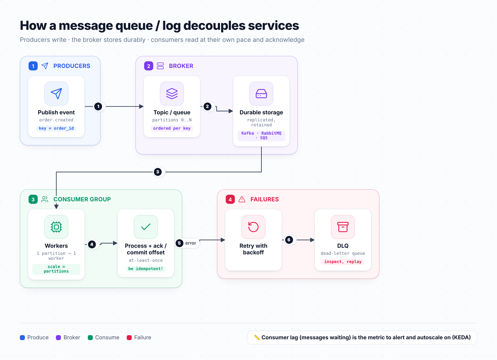
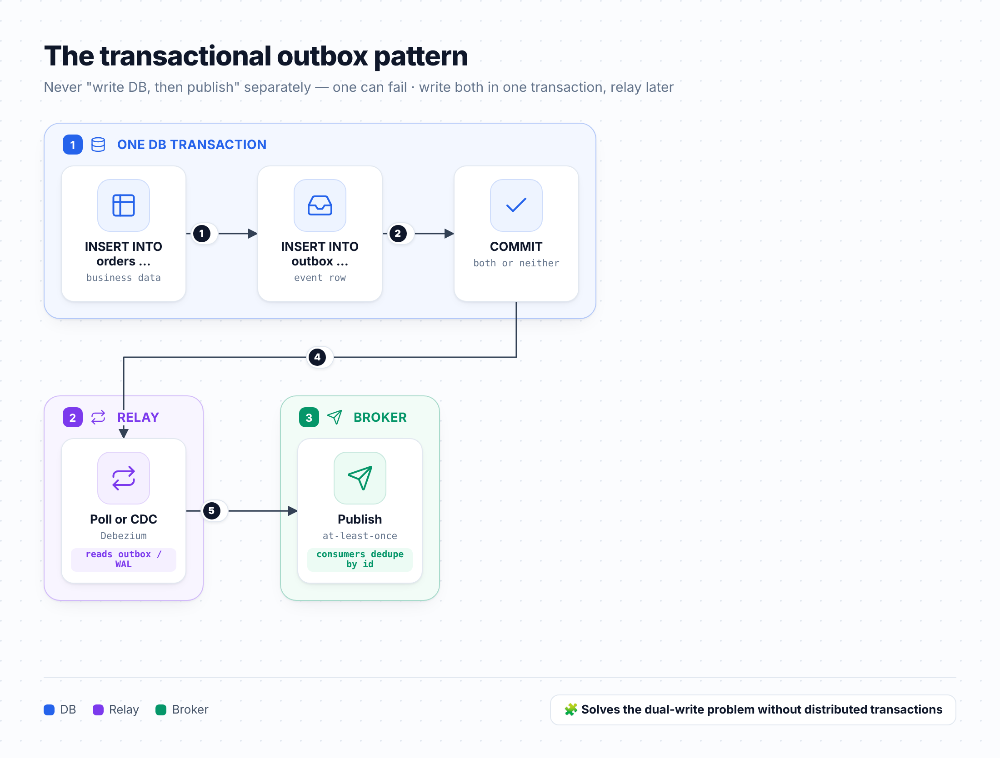

# 7.4 — Kuyruklar, stream'ler ve olay güdümlü sistemler

!!! abstract "Tek cümlede"
    Bir **mesaj broker'ı** servislerin arasına oturur; üretici işi devredip ya da bir **olay** duyurup yoluna devam eder,
    tüketiciler de onu sonra kendi hızlarında işler. **Kuyruklar** (RabbitMQ, SQS) işlenen mesajı siler, **log'lar**
    (Kafka, Kinesis) yeniden oynatmak için saklar. Teslim neredeyse her zaman **en az bir kezdir**, bu yüzden
    tüketiciler **idempotent** olmalıdır; hatalar kaybolmak yerine **yeniden denemelere** ve bir **dead-letter kuyruğuna** gider.

## 📖 Temel terimler ve kısaltmalar

| Terim | Açılımı | Nedir | Nasıl çalışır (tek satır) |
|---|---|---|---|
| **Broker** | — | Mesajları saklayan ve ileten sunucu | Kafka, RabbitMQ, SQS, Pub/Sub, NATS |
| **Üretici / tüketici** | Producer / consumer | Mesaj yazar / okur | Zamanda ve ölçekte ayrışmış |
| **Kuyruk** | Queue | Her mesajı tek tüketici işler, sonra silinir | İş dağıtımı |
| **Log / stream** | — | Sadece eklenen, saklanan, yeniden oynatılabilir | Çok sayıda tüketici grubu bağımsız okur |
| **Topic / partition** | — | İsimli stream / onun sıralı bir parçası | Sıra sadece bir partition içinde garanti |
| **Tüketici grubu** | Consumer group | Bir topic'in partition'larını paylaşan tüketiciler | Azami paralellik = partition sayısı |
| **Offset / ack** | acknowledgement | Okunan konum / "bu mesajla işim bitti" | İşledikten sonra commit et |
| **En fazla / en az / tam bir kez** | At-most / at-least / exactly-once | Teslim garantileri | Pratik varsayılan: en az bir kez + idempotency |
| **Idempotency** | — | İki kez işlemek bir kez işlemekle aynı etkiye sahip | Mesaj kimliğine göre ayıkla, upsert |
| **DLQ** | Dead-Letter Queue | Zehirli mesajların gittiği yer | Sonra incele ve yeniden oynat |
| **Geri basınç** | Backpressure | Tüketiciler yetişemeyince üreticileri yavaşlatmak | Sınırlı kuyruklar, hız sınırları |
| **Outbox / CDC** | — / Change Data Capture | Güvenilir "DB yazma + olay" | Olay satırı aynı transaction'da, sonra aktarılır |
| **Saga** | — | Servisler arası çok adımlı iş süreci | Her adımın telafi eden bir eylemi var |
| **Tüketici gecikmesi** | Consumer lag | İşlenmeyi bekleyen mesajlar | Ana metrik; otomatik ölçeklemeyi sürer (KEDA) |

## 🗺️ Büyük resim



---

## 1 · Araya neden kuyruk konur?

- **Ani yükleri emmek**: bir dakikada 10.000 sipariş gelir, worker'lar saniyede 500'ü sabit işler.
- **Ayrıştırmak**: ödeme servisinin e-posta, fatura ve analitiğin ayakta olmasına ihtiyacı yok.
- **Güvenle yeniden denemek**: başarısız bir iş kullanıcının isteğini düşürmek yerine geri döner.
- **Yayma (fan-out)**: tek bir `order.created` olayı çok sayıda bağımsız tüketiciyi besler.

Bedeli: **nihai tutarlılık** (işler şimdi değil "yakında" olur), daha zor hata ayıklama (asenkron duraklar boyunca trace) ve yeni hata modları.

## 2 · Kuyruk ve log

| | Kuyruk (RabbitMQ, SQS) | Log (Kafka, Kinesis, Pulsar, Redpanda) |
|---|---|---|
| Tüketimden sonra | Mesaj silinir | Mesaj kalır (saklama: saatler…sonsuza dek) |
| Okuyanlar | Yarışan tüketiciler | Her biri kendi offset'iyle çok sayıda bağımsız tüketici grubu |
| Yeniden oynatma | Yok | Var: offset'leri sıfırla, durumu yeniden kur |
| Sıralama | Kuyruk başına (FIFO varyantları) | Partition başına (anahtara göre) |
| Güçlü yanları | İş dağıtımı, yönlendirme, mesaj başı ack, gecikmeler | Olay akışı, yüksek throughput, event sourcing, CDC |

## 3 · Teslim garantileri ve idempotency

### En az bir kez nasıl çalışır?

1. Tüketici bir mesajı okur, işler, **sonra** ack'ler/offset'i commit eder.
2. İşledikten sonra ama ack'ten önce çökerse mesaj **tekrar** teslim edilir.
3. Bu yüzden handler **idempotent** olmalı: işlenen mesaj kimliklerini sakla, upsert kullan (`INSERT … ON CONFLICT DO NOTHING`) ya da doğal olarak tekrarlanabilir işlemler tasarla ("10 € ekle" değil, "durum = ödendi").

"Tam bir kez" sadece belirli sistemlerin içinde vardır (topic'ler arası Kafka transaction'ları); bir DB, bir e-posta ve bir ödeme API'si arasında **en az bir kez + idempotency**'dir.

## 4 · Yeniden denemeler, DLQ'lar ve sıralama

- Geçici hataları **üstel backoff** ile yeniden dene (gecikme kuyrukları, retry topic'leri); sıkışık döngüye girme.
- N denemeden sonra mesajı bir **DLQ**'ya taşı ve alarm ver; kötü bir mesaj tüm partition'ı bloklamamalı (**zehirli hap**).
- Müşteri başına sıra mı lazım? Müşteri kimliğini **partition anahtarı** yap; global değil anahtar başına sıra alırsın.
- **Partition'dan fazla tüketici boşta oturur**; partition sayılarını gelecekteki paralelliğe göre planla.

## 5 · Bir veritabanından güvenilir olaylar: outbox ve CDC



"Siparişi kaydet, sonra `order.created` yayınla", uygulama iki adım arasında ölürse (ya da yayınlama başarısız olursa) bozulur. **Outbox**: olayı **aynı transaction'da** bir `outbox` tablosuna yaz; bir aktarıcı (polling ya da WAL'ı okuyan Debezium ile **CDC**, 7.3) onu yayınlar. Tüketiciler olay kimliğine göre ayıklar.

**Saga**'lar çok servisli iş akışlarını (stok ayır → karttan çek → kargola) dağıtık transaction'lar yerine telafi adımlarıyla (stoku bırak, iade et) koordine eder.

## 🔧 DevOps bağlantısı

- **Tüketicileri CPU'ya göre değil gecikmeye göre otomatik ölçekle**: Kafka, SQS, RabbitMQ, Redis Streams, Pub/Sub için **KEDA** scaler'ları (boştayken sıfıra ölçekle).
- **Alarm kur**: büyüyen tüketici gecikmesi, DLQ boyutu > 0, en eski mesajın yaşı, broker disk kullanımı ve az replike edilmiş partition'lar (Kafka).
- **Kafka'yı Kubernetes'te** **Strimzi** (operator) ile çalıştır ya da yönetileni kullan (MSK, Confluent Cloud, Event Hubs); ZooKeeper'ın yerini KRaft modu aldı.
- **Tüketiciler için düzgün kapanış**: almayı bırak, işlemdeki mesajları bitir, commit et, sonra çık (3.1); yoksa her deploy yeniden teslimlere yol açar.

## 🧪 Kendin dene

```bash
# http://localhost:15672'de yönetim arayüzüyle RabbitMQ (guest/guest)
docker run -d --rm --name rmq -p 5672:5672 -p 15672:15672 rabbitmq:4-management

# Kafka (KRaft, tek node) ve CLI'ı
docker run -d --rm --name kafka -p 9092:9092 apache/kafka:latest
sleep 15; K="docker exec -i kafka /opt/kafka/bin"
$K/kafka-topics.sh --bootstrap-server localhost:9092 --create --topic orders --partitions 3
printf 'cust1:order-1\ncust2:order-2\ncust1:order-3\n' | \
  $K/kafka-console-producer.sh --bootstrap-server localhost:9092 --topic orders --property parse.key=true --property key.separator=:
$K/kafka-console-consumer.sh --bootstrap-server localhost:9092 --topic orders --from-beginning \
  --group billing --property print.key=true --property print.partition=true --timeout-ms 5000
$K/kafka-consumer-groups.sh --bootstrap-server localhost:9092 --describe --group billing   # offset'ler + LAG
docker stop kafka rmq
```

## 🃏 Hatırlatma kartı

| İhtiyaç | Kullan |
|---|---|
| Arka plan işleri | Kuyruk (SQS, RabbitMQ) + worker'lar |
| Çok tüketici, yeniden oynatma, yüksek hacim | Log (Kafka) |
| Varlık başına sıra | Partition anahtarı = varlık kimliği |
| Tekrarlardan sağ çık | Idempotent handler'lar (kimlik ayıklama, upsert) |
| DB yazma + olay | Outbox / CDC |
| Zehirli mesaj | Backoff'lu yeniden denemeler → DLQ |
| Worker'ları ölçekle | Gecikmeye göre KEDA |

## ❓ Kendini test et

??? question "1. Tüketiciler neden idempotent olmalı?"
    En az bir kez teslimde işleme ile ack arasındaki bir çökme yeniden teslime yol açar; handler iki kez aynı sonucu üretmeli.

??? question "2. 6 partition'lı bir topic'in var ve tüketicileri 10'a çıkarıyorsun. Ne olur?"
    Sadece 6 tüketici partition alır; 4'ü boşta oturur. Paralelliği partition sayısı sınırlar.

??? question "3. Uygulama kodunda 'DB'ye yaz, sonra Kafka'ya yayınla' yapmanın sorunu ne?"
    İkisi atomik değil: commit'ten sonraki bir çökme ya da yayınlama hatası olayı kaybettirir (ya da ters sırada geri alınmış veri için olay yayınlanır). Outbox/CDC kullan.

??? question "4. Büyüyen tüketici gecikmesi sana ne söyler, ne yaparsın?"
    Tüketiciler üreticilerin yazdığından yavaş işliyor. Tüketicileri ölçekle (partition sayısına kadar), yavaş handler'ları düzelt ya da partition ekle.

??? question "5. 'Son 7 günün olaylarını yeni bir analitik servisine yeniden oynat' için kuyruk mu log mu?"
    ≥ 7 gün saklamalı bir log (Kafka); kuyruk tüketilince mesajları siler.

---

## 📚 Kaynaklar

- [Apache Kafka documentation](https://kafka.apache.org/documentation/)
- [RabbitMQ — Reliability guide](https://www.rabbitmq.com/docs/reliability)
- [microservices.io — Transactional outbox](https://microservices.io/patterns/data/transactional-outbox.html) · [Saga](https://microservices.io/patterns/data/saga.html)
- [KEDA scalers](https://keda.sh/docs/latest/scalers/) · [Strimzi](https://strimzi.io/)

## ✍️ Notlarım

> Sahip olduğun bir asenkron akış için: teslim garantisi ne, tekrarlar nasıl ele alınıyor, başarısız mesajlar nereye gidiyor ve kime alarm gidiyor?

-
