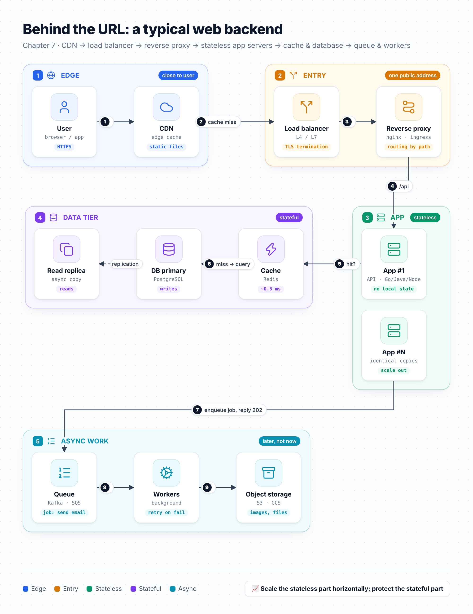
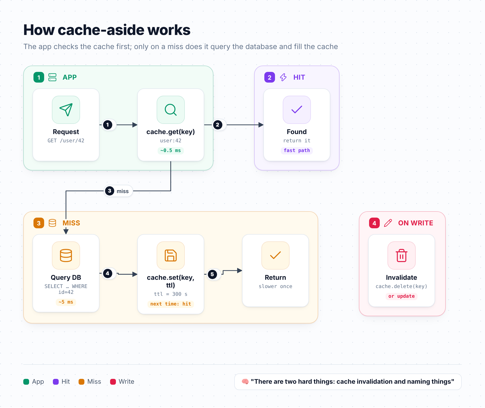

# Chapter 7 — Server side

!!! abstract "In one sentence"
    A request is first answered by a **CDN** if it can be. Otherwise it reaches a **load balancer**, which spreads it across
    identical, **stateless app servers** behind a **reverse proxy**. The app reads from a **cache**, falls back to the
    **database**, and pushes slow work to a **queue** for **workers**. You scale the stateless part by adding copies
    and protect the stateful part (data) carefully.

## 📖 Key terms & abbreviations

| Term | Stands for | What it is | How it works (one line) |
|---|---|---|---|
| **CDN** | Content Delivery Network | Servers near users caching content | Serves cached responses from the closest edge |
| **LB** | Load Balancer | Spreads traffic over backends | L4 by connection, L7 by HTTP request; health checks |
| **L4 / L7** | Layer 4 / Layer 7 | Transport-level vs application-level | L4 sees IP:port, L7 sees host, path, headers |
| **Reverse proxy / ingress** | — | Front server routing requests to services | Routes by host/path, terminates TLS, adds headers |
| **Stateless / stateful** | — | Keeps nothing between requests / keeps data | Stateless scales by copies; stateful needs care |
| **Horizontal / vertical scaling** | — | More machines / bigger machine | Horizontal needs stateless apps and a load balancer |
| **Cache-aside** | — | App-managed caching pattern | Check cache → on miss read DB → fill cache |
| **Primary / replica** | — | Write node / read copies of a database | Replication copies changes, usually asynchronously |
| **Replication lag** | — | Delay before replicas see a write | Read-after-write may return old data |
| **Queue / worker** | — | Buffer of jobs / process consuming them | At-least-once delivery → idempotent jobs, DLQ for failures |
| **Idempotent** | — | Safe to run twice with the same result | Use idempotency keys for payments and jobs |
| **Object storage** | — | Store for files/blobs (S3, GCS) | Flat namespace, HTTP API, presigned URLs |
| **Circuit breaker** | — | Stops calling a failing dependency for a while | Fail fast instead of piling up timeouts |

## 🗺️ Big picture



---

## 1 · Edge: CDN

| What | Why |
|---|---|
| A network of servers in hundreds of cities (Cloudflare, CloudFront, Fastly, Akamai) | The closest server is a few ms away instead of 50–150 ms (Chapter 6: round trips!) |
| Caches **static files** (JS, CSS, images, video) and sometimes API responses | The origin never sees most traffic |
| Terminates TLS close to the user, absorbs DDoS, can run small edge functions | Faster handshakes, protection |

Caching is controlled with HTTP headers like `Cache-Control: max-age=3600`. A response header such as `cf-cache-status: HIT` or `x-cache: Hit from cloudfront` tells you the CDN answered.

## 2 · Entry: load balancer and reverse proxy

| Component | Layer | Job |
|---|---|---|
| **Load balancer** (AWS ALB/NLB, GCP LB, HAProxy) | **L4** (TCP: forwards connections) or **L7** (HTTP: reads the request) | One public address. Spreads traffic over healthy backends (round robin, least connections). Runs **health checks**. Often **terminates TLS**. |
| **Reverse proxy / ingress** (nginx, Envoy, Traefik, Kubernetes Ingress / Gateway API) | L7 | Routes by **host** and **path** (`/api` → API service, `/` → frontend). Adds headers like `X-Forwarded-For` (the real client IP), compression, rate limits, timeouts. |

## 3 · App tier: stateless servers

- **Stateless** means a server keeps **nothing** between requests that it alone knows: no sessions in memory, no files on local disk. Sessions live in Redis or in a signed token (JWT). Files go to object storage.
- That makes every copy **identical and disposable**, so you can scale **horizontally** (add more copies) and kill any copy at any time. That's exactly what Kubernetes and autoscalers do.
- **Vertical** scaling (a bigger machine) is simpler but has a ceiling and a single point of failure.

## 4 · Data tier: cache and database

**Cache-aside** pattern (the most common):

```text
value = cache.get(key)
if value is None:                 # miss
    value = db.query(...)
    cache.set(key, value, ttl=300)
return value
```

| Component | Typical latency (same datacenter) | Notes |
|---|---|---|
| Redis / Memcached | ~0.2–1 ms | In memory. Hard part: **invalidation** (when data changes, delete or update the cache entry). |
| Database query (indexed) | ~1–10 ms | Without an index it's a full table scan, and it gets slower as the table grows. |

**Database scaling**

- **Primary** takes all **writes**. **Read replicas** receive a copy (usually **asynchronous**) and serve reads, so a read right after a write may see old data (**replication lag**).
- **Connection pooling** (PgBouncer, or pools in the app): databases handle hundreds of connections, not tens of thousands.
- **Sharding** (splitting data across several primaries) comes only when one primary can't keep up.

### How does cache-aside work?

The app asks the cache first. On a **hit** it returns immediately. On a **miss** it queries the database, stores the result in the cache with a TTL, and returns. On writes, it deletes (or updates) the cached key so readers don't see stale data for long.



## 5 · Async work: queue, workers, object storage

| Use when | Example |
|---|---|
| The user doesn't need to wait for it | Sending an email, resizing an image, generating a PDF, calling a slow third party |

Flow: the app puts a **job** on the queue and immediately replies `202 Accepted`. **Workers** pick jobs up, retry on failure, and send jobs that keep failing to a **dead-letter queue**. Jobs should be **idempotent** (safe to run twice), because "at least once" delivery means duplicates happen.

**Object storage** (S3, GCS) holds files. Clients often upload and download directly with short-lived **presigned URLs**, so file bytes never pass through your app servers.

## 6 · Keeping it alive

| Practice | Why |
|---|---|
| **Health checks** (liveness / readiness) | The LB or Kubernetes stops sending traffic to broken instances. |
| **Timeouts** on every network call | A slow dependency must not hang all your threads. |
| **Retries with backoff + jitter** | Survive blips without causing a retry storm. |
| **Circuit breakers / rate limits** | Fail fast and protect overloaded dependencies. |
| **Metrics, logs, traces** | You can't fix what you can't see (Chapter 9). |

---

## 🧪 Try it yourself (Docker)

A load balancer in front of two app servers, in 2 minutes:

```bash
mkdir lb-lab && cd lb-lab
cat > nginx.conf <<'EOF'
upstream app { server app1:80; server app2:80; }
server {
  listen 80;
  location / {
    proxy_pass http://app;
    proxy_set_header X-Forwarded-For $proxy_add_x_forwarded_for;
  }
}
EOF
cat > compose.yaml <<'EOF'
services:
  app1: { image: traefik/whoami }
  app2: { image: traefik/whoami }
  lb:
    image: nginx:alpine
    ports: ["8080:80"]
    volumes: ["./nginx.conf:/etc/nginx/conf.d/default.conf:ro"]
EOF
docker compose up -d
for i in 1 2 3 4; do curl -s localhost:8080 | grep Hostname; done   # alternates: round robin
docker compose stop app1 && curl -s localhost:8080 | grep Hostname  # still works
docker compose down
```

```bash
# Is a CDN answering? Look at the cache headers
curl -sI https://www.cloudflare.com | grep -iE "cf-cache-status|age|cache-control"
```

**Exercise:** while the lab is running, stop `app1` and send requests. What does nginx do on the first failed attempt, and how would a health check change that?

---

## 🃏 Cheat sheet

```text
User → CDN (static, cache HIT?) → LB (L4/L7, TLS, health checks) → reverse proxy (host/path routing)
     → stateless app × N (scale out) → cache (hit?) → DB primary (writes) / replicas (reads, lag)
     → slow work: queue → workers (retry, idempotent, DLQ) → object storage (presigned URLs)
Stateless = disposable copies. Stateful = protect it, back it up, scale it carefully.
Always: timeouts, retries with backoff, health checks, observability.
```

---

## ❓ Test yourself

??? question "1. Why should app servers be stateless?"
    So any instance can serve any request and any instance can be added or killed at any time. That enables horizontal scaling, rolling deploys and self-healing.

??? question "2. What's the difference between an L4 and an L7 load balancer?"
    L4 forwards TCP/UDP connections by IP and port without reading the content. L7 understands HTTP, so it can route by host, path or header, terminate TLS and retry individual requests.

??? question "3. A user updates their profile and then immediately sees the old version. What could cause this?"
    Replication lag (the read went to a replica that hasn't caught up yet) or a stale cache entry that wasn't invalidated on write.

??? question "4. Why should queue workers be idempotent?"
    Most queues deliver "at least once", so a job can run twice (e.g. a worker crashes after doing the work but before acknowledging it). Running it twice must not charge a card twice.

??? question "5. Your API calls a payment provider that sometimes takes 30 s. What do you add?"
    A timeout on the call, retries with backoff (only if the call is idempotent), a circuit breaker, and ideally moving it to an async job so the user's request doesn't wait.

---

## 📚 Sources

- [Designing Data-Intensive Applications, Martin Kleppmann](https://dataintensive.net/)
- [The System Design Primer (GitHub)](https://github.com/donnemartin/system-design-primer)
- [nginx: HTTP load balancing](https://nginx.org/en/docs/http/load_balancing.html)
- [AWS Builders' Library: timeouts, retries and backoff with jitter](https://aws.amazon.com/builders-library/timeouts-retries-and-backoff-with-jitter/)
- [The Twelve-Factor App](https://12factor.net/)

## ✍️ My notes

> Explain why we scale stateless and stateful parts differently, in your own words in 5 lines.

-
