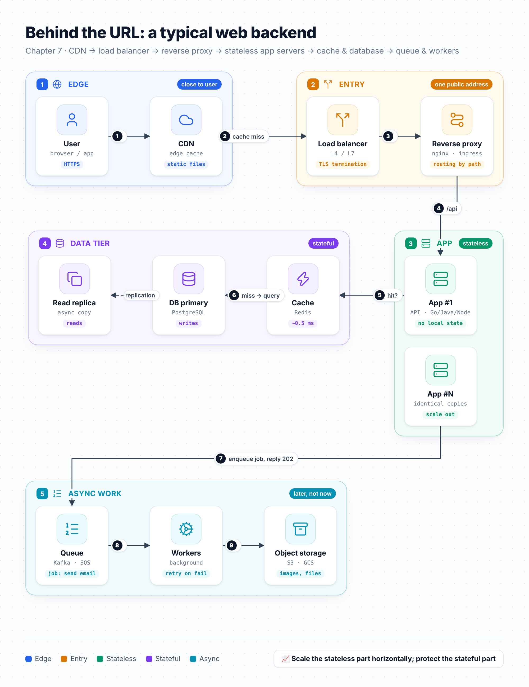

# Bölüm 7 — Sunucu tarafı

!!! abstract "Tek cümlede"
    Bir isteğe, cevaplayabiliyorsa önce bir **CDN** cevap verir. Veremiyorsa istek bir **load balancer**'a ulaşır,
    o da isteği bir **reverse proxy** arkasındaki birbirinin aynısı, **stateless uygulama sunucularına** dağıtır.
    Uygulama veriyi önce **cache**'ten okur, orada yoksa **veritabanına** gider, yavaş işleri de **worker**'lar için
    bir **kuyruğa** atar. Stateless kısmı kopya ekleyerek ölçeklersin, stateful kısmı (veriyi) özenle korursun.



---

## 1 · Uç (edge): CDN

| Ne | Neden |
|---|---|
| Yüzlerce şehre dağılmış bir sunucu ağı (Cloudflare, CloudFront, Fastly, Akamai) | En yakın sunucu 50–150 ms değil, birkaç ms uzakta (Bölüm 6: gidiş-dönüşler!) |
| **Statik dosyaları** (JS, CSS, resim, video), bazen API cevaplarını da önbelleğe alır | Trafiğin çoğu origin sunucuya hiç ulaşmaz |
| TLS'i kullanıcıya yakın sonlandırır, DDoS'u emer, küçük edge fonksiyonları çalıştırabilir | Daha hızlı el sıkışma, koruma |

Önbellekleme `Cache-Control: max-age=3600` gibi HTTP başlıklarıyla kontrol edilir. Cevaptaki `cf-cache-status: HIT` ya da `x-cache: Hit from cloudfront` gibi başlıklar, cevabı CDN'in verdiğini gösterir.

## 2 · Giriş: load balancer ve reverse proxy

| Bileşen | Katman | Görevi |
|---|---|---|
| **Load balancer** (AWS ALB/NLB, GCP LB, HAProxy) | **L4** (TCP: bağlantıları iletir) ya da **L7** (HTTP: isteği okur) | Tek genel adres. Trafiği sağlıklı arka uçlara dağıtır (round robin, en az bağlantı). **Health check** çalıştırır. Çoğu zaman **TLS'i sonlandırır**. |
| **Reverse proxy / ingress** (nginx, Envoy, Traefik, Kubernetes Ingress / Gateway API) | L7 | **Host** ve **yola** göre yönlendirir (`/api` → API servisi, `/` → frontend). `X-Forwarded-For` (gerçek istemci IP'si) gibi başlıklar ekler, sıkıştırma, hız sınırı ve zaman aşımı uygular. |

## 3 · Uygulama katmanı: stateless sunucular

- **Stateless**, bir sunucunun istekler arasında sadece kendisinin bildiği **hiçbir şeyi** tutmaması demektir: bellekte oturum yok, yerel diskte dosya yok. Oturumlar Redis'te ya da imzalı bir token'da (JWT) durur. Dosyalar nesne depolamaya gider.
- Bu sayede her kopya **birbirinin aynısı ve harcanabilir** olur. **Yatay** ölçeklenebilirsin (kopya eklersin) ve herhangi bir kopyayı istediğin an öldürebilirsin. Kubernetes ve autoscaler'lar tam olarak bunu yapar.
- **Dikey** ölçekleme (daha büyük makine) daha basittir ama bir tavanı vardır ve tek bir hata noktası yaratır.

## 4 · Veri katmanı: cache ve veritabanı

**Cache-aside** deseni (en yaygın olanı):

```text
value = cache.get(key)
if value is None:                 # cache'te yok (miss)
    value = db.query(...)
    cache.set(key, value, ttl=300)
return value
```

| Bileşen | Tipik gecikme (aynı veri merkezinde) | Notlar |
|---|---|---|
| Redis / Memcached | ~0,2–1 ms | Bellekte çalışır. Zor kısmı **geçersiz kılmadır (invalidation)**: veri değişince cache girdisini sil ya da güncelle. |
| Veritabanı sorgusu (index'li) | ~1–10 ms | Index yoksa tüm tabloyu tarar ve tablo büyüdükçe yavaşlar. |

**Veritabanını ölçeklemek**

- Tüm **yazmaları** **primary** alır. **Okuma replikaları** bir kopya alır (genelde **asenkron**) ve okumalara cevap verir. Bu yüzden yazmadan hemen sonraki bir okuma eski veriyi görebilir (**replikasyon gecikmesi**).
- **Bağlantı havuzu (connection pooling)**: PgBouncer ya da uygulamadaki havuzlar. Veritabanları onbinlerce değil, yüzlerce bağlantıyı kaldırır.
- **Sharding** (veriyi birden fazla primary'ye bölmek) ancak tek bir primary yetişemediğinde gündeme gelir.

## 5 · Asenkron işler: kuyruk, worker, nesne depolama

| Ne zaman | Örnek |
|---|---|
| Kullanıcının beklemesine gerek yoksa | E-posta göndermek, resim boyutlandırmak, PDF üretmek, yavaş bir üçüncü tarafı çağırmak |

Akış şöyle: uygulama kuyruğa bir **iş (job)** koyar ve hemen `202 Accepted` döner. **Worker**'lar işleri alır, hata olursa tekrar dener, sürekli başarısız olanları bir **dead-letter queue**'ya gönderir. İşler **idempotent** olmalıdır (iki kez çalışması güvenli olmalı), çünkü "en az bir kez" teslimatta tekrarlar yaşanır.

**Nesne depolama** (S3, GCS) dosyaları tutar. İstemciler dosyaları çoğu zaman kısa ömürlü **presigned URL**'lerle doğrudan yükler ve indirir, dosya byte'ları uygulama sunucularından hiç geçmez.

## 6 · Ayakta tutmak

| Uygulama | Neden |
|---|---|
| **Health check** (liveness / readiness) | LB ya da Kubernetes bozuk instance'lara trafik göndermeyi bırakır. |
| Her ağ çağrısında **zaman aşımı (timeout)** | Yavaş bir bağımlılık tüm thread'lerini kilitlememeli. |
| **Backoff + jitter ile tekrar deneme** | Anlık aksaklıkları atlat, ama tekrar deneme fırtınasına yol açma. |
| **Circuit breaker / hız sınırı** | Hızlı başarısız ol, aşırı yüklenmiş bağımlılıkları koru. |
| **Metrik, log, trace** | Göremediğini düzeltemezsin (Bölüm 9). |

---

## 🧪 Kendin dene (Docker)

İki uygulama sunucusunun önünde bir load balancer, 2 dakikada:

```bash
mkdir lb-lab && cd lb-lab
cat > nginx.conf <<'EOF'
upstream app { server app1:80; server app2:80; }
server {
  listen 80;
  location / {
    proxy_pass http://app;
    proxy_set_header X-Forwarded-For $proxy_add_x_forwarded_for;
  }
}
EOF
cat > compose.yaml <<'EOF'
services:
  app1: { image: traefik/whoami }
  app2: { image: traefik/whoami }
  lb:
    image: nginx:alpine
    ports: ["8080:80"]
    volumes: ["./nginx.conf:/etc/nginx/conf.d/default.conf:ro"]
EOF
docker compose up -d
for i in 1 2 3 4; do curl -s localhost:8080 | grep Hostname; done   # sırayla değişir: round robin
docker compose stop app1 && curl -s localhost:8080 | grep Hostname  # hâlâ çalışıyor
docker compose down
```

```bash
# Cevabı CDN mi veriyor? Önbellek başlıklarına bak
curl -sI https://www.cloudflare.com | grep -iE "cf-cache-status|age|cache-control"
```

**Görev:** laboratuvar çalışırken `app1`'i durdur ve istek gönder. nginx ilk başarısız denemede ne yapıyor? Bir health check bunu nasıl değiştirirdi?

---

## 🃏 Hatırlatma kartı

```text
Kullanıcı → CDN (statik, önbellekte var mı?) → LB (L4/L7, TLS, health check) → reverse proxy (host/yol yönlendirme)
     → stateless uygulama × N (yatay ölçek) → cache (var mı?) → DB primary (yazma) / replikalar (okuma, gecikme)
     → yavaş işler: kuyruk → worker (tekrar dene, idempotent, DLQ) → nesne depolama (presigned URL)
Stateless = harcanabilir kopyalar. Stateful = koru, yedekle, dikkatle ölçekle.
Her zaman: zaman aşımı, backoff ile tekrar deneme, health check, gözlemlenebilirlik.
```

---

## ❓ Kendini test et

??? question "1. Uygulama sunucuları neden stateless olmalı?"
    Böylece her instance her isteğe hizmet verebilir ve herhangi bir instance istendiği an eklenip öldürülebilir. Yatay ölçekleme, kademeli deploy ve kendi kendini iyileştirme bu sayede mümkün olur.

??? question "2. L4 ile L7 load balancer arasındaki fark ne?"
    L4, TCP/UDP bağlantılarını içeriği okumadan IP ve porta göre iletir. L7 HTTP'yi anlar: host'a, yola ya da başlığa göre yönlendirebilir, TLS'i sonlandırabilir, tek tek istekleri tekrar deneyebilir.

??? question "3. Bir kullanıcı profilini güncelliyor ve hemen ardından eski halini görüyor. Sebebi ne olabilir?"
    Replikasyon gecikmesi (okuma henüz yetişmemiş bir replikaya gitti) ya da yazma sırasında geçersiz kılınmamış eski bir cache girdisi.

??? question "4. Kuyruk worker'ları neden idempotent olmalı?"
    Çoğu kuyruk "en az bir kez" teslim eder. Bir iş iki kez çalışabilir; örneğin worker işi yaptıktan sonra ama onaylamadan önce çökerse. İki kez çalışınca kartı iki kez çekmemeli.

??? question "5. API'n bazen 30 sn süren bir ödeme sağlayıcısını çağırıyor. Ne eklersin?"
    Çağrıya bir zaman aşımı, backoff ile tekrar deneme (sadece çağrı idempotent ise), bir circuit breaker. En iyisi de çağrıyı asenkron bir işe taşımak, kullanıcının isteği beklemesin.

---

## 📚 Kaynaklar

- [Designing Data-Intensive Applications, Martin Kleppmann](https://dataintensive.net/)
- [The System Design Primer (GitHub)](https://github.com/donnemartin/system-design-primer)
- [nginx: HTTP load balancing](https://nginx.org/en/docs/http/load_balancing.html)
- [AWS Builders' Library: zaman aşımı, tekrar deneme ve jitter'lı backoff](https://aws.amazon.com/builders-library/timeouts-retries-and-backoff-with-jitter/)
- [The Twelve-Factor App](https://12factor.net/)

## ✍️ Kendi notlarım

> Stateless ve stateful kısımları neden farklı ölçeklediğimizi kendi cümlelerinle 5 satırda anlat.

-
