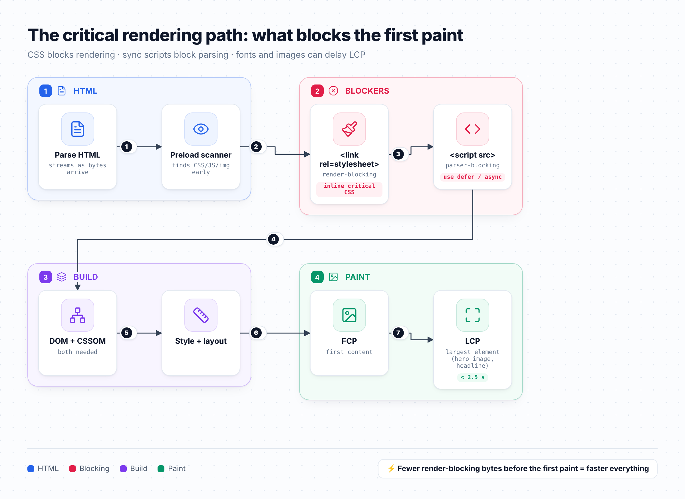

# 8.1 — The rendering pipeline in depth

!!! abstract "In one sentence"
    The browser parses **HTML** into the **DOM** and **CSS** into the **CSSOM**, combines them, computes **style** and
    **layout** (where every box goes), **paints** layers and **composites** them on the GPU; anything that blocks this
    path — **render-blocking CSS**, **parser-blocking scripts**, late fonts and images — delays the first meaningful
    pixels, and anything that forces layout again and again makes the page janky.

## 📖 Key terms & abbreviations

| Term | Stands for | What it is | How it works (one line) |
|---|---|---|---|
| **CRP** | Critical Rendering Path | Steps from bytes to first pixels | HTML → DOM, CSS → CSSOM, layout, paint |
| **DOM / CSSOM** | Document / CSS Object Model | Trees for content / styles | Built incrementally while downloading |
| **Render-blocking** | — | Resource the browser waits for before painting | `<link rel=stylesheet>` in `<head>` |
| **Parser-blocking** | — | Script that stops HTML parsing | `<script src>` without defer/async |
| **Preload scanner** | — | Secondary parser that finds resources early | Starts downloads while the main parser is blocked |
| **Resource hints** | — | `preload`, `preconnect`, `dns-prefetch`, `fetchpriority` | Tell the browser what matters early |
| **Style recalc** | — | Computing final styles for elements | Selector matching, cascade, inheritance |
| **Layout (reflow)** | — | Computing geometry of every box | Expensive on big DOMs |
| **Paint** | — | Recording draw operations into layers | Text, colours, borders, images |
| **Compositing** | — | Combining layers on the GPU | `transform`/`opacity` changes only need this |
| **Layout thrashing** | — | Alternating DOM writes and layout reads | Forces many synchronous layouts |
| **FOIT / FOUT** | Flash Of Invisible / Unstyled Text | Font-loading behaviours | Controlled by `font-display` |
| **Lazy loading** | — | Load offscreen images/iframes later | `loading="lazy"` |

## 🗺️ Big picture



---

## 1 · The critical rendering path

### How does it work?

1. **HTML arrives in chunks** and is parsed into the DOM as it streams (TTFB matters, server streaming helps).
2. The **preload scanner** looks ahead and starts downloading CSS, JS, fonts and images it finds in the markup.
3. **CSS is render-blocking**: the browser won't paint until it has the CSSOM for stylesheets in `<head>` (otherwise you'd see unstyled content).
4. **Classic `<script src>` is parser-blocking**: parsing stops until it downloads and runs (it might `document.write`). It also waits for preceding CSS.
5. With DOM + CSSOM → **style → layout → paint → composite** → **First Contentful Paint**, and later **LCP** when the biggest element appears.

## 2 · Unblocking the path

| Technique | Effect |
|---|---|
| `<script defer>` | Download in parallel, run after parsing, in order |
| `<script async>` | Download in parallel, run when ready (any order) — analytics |
| `<script type=module>` | Deferred by default |
| Inline **critical CSS**, load the rest later | Paint above-the-fold content sooner |
| `<link rel=preload as=font/image>` | Start late-discovered critical resources early |
| `<link rel=preconnect href=https://cdn…>` | Do DNS+TCP+TLS to a third-party origin early |
| `fetchpriority="high"` on the LCP image | Download it before less important images |
| `loading="lazy"` on offscreen images | Save bandwidth for what's visible |
| `font-display: swap` + preload + subsetting | Text visible immediately, less layout shift |

## 3 · Style, layout, paint, composite

| Change | Pipeline work | Cost |
|---|---|---|
| `width`, `top`, font size, adding DOM nodes | Style → **layout** → paint → composite | High |
| `color`, `background`, `box-shadow` | Style → paint → composite | Medium |
| `transform`, `opacity` (on own layer) | **Composite only** (GPU) | Low → smooth 60 fps animations |

**Layout thrashing**: reading `el.offsetHeight` right after writing a style forces the browser to do layout *now*; in a loop this means hundreds of layouts per frame. Batch reads, then writes (or use `requestAnimationFrame`).

**Big DOMs** (tens of thousands of nodes) make every style/layout pass slower: virtualize long lists.

## 4 · Images and fonts

- **Images** are usually the LCP element and most of the bytes: serve **AVIF/WebP**, the right size per screen (`srcset`/`sizes`), from a CDN, with `width`/`height` set to avoid layout shift.
- **Fonts**: limit families/weights, self-host or preconnect, subset, `font-display: swap`.

## 🔧 DevOps connection

- **TTFB is infra's part of rendering**: CDN caching of HTML, compression (br/zstd), HTTP/2-3, early hints (`103`), server-side streaming.
- **Cache headers** for hashed static assets (`immutable`), short/no-cache for HTML (6.1).
- **Image CDNs** (or resizing at the edge) turn "upload 5 MB photo" into "serve 60 KB AVIF".
- **Performance budgets in CI** (Lighthouse CI) block regressions in JS/CSS size before they ship.

## 🧪 Try it yourself

```bash
# Lighthouse from the command line (Node required)
npx -y lighthouse https://example.com --only-categories=performance --quiet --chrome-flags="--headless" --output=json \
  | python3 -c "import json,sys; a=json.load(sys.stdin)['audits']; [print(k, a[k]['displayValue']) for k in ['first-contentful-paint','largest-contentful-paint','total-blocking-time','cumulative-layout-shift']]"
```

In Chrome DevTools:

1. **Network** → reload → look at the waterfall: what starts late? what blocks?
2. **Performance** → record a reload → see Parse HTML, Recalculate Style, Layout, Paint; long purple (layout) blocks = thrashing.
3. **Rendering** panel → enable "Paint flashing" and "Layout shift regions".
4. **Coverage** (Ctrl+Shift+P → Coverage) → how much CSS/JS is unused on load.

## 🃏 Cheat sheet

| Problem | Fix |
|---|---|
| Blank screen for long | Inline critical CSS, defer scripts, reduce TTFB |
| LCP image late | `fetchpriority=high`, preload, CDN, modern format, right size |
| Janky animation | Animate `transform`/`opacity` only |
| Layout thrashing | Batch reads then writes |
| Text invisible | `font-display: swap`, preload fonts |
| Huge DOM | Virtualize lists |

## ❓ Test yourself

??? question "1. Why is CSS render-blocking but images aren't?"
    Without the CSSOM the browser can't know how anything looks or where it goes; painting without it would flash unstyled content. Images can fill in later.

??? question "2. What's the difference between `defer` and `async`?"
    Both download in parallel. `defer` runs after HTML parsing, in document order; `async` runs as soon as it's downloaded, in any order.

??? question "3. Why animate `transform` instead of `left`?"
    `left` triggers layout and paint every frame; `transform` can be handled by the compositor on the GPU without layout.

??? question "4. What is layout thrashing?"
    Interleaving DOM writes and layout reads so the browser must recompute layout synchronously many times per frame.

??? question "5. What can the infrastructure team do for rendering speed?"
    Lower TTFB (CDN, caching, streaming), compression, HTTP/2-3, early hints, correct cache headers and image optimization at the edge.

---

## 📚 Sources

- [web.dev — Critical rendering path](https://web.dev/learn/performance/understanding-the-critical-path)
- [web.dev — Rendering performance](https://web.dev/articles/rendering-performance)
- [Chrome — Inside look at modern web browser (part 3)](https://developer.chrome.com/blog/inside-browser-part3)
- [MDN — `<script>`: defer and async](https://developer.mozilla.org/en-US/docs/Web/HTML/Element/script)

## ✍️ My notes

> Record a Performance trace of your company's homepage. Which resource blocks the first paint the longest?

-
