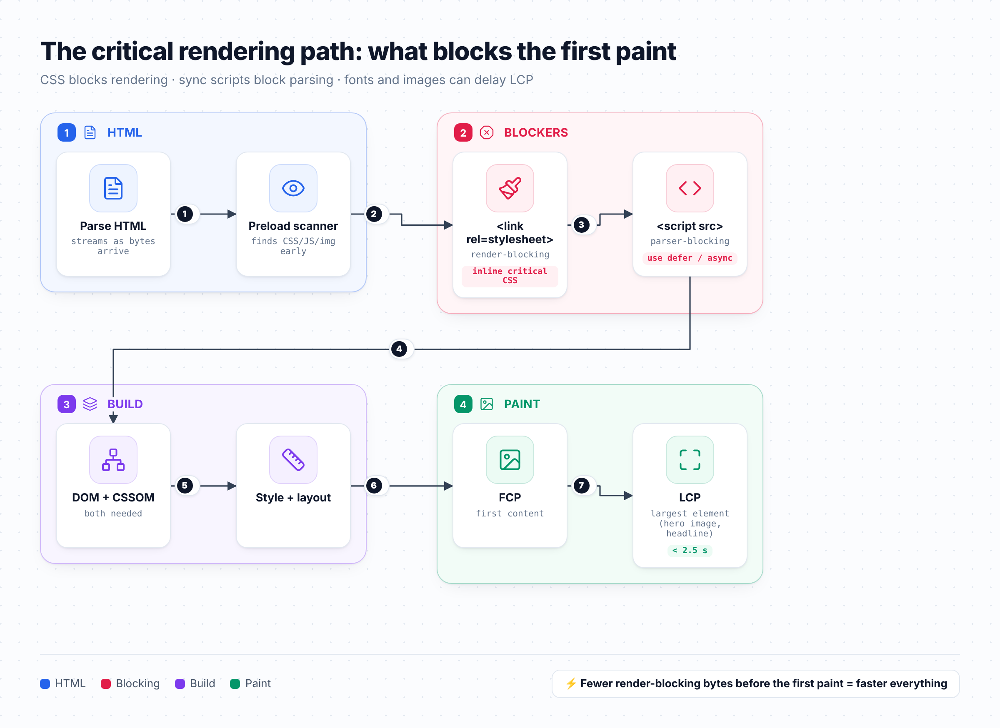

# 8.1 — Render pipeline'ına derin dalış

!!! abstract "Tek cümlede"
    Tarayıcı **HTML**'i **DOM**'a, **CSS**'i **CSSOM**'a ayrıştırır, onları birleştirir, **stili** ve **layout**'u (her
    kutunun nereye gideceğini) hesaplar, katmanları **boyar** ve GPU'da **birleştirir** (composite); bu yolu engelleyen
    her şey (**render engelleyici CSS**, **ayrıştırma engelleyici script'ler**, geç gelen fontlar ve görseller) ilk anlamlı
    pikselleri geciktirir, layout'u tekrar tekrar zorlayan her şey de sayfayı takılgan yapar.

## 📖 Temel terimler ve kısaltmalar

| Terim | Açılımı | Nedir | Nasıl çalışır (tek satır) |
|---|---|---|---|
| **CRP** | Critical Rendering Path | Byte'lardan ilk piksellere adımlar | HTML → DOM, CSS → CSSOM, layout, paint |
| **DOM / CSSOM** | Document / CSS Object Model | İçerik / stil ağaçları | İndirilirken adım adım kurulur |
| **Render engelleyici** | Render-blocking | Tarayıcının boyamadan önce beklediği kaynak | `<head>`'deki `<link rel=stylesheet>` |
| **Ayrıştırma engelleyici** | Parser-blocking | HTML ayrıştırmayı durduran script | defer/async'siz `<script src>` |
| **Preload tarayıcısı** | Preload scanner | Kaynakları erken bulan ikincil ayrıştırıcı | Ana ayrıştırıcı bloklanmışken indirmeleri başlatır |
| **Kaynak ipuçları** | Resource hints | `preload`, `preconnect`, `dns-prefetch`, `fetchpriority` | Tarayıcıya neyin erken önemli olduğunu söyler |
| **Stil yeniden hesaplama** | Style recalc | Elemanların son stillerini hesaplamak | Seçici eşleştirme, cascade, kalıtım |
| **Layout (reflow)** | — | Her kutunun geometrisini hesaplamak | Büyük DOM'larda pahalı |
| **Paint** | — | Çizim işlemlerini katmanlara kaydetmek | Metin, renkler, kenarlıklar, görseller |
| **Compositing** | — | Katmanları GPU'da birleştirmek | `transform`/`opacity` değişiklikleri sadece bunu ister |
| **Layout thrashing** | — | DOM yazma ve layout okumayı sırayla yapmak | Çok sayıda senkron layout'u zorlar |
| **FOIT / FOUT** | Flash Of Invisible / Unstyled Text | Font yükleme davranışları | `font-display` ile kontrol edilir |
| **Tembel yükleme** | Lazy loading | Ekran dışı görselleri/iframe'leri sonra yükle | `loading="lazy"` |

## 🗺️ Büyük resim



---

## 1 · Kritik render yolu

### Nasıl çalışır?

1. **HTML parça parça gelir** ve akarken DOM'a ayrıştırılır (TTFB önemli, sunucu akışı yardımcı olur).
2. **Preload tarayıcısı** ileriye bakar ve işaretlemede bulduğu CSS, JS, font ve görselleri indirmeye başlar.
3. **CSS render engelleyicidir**: tarayıcı `<head>`'deki stil dosyaları için CSSOM'a sahip olmadan boyamaz (yoksa stilsiz içerik görürdün).
4. **Klasik `<script src>` ayrıştırma engelleyicidir**: indirilip çalışana kadar ayrıştırma durur (`document.write` yapabilir). Önceki CSS'i de bekler.
5. DOM + CSSOM ile → **stil → layout → paint → composite** → **First Contentful Paint**, sonra en büyük eleman görününce **LCP**.

## 2 · Yolu açmak

| Teknik | Etkisi |
|---|---|
| `<script defer>` | Paralel indir, ayrıştırmadan sonra sırayla çalıştır |
| `<script async>` | Paralel indir, hazır olunca çalıştır (herhangi bir sırada); analitik |
| `<script type=module>` | Varsayılan olarak defer |
| **Kritik CSS**'i inline yap, gerisini sonra yükle | Ekranın üstündeki içeriği daha erken boya |
| `<link rel=preload as=font/image>` | Geç keşfedilen kritik kaynakları erken başlat |
| `<link rel=preconnect href=https://cdn…>` | Üçüncü taraf origin'e DNS+TCP+TLS'i erken yap |
| LCP görselinde `fetchpriority="high"` | Daha az önemli görsellerden önce indir |
| Ekran dışı görsellerde `loading="lazy"` | Bant genişliğini görünene sakla |
| `font-display: swap` + preload + subset | Metin hemen görünür, daha az layout kayması |

## 3 · Stil, layout, paint, composite

| Değişiklik | Pipeline işi | Maliyet |
|---|---|---|
| `width`, `top`, font boyutu, DOM düğümü eklemek | Stil → **layout** → paint → composite | Yüksek |
| `color`, `background`, `box-shadow` | Stil → paint → composite | Orta |
| `transform`, `opacity` (kendi katmanında) | **Sadece composite** (GPU) | Düşük → akıcı 60 fps animasyonlar |

**Layout thrashing**: bir stil yazdıktan hemen sonra `el.offsetHeight` okumak tarayıcıyı layout'u *şimdi* yapmaya zorlar; bir döngüde bu kare başına yüzlerce layout demektir. Önce okumaları, sonra yazmaları grupla (ya da `requestAnimationFrame` kullan).

**Büyük DOM'lar** (on binlerce düğüm) her stil/layout geçişini yavaşlatır: uzun listeleri sanallaştır.

## 4 · Görseller ve fontlar

- **Görseller** genelde LCP elemanıdır ve byte'ların çoğunu oluşturur: **AVIF/WebP**, ekran başına doğru boyutta (`srcset`/`sizes`), bir CDN'den, layout kaymasını önlemek için `width`/`height` ayarlı sun.
- **Fontlar**: aile/ağırlık sayısını sınırla, kendin host et ya da preconnect yap, subset al, `font-display: swap`.

## 🔧 DevOps bağlantısı

- **TTFB render'ın altyapı kısmıdır**: HTML'in CDN'de önbelleğe alınması, sıkıştırma (br/zstd), HTTP/2-3, early hints (`103`), sunucu tarafı akış.
- Hash'li statik dosyalar için **cache header**'ları (`immutable`), HTML için kısa/no-cache (6.1).
- **Görsel CDN'leri** (ya da uçta yeniden boyutlandırma) "5 MB fotoğraf yükle"yi "60 KB AVIF sun"a çevirir.
- **CI'da performans bütçeleri** (Lighthouse CI) JS/CSS boyutundaki gerilemeleri yayına çıkmadan engeller.

## 🧪 Kendin dene

```bash
# Komut satırından Lighthouse (Node gerekir)
npx -y lighthouse https://example.com --only-categories=performance --quiet --chrome-flags="--headless" --output=json \
  | python3 -c "import json,sys; a=json.load(sys.stdin)['audits']; [print(k, a[k]['displayValue']) for k in ['first-contentful-paint','largest-contentful-paint','total-blocking-time','cumulative-layout-shift']]"
```

Chrome DevTools'ta:

1. **Network** → yeniden yükle → şelaleye bak: ne geç başlıyor? ne engelliyor?
2. **Performance** → bir yeniden yüklemeyi kaydet → Parse HTML, Recalculate Style, Layout, Paint'i gör; uzun mor (layout) bloklar = thrashing.
3. **Rendering** paneli → "Paint flashing" ve "Layout shift regions"ı aç.
4. **Coverage** (Ctrl+Shift+P → Coverage) → yüklemede CSS/JS'in ne kadarı kullanılmıyor.

## 🃏 Hatırlatma kartı

| Sorun | Çözüm |
|---|---|
| Uzun süre boş ekran | Kritik CSS'i inline yap, script'leri defer et, TTFB'yi düşür |
| LCP görseli geç | `fetchpriority=high`, preload, CDN, modern format, doğru boyut |
| Takılgan animasyon | Sadece `transform`/`opacity` animasyonu |
| Layout thrashing | Önce okumaları, sonra yazmaları grupla |
| Görünmez metin | `font-display: swap`, fontları preload et |
| Dev DOM | Listeleri sanallaştır |

## ❓ Kendini test et

??? question "1. CSS neden render engelleyici de görseller değil?"
    CSSOM olmadan tarayıcı hiçbir şeyin nasıl görüneceğini ya da nereye gideceğini bilemez; onsuz boyamak stilsiz içerik yanıp sönmesine yol açar. Görseller sonra yerine oturabilir.

??? question "2. `defer` ile `async` arasındaki fark ne?"
    İkisi de paralel indirir. `defer` HTML ayrıştırmasından sonra, belge sırasıyla çalışır; `async` iner inmez, herhangi bir sırada çalışır.

??? question "3. Neden `left` yerine `transform` animasyonu yapılır?"
    `left` her karede layout ve paint tetikler; `transform` layout olmadan GPU'da compositor tarafından işlenebilir.

??? question "4. Layout thrashing nedir?"
    DOM yazmaları ile layout okumalarını iç içe yapmak; tarayıcı kare başına birçok kez layout'u senkron yeniden hesaplamak zorunda kalır.

??? question "5. Altyapı ekibi render hızı için ne yapabilir?"
    TTFB'yi düşürmek (CDN, önbellek, akış), sıkıştırma, HTTP/2-3, early hints, doğru cache header'ları ve uçta görsel optimizasyonu.

---

## 📚 Kaynaklar

- [web.dev — Critical rendering path](https://web.dev/learn/performance/understanding-the-critical-path)
- [web.dev — Rendering performance](https://web.dev/articles/rendering-performance)
- [Chrome — Inside look at modern web browser (part 3)](https://developer.chrome.com/blog/inside-browser-part3)
- [MDN — `<script>`: defer and async](https://developer.mozilla.org/en-US/docs/Web/HTML/Element/script)

## ✍️ Notlarım

> Şirketinin ana sayfasının bir Performance kaydını al. İlk boyamayı en uzun hangi kaynak engelliyor?

-
