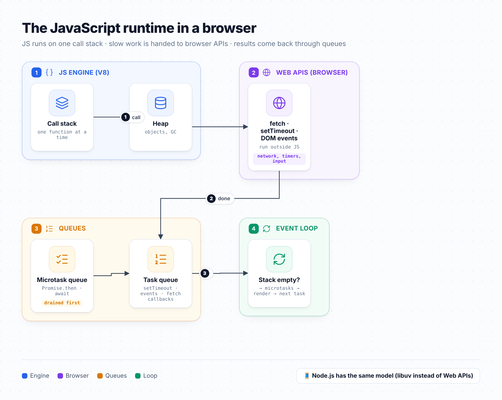
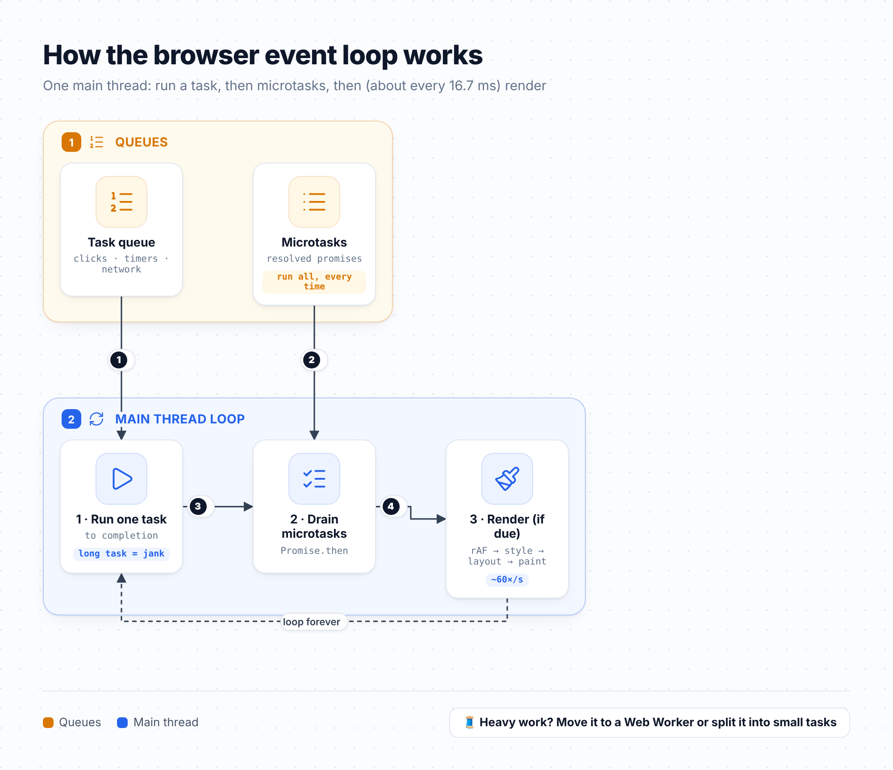

# 8.2 — JavaScript, the event loop & async

!!! abstract "In short"
    JavaScript runs your code on **one call stack per page**. Slow things (network, timers, user input) are handled by
    the browser's **Web APIs**, which put callbacks into **task** and **microtask queues**. The **event loop** runs one
    task at a time, drains all microtasks (promises), then lets the page **render**. So any long task freezes clicks,
    scrolling and animations until it ends.

## 📖 Key terms & abbreviations

| Term | Stands for | What it is | How it works (one line) |
|---|---|---|---|
| **Call stack** | — | Frames of currently running functions | One at a time; must empty before the next task |
| **Heap** | — | Where objects live | Garbage collected by V8 |
| **Web APIs** | — | Browser features outside JS | `fetch`, timers, DOM events, IndexedDB |
| **Task (macrotask)** | — | Unit of work from the task queue | Event handler, timer callback, message |
| **Microtask** | — | High-priority follow-up work | Promise reactions, `queueMicrotask`, MutationObserver |
| **Event loop** | — | Scheduler of the main thread | Task → all microtasks → (render) → next task |
| **Promise** | — | Object for a future value | `.then` callbacks run as microtasks |
| **async / await** | — | Syntax over promises | `await` pauses the function, not the thread |
| **Long task** | — | Task > 50 ms | Delays input → bad INP |
| **rAF** | requestAnimationFrame | Callback before the next paint | For animations and DOM writes |
| **Web Worker** | — | Background thread without DOM | Heavy compute off the main thread |
| **Memory leak** | — | Objects kept reachable by mistake | Detached DOM nodes, listeners, growing caches |
| **libuv** | — | Node.js' event loop + thread pool | Same model on the server |

## 🗺️ Big picture



---

## 1 · One thread, many things happening

### How does it work?

```js
console.log('1 sync');
setTimeout(() => console.log('4 task (timer)'), 0);
Promise.resolve().then(() => console.log('3 microtask'));
console.log('2 sync');
// prints: 1 sync, 2 sync, 3 microtask, 4 task (timer)
```

1. The script itself is a **task**: lines run on the **call stack** top to bottom.
2. `setTimeout` hands a timer to the **Web APIs**; when it fires, its callback goes into the **task queue**.
3. `Promise.then` schedules a **microtask**.
4. When the stack is empty, the event loop **drains all microtasks** (3), maybe **renders**, then takes the next **task** (4).

## 2 · The event loop and rendering



- At 60 Hz the browser wants to render every **16.7 ms**. Rendering can only happen **between tasks**.
- A 300 ms task (big JSON parse, heavy loop, huge React re-render) = 300 ms with no clicks, no scrolling (unless compositor-only), no animation.
- **Microtasks run until the queue is empty**: a promise chain that keeps scheduling itself can starve rendering entirely.

## 3 · Async patterns

| Pattern | Looks like | Notes |
|---|---|---|
| Callbacks | `fs.readFile(p, (err, data) => …)` | Nesting, error handling per callback |
| Promises | `fetch(u).then(r => r.json())` | Chainable, `.catch` once |
| async/await | `const r = await fetch(u)` | Reads like sync code; `await` yields to the event loop |
| Parallel | `await Promise.all([a(), b()])` | Don't `await` in a loop when calls are independent |
| Cancel | `AbortController` | Abort fetches on navigation/unmount |

`await` doesn't block the thread: the function pauses, other tasks keep running. But **CPU work is never async**: a `for` loop over 10 million items blocks whatever you wrap around it.

## 4 · Keeping the main thread free

- **Break up long tasks**: process in chunks and yield (`await scheduler.yield()` where supported, or `setTimeout(0)`), so input can be handled between chunks.
- **Move heavy work to a Web Worker** (parsing, image processing, crypto, search indexing); communicate with `postMessage`.
- **Do DOM writes in `requestAnimationFrame`**; avoid layout thrashing (8.1).
- **Ship less JS**: code-split by route, remove unused libraries, defer third-party scripts (tag managers are frequent offenders).

## 5 · Memory leaks

Common causes: event listeners never removed, intervals never cleared, closures holding big objects, **detached DOM nodes** still referenced, unbounded in-memory caches. Find them with DevTools **Memory** → heap snapshots (compare before/after) and the "Detached elements" view.

## 🔧 DevOps connection

- **Node.js is the same model** with libuv: a blocking call (sync file I/O, `JSON.parse` of 50 MB, bcrypt on the main thread) stalls **every** request on that process. Watch **event loop lag** / `eventLoopUtilization` as a metric.
- **Scale Node.js horizontally** (more pods / cluster workers), not with more CPU per pod (4.3).
- **Real-user monitoring** (RUM) of long tasks and INP shows which releases hurt responsiveness.
- **Third-party scripts** (chat widgets, A/B tools, analytics) often dominate main-thread time; govern them like dependencies.

## 🧪 Try it yourself

```js
// Paste in the browser console on any page

// 1. Order of execution
setTimeout(() => console.log('task'), 0);
Promise.resolve().then(() => console.log('microtask'));
console.log('sync');

// 2. Feel a long task: try to scroll or click during these 3 seconds
const end = Date.now() + 3000; while (Date.now() < end) {}

// 3. Observe long tasks on this page
new PerformanceObserver(l => l.getEntries().forEach(e => console.log('long task', Math.round(e.duration), 'ms')))
  .observe({ type: 'longtask', buffered: true });

// 4. Same work, chunked, page stays responsive
async function chunked(n) { for (let i = 0; i < n; i++) { if (i % 1e6 === 0) await new Promise(r => setTimeout(r)); } console.log('done'); }
chunked(5e7);
```

```bash
# Node.js: event loop delay while blocking
node -e "const {monitorEventLoopDelay}=require('perf_hooks');const h=monitorEventLoopDelay();h.enable();
setTimeout(()=>{const e=Date.now()+500;while(Date.now()<e){}},100);
setTimeout(()=>console.log('p99 delay ms', h.percentile(99)/1e6),1000)"
```

## 🃏 Cheat sheet

| Order | What runs |
|---|---|
| 1 | Current task (script, event handler, timer callback) |
| 2 | **All** microtasks (promise callbacks, await continuations) |
| 3 | Render if due (rAF → style → layout → paint) |
| 4 | Next task |

| Problem | Fix |
|---|---|
| UI freezes | Find long tasks; chunk or move to a Worker |
| Slow independent awaits | `Promise.all` |
| Memory grows | Heap snapshots, remove listeners/timers |
| Node latency spikes | Event loop lag metric, offload CPU work |

## ❓ Test yourself

??? question "1. In what order do `setTimeout(f,0)`, `Promise.resolve().then(g)` and a sync `console.log` run?"
    Sync log first, then `g` (microtask), then `f` (task).

??? question "2. Why does a 500 ms loop make clicks feel ignored?"
    The click handler is a task that can only run after the current task finishes; rendering also waits.

??? question "3. Does `await` block the main thread?"
    No. It pauses that async function and returns control to the event loop; CPU-bound code still blocks.

??? question "4. When should you use a Web Worker?"
    For CPU-heavy work (parsing, image/crypto processing, search) that would otherwise create long tasks on the main thread.

??? question "5. What's the server-side equivalent of a long task, and how do you detect it?"
    A blocking operation on the Node.js event loop; detect with event loop delay/utilization metrics.

---

## 📚 Sources

- [MDN — The event loop](https://developer.mozilla.org/en-US/docs/Web/JavaScript/Event_loop)
- [Jake Archibald — Tasks, microtasks, queues and schedules](https://jakearchibald.com/2015/tasks-microtasks-queues-and-schedules/)
- [web.dev — Optimize long tasks](https://web.dev/articles/optimize-long-tasks)
- [Node.js — The event loop, timers and process.nextTick()](https://nodejs.org/en/learn/asynchronous-work/event-loop-timers-and-nexttick)

## ✍️ My notes

> Run the long-task observer on your product's main page. How many long tasks happen during load, and which scripts cause them?
