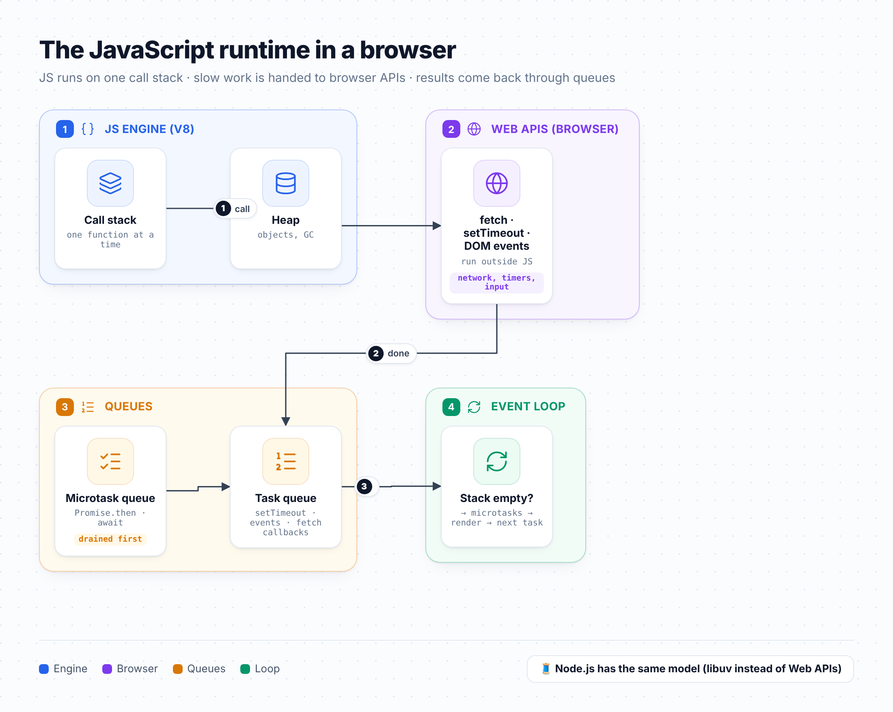
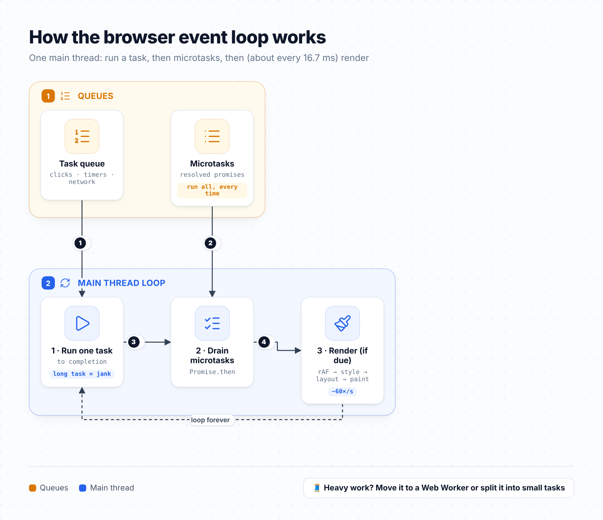

# 8.2 — JavaScript, event loop ve asenkron

!!! abstract "Kısaca"
    JavaScript kodunu **sayfa başına tek bir çağrı stack'inde** çalıştırır. Yavaş şeyler (ağ, zamanlayıcılar, kullanıcı
    girdisi) tarayıcının **Web API**'leri tarafından ele alınır, onlar da callback'leri **görev** ve **mikro görev
    kuyruklarına** koyar. **Event loop** aynı anda tek bir görev çalıştırır, tüm mikro görevleri (promise'ler) boşaltır,
    sonra sayfanın **render** etmesine izin verir. Bu yüzden uzun süren her görev, bitene kadar tıklamaları, kaydırmayı
    ve animasyonları dondurur.

## 📖 Temel terimler ve kısaltmalar

| Terim | Açılımı | Nedir | Nasıl çalışır (tek satır) |
|---|---|---|---|
| **Çağrı stack'i** | Call stack | O an çalışan fonksiyonların çerçeveleri | Aynı anda bir tane; sıradaki görevden önce boşalmalı |
| **Heap** | — | Nesnelerin yaşadığı yer | V8 tarafından çöp toplanır |
| **Web API'leri** | — | JS dışındaki tarayıcı özellikleri | `fetch`, zamanlayıcılar, DOM olayları, IndexedDB |
| **Görev (macrotask)** | Task | Görev kuyruğundan bir iş birimi | Olay handler'ı, zamanlayıcı callback'i, mesaj |
| **Mikro görev** | Microtask | Yüksek öncelikli devam işi | Promise tepkileri, `queueMicrotask`, MutationObserver |
| **Event loop** | — | Ana thread'in zamanlayıcısı | Görev → tüm mikro görevler → (render) → sıradaki görev |
| **Promise** | — | Gelecekteki bir değer için nesne | `.then` callback'leri mikro görev olarak çalışır |
| **async / await** | — | Promise'ler üstüne sözdizimi | `await` thread'i değil fonksiyonu duraklatır |
| **Uzun görev** | Long task | 50 ms'den uzun görev | Girdiyi geciktirir → kötü INP |
| **rAF** | requestAnimationFrame | Sonraki boyamadan önce callback | Animasyonlar ve DOM yazmaları için |
| **Web Worker** | — | DOM'suz arka plan thread'i | Ağır hesaplamayı ana thread'den çıkarır |
| **Bellek sızıntısı** | Memory leak | Yanlışlıkla erişilebilir tutulan nesneler | Kopuk DOM düğümleri, listener'lar, büyüyen önbellekler |
| **libuv** | — | Node.js'in event loop'u + thread havuzu | Sunucuda aynı model |

## 🗺️ Büyük resim



---

## 1 · Tek thread, olan çok şey

### Nasıl çalışır?

```js
console.log('1 senkron');
setTimeout(() => console.log('4 görev (zamanlayıcı)'), 0);
Promise.resolve().then(() => console.log('3 mikro görev'));
console.log('2 senkron');
// yazdırır: 1 senkron, 2 senkron, 3 mikro görev, 4 görev (zamanlayıcı)
```

1. Script'in kendisi bir **görevdir**: satırlar **çağrı stack'inde** yukarıdan aşağı çalışır.
2. `setTimeout` bir zamanlayıcıyı **Web API**'lerine verir; tetiklenince callback'i **görev kuyruğuna** gider.
3. `Promise.then` bir **mikro görev** planlar.
4. Stack boşalınca event loop **tüm mikro görevleri boşaltır** (3), belki **render** eder, sonra sıradaki **görevi** alır (4).

## 2 · Event loop ve render



- 60 Hz'de tarayıcı her **16,7 ms**'de render etmek ister. Render sadece **görevler arasında** olabilir.
- 300 ms'lik bir görev (büyük JSON ayrıştırma, ağır döngü, dev bir React yeniden render'ı) = 300 ms boyunca tıklama yok, kaydırma yok (sadece compositor ile olanlar hariç), animasyon yok.
- **Mikro görevler kuyruk boşalana kadar çalışır**: sürekli kendini planlayan bir promise zinciri render'ı tamamen aç bırakabilir.

## 3 · Asenkron desenler

| Desen | Görünüşü | Notlar |
|---|---|---|
| Callback'ler | `fs.readFile(p, (err, data) => …)` | İç içe geçme, callback başına hata işleme |
| Promise'ler | `fetch(u).then(r => r.json())` | Zincirlenebilir, tek `.catch` |
| async/await | `const r = await fetch(u)` | Senkron kod gibi okunur; `await` event loop'a devreder |
| Paralel | `await Promise.all([a(), b()])` | Çağrılar bağımsızsa döngüde `await` etme |
| İptal | `AbortController` | Gezinmede/unmount'ta fetch'leri iptal et |

`await` thread'i bloklamaz: fonksiyon durur, diğer görevler çalışmaya devam eder. Ama **CPU işi asla asenkron değildir**: 10 milyon eleman üzerinde bir `for` döngüsü etrafına ne sararsan sar bloklar.

## 4 · Ana thread'i serbest tutmak

- **Uzun görevleri böl**: parçalar halinde işle ve devret (destekleniyorsa `await scheduler.yield()`, ya da `setTimeout(0)`); girdi parçalar arasında işlenebilsin.
- **Ağır işi bir Web Worker'a taşı** (ayrıştırma, görsel işleme, kripto, arama indeksleme); `postMessage` ile iletişim kur.
- **DOM yazmalarını `requestAnimationFrame`'de yap**; layout thrashing'den kaçın (8.1).
- **Daha az JS gönder**: route'a göre kod böl, kullanılmayan kütüphaneleri çıkar, üçüncü taraf script'leri ertele (tag manager'lar sık suçludur).

## 5 · Bellek sızıntıları

Yaygın sebepler: hiç kaldırılmayan olay listener'ları, hiç temizlenmeyen interval'lar, büyük nesneleri tutan closure'lar, hâlâ referans verilen **kopuk DOM düğümleri**, sınırsız bellek içi önbellekler. DevTools **Memory** → heap snapshot'ları (önce/sonra karşılaştır) ve "Detached elements" görünümüyle bul.

## 🔧 DevOps bağlantısı

- **Node.js aynı modeldir** (libuv ile): bloklayan bir çağrı (senkron dosya I/O, 50 MB'lık `JSON.parse`, ana thread'de bcrypt) o process'teki **her** isteği durdurur. **Event loop gecikmesini** / `eventLoopUtilization`'ı metrik olarak izle.
- **Node.js'i yatay ölçekle** (daha çok pod / cluster worker'ı), pod başına daha çok CPU ile değil (4.3).
- Uzun görevlerin ve INP'nin **gerçek kullanıcı izlemesi** (RUM) hangi sürümlerin tepkiselliğe zarar verdiğini gösterir.
- **Üçüncü taraf script'ler** (sohbet widget'ları, A/B araçları, analitik) çoğu zaman ana thread zamanına hükmeder; onları bağımlılık gibi yönet.

## 🧪 Kendin dene

```js
// Herhangi bir sayfada tarayıcı konsoluna yapıştır

// 1. Çalışma sırası
setTimeout(() => console.log('görev'), 0);
Promise.resolve().then(() => console.log('mikro görev'));
console.log('senkron');

// 2. Uzun bir görevi hisset: bu 3 saniye boyunca kaydırmayı ya da tıklamayı dene
const end = Date.now() + 3000; while (Date.now() < end) {}

// 3. Bu sayfadaki uzun görevleri gözlemle
new PerformanceObserver(l => l.getEntries().forEach(e => console.log('uzun görev', Math.round(e.duration), 'ms')))
  .observe({ type: 'longtask', buffered: true });

// 4. Aynı iş, parçalanmış; sayfa tepki vermeye devam eder
async function chunked(n) { for (let i = 0; i < n; i++) { if (i % 1e6 === 0) await new Promise(r => setTimeout(r)); } console.log('bitti'); }
chunked(5e7);
```

```bash
# Node.js: bloklarken event loop gecikmesi
node -e "const {monitorEventLoopDelay}=require('perf_hooks');const h=monitorEventLoopDelay();h.enable();
setTimeout(()=>{const e=Date.now()+500;while(Date.now()<e){}},100);
setTimeout(()=>console.log('p99 gecikme ms', h.percentile(99)/1e6),1000)"
```

## 🃏 Hatırlatma kartı

| Sıra | Ne çalışır |
|---|---|
| 1 | Mevcut görev (script, olay handler'ı, zamanlayıcı callback'i) |
| 2 | **Tüm** mikro görevler (promise callback'leri, await devamları) |
| 3 | Zamanı geldiyse render (rAF → stil → layout → paint) |
| 4 | Sıradaki görev |

| Sorun | Çözüm |
|---|---|
| Arayüz donuyor | Uzun görevleri bul; parçala ya da Worker'a taşı |
| Yavaş bağımsız await'ler | `Promise.all` |
| Bellek büyüyor | Heap snapshot'ları, listener/zamanlayıcıları kaldır |
| Node gecikme sıçramaları | Event loop gecikme metriği, CPU işini dışarı al |

## ❓ Kendini test et

??? question "1. `setTimeout(f,0)`, `Promise.resolve().then(g)` ve senkron bir `console.log` hangi sırayla çalışır?"
    Önce senkron log, sonra `g` (mikro görev), sonra `f` (görev).

??? question "2. 500 ms'lik bir döngü neden tıklamaların yok sayıldığı hissini verir?"
    Tıklama handler'ı ancak mevcut görev bitince çalışabilen bir görevdir; render da bekler.

??? question "3. `await` ana thread'i bloklar mı?"
    Hayır. O async fonksiyonu duraklatır ve kontrolü event loop'a verir; CPU yoğun kod yine bloklar.

??? question "4. Web Worker ne zaman kullanılmalı?"
    Aksi halde ana thread'de uzun görevler oluşturacak CPU yoğun işler için (ayrıştırma, görsel/kripto işleme, arama).

??? question "5. Uzun görevin sunucu tarafındaki karşılığı ne, nasıl tespit edilir?"
    Node.js event loop'unda bloklayan bir işlem; event loop gecikme/kullanım metrikleriyle tespit edilir.

---

## 📚 Kaynaklar

- [MDN — The event loop](https://developer.mozilla.org/en-US/docs/Web/JavaScript/Event_loop)
- [Jake Archibald — Tasks, microtasks, queues and schedules](https://jakearchibald.com/2015/tasks-microtasks-queues-and-schedules/)
- [web.dev — Optimize long tasks](https://web.dev/articles/optimize-long-tasks)
- [Node.js — The event loop, timers and process.nextTick()](https://nodejs.org/en/learn/asynchronous-work/event-loop-timers-and-nexttick)

## ✍️ Notlarım

> Ürününün ana sayfasında uzun görev gözlemcisini çalıştır. Yükleme sırasında kaç uzun görev oluyor ve onlara hangi script'ler yol açıyor?
