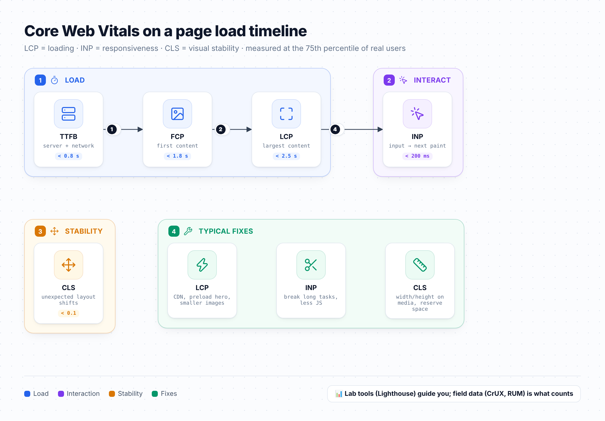

# 8.3 — Web performance & Core Web Vitals

!!! abstract "In one sentence"
    **Core Web Vitals** turn "is the site fast?" into three user-centred numbers measured on real visits: **LCP**
    (how fast the main content appears), **INP** (how quickly the page responds to input) and **CLS** (how much things
    jump around), judged at the **75th percentile**; lab tools like **Lighthouse** help you debug, but **field data**
    from real users (**CrUX**, **RUM**) is what counts — and much of it depends on infrastructure: TTFB, CDN, caching and compression.

## 📖 Key terms & abbreviations

| Term | Stands for | What it is | How it works (one line) |
|---|---|---|---|
| **Core Web Vitals** | — | Google's three key UX metrics | LCP, INP, CLS |
| **LCP** | Largest Contentful Paint | Time until the largest content element renders | Good ≤ 2.5 s |
| **INP** | Interaction to Next Paint | Slowest typical delay from input to next frame | Good ≤ 200 ms (replaced FID in 2024) |
| **CLS** | Cumulative Layout Shift | Unexpected movement of visible content | Good ≤ 0.1 |
| **TTFB** | Time To First Byte | Request start → first response byte | Good ≤ 0.8 s |
| **FCP** | First Contentful Paint | First text/image painted | Good ≤ 1.8 s |
| **TBT** | Total Blocking Time | Lab proxy for responsiveness | Sum of long-task time over 50 ms |
| **p75** | 75th percentile | The value 75% of visits beat | Used to pass/fail each metric |
| **Lab data** | — | Synthetic test in a controlled setup | Lighthouse, WebPageTest |
| **Field data / RUM** | Real User Monitoring | Measurements from real visitors | CrUX, web-vitals.js, vendor RUM |
| **CrUX** | Chrome UX Report | Google's public field dataset | Origin/URL level, 28-day window |
| **Performance budget** | — | Limits on bytes/metrics | Enforced in CI |

## 🗺️ Big picture



---

## 1 · The three Core Web Vitals

| Metric | Good | Needs improvement | Poor | Measures |
|---|---|---|---|---|
| **LCP** | ≤ 2.5 s | ≤ 4 s | > 4 s | Loading |
| **INP** | ≤ 200 ms | ≤ 500 ms | > 500 ms | Responsiveness |
| **CLS** | ≤ 0.1 | ≤ 0.25 | > 0.25 | Visual stability |

A page "passes" when **75%** of visits are in the good range for each. They affect search ranking slightly, but they matter more because they correlate with conversion and bounce rates.

## 2 · What drives each metric

### LCP = TTFB + resource load delay + resource load time + render delay

- **TTFB**: server time, DB queries, cold caches, far-away origin, redirects. → CDN/edge caching of HTML, faster backend, `103 Early Hints`.
- **Load delay**: LCP image discovered late (CSS background, JS-inserted). → put it in HTML, `preload`, `fetchpriority=high`.
- **Load time**: big image. → AVIF/WebP, right size, image CDN.
- **Render delay**: render-blocking CSS/JS, client-side rendering waiting for data. → critical CSS, SSR/streaming, defer JS (8.1).

### INP = input delay + processing time + presentation delay

- Long tasks already running when the user clicks; heavy event handlers; huge re-renders. → break up tasks, less JS, Workers, `content-visibility`, avoid layout thrashing (8.2).

### CLS

- Images/ads/embeds without reserved size; fonts swapping; content injected above existing content. → `width`/`height` or `aspect-ratio`, reserve slots, `font-display` + size-adjusted fallbacks, insert below the fold or on user action.

## 3 · Lab vs field

| | Lab (Lighthouse, WebPageTest) | Field (CrUX, RUM) |
|---|---|---|
| Who | One simulated device/network | All your real users |
| Good for | Debugging, CI regressions, before release | Truth, trends, segmentation (country, device) |
| INP | Not measurable (no real interactions) → TBT as proxy | Real INP |
| Variance | Low (controlled) | Real-world spread |

Collect field data yourself with the `web-vitals` library → send to your analytics/observability backend, segment by route, release and device class.

## 4 · Budgets and process

- **Performance budgets**: e.g. "JS ≤ 200 KB gzip on the landing page", "LCP p75 ≤ 2.5 s". Enforce with **Lighthouse CI** in pull requests and alerts on RUM.
- **Release annotations** on RUM dashboards show which deploy made INP worse.
- **Third-party governance**: every tag must justify its cost.

## 🔧 DevOps connection

- **You own TTFB**: CDN in front of HTML (stale-while-revalidate), origin close to users, warm caches, connection reuse to backends, no redirect chains (`http→https→www`).
- **Transport**: HTTP/2-3, TLS 1.3, Brotli/zstd compression, correct `Cache-Control` and hashed assets (6.1, 6.5).
- **Edge features**: image optimization, Early Hints, edge SSR / caching personalized pages carefully.
- **Observability**: put web vitals next to backend latency in the same dashboards; a TTFB jump often points to a backend or cache problem.

## 🧪 Try it yourself

```bash
# Field data from CrUX for any public origin (needs a free Google API key)
# curl -s "https://chromeuxreport.googleapis.com/v1/records:queryRecord?key=$KEY" \
#   -d '{"origin":"https://www.example.com"}' | jq '.record.metrics | map_values(.percentiles.p75)'

# Lab data
npx -y lighthouse https://example.com --preset=desktop --only-categories=performance --view

# TTFB breakdown from the terminal
curl -so /dev/null -w 'dns=%{time_namelookup} tcp=%{time_connect} tls=%{time_appconnect} ttfb=%{time_starttransfer} total=%{time_total}\n' https://example.com
```

```html
<!-- Field data from your own users -->
<script type="module">
  import {onLCP, onINP, onCLS} from 'https://unpkg.com/web-vitals@4?module';
  const send = m => navigator.sendBeacon('/rum', JSON.stringify({name: m.name, value: m.value, id: m.id}));
  onLCP(send); onINP(send); onCLS(send);
</script>
```

## 🃏 Cheat sheet

| Metric bad | First things to check |
|---|---|
| LCP | TTFB, LCP image discovery/priority/size, render-blocking CSS/JS |
| INP | Long tasks, heavy handlers, third-party scripts, big re-renders |
| CLS | Missing image dimensions, ads/embeds, fonts, injected banners |
| TTFB | CDN cache hit ratio, backend latency, redirects, distance |

## ❓ Test yourself

??? question "1. Why can't Lighthouse report INP, and what does it show instead?"
    INP needs real user interactions over the page's life; Lighthouse shows Total Blocking Time as a lab proxy.

??? question "2. LCP is 4 s but TTFB is 3 s. Where do you start?"
    Server side: caching HTML at the CDN, backend/database latency, redirects, origin distance. The frontend can't fix a 3 s TTFB.

??? question "3. What does 'p75 LCP = 2.3 s' mean?"
    75% of real page loads had LCP at or below 2.3 s; the slowest 25% were worse.

??? question "4. A cookie banner pushes the page down after load. Which metric suffers and how do you fix it?"
    CLS. Reserve its space from the start, overlay it, or show it without moving existing content.

??? question "5. Name three infrastructure changes that improve Core Web Vitals."
    CDN caching of HTML/assets, HTTP/3 + Brotli compression, image optimization at the edge (also: Early Hints, removing redirect chains).

---

## 📚 Sources

- [web.dev — Web Vitals](https://web.dev/articles/vitals)
- [web.dev — Optimize LCP](https://web.dev/articles/optimize-lcp) · [Optimize INP](https://web.dev/articles/optimize-inp) · [Optimize CLS](https://web.dev/articles/optimize-cls)
- [Chrome UX Report](https://developer.chrome.com/docs/crux)
- [web-vitals library](https://github.com/GoogleChrome/web-vitals)

## ✍️ My notes

> Look up your site's CrUX p75 values (PageSpeed Insights shows them). Which metric fails, and which team owns the fix?

-
