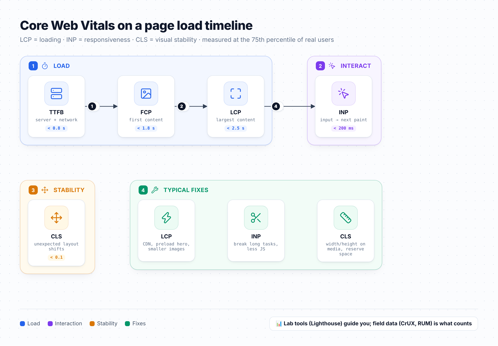

# 8.3 — Web performansı ve Core Web Vitals

!!! abstract "Kısaca"
    **Core Web Vitals**, "site hızlı mı?" sorusunu gerçek ziyaretlerde ölçülen kullanıcı odaklı üç sayıya çevirir:
    **LCP** (ana içerik ne kadar hızlı görünür), **INP** (sayfa girdiye ne kadar hızlı tepki verir) ve **CLS** (şeyler
    ne kadar zıplar); **75. yüzdelikte** değerlendirilir. **Lighthouse** gibi laboratuvar araçları hata ayıklamaya
    yardım eder ama asıl önemli olan gerçek kullanıcılardan gelen **saha verisidir** (**CrUX**, **RUM**). Bunun çoğu da
    altyapıya bağlıdır: TTFB, CDN, önbellek ve sıkıştırma.

## 📖 Temel terimler ve kısaltmalar

| Terim | Açılımı | Nedir | Nasıl çalışır (tek satır) |
|---|---|---|---|
| **Core Web Vitals** | — | Google'ın üç ana UX metriği | LCP, INP, CLS |
| **LCP** | Largest Contentful Paint | En büyük içerik elemanı render olana kadar geçen süre | İyi ≤ 2,5 sn |
| **INP** | Interaction to Next Paint | Girdiden sonraki kareye tipik en yavaş gecikme | İyi ≤ 200 ms (2024'te FID'nin yerini aldı) |
| **CLS** | Cumulative Layout Shift | Görünür içeriğin beklenmedik hareketi | İyi ≤ 0,1 |
| **TTFB** | Time To First Byte | İstek başlangıcı → ilk cevap byte'ı | İyi ≤ 0,8 sn |
| **FCP** | First Contentful Paint | Boyanan ilk metin/görsel | İyi ≤ 1,8 sn |
| **TBT** | Total Blocking Time | Tepkisellik için laboratuvar vekili | 50 ms üstü uzun görev sürelerinin toplamı |
| **p75** | 75. yüzdelik | Ziyaretlerin %75'inin geçtiği değer | Her metriği geçti/kaldı değerlendirmede kullanılır |
| **Laboratuvar verisi** | Lab data | Kontrollü ortamda sentetik test | Lighthouse, WebPageTest |
| **Saha verisi / RUM** | Real User Monitoring | Gerçek ziyaretçilerden ölçümler | CrUX, web-vitals.js, sağlayıcı RUM'u |
| **CrUX** | Chrome UX Report | Google'ın açık saha veri seti | Origin/URL düzeyi, 28 günlük pencere |
| **Performans bütçesi** | Performance budget | Byte/metrik limitleri | CI'da uygulanır |

## 🗺️ Büyük resim



---

## 1 · Üç Core Web Vital

| Metrik | İyi | İyileştirilmeli | Kötü | Ölçtüğü |
|---|---|---|---|---|
| **LCP** | ≤ 2,5 sn | ≤ 4 sn | > 4 sn | Yükleme |
| **INP** | ≤ 200 ms | ≤ 500 ms | > 500 ms | Tepkisellik |
| **CLS** | ≤ 0,1 | ≤ 0,25 | > 0,25 | Görsel kararlılık |

Ziyaretlerin **%75'i** her biri için iyi aralıkta olunca sayfa "geçer". Arama sıralamasını biraz etkilerler ama asıl önemleri dönüşüm ve hemen çıkma oranlarıyla ilişkili olmalarıdır.

## 2 · Her metriği ne belirler

### LCP = TTFB + kaynak yükleme gecikmesi + kaynak yükleme süresi + render gecikmesi

- **TTFB**: sunucu süresi, DB sorguları, soğuk önbellekler, uzak origin, yönlendirmeler. → HTML'in CDN/uçta önbelleğe alınması, daha hızlı backend, `103 Early Hints`.
- **Yükleme gecikmesi**: LCP görseli geç keşfediliyor (CSS arka planı, JS ile eklenmiş). → HTML'e koy, `preload`, `fetchpriority=high`.
- **Yükleme süresi**: büyük görsel. → AVIF/WebP, doğru boyut, görsel CDN'i.
- **Render gecikmesi**: render engelleyici CSS/JS, veriyi bekleyen istemci tarafı render. → kritik CSS, SSR/akış, JS'i ertele (8.1).

### INP = girdi gecikmesi + işleme süresi + sunum gecikmesi

- Kullanıcı tıklarken zaten çalışan uzun görevler; ağır olay handler'ları; dev yeniden render'lar. → görevleri böl, daha az JS, Worker'lar, `content-visibility`, layout thrashing'den kaçın (8.2).

### CLS

- Yeri ayrılmamış görseller/reklamlar/gömülüler; font değişimi; mevcut içeriğin üstüne eklenen içerik. → `width`/`height` ya da `aspect-ratio`, slot ayır, `font-display` + boyutu ayarlanmış yedek fontlar, ekranın altına ya da kullanıcı eylemiyle ekle.

## 3 · Laboratuvar ve saha

| | Laboratuvar (Lighthouse, WebPageTest) | Saha (CrUX, RUM) |
|---|---|---|
| Kim | Tek bir taklit cihaz/ağ | Tüm gerçek kullanıcıların |
| İyi olduğu yer | Hata ayıklama, CI gerilemeleri, yayından önce | Gerçek, trendler, bölümleme (ülke, cihaz) |
| INP | Ölçülemez (gerçek etkileşim yok) → vekil olarak TBT | Gerçek INP |
| Varyans | Düşük (kontrollü) | Gerçek dünya dağılımı |

Saha verisini `web-vitals` kütüphanesiyle kendin topla → analitik/gözlemlenebilirlik backend'ine gönder, route, sürüm ve cihaz sınıfına göre böl.

## 4 · Bütçeler ve süreç

- **Performans bütçeleri**: ör. "giriş sayfasında JS ≤ 200 KB gzip", "LCP p75 ≤ 2,5 sn". Pull request'lerde **Lighthouse CI** ve RUM alarmlarıyla uygula.
- RUM panolarındaki **sürüm notları** INP'yi hangi deploy'un kötüleştirdiğini gösterir.
- **Üçüncü taraf yönetimi**: her etiket maliyetini haklı çıkarmalı.

## 🔧 DevOps bağlantısı

- **TTFB senin**: HTML'in önünde CDN (stale-while-revalidate), kullanıcılara yakın origin, sıcak önbellekler, backend'lere bağlantı yeniden kullanımı, yönlendirme zinciri yok (`http→https→www`).
- **Taşıma**: HTTP/2-3, TLS 1.3, Brotli/zstd sıkıştırma, doğru `Cache-Control` ve hash'li dosyalar (6.1, 6.5).
- **Uç özellikleri**: görsel optimizasyonu, Early Hints, uçta SSR / kişiselleştirilmiş sayfaları dikkatle önbelleğe alma.
- **Gözlemlenebilirlik**: web vitals'ı backend gecikmesiyle aynı panolara koy; TTFB'deki bir sıçrama çoğu zaman bir backend ya da önbellek sorununa işaret eder.

## 🧪 Kendin dene

```bash
# Herhangi bir açık origin için CrUX'tan saha verisi (ücretsiz bir Google API anahtarı gerekir)
# curl -s "https://chromeuxreport.googleapis.com/v1/records:queryRecord?key=$KEY" \
#   -d '{"origin":"https://www.example.com"}' | jq '.record.metrics | map_values(.percentiles.p75)'

# Laboratuvar verisi
npx -y lighthouse https://example.com --preset=desktop --only-categories=performance --view

# Terminalden TTFB dökümü
curl -so /dev/null -w 'dns=%{time_namelookup} tcp=%{time_connect} tls=%{time_appconnect} ttfb=%{time_starttransfer} total=%{time_total}\n' https://example.com
```

```html
<!-- Kendi kullanıcılarından saha verisi -->
<script type="module">
  import {onLCP, onINP, onCLS} from 'https://unpkg.com/web-vitals@4?module';
  const send = m => navigator.sendBeacon('/rum', JSON.stringify({name: m.name, value: m.value, id: m.id}));
  onLCP(send); onINP(send); onCLS(send);
</script>
```

## 🃏 Hatırlatma kartı

| Kötü metrik | İlk kontrol edilecekler |
|---|---|
| LCP | TTFB, LCP görselinin keşfi/önceliği/boyutu, render engelleyici CSS/JS |
| INP | Uzun görevler, ağır handler'lar, üçüncü taraf script'ler, büyük yeniden render'lar |
| CLS | Eksik görsel boyutları, reklamlar/gömülüler, fontlar, eklenen banner'lar |
| TTFB | CDN önbellek isabet oranı, backend gecikmesi, yönlendirmeler, mesafe |

## ❓ Kendini test et

??? question "1. Lighthouse neden INP bildiremez, onun yerine ne gösterir?"
    INP sayfanın ömrü boyunca gerçek kullanıcı etkileşimleri ister; Lighthouse laboratuvar vekili olarak Total Blocking Time gösterir.

??? question "2. LCP 4 sn ama TTFB 3 sn. Nereden başlarsın?"
    Sunucu tarafından: HTML'i CDN'de önbelleğe almak, backend/veritabanı gecikmesi, yönlendirmeler, origin mesafesi. Ön uç 3 sn'lik bir TTFB'yi düzeltemez.

??? question "3. 'p75 LCP = 2,3 sn' ne demek?"
    Gerçek sayfa yüklemelerinin %75'inde LCP 2,3 sn ya da altındaydı; en yavaş %25 daha kötüydü.

??? question "4. Bir cookie banner'ı yüklemeden sonra sayfayı aşağı itiyor. Hangi metrik zarar görür, nasıl düzeltirsin?"
    CLS. Yerini baştan ayır, üstüne bindir ya da mevcut içeriği kaydırmadan göster.

??? question "5. Core Web Vitals'ı iyileştiren üç altyapı değişikliği say."
    HTML/dosyaların CDN'de önbelleğe alınması, HTTP/3 + Brotli sıkıştırma, uçta görsel optimizasyonu (ayrıca: Early Hints, yönlendirme zincirlerini kaldırmak).

---

## 📚 Kaynaklar

- [web.dev — Web Vitals](https://web.dev/articles/vitals)
- [web.dev — Optimize LCP](https://web.dev/articles/optimize-lcp) · [Optimize INP](https://web.dev/articles/optimize-inp) · [Optimize CLS](https://web.dev/articles/optimize-cls)
- [Chrome UX Report](https://developer.chrome.com/docs/crux)
- [web-vitals library](https://github.com/GoogleChrome/web-vitals)

## ✍️ Notlarım

> Sitenin CrUX p75 değerlerine bak (PageSpeed Insights gösterir). Hangi metrik kalıyor ve düzeltmenin sahibi hangi ekip?
