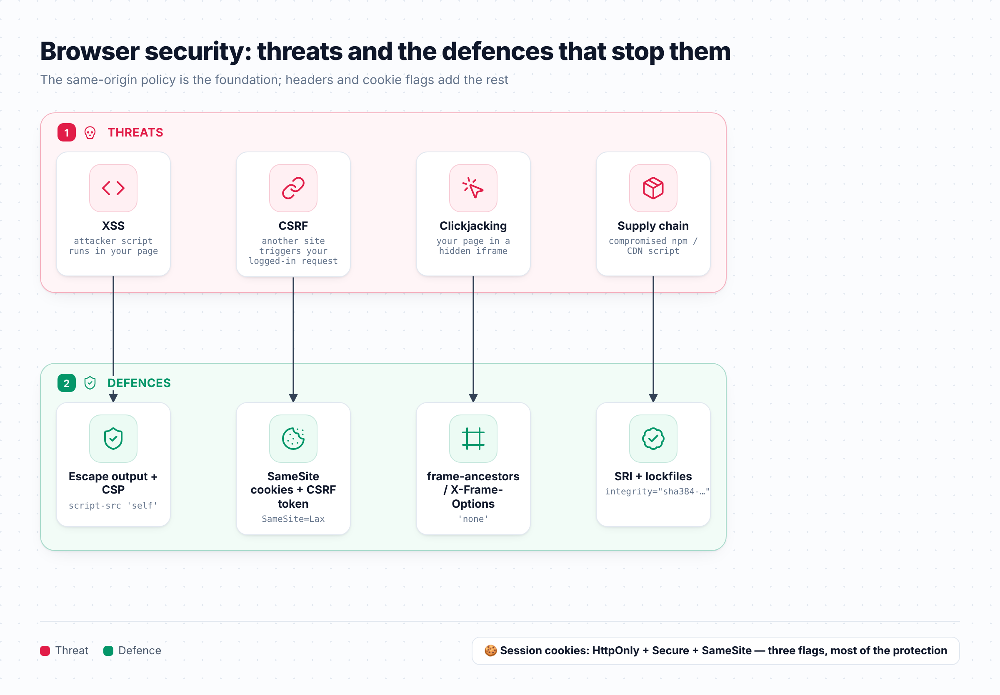

# 8.4 — Browser security

!!! abstract "In one sentence"
    Browsers run code from millions of untrusted sites side by side, so they enforce the **same-origin policy** (a page
    can't read another origin's data) and isolate sites in separate processes; most web attacks try to get around that —
    **XSS** runs the attacker's script *inside* your origin, **CSRF** makes the browser send your cookies to your site
    from somewhere else, **clickjacking** frames your page — and the defences are mostly **headers and cookie flags** the
    platform team can set centrally.

## 📖 Key terms & abbreviations

| Term | Stands for | What it is | How it works (one line) |
|---|---|---|---|
| **Origin** | — | scheme + host + port | `https://app.example.com:443` |
| **Site** | — | Registrable domain (eTLD+1) + scheme | `https://example.com`; used by SameSite |
| **SOP** | Same-Origin Policy | Pages can't read other origins' responses/DOM | The browser's core security boundary |
| **Site isolation** | — | Each site in its own renderer process | Limits Spectre-style leaks between sites |
| **XSS** | Cross-Site Scripting | Attacker-controlled script runs in your page | Stored, reflected or DOM-based |
| **CSP** | Content Security Policy | Header listing allowed script/style/connect sources | Blocks injected and inline scripts |
| **CSRF** | Cross-Site Request Forgery | Another site triggers a state-changing request with your cookies | Prevented by SameSite, tokens, Origin checks |
| **SameSite** | — | Cookie attribute: Strict / Lax / None | Controls sending cookies on cross-site requests |
| **Clickjacking** | — | Your page invisibly framed under a decoy | `frame-ancestors` / X-Frame-Options |
| **CORS** | Cross-Origin Resource Sharing | Opt-in relaxation of SOP for reads | `Access-Control-Allow-Origin` (6.1) |
| **HSTS** | HTTP Strict Transport Security | Always use HTTPS for this site | Prevents SSL stripping |
| **SRI** | Subresource Integrity | Hash pinning for external scripts | `integrity="sha384-…"` |
| **Trusted Types** | — | CSP feature restricting DOM XSS sinks | `innerHTML` only accepts vetted values |
| **COOP / COEP** | Cross-Origin Opener / Embedder Policy | Isolation headers | Needed for `SharedArrayBuffer`, stronger isolation |

## 🗺️ Big picture



---

## 1 · The same-origin policy

### How does it work?

JavaScript on `https://evil.example` can **send** requests to `https://bank.example` (forms, images, `fetch`), but it **cannot read** the responses, the DOM, cookies or storage of that origin. Everything else in browser security either protects this boundary or carefully relaxes it (**CORS** for reads, `postMessage` for windows).

Modern browsers also put each **site** in its own **process** (site isolation), so even a renderer bug or Spectre-style side channel can't easily read another site's memory.

## 2 · XSS and Content Security Policy

**XSS** = the attacker gets their JavaScript to run on *your* origin, so the SOP doesn't protect you: it can read the page, call your APIs with the user's session, steal non-HttpOnly tokens.

| Kind | How | Example |
|---|---|---|
| Stored | Malicious input saved and shown to others | Comment containing `<script>` |
| Reflected | Input echoed in a response | `?q=<script>…` in search results |
| DOM-based | Client code writes untrusted data into the DOM | `el.innerHTML = location.hash` |

**Defences (layered):**

1. **Encode output** for the context (templating frameworks do it by default; avoid `innerHTML`, `dangerouslySetInnerHTML`, `v-html`).
2. **CSP**: `Content-Security-Policy: default-src 'self'; script-src 'self' 'nonce-r4nd0m'; object-src 'none'; base-uri 'none'` — blocks inline and foreign scripts even if injection happens. Roll out with `Content-Security-Policy-Report-Only` first.
3. **Trusted Types** for DOM XSS sinks; **HttpOnly** cookies so scripts can't read the session.

## 3 · CSRF and SameSite cookies

### How does it work?

The browser automatically attaches cookies to requests for a site — even if the request was started by another site (a hidden form on `evil.example` posting to `bank.example/transfer`).

**Defences:**

- **`SameSite=Lax`** (browser default for cookies without the attribute in Chrome): cookies aren't sent on cross-site POSTs/subrequests, only on top-level GET navigations. `Strict` = never cross-site. `None` (+`Secure`) only when you truly need third-party context.
- **CSRF tokens** in forms/headers, or check the **`Origin`/`Sec-Fetch-Site`** headers on state-changing requests.
- **Never change state on GET.**

## 4 · Framing, transport and third parties

- **Clickjacking** → `Content-Security-Policy: frame-ancestors 'none'` (or `X-Frame-Options: DENY`).
- **HSTS** → `Strict-Transport-Security: max-age=31536000; includeSubDomains; preload`; no **mixed content** (HTTP resources on HTTPS pages are blocked).
- **Third-party scripts** run with *your* origin's power. Minimize them, pin versions, use **SRI** for CDN-hosted files, restrict with CSP, and review npm dependencies (lockfiles, audit, provenance) — supply-chain attacks on popular packages are common.
- **Tokens in `localStorage`** are readable by any XSS. Prefer **HttpOnly, Secure, SameSite** cookies for sessions (or keep access tokens in memory with short lifetimes).

## 🔧 DevOps connection

- **Set security headers centrally** at the CDN/ingress/gateway (HSTS, CSP, `frame-ancestors`, `nosniff`, `Referrer-Policy`, `Permissions-Policy`) so every app gets them (6.1).
- **CSP report endpoints** (`report-to`) feed violations into your logging; spikes after a deploy show broken or injected scripts.
- **WAF** rules catch common injection payloads but are a backstop, not a replacement for encoding.
- **Dependency scanning and SBOMs** in CI for frontend packages; pin and verify third-party script hashes.
- **Cookie flags are config**: check them in integration tests (`Set-Cookie` must have `HttpOnly; Secure; SameSite`).

## 🧪 Try it yourself

```bash
# Which security headers does a site send?
curl -sI https://github.com | grep -iE 'content-security-policy|strict-transport|x-frame|x-content-type|referrer-policy|permissions-policy|cross-origin'

# Cookie flags
curl -sI https://github.com | grep -i '^set-cookie' | head -3
```

```js
// Browser console on any site: the SOP in action
fetch('https://example.com').then(r => r.text()).then(console.log).catch(e => console.log('blocked by CORS/SOP:', e.message));
document.cookie;          // HttpOnly cookies do NOT appear here
```

Online: run your domain through **securityheaders.com** and Mozilla **HTTP Observatory**; test CSP with **csp-evaluator.withgoogle.com**.

## 🃏 Cheat sheet

| Threat | Defence |
|---|---|
| XSS | Output encoding, CSP (nonces, no inline), Trusted Types, HttpOnly |
| CSRF | SameSite=Lax/Strict, CSRF tokens, Origin check, no state change on GET |
| Clickjacking | `frame-ancestors 'none'` |
| Downgrade / sniffing | HSTS (+ preload) |
| Compromised CDN script | SRI + CSP allow-list |
| Token theft | HttpOnly Secure cookies, short-lived tokens |

## ❓ Test yourself

??? question "1. What exactly does the same-origin policy prevent?"
    Reading responses, DOM, cookies and storage of another origin; it doesn't prevent sending requests to it.

??? question "2. Why is XSS so dangerous even with the SOP in place?"
    The attacker's script runs on your origin, so the SOP treats it as your code: it can read pages and call APIs as the user.

??? question "3. How does SameSite=Lax stop most CSRF?"
    Cookies aren't attached to cross-site POSTs or subrequests, so a forged form submission from another site arrives without the session.

??? question "4. Is CORS a security feature that protects your API?"
    No. It's a controlled relaxation of the SOP for browser reads; it doesn't stop non-browser clients and isn't authentication.

??? question "5. Why roll out CSP in Report-Only mode first?"
    To see what legitimate scripts/styles would be blocked before enforcing, avoiding breaking the site.

---

## 📚 Sources

- [MDN — Same-origin policy](https://developer.mozilla.org/en-US/docs/Web/Security/Same-origin_policy)
- [MDN — Content Security Policy](https://developer.mozilla.org/en-US/docs/Web/HTTP/CSP)
- [OWASP — XSS Prevention Cheat Sheet](https://cheatsheetseries.owasp.org/cheatsheets/Cross_Site_Scripting_Prevention_Cheat_Sheet.html) · [CSRF Prevention Cheat Sheet](https://cheatsheetseries.owasp.org/cheatsheets/Cross-Site_Request_Forgery_Prevention_Cheat_Sheet.html)
- [web.dev — SameSite cookies explained](https://web.dev/articles/samesite-cookies-explained)
- [Mozilla HTTP Observatory](https://developer.mozilla.org/en-US/observatory)

## ✍️ My notes

> Scan your production domain with HTTP Observatory. Which headers are missing, and where (CDN, ingress, app) would you add them?

-
