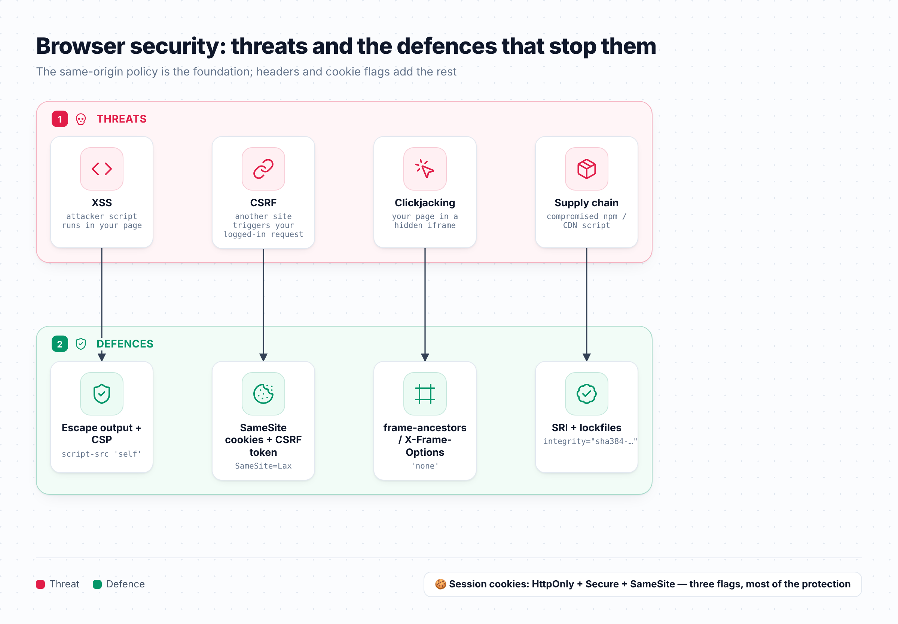

# 8.4 — Tarayıcı güvenliği

!!! abstract "Kısaca"
    Tarayıcılar milyonlarca güvenilmeyen siteden gelen kodu yan yana çalıştırır. Bu yüzden **same-origin policy**'yi
    (bir sayfa başka bir origin'in verisini okuyamaz) uygular ve siteleri ayrı process'lerde izole eder. Çoğu web
    saldırısı bunu aşmaya çalışır: **XSS** saldırganın script'ini senin origin'inin *içinde* çalıştırır, **CSRF**
    tarayıcının cookie'lerini başka bir yerden senin sitene göndermesini sağlar, **clickjacking** sayfanı bir çerçeveye
    koyar. Savunmaların çoğu platform ekibinin merkezi olarak ayarlayabileceği **header'lar ve cookie bayraklarıdır**.

## 📖 Temel terimler ve kısaltmalar

| Terim | Açılımı | Nedir | Nasıl çalışır (tek satır) |
|---|---|---|---|
| **Origin** | — | şema + host + port | `https://app.example.com:443` |
| **Site** | — | Kayıt edilebilir alan adı (eTLD+1) + şema | `https://example.com`; SameSite bunu kullanır |
| **SOP** | Same-Origin Policy | Sayfalar diğer origin'lerin cevaplarını/DOM'unu okuyamaz | Tarayıcının temel güvenlik sınırı |
| **Site izolasyonu** | Site isolation | Her site kendi renderer process'inde | Siteler arası Spectre tarzı sızıntıları sınırlar |
| **XSS** | Cross-Site Scripting | Saldırganın kontrol ettiği script sayfanda çalışır | Kalıcı, yansıyan ya da DOM tabanlı |
| **CSP** | Content Security Policy | İzin verilen script/stil/bağlantı kaynaklarını listeleyen header | Enjekte edilmiş ve inline script'leri engeller |
| **CSRF** | Cross-Site Request Forgery | Başka bir site cookie'lerinle durum değiştiren bir istek tetikler | SameSite, token'lar, Origin kontrolleriyle önlenir |
| **SameSite** | — | Cookie özniteliği: Strict / Lax / None | Siteler arası isteklerde cookie gönderimini kontrol eder |
| **Clickjacking** | — | Sayfan bir yemin altında görünmez çerçevede | `frame-ancestors` / X-Frame-Options |
| **CORS** | Cross-Origin Resource Sharing | Okumalar için SOP'nin isteğe bağlı gevşetilmesi | `Access-Control-Allow-Origin` (6.1) |
| **HSTS** | HTTP Strict Transport Security | Bu siteye hep HTTPS ile git | SSL stripping'i önler |
| **SRI** | Subresource Integrity | Dış script'ler için hash sabitleme | `integrity="sha384-…"` |
| **Trusted Types** | — | DOM XSS noktalarını kısıtlayan CSP özelliği | `innerHTML` sadece onaylı değerleri kabul eder |
| **COOP / COEP** | Cross-Origin Opener / Embedder Policy | İzolasyon header'ları | `SharedArrayBuffer` ve daha güçlü izolasyon için |

## 🗺️ Büyük resim



---

## 1 · Same-origin policy

### Nasıl çalışır?

`https://evil.example`'daki JavaScript `https://bank.example`'a istek **gönderebilir** (formlar, görseller, `fetch`), ama o origin'in cevaplarını, DOM'unu, cookie'lerini ya da depolamasını **okuyamaz**. Tarayıcı güvenliğindeki diğer her şey ya bu sınırı korur ya da dikkatle gevşetir (okumalar için **CORS**, pencereler için `postMessage`).

Modern tarayıcılar her **siteyi** kendi **process'ine** de koyar (site izolasyonu); bir renderer hatası ya da Spectre tarzı bir yan kanal bile başka bir sitenin belleğini kolayca okuyamaz.

## 2 · XSS ve Content Security Policy

**XSS** = saldırgan JavaScript'ini *senin* origin'inde çalıştırır; SOP seni korumaz: sayfayı okuyabilir, kullanıcının oturumuyla API'lerini çağırabilir, HttpOnly olmayan token'ları çalabilir.

| Tür | Nasıl | Örnek |
|---|---|---|
| Kalıcı | Kötü niyetli girdi kaydedilip başkalarına gösterilir | `<script>` içeren yorum |
| Yansıyan | Girdi bir cevapta geri yansıtılır | Arama sonuçlarında `?q=<script>…` |
| DOM tabanlı | İstemci kodu güvenilmeyen veriyi DOM'a yazar | `el.innerHTML = location.hash` |

**Savunmalar (katmanlı):**

1. **Çıktıyı bağlama göre kodla** (şablon framework'leri bunu varsayılan yapar; `innerHTML`, `dangerouslySetInnerHTML`, `v-html`'den kaçın).
2. **CSP**: `Content-Security-Policy: default-src 'self'; script-src 'self' 'nonce-r4nd0m'; object-src 'none'; base-uri 'none'`; enjeksiyon olsa bile inline ve yabancı script'leri engeller. Önce `Content-Security-Policy-Report-Only` ile yayına al.
3. DOM XSS noktaları için **Trusted Types**; script'ler oturumu okuyamasın diye **HttpOnly** cookie'ler.

## 3 · CSRF ve SameSite cookie'ler

### Nasıl çalışır?

Tarayıcı bir siteye giden isteklere cookie'leri otomatik ekler; istek başka bir site tarafından başlatılmış olsa bile (`evil.example`'daki gizli bir formun `bank.example/transfer`'e POST etmesi).

**Savunmalar:**

- **`SameSite=Lax`** (Chrome'da özniteliği olmayan cookie'ler için tarayıcı varsayılanı): cookie'ler siteler arası POST/alt isteklerde gönderilmez, sadece üst düzey GET gezinmelerinde. `Strict` = siteler arası asla. `None` (+`Secure`) sadece gerçekten üçüncü taraf bağlamına ihtiyacın varsa.
- Formlarda/header'larda **CSRF token'ları** ya da durum değiştiren isteklerde **`Origin`/`Sec-Fetch-Site`** header'larını kontrol et.
- **GET'te asla durum değiştirme.**

## 4 · Çerçeveleme, taşıma ve üçüncü taraflar

- **Clickjacking** → `Content-Security-Policy: frame-ancestors 'none'` (ya da `X-Frame-Options: DENY`).
- **HSTS** → `Strict-Transport-Security: max-age=31536000; includeSubDomains; preload`; **karışık içerik** yok (HTTPS sayfalarındaki HTTP kaynakları engellenir).
- **Üçüncü taraf script'ler** *senin* origin'inin gücüyle çalışır. Azalt, sürümleri sabitle, CDN'de barındırılan dosyalar için **SRI** kullan, CSP ile kısıtla ve npm bağımlılıklarını gözden geçir (lockfile'lar, audit, provenance); popüler paketlere tedarik zinciri saldırıları yaygın.
- **`localStorage`'daki token'lar** her XSS tarafından okunabilir. Oturumlar için **HttpOnly, Secure, SameSite** cookie'leri tercih et (ya da kısa ömürlü access token'ları bellekte tut).

## 🔧 DevOps bağlantısı

- **Güvenlik header'larını CDN/ingress/gateway'de merkezi ayarla** (HSTS, CSP, `frame-ancestors`, `nosniff`, `Referrer-Policy`, `Permissions-Policy`); her uygulama onları alsın (6.1).
- **CSP rapor endpoint'leri** (`report-to`) ihlalleri loglamana besler; deploy sonrası ani artışlar bozuk ya da enjekte edilmiş script'leri gösterir.
- **WAF** kuralları yaygın enjeksiyon yüklerini yakalar ama kodlamanın yerine değil, son savunma hattıdır.
- CI'da ön uç paketleri için **bağımlılık taraması ve SBOM'lar**; üçüncü taraf script hash'lerini sabitle ve doğrula.
- **Cookie bayrakları konfigürasyondur**: entegrasyon testlerinde kontrol et (`Set-Cookie`'de `HttpOnly; Secure; SameSite` olmalı).

## 🧪 Kendin dene

```bash
# Bir site hangi güvenlik header'larını gönderiyor?
curl -sI https://github.com | grep -iE 'content-security-policy|strict-transport|x-frame|x-content-type|referrer-policy|permissions-policy|cross-origin'

# Cookie bayrakları
curl -sI https://github.com | grep -i '^set-cookie' | head -3
```

```js
// Herhangi bir sitede tarayıcı konsolu: SOP iş başında
fetch('https://example.com').then(r => r.text()).then(console.log).catch(e => console.log('CORS/SOP engelledi:', e.message));
document.cookie;          // HttpOnly cookie'ler burada GÖRÜNMEZ
```

Çevrimiçi: alan adını **securityheaders.com** ve Mozilla **HTTP Observatory**'den geçir; CSP'yi **csp-evaluator.withgoogle.com** ile test et.

## 🃏 Hatırlatma kartı

| Tehdit | Savunma |
|---|---|
| XSS | Çıktı kodlama, CSP (nonce'lar, inline yok), Trusted Types, HttpOnly |
| CSRF | SameSite=Lax/Strict, CSRF token'ları, Origin kontrolü, GET'te durum değişikliği yok |
| Clickjacking | `frame-ancestors 'none'` |
| Düşürme / koklama | HSTS (+ preload) |
| Ele geçirilmiş CDN script'i | SRI + CSP izin listesi |
| Token hırsızlığı | HttpOnly Secure cookie'ler, kısa ömürlü token'lar |

## ❓ Kendini test et

??? question "1. Same-origin policy tam olarak neyi engeller?"
    Başka bir origin'in cevaplarını, DOM'unu, cookie'lerini ve depolamasını okumayı; ona istek göndermeyi engellemez.

??? question "2. SOP yerindeyken bile XSS neden bu kadar tehlikeli?"
    Saldırganın script'i senin origin'inde çalışır; SOP onu senin kodun sayar: sayfaları okuyabilir ve kullanıcı olarak API çağırabilir.

??? question "3. SameSite=Lax çoğu CSRF'i nasıl durdurur?"
    Cookie'ler siteler arası POST'lara ya da alt isteklere eklenmez; başka bir siteden gelen sahte form gönderimi oturumsuz ulaşır.

??? question "4. CORS API'ni koruyan bir güvenlik özelliği mi?"
    Hayır. Tarayıcı okumaları için SOP'nin kontrollü bir gevşetilmesidir; tarayıcı olmayan istemcileri durdurmaz ve kimlik doğrulama değildir.

??? question "5. CSP neden önce Report-Only modunda yayına alınır?"
    Uygulamaya koymadan önce hangi meşru script/stillerin engelleneceğini görmek ve siteyi bozmamak için.

---

## 📚 Kaynaklar

- [MDN — Same-origin policy](https://developer.mozilla.org/en-US/docs/Web/Security/Same-origin_policy)
- [MDN — Content Security Policy](https://developer.mozilla.org/en-US/docs/Web/HTTP/CSP)
- [OWASP — XSS Prevention Cheat Sheet](https://cheatsheetseries.owasp.org/cheatsheets/Cross_Site_Scripting_Prevention_Cheat_Sheet.html) · [CSRF Prevention Cheat Sheet](https://cheatsheetseries.owasp.org/cheatsheets/Cross-Site_Request_Forgery_Prevention_Cheat_Sheet.html)
- [web.dev — SameSite cookies explained](https://web.dev/articles/samesite-cookies-explained)
- [Mozilla HTTP Observatory](https://developer.mozilla.org/en-US/observatory)

## ✍️ Notlarım

> Production alan adını HTTP Observatory ile tara. Hangi header'lar eksik ve onları nereye (CDN, ingress, uygulama) eklerdin?
