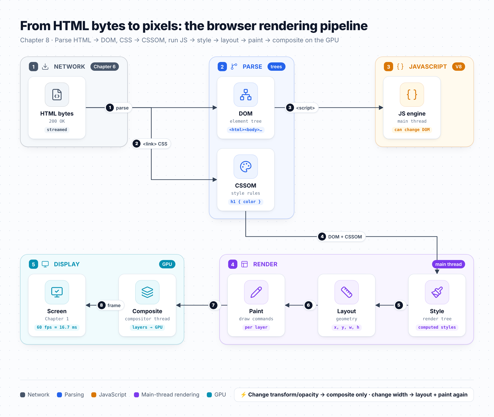

# Chapter 8 — The browser

!!! abstract "In one sentence"
    The browser **parses** HTML into the **DOM** and CSS into the **CSSOM**, lets **JavaScript** modify both,
    combines them into styled boxes (**style**), works out where every box goes (**layout**), records how to draw them
    (**paint**), and lets the GPU stack the resulting layers into a frame (**composite**). It tries to do this
    within 16.7 ms, 60 times a second, on a **single main thread** that JavaScript also has to share.



---

## 0 · A browser is many processes

| Process | Job |
|---|---|
| **Browser process** | Tabs, address bar, network requests, storage, permissions |
| **Renderer process** (one per site, sandboxed) | Parses HTML/CSS, runs JS, does style/layout/paint. Has a **main thread**, a **compositor thread** and raster threads. |
| **GPU process** | Talks to the GPU and draws the final frames |

> Why many processes? **Security** (a malicious site is locked in its sandboxed renderer) and **stability** (one crashing tab doesn't take the others down). Chapter 3 isolation, applied.

## 1 · Parse: HTML → DOM, CSS → CSSOM

| Step | What happens |
|---|---|
| **HTML parsing** | Bytes → characters → tokens (`<h1>`, text, `</h1>`) → nodes → the **DOM** tree. The parser is streaming (it starts before the whole file arrives) and very forgiving of broken HTML. |
| **Preload scanner** | Looks ahead in the HTML for `<link>`, `<script>`, `` and starts downloading them early. |
| **CSS parsing** | Every stylesheet becomes the **CSSOM**: rules with selectors and properties. CSS is **render-blocking**: the browser won't paint until it has the CSS, to avoid a flash of unstyled content. |

## 2 · JavaScript: the main-thread guest

- A plain `<script src>` is **parser-blocking**: HTML parsing stops until the script is downloaded and executed, because the script might change the document.
- `defer` → download in parallel, run after parsing finishes (in order). `async` → download in parallel, run as soon as it arrives. `type="module"` is deferred by default.
- JS reads and changes the DOM and styles through the **DOM API** (`document.querySelector`, `element.style`, …). Every change can invalidate style, layout or paint.
- JS runs in V8 (Chapter 4: bytecode + JIT).

## 3 · Render: style → layout → paint

| # | Stage | What happens |
|---|---|---|
| 4 | **Style** | Match CSS rules to DOM nodes and compute the final value of every property. Nodes with `display: none` are dropped. Result: the **render tree**. |
| 5 | **Layout** (reflow) | Calculate the geometry: the `x, y, width, height` of every box, text line breaks. Depends on the viewport size. |
| 6 | **Paint** | Record draw commands ("fill rect here, draw text there") for each **layer**. |
| 7 | **Composite** | The **compositor thread** rasterizes layers into tiles (on the GPU) and stacks them into a frame. Scrolling and `transform`/`opacity` animations can be done here **without touching the main thread**. |
| 8 | **Display** | The frame goes to the GPU process and, at the next vsync, to the screen (Chapter 1, step 18). |

!!! tip "Remember this: the cost of a change"
    Changing `width`/`top`/font size → **layout + paint + composite** (expensive).
    Changing `color`/`background` → **paint + composite**.
    Changing `transform`/`opacity` → **composite only** (cheap, smooth). That's why good animations use `transform`.

## 4 · The event loop and the 16.7 ms budget

The main thread runs a loop: take a **task** (a click handler, a network callback, a timer), run it to completion, run **microtasks** (resolved promises), then, about every 16.7 ms, do a **rendering step** (`requestAnimationFrame` callbacks → style → layout → paint).

- A JS task that runs for 200 ms blocks clicks, typing and rendering for 200 ms. That's **jank**. Tasks over 50 ms are called **long tasks**.
- Heavy work goes to a **Web Worker** (a separate thread without DOM access) or is split into smaller chunks.
- **Layout thrashing:** reading layout (`offsetHeight`) right after writing styles, in a loop, forces layout again and again.

## 5 · Measuring what users feel: Core Web Vitals

| Metric | Measures | "Good" |
|---|---|---|
| **LCP** (Largest Contentful Paint) | When the main content appeared | ≤ 2.5 s |
| **INP** (Interaction to Next Paint) | How fast the page reacts to clicks and typing | ≤ 200 ms |
| **CLS** (Cumulative Layout Shift) | How much things jump around while loading | ≤ 0.1 |

## 6 · SPA vs server-side rendering

| Approach | First response | Trade-off |
|---|---|---|
| **SPA** (React/Vue app, client-side) | An almost empty HTML shell + a big JS bundle that builds the DOM | Slow first paint on weak devices, smooth navigation after |
| **SSR / SSG** (Next.js, Nuxt, Astro) | Fully rendered HTML from the server or a CDN, then JS **hydrates** it to make it interactive | Fast first paint, more server work |

> DevOps connection: frontend performance is mostly **Chapters 6–7 + this chapter**: fewer round trips (HTTP/2, CDN, caching headers), fewer and smaller bytes (compression, code splitting), and less main-thread work.

---

## 🧪 Try it yourself (Chrome DevTools)

1. Open any site → **DevTools → Performance** → record a page reload. Find the **Parse HTML**, **Evaluate Script**, **Recalculate Style**, **Layout**, **Paint** and **Composite Layers** blocks on the Main and Compositor tracks.
2. **DevTools → Lighthouse** → run a report and read LCP, CLS and TBT (total blocking time).
3. **DevTools → More tools → Rendering** → enable **Paint flashing** and **Layout shift regions**, then scroll and interact.
4. Compare **View Page Source** (what the server sent) with the **Elements** panel (the live DOM after JS ran). For a client-side SPA they're very different.
5. In the Console:

```js
// Navigation timing: DNS, TCP, TLS, TTFB, DOM ready (Chapter 6 numbers, from the browser's view)
const n = performance.getEntriesByType('navigation')[0];
console.table({ dns: n.domainLookupEnd - n.domainLookupStart, tcp: n.connectEnd - n.connectStart,
  ttfb: n.responseStart - n.requestStart, domContentLoaded: n.domContentLoadedEventEnd, load: n.loadEventEnd });

// Feel a long task: the page freezes for 2 seconds
const t = Date.now(); while (Date.now() - t < 2000) {}
```

**Exercise:** in the Performance panel, record while running the 2-second loop and try clicking a button on the page. Find the long task and see when the click was finally handled.

---

## 🃏 Cheat sheet

```text
Bytes → HTML parser → DOM          CSS → CSSOM (render-blocking)
<script> blocks parsing (use defer/async) · JS changes DOM/CSSOM via DOM API
DOM + CSSOM → Style (render tree) → Layout (geometry) → Paint (draw commands)
   → Composite (layers on GPU, compositor thread) → frame → vsync → screen
Event loop: task → microtasks → (every ~16.7 ms) rAF → style → layout → paint
transform/opacity = composite only · width/top = layout again
Core Web Vitals: LCP ≤ 2.5 s · INP ≤ 200 ms · CLS ≤ 0.1
```

---

## ❓ Test yourself

??? question "1. Why can a plain `<script src>` in the `<head>` delay the whole page?"
    It's parser-blocking: the HTML parser stops, waits for the script to download and execute, and only then continues building the DOM. `defer` or `async` avoids this.

??? question "2. Which is cheaper to animate, `left` or `transform: translateX()`? Why?"
    `transform`. Changing `left` triggers layout and paint on the main thread every frame. `transform` can be handled by the compositor on the GPU without layout or paint.

??? question "3. A button click takes 400 ms to show any effect. Which metric gets worse, and what's the usual cause?"
    INP (Interaction to Next Paint). Usually a long JavaScript task on the main thread that blocks the event handler or the next rendering step.

??? question "4. What's the difference between View Source and the Elements panel?"
    View Source shows the original HTML bytes the server sent. Elements shows the current DOM, after the parser fixed things up and JavaScript changed it.

??? question "5. Why does each site get its own renderer process?"
    Security and stability. A compromised or crashing page is isolated in its own sandboxed process (Site Isolation) and can't read other sites' memory or bring them down.

---

## 📚 Sources

- [Inside look at modern web browser (Chrome for Developers, 4 parts)](https://developer.chrome.com/blog/inside-browser-part1)
- [How browsers work (web.dev)](https://web.dev/articles/howbrowserswork)
- [Rendering performance (web.dev)](https://web.dev/articles/rendering-performance)
- [Web Vitals (web.dev)](https://web.dev/articles/vitals)
- [MDN: the event loop](https://developer.mozilla.org/en-US/docs/Web/JavaScript/Event_loop)

## ✍️ My notes

> Explain the path from HTML bytes to pixels, and why long JavaScript tasks make a page feel slow, in your own words in 5 lines.

-
