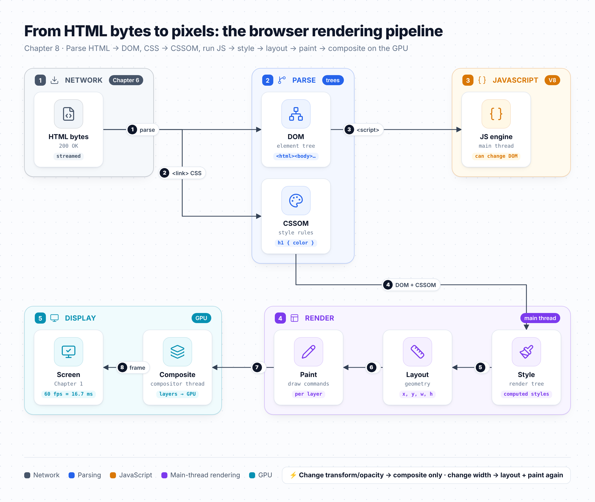

# Bölüm 8 — Tarayıcı

!!! abstract "Tek cümlede"
    Tarayıcı HTML'i **DOM**'a, CSS'i **CSSOM**'a **ayrıştırır**, **JavaScript**'in ikisini de değiştirmesine izin verir,
    bunları stillendirilmiş kutulara dönüştürür (**style**), her kutunun nereye gideceğini hesaplar (**layout**),
    onları nasıl çizeceğini kaydeder (**paint**) ve ortaya çıkan katmanları GPU'nun bir kare halinde üst üste koymasını sağlar
    (**composite**). Bunu saniyede 60 kez, 16,7 ms içinde, JavaScript'in de paylaşmak zorunda olduğu **tek bir ana thread** üzerinde yapmaya çalışır.



---

## 0 · Bir tarayıcı birçok process'ten oluşur

| Process | Görevi |
|---|---|
| **Browser process** | Sekmeler, adres çubuğu, ağ istekleri, depolama, izinler |
| **Renderer process** (site başına bir tane, sandbox içinde) | HTML/CSS'i ayrıştırır, JS çalıştırır, style/layout/paint yapar. Bir **ana thread**'i (main thread), bir **compositor thread**'i ve raster thread'leri vardır. |
| **GPU process** | GPU ile konuşur ve son kareleri çizer |

> Neden birçok process? **Güvenlik** (kötü niyetli bir site kendi sandbox'lı renderer'ına kilitlenir) ve **kararlılık** (çöken bir sekme diğerlerini götürmez). Bölüm 3'teki izolasyonun uygulaması.

## 1 · Ayrıştır: HTML → DOM, CSS → CSSOM

| Adım | Ne oluyor |
|---|---|
| **HTML ayrıştırma** | Byte'lar → karakterler → token'lar (`<h1>`, metin, `</h1>`) → düğümler → **DOM** ağacı. Ayrıştırıcı akış halinde çalışır (dosyanın tamamı gelmeden başlar) ve bozuk HTML'e karşı çok hoşgörülüdür. |
| **Preload scanner** | HTML'de ileriye bakıp `<link>`, `<script>`, `` etiketlerini bulur ve onları erkenden indirmeye başlar. |
| **CSS ayrıştırma** | Her stil dosyası **CSSOM**'a dönüşür: seçicileri ve özellikleri olan kurallar. CSS **render'ı bloklar**: stilsiz içeriğin bir anlığına görünmesini önlemek için tarayıcı CSS'i almadan çizim yapmaz. |

## 2 · JavaScript: ana thread'in misafiri

- Düz bir `<script src>` **ayrıştırıcıyı bloklar**: script indirilip çalıştırılana kadar HTML ayrıştırması durur, çünkü script dokümanı değiştirebilir.
- `defer` → paralel indir, ayrıştırma bitince (sırayla) çalıştır. `async` → paralel indir, gelir gelmez çalıştır. `type="module"` varsayılan olarak defer'lıdır.
- JS, DOM'u ve stilleri **DOM API** üzerinden okur ve değiştirir (`document.querySelector`, `element.style`, …). Her değişiklik style, layout ya da paint'i geçersiz kılabilir.
- JS, V8'de çalışır (Bölüm 4: bytecode + JIT).

## 3 · Render: style → layout → paint

| # | Aşama | Ne oluyor |
|---|---|---|
| 4 | **Style** | CSS kurallarını DOM düğümleriyle eşleştir ve her özelliğin son değerini hesapla. `display: none` olan düğümler çıkarılır. Sonuç: **render ağacı**. |
| 5 | **Layout** (reflow) | Geometriyi hesapla: her kutunun `x, y, genişlik, yükseklik` değerleri, metin satır kesmeleri. Pencere boyutuna bağlıdır. |
| 6 | **Paint** | Her **katman** için çizim komutlarını kaydet ("buraya dikdörtgen doldur, şuraya metin çiz"). |
| 7 | **Composite** | **Compositor thread**, katmanları karolara rasterize eder (GPU'da) ve bir kare halinde üst üste koyar. Kaydırma ve `transform`/`opacity` animasyonları burada, **ana thread'e hiç dokunmadan** yapılabilir. |
| 8 | **Ekran** | Kare GPU process'ine, sonraki vsync'te de ekrana gider (Bölüm 1, adım 18). |

!!! tip "Bunu hatırla: bir değişikliğin maliyeti"
    `width`/`top`/font boyutu değişirse → **layout + paint + composite** (pahalı).
    `color`/`background` değişirse → **paint + composite**.
    `transform`/`opacity` değişirse → **sadece composite** (ucuz, akıcı). İyi animasyonların `transform` kullanmasının sebebi bu.

## 4 · Event loop ve 16,7 ms bütçesi

Ana thread bir döngü çalıştırır: bir **görev (task)** al (tıklama işleyicisi, ağ callback'i, zamanlayıcı), sonuna kadar çalıştır, **mikro görevleri** çalıştır (çözülmüş promise'ler), sonra yaklaşık her 16,7 ms'de bir **render adımı** yap (`requestAnimationFrame` callback'leri → style → layout → paint).

- 200 ms süren bir JS görevi tıklamaları, yazmayı ve render'ı 200 ms boyunca bloklar. Buna **jank** (takılma) denir. 50 ms'yi aşan görevlere **uzun görev (long task)** denir.
- Ağır işler bir **Web Worker**'a (DOM erişimi olmayan ayrı bir thread) gider ya da küçük parçalara bölünür.
- **Layout thrashing:** bir döngüde stilleri yazdıktan hemen sonra layout'u okumak (`offsetHeight`), layout'u tekrar tekrar zorlar.

## 5 · Kullanıcının hissettiğini ölçmek: Core Web Vitals

| Metrik | Ölçtüğü | "İyi" |
|---|---|---|
| **LCP** (Largest Contentful Paint) | Ana içeriğin ne zaman göründüğü | ≤ 2,5 sn |
| **INP** (Interaction to Next Paint) | Sayfanın tıklamalara ve yazmaya ne kadar hızlı tepki verdiği | ≤ 200 ms |
| **CLS** (Cumulative Layout Shift) | Yükleme sırasında öğelerin ne kadar zıpladığı | ≤ 0,1 |

## 6 · SPA ve sunucu tarafında render

| Yaklaşım | İlk cevap | Bedeli |
|---|---|---|
| **SPA** (React/Vue uygulaması, istemci tarafı) | Neredeyse boş bir HTML kabuğu + DOM'u kuran büyük bir JS paketi | Zayıf cihazlarda yavaş ilk çizim, sonrasında akıcı gezinme |
| **SSR / SSG** (Next.js, Nuxt, Astro) | Sunucudan ya da CDN'den gelen, tamamen render edilmiş HTML. Sonra JS onu etkileşimli hale getirmek için **hydrate** eder | Hızlı ilk çizim, daha fazla sunucu işi |

> DevOps bağlantısı: frontend performansı çoğunlukla **Bölüm 6–7 + bu bölümdür**: daha az gidiş-dönüş (HTTP/2, CDN, önbellek başlıkları), daha az ve daha küçük byte (sıkıştırma, code splitting) ve daha az ana thread işi.

---

## 🧪 Kendin dene (Chrome DevTools)

1. Herhangi bir siteyi aç → **DevTools → Performance** → sayfa yenilemesini kaydet. Main ve Compositor izlerinde **Parse HTML**, **Evaluate Script**, **Recalculate Style**, **Layout**, **Paint** ve **Composite Layers** bloklarını bul.
2. **DevTools → Lighthouse** → bir rapor çalıştır ve LCP, CLS ile TBT (toplam bloklama süresi) değerlerini oku.
3. **DevTools → More tools → Rendering** → **Paint flashing** ve **Layout shift regions** seçeneklerini aç, sonra sayfayı kaydır ve etkileşime gir.
4. **View Page Source**'u (sunucunun gönderdiği) **Elements** paneliyle (JS çalıştıktan sonraki canlı DOM) karşılaştır. İstemci tarafı bir SPA'da ikisi çok farklıdır.
5. Console'da:

```js
// Navigasyon zamanlaması: DNS, TCP, TLS, TTFB, DOM hazır (Bölüm 6'daki sayılar, tarayıcının gözünden)
const n = performance.getEntriesByType('navigation')[0];
console.table({ dns: n.domainLookupEnd - n.domainLookupStart, tcp: n.connectEnd - n.connectStart,
  ttfb: n.responseStart - n.requestStart, domContentLoaded: n.domContentLoadedEventEnd, load: n.loadEventEnd });

// Uzun bir görevi hisset: sayfa 2 saniye donar
const t = Date.now(); while (Date.now() - t < 2000) {}
```

**Görev:** Performance panelinde kayıt alırken 2 saniyelik döngüyü çalıştır ve sayfadaki bir butona tıklamayı dene. Uzun görevi bul ve tıklamanın sonunda ne zaman işlendiğine bak.

---

## 🃏 Hatırlatma kartı

```text
Byte'lar → HTML ayrıştırıcı → DOM          CSS → CSSOM (render'ı bloklar)
<script> ayrıştırmayı bloklar (defer/async kullan) · JS, DOM API ile DOM/CSSOM'u değiştirir
DOM + CSSOM → Style (render ağacı) → Layout (geometri) → Paint (çizim komutları)
   → Composite (GPU'da katmanlar, compositor thread) → kare → vsync → ekran
Event loop: görev → mikro görevler → (~16,7 ms'de bir) rAF → style → layout → paint
transform/opacity = sadece composite · width/top = layout baştan
Core Web Vitals: LCP ≤ 2,5 sn · INP ≤ 200 ms · CLS ≤ 0,1
```

---

## ❓ Kendini test et

??? question "1. `<head>` içindeki düz bir `<script src>` neden tüm sayfayı geciktirebilir?"
    Ayrıştırıcıyı bloklar: HTML ayrıştırıcısı durur, script'in inmesini ve çalışmasını bekler, DOM'u kurmaya ancak ondan sonra devam eder. `defer` ya da `async` bunu önler.

??? question "2. `left` ile `transform: translateX()` arasında animasyonu hangisi daha ucuz? Neden?"
    `transform`. `left` değişikliği her karede ana thread'de layout ve paint tetikler. `transform`, layout ya da paint olmadan GPU'daki compositor tarafından halledilebilir.

??? question "3. Bir butona tıklamanın herhangi bir etkisi 400 ms sonra görünüyor. Hangi metrik kötüleşir ve olağan sebep nedir?"
    INP (Interaction to Next Paint). Olağan sebep, ana thread'de olay işleyicisini ya da sonraki render adımını bloklayan uzun bir JavaScript görevidir.

??? question "4. View Source ile Elements paneli arasındaki fark ne?"
    View Source, sunucunun gönderdiği orijinal HTML byte'larını gösterir. Elements ise ayrıştırıcının düzelttiği ve JavaScript'in değiştirdiği mevcut DOM'u gösterir.

??? question "5. Neden her site kendi renderer process'ini alır?"
    Güvenlik ve kararlılık. Ele geçirilmiş ya da çöken bir sayfa kendi sandbox'lı process'inde izole edilir (Site Isolation). Diğer sitelerin belleğini okuyamaz, onları da çökertemez.

---

## 📚 Kaynaklar

- [Inside look at modern web browser (Chrome for Developers, 4 bölüm)](https://developer.chrome.com/blog/inside-browser-part1)
- [How browsers work (web.dev)](https://web.dev/articles/howbrowserswork)
- [Rendering performance (web.dev)](https://web.dev/articles/rendering-performance)
- [Web Vitals (web.dev)](https://web.dev/articles/vitals)
- [MDN: event loop](https://developer.mozilla.org/en-US/docs/Web/JavaScript/Event_loop)

## ✍️ Kendi notlarım

> HTML byte'larından piksellere giden yolu ve uzun JavaScript görevlerinin sayfayı neden yavaş hissettirdiğini kendi cümlelerinle 5 satırda anlat.

-
