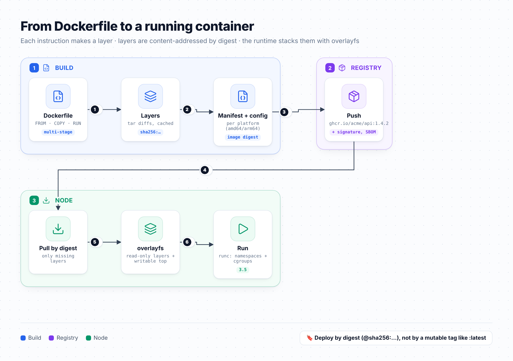
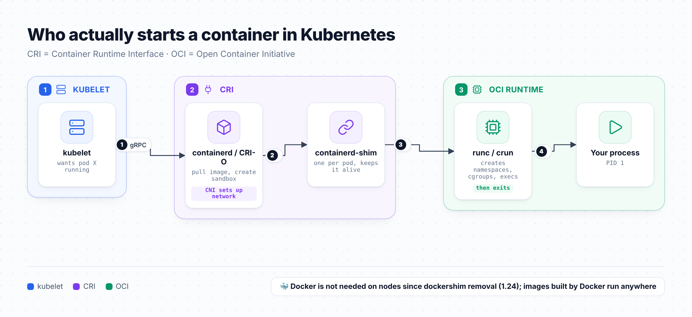

# 9.1 — Containers & images

!!! abstract "In one sentence"
    A container **image** is a stack of read-only, content-addressed **layers** plus a **config**, described by a
    **manifest** and identified by a **digest**; you build it from a **Dockerfile**, push it to a **registry**, and on
    each node **containerd** pulls only the missing layers, stacks them with **overlayfs** and asks **runc** to start
    your process inside namespaces and cgroups (3.5).

## 📖 Key terms & abbreviations

| Term | Stands for | What it is | How it works (one line) |
|---|---|---|---|
| **OCI** | Open Container Initiative | Standards for images, runtimes, distribution | Docker, Podman, containerd all follow them |
| **Image** | — | Filesystem layers + config (entrypoint, env, user) | Immutable; identified by digest |
| **Layer** | — | Tarball of filesystem changes | Shared and cached between images |
| **Manifest / index** | — | List of layers + config / list of per-platform manifests | Multi-arch images use an index |
| **Digest** | — | `sha256:` hash of content | Same digest = byte-identical image |
| **Tag** | — | Human name pointing at a digest | Mutable (`:latest`, `:1.4`) |
| **Registry** | — | Server storing images | Docker Hub, GHCR, ECR, GAR, Harbor |
| **BuildKit / buildx** | — | Modern Docker build engine | Parallel stages, cache mounts, multi-platform |
| **Multi-stage build** | — | Build in one stage, copy artifacts to a small final stage | Smaller, safer images |
| **Distroless / scratch** | — | Minimal base images | No shell or package manager |
| **SBOM** | Software Bill of Materials | List of packages in an image | Syft, `docker buildx --sbom` |
| **cosign / Sigstore** | — | Image signing and verification | Admission policies verify signatures |
| **CRI / containerd / runc** | Container Runtime Interface | kubelet's runtime API / runtime / low-level OCI runtime | kubelet → containerd → shim → runc |

## 🗺️ Big picture



---

## 1 · What's inside an image?

### How does it work?

```text
image index (multi-arch)  sha256:aa…
 ├─ manifest linux/amd64  sha256:bb…
 │   ├─ config  (Entrypoint, Env, User, WorkingDir…)
 │   └─ layers  sha256:l1 (base OS) · sha256:l2 (deps) · sha256:l3 (app)
 └─ manifest linux/arm64  sha256:cc…
```

- Each Dockerfile instruction that changes the filesystem (`RUN`, `COPY`, `ADD`) creates a **layer**. Layers are hashed; identical layers are stored and downloaded once.
- On the node, **overlayfs** stacks the layers read-only and adds one **writable layer** per container. Deleting a file in a later layer only hides it; the bytes are still in the image.
- **Tags move, digests don't.** `api:1.4` can be re-pushed; `api@sha256:…` always means the same bytes.

## 2 · Builds and caching

- Build cache is per instruction: if an instruction and its inputs haven't changed, the cached layer is reused; **once one step changes, all later steps rebuild**.
- So **order from least to most frequently changing**: base image → OS packages → dependency manifest (`package.json`, `go.mod`) → `install` → source code.
- **BuildKit** features: parallel stages, `--mount=type=cache` for package caches, secrets that don't end up in layers (`--mount=type=secret`), remote cache in the registry for CI.

```dockerfile
# syntax=docker/dockerfile:1
FROM golang:1.25 AS build
WORKDIR /src
COPY go.mod go.sum ./
RUN --mount=type=cache,target=/go/pkg/mod go mod download
COPY . .
RUN CGO_ENABLED=0 go build -trimpath -ldflags="-s -w" -o /app ./cmd/api

FROM gcr.io/distroless/static:nonroot
COPY --from=build /app /app
USER nonroot
ENTRYPOINT ["/app"]
```

## 3 · Small, secure images

| Practice | Why |
|---|---|
| Multi-stage + distroless/scratch/minimal base | Fewer packages = fewer CVEs, smaller pulls |
| Pin base images by digest, rebuild regularly | Reproducible, but still get patches |
| Run as non-root, read-only root filesystem | Limits damage of a compromise (3.5) |
| No secrets in layers or build args | Layers are forever; use runtime secrets |
| Exec-form `ENTRYPOINT`/`CMD` | Signals reach your app (3.1) |
| `.dockerignore` | Keep `.git`, `node_modules`, local files out |
| Scan (Trivy, Grype), SBOM (Syft), sign (cosign) | Know what's inside, prove where it came from |

## 4 · The runtime chain



1. **kubelet** decides a pod should run and calls the **CRI** (gRPC) on **containerd** (or CRI-O).
2. containerd pulls the image, creates the pod **sandbox** (pause container holding namespaces), asks the **CNI** plugin to set up networking.
3. A **containerd-shim** per pod launches **runc**, which creates namespaces and cgroups, applies security settings and `execve`s your entrypoint, then exits; the shim stays as parent.
4. **Image pull** is often the slowest part of pod start: big images, cold nodes, registry rate limits. Mitigate with smaller images, pre-pulling, registry mirrors, lazy-pulling snapshotters (stargz/SOCI).

## 🔧 DevOps connection

- **`ImagePullBackOff` / `ErrImagePull`**: wrong name/tag, missing pull secret, registry rate limit (Docker Hub), or arch mismatch.
- **Deploy by digest** (GitOps tools can pin and update digests) so every node runs exactly the tested bytes.
- **Admission policies** (Kyverno, Gatekeeper, Sigstore policy-controller) enforce: allowed registries, signed images, no `:latest`, non-root.
- **Registry ops**: retention policies, vulnerability scanning, replication close to clusters, pull-through caches.

## 🧪 Try it yourself

```bash
docker buildx imagetools inspect nginx:alpine | head -20      # index → per-platform manifests
docker pull alpine:3.20 && docker image inspect alpine:3.20 --format '{{.RootFS.Layers}}'
docker history --no-trunc python:3.12-slim | head              # which instruction made each layer
docker run --rm -v /var/run/docker.sock:/var/run/docker.sock wagoodman/dive:latest nginx:alpine --ci 2>/dev/null | tail -5   # layer efficiency
docker run --rm aquasec/trivy:latest image --severity HIGH,CRITICAL python:3.12-slim 2>/dev/null | tail -15
sudo crictl images 2>/dev/null | head; sudo crictl ps 2>/dev/null | head   # on a Kubernetes node
```

## 🃏 Cheat sheet

| Need | Do |
|---|---|
| Fast rebuilds | Copy dependency manifests before source; cache mounts |
| Small image | Multi-stage + distroless/scratch |
| Same bytes everywhere | Reference `@sha256:` digests |
| Both amd64 and arm64 | `docker buildx build --platform linux/amd64,linux/arm64 --push` |
| Know what's inside | SBOM + scanner in CI |
| Trust the source | cosign sign + verify at admission |

## ❓ Test yourself

??? question "1. Why does changing one line of source code rebuild `npm install` in a badly ordered Dockerfile?"
    The `COPY . .` comes before the install step; any source change invalidates that layer and every layer after it.

??? question "2. You `RUN rm secret.key` in a later step. Is the secret gone from the image?"
    No. It's still in the earlier layer; anyone with the image can extract it. Use build secrets.

??? question "3. What's the difference between a tag and a digest?"
    A tag is a movable name; a digest is a content hash that always identifies the same image bytes.

??? question "4. Which component actually calls clone() to create the container's namespaces?"
    runc (or another OCI runtime), started by containerd's shim on behalf of the kubelet.

??? question "5. Pods take 2 minutes to start on new nodes. Where do you look?"
    Image pull time: image size, registry throttling/latency, no cache on fresh nodes; use smaller images, mirrors, pre-pulling or lazy pulling.

---

## 📚 Sources

- [OCI Image Specification](https://github.com/opencontainers/image-spec)
- [Docker — Build best practices](https://docs.docker.com/build/building/best-practices/) · [BuildKit](https://docs.docker.com/build/buildkit/)
- [Sigstore cosign](https://docs.sigstore.dev/) · [Trivy](https://trivy.dev/) · [Syft](https://github.com/anchore/syft)
- [Kubernetes — Container runtimes](https://kubernetes.io/docs/setup/production-environment/container-runtimes/)

## ✍️ My notes

> Take your biggest image: how many MB, how many layers, how many HIGH/CRITICAL CVEs? What would a distroless multi-stage version weigh?

-
