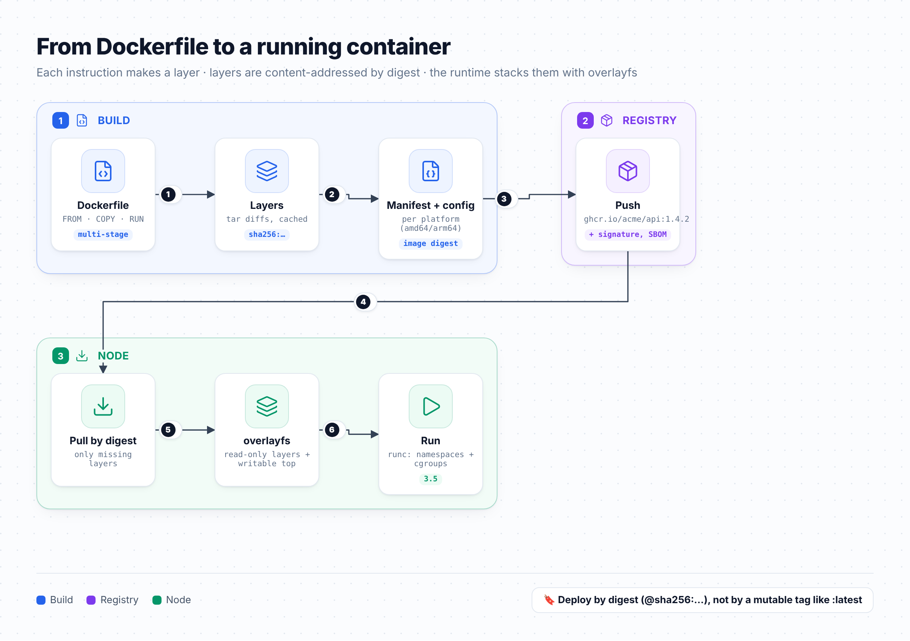
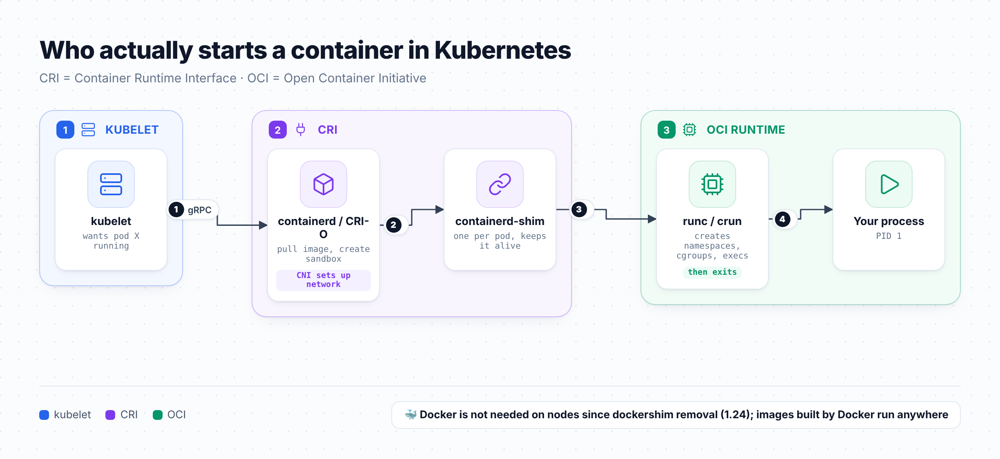

# 9.1 — Container'lar ve imajlar

!!! abstract "Tek cümlede"
    Bir container **imajı**, salt okunur, içerikle adreslenen **katmanlar** yığını artı bir **config**'tir; bir **manifest**
    ile tarif edilir ve bir **digest** ile tanımlanır. Onu bir **Dockerfile**'dan üretirsin, bir **registry**'ye push edersin;
    her node'da **containerd** sadece eksik katmanları çeker, onları **overlayfs** ile üst üste koyar ve process'ini
    namespace ve cgroup'lar içinde başlatması için **runc**'ye söyler (3.5).

## 📖 Temel terimler ve kısaltmalar

| Terim | Açılımı | Nedir | Nasıl çalışır (tek satır) |
|---|---|---|---|
| **OCI** | Open Container Initiative | İmajlar, runtime'lar, dağıtım için standartlar | Docker, Podman, containerd hepsi uyar |
| **İmaj** | Image | Dosya sistemi katmanları + config (entrypoint, env, user) | Değişmez; digest ile tanımlanır |
| **Katman** | Layer | Dosya sistemi değişikliklerinin tar arşivi | İmajlar arasında paylaşılır ve önbelleğe alınır |
| **Manifest / index** | — | Katmanlar + config listesi / platform başına manifest listesi | Çok mimarili imajlar index kullanır |
| **Digest** | — | İçeriğin `sha256:` hash'i | Aynı digest = byte byte aynı imaj |
| **Etiket** | Tag | Bir digest'e işaret eden insan dostu ad | Değişebilir (`:latest`, `:1.4`) |
| **Registry** | — | İmajları saklayan sunucu | Docker Hub, GHCR, ECR, GAR, Harbor |
| **BuildKit / buildx** | — | Modern Docker build motoru | Paralel aşamalar, cache mount'ları, çok platform |
| **Çok aşamalı build** | Multi-stage build | Bir aşamada derle, artefaktları küçük son aşamaya kopyala | Daha küçük, daha güvenli imajlar |
| **Distroless / scratch** | — | Minimal taban imajlar | Shell ya da paket yöneticisi yok |
| **SBOM** | Software Bill of Materials | Bir imajdaki paketlerin listesi | Syft, `docker buildx --sbom` |
| **cosign / Sigstore** | — | İmaj imzalama ve doğrulama | Admission politikaları imzaları doğrular |
| **CRI / containerd / runc** | Container Runtime Interface | kubelet'in runtime API'si / runtime / düşük seviyeli OCI runtime'ı | kubelet → containerd → shim → runc |

## 🗺️ Büyük resim



---

## 1 · Bir imajın içinde ne var?

### Nasıl çalışır?

```text
imaj index'i (çok mimarili)  sha256:aa…
 ├─ manifest linux/amd64  sha256:bb…
 │   ├─ config  (Entrypoint, Env, User, WorkingDir…)
 │   └─ katmanlar  sha256:l1 (taban OS) · sha256:l2 (bağımlılıklar) · sha256:l3 (uygulama)
 └─ manifest linux/arm64  sha256:cc…
```

- Dosya sistemini değiştiren her Dockerfile talimatı (`RUN`, `COPY`, `ADD`) bir **katman** oluşturur. Katmanlar hash'lenir; özdeş katmanlar bir kez saklanır ve indirilir.
- Node'da **overlayfs** katmanları salt okunur üst üste koyar ve container başına bir **yazılabilir katman** ekler. Sonraki bir katmanda dosya silmek onu sadece gizler; byte'lar hâlâ imajdadır.
- **Etiketler kayar, digest'ler kaymaz.** `api:1.4` yeniden push edilebilir; `api@sha256:…` hep aynı byte'ları ifade eder.

## 2 · Build'ler ve önbellek

- Build önbelleği talimat başınadır: bir talimat ve girdileri değişmediyse önbellekteki katman yeniden kullanılır; **bir adım değişince sonraki tüm adımlar yeniden üretilir**.
- Bu yüzden **en az değişenden en çok değişene sırala**: taban imaj → OS paketleri → bağımlılık manifest'i (`package.json`, `go.mod`) → `install` → kaynak kod.
- **BuildKit** özellikleri: paralel aşamalar, paket önbellekleri için `--mount=type=cache`, katmanlara girmeyen secret'lar (`--mount=type=secret`), CI için registry'de uzak önbellek.

```dockerfile
# syntax=docker/dockerfile:1
FROM golang:1.25 AS build
WORKDIR /src
COPY go.mod go.sum ./
RUN --mount=type=cache,target=/go/pkg/mod go mod download
COPY . .
RUN CGO_ENABLED=0 go build -trimpath -ldflags="-s -w" -o /app ./cmd/api

FROM gcr.io/distroless/static:nonroot
COPY --from=build /app /app
USER nonroot
ENTRYPOINT ["/app"]
```

## 3 · Küçük, güvenli imajlar

| Pratik | Neden |
|---|---|
| Çok aşamalı + distroless/scratch/minimal taban | Daha az paket = daha az CVE, daha küçük çekme |
| Taban imajları digest ile sabitle, düzenli yeniden üret | Tekrarlanabilir, ama yamaları yine al |
| Root olmayan kullanıcı, salt okunur kök dosya sistemi | Bir ele geçirmenin zararını sınırlar (3.5) |
| Katmanlarda ya da build arg'larında secret yok | Katmanlar kalıcıdır; çalışma anı secret'ları kullan |
| Exec formunda `ENTRYPOINT`/`CMD` | Sinyaller uygulamana ulaşır (3.1) |
| `.dockerignore` | `.git`, `node_modules`, yerel dosyaları dışarıda tut |
| Tara (Trivy, Grype), SBOM (Syft), imzala (cosign) | İçinde ne olduğunu bil, nereden geldiğini kanıtla |

## 4 · Runtime zinciri



1. **kubelet** bir pod'un çalışması gerektiğine karar verir ve **containerd**'de (ya da CRI-O'da) **CRI**'ı (gRPC) çağırır.
2. containerd imajı çeker, pod **sandbox**'ını (namespace'leri tutan pause container'ı) oluşturur, ağı kurması için **CNI** eklentisini çağırır.
3. Pod başına bir **containerd-shim** **runc**'yi başlatır; runc namespace ve cgroup'ları oluşturur, güvenlik ayarlarını uygular ve entrypoint'ini `execve` eder, sonra çıkar; shim ebeveyn olarak kalır.
4. **İmaj çekme** çoğu zaman pod başlatmanın en yavaş kısmıdır: büyük imajlar, soğuk node'lar, registry hız sınırları. Daha küçük imajlar, önceden çekme, registry aynaları, tembel çeken snapshotter'larla (stargz/SOCI) hafiflet.

## 🔧 DevOps bağlantısı

- **`ImagePullBackOff` / `ErrImagePull`**: yanlış ad/etiket, eksik pull secret, registry hız sınırı (Docker Hub) ya da mimari uyumsuzluğu.
- **Digest ile deploy et** (GitOps araçları digest'leri sabitleyip güncelleyebilir); her node tam olarak test edilen byte'ları çalıştırsın.
- **Admission politikaları** (Kyverno, Gatekeeper, Sigstore policy-controller) şunları zorunlu kılar: izinli registry'ler, imzalı imajlar, `:latest` yok, root olmayan kullanıcı.
- **Registry operasyonları**: saklama politikaları, açık taraması, cluster'lara yakın replikasyon, pull-through önbellekleri.

## 🧪 Kendin dene

```bash
docker buildx imagetools inspect nginx:alpine | head -20      # index → platform başına manifest'ler
docker pull alpine:3.20 && docker image inspect alpine:3.20 --format '{{.RootFS.Layers}}'
docker history --no-trunc python:3.12-slim | head              # her katmanı hangi talimat yaptı
docker run --rm -v /var/run/docker.sock:/var/run/docker.sock wagoodman/dive:latest nginx:alpine --ci 2>/dev/null | tail -5   # katman verimliliği
docker run --rm aquasec/trivy:latest image --severity HIGH,CRITICAL python:3.12-slim 2>/dev/null | tail -15
sudo crictl images 2>/dev/null | head; sudo crictl ps 2>/dev/null | head   # bir Kubernetes node'unda
```

## 🃏 Hatırlatma kartı

| İhtiyaç | Yap |
|---|---|
| Hızlı yeniden build | Bağımlılık manifest'lerini kaynaktan önce kopyala; cache mount'ları |
| Küçük imaj | Çok aşamalı + distroless/scratch |
| Her yerde aynı byte'lar | `@sha256:` digest'lerine referans ver |
| Hem amd64 hem arm64 | `docker buildx build --platform linux/amd64,linux/arm64 --push` |
| İçinde ne olduğunu bil | CI'da SBOM + tarayıcı |
| Kaynağa güven | cosign ile imzala + admission'da doğrula |

## ❓ Kendini test et

??? question "1. Kötü sıralanmış bir Dockerfile'da tek satır kaynak kodu değiştirmek neden `npm install`'ı yeniden çalıştırır?"
    `COPY . .` install adımından önce geliyor; herhangi bir kaynak değişikliği o katmanı ve sonraki her katmanı geçersiz kılar.

??? question "2. Sonraki bir adımda `RUN rm secret.key` yapıyorsun. Secret imajdan gitti mi?"
    Hayır. Hâlâ önceki katmanda; imaja sahip herkes onu çıkarabilir. Build secret'ları kullan.

??? question "3. Etiket ile digest arasındaki fark ne?"
    Etiket taşınabilir bir addır; digest her zaman aynı imaj byte'larını tanımlayan bir içerik hash'idir.

??? question "4. Container'ın namespace'lerini oluşturmak için clone()'u aslında hangi bileşen çağırır?"
    kubelet adına containerd'nin shim'inin başlattığı runc (ya da başka bir OCI runtime'ı).

??? question "5. Yeni node'larda pod'ların başlaması 2 dakika sürüyor. Nereye bakarsın?"
    İmaj çekme süresine: imaj boyutu, registry kısıtlaması/gecikmesi, taze node'larda önbellek olmaması; daha küçük imajlar, aynalar, önceden çekme ya da tembel çekme kullan.

---

## 📚 Kaynaklar

- [OCI Image Specification](https://github.com/opencontainers/image-spec)
- [Docker — Build best practices](https://docs.docker.com/build/building/best-practices/) · [BuildKit](https://docs.docker.com/build/buildkit/)
- [Sigstore cosign](https://docs.sigstore.dev/) · [Trivy](https://trivy.dev/) · [Syft](https://github.com/anchore/syft)
- [Kubernetes — Container runtimes](https://kubernetes.io/docs/setup/production-environment/container-runtimes/)

## ✍️ Notlarım

> En büyük imajını al: kaç MB, kaç katman, kaç HIGH/CRITICAL CVE? Distroless çok aşamalı bir sürümü ne kadar tutardı?

-
