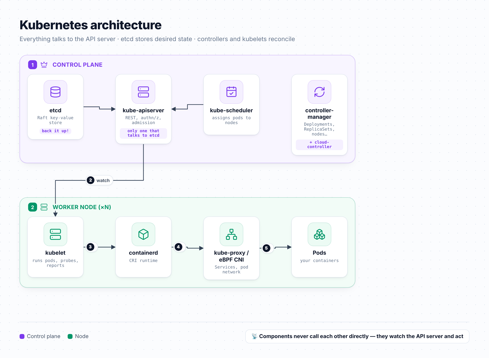
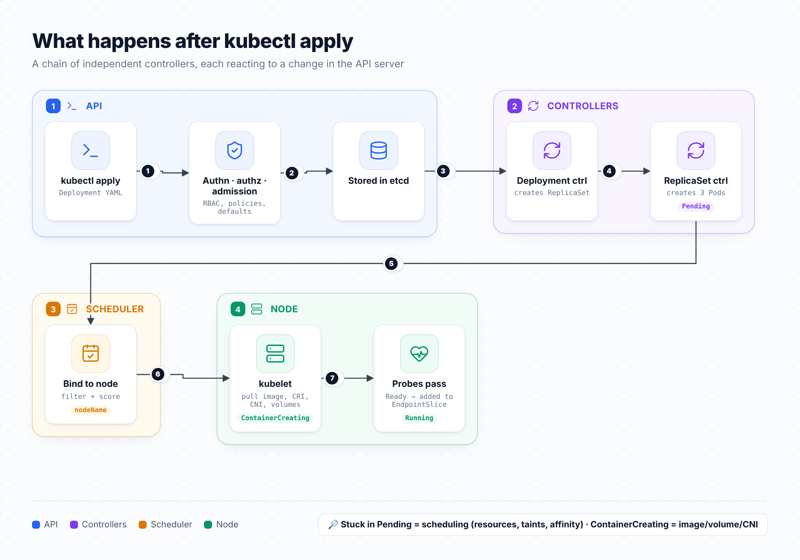

# 9.2 — Kubernetes architecture

!!! abstract "In one sentence"
    Kubernetes is a **database of desired state** (etcd behind the **API server**) plus many independent **controllers**
    that **watch** it and work to make reality match: the **scheduler** assigns pods to nodes, the **kubelet** on each
    node starts them through the container runtime, and higher-level controllers (Deployments, StatefulSets, Jobs,
    **operators**) keep creating, replacing and updating pods for you.

## 📖 Key terms & abbreviations

| Term | Stands for | What it is | How it works (one line) |
|---|---|---|---|
| **Control plane** | — | Components that manage the cluster | API server, etcd, scheduler, controller-manager |
| **kube-apiserver** | — | The only entry point; REST API | Authn → authz (RBAC) → admission → etcd |
| **etcd** | — | Consistent key-value store (Raft) | Holds all cluster state; back it up |
| **kube-scheduler** | — | Picks a node for each pending pod | Filter (fits?) then score (best?) |
| **Controller** | — | Reconcile loop for a resource type | Watch → diff → act (9a) |
| **kubelet** | — | Node agent | Runs pods via CRI, probes, reports status |
| **Pod** | — | Smallest unit: one or more containers sharing net/IPC | Has its own IP |
| **Deployment / ReplicaSet** | — | Stateless replicas with rolling updates | ReplicaSet per version |
| **StatefulSet** | — | Stable names + storage per replica | Databases, Kafka |
| **DaemonSet / Job / CronJob** | — | One pod per node / run to completion / scheduled | Agents, batch, periodic tasks |
| **Requests / limits** | — | Scheduling reservation / hard cap | CPU throttles, memory OOMs (3.2, 3.3) |
| **QoS class** | Quality of Service | Guaranteed, Burstable, BestEffort | Eviction order under node pressure |
| **Taints / tolerations, affinity** | — | Keep pods off / attract pods to nodes | Dedicated nodes, spreading |
| **CRD / operator** | Custom Resource Definition | Extend the API / controller for an app | `kind: PostgresCluster` managed automatically |
| **Admission webhook** | — | Validate or mutate objects on create/update | Policies (Kyverno), sidecar injection |

## 🗺️ Big picture



---

## 1 · The declarative model

You don't tell Kubernetes *what to do*, you tell it *what you want* (`replicas: 3`, image, resources). Controllers continuously compare **spec** (desired) with **status** (actual) and act (9a diagram). Consequences:

- Delete a pod of a Deployment → a new one appears. Edit a pod by hand → it may be replaced.
- Everything is **eventually consistent**: `kubectl apply` returns immediately; the system converges over seconds.
- Components never call each other; they **watch** the API server. That's why the API server and etcd health are critical.

## 2 · What happens after `kubectl apply`



1. **API server**: authenticates you, checks **RBAC**, runs **admission** (defaults, policies, mutating webhooks), validates and stores the Deployment in **etcd**.
2. **Deployment controller** creates a **ReplicaSet**; the **ReplicaSet controller** creates 3 **Pods** (status `Pending`, no node).
3. **Scheduler** filters nodes (enough requested CPU/memory? taints tolerated? affinity? volume zone?), scores the rest (spread, bin-packing), and **binds** each pod to a node.
4. **kubelet** on that node sees the pod: pulls the image, creates the sandbox, **CNI** assigns an IP, mounts volumes, starts containers (9.1).
5. **Probes**: startup → readiness → pod becomes **Ready** and is added to Service **EndpointSlices**; traffic starts (7.1).

## 3 · Scheduling and resources

- The scheduler only looks at **requests**, not actual usage. Requests too low → overpacked nodes, throttling/OOM; too high → wasted money.
- **Taints/tolerations**: keep general pods off special nodes (GPU, spot). **Node affinity**: require/prefer certain nodes. **Pod (anti-)affinity** and **topology spread constraints**: spread replicas across nodes and zones.
- **QoS**: Guaranteed (requests = limits for all), Burstable, BestEffort (none). Under node memory pressure the kubelet evicts BestEffort first.
- **PriorityClasses** + preemption let critical pods evict less important ones.
- **Autoscaling**: HPA (replicas by metrics), VPA (right-size requests), Cluster Autoscaler / **Karpenter** (add/remove nodes).

## 4 · Extending Kubernetes: CRDs and operators

A **CRD** adds a new resource type (`Certificate`, `KafkaTopic`, `PostgresCluster`); an **operator** is a controller that reconciles it, encoding operational knowledge (backups, failover, upgrades). Most of the ecosystem — cert-manager, Argo CD, Strimzi, CloudNativePG, KServe — is built this way.

## 🔧 DevOps connection

- **Troubleshooting order**: `kubectl get pod` (status) → `describe` (events) → `logs --previous` → node and cluster events.
- **Protect the control plane**: etcd backups, API rate limits (APF), avoid controllers or CI jobs that list everything every second.
- **Upgrades**: control plane first, then nodes; respect version skew; use **PodDisruptionBudgets** so drains don't take down all replicas.
- **Multi-tenancy**: namespaces + RBAC + ResourceQuotas + LimitRanges + NetworkPolicies + Pod Security Admission.

## 🧪 Try it yourself

```bash
# A local cluster
kind create cluster --name lab 2>/dev/null || true
kubectl get nodes -o wide
kubectl get pods -n kube-system                      # control plane as pods (kind/kubeadm)
kubectl create deployment web --image=nginx:alpine --replicas=3
kubectl get events --sort-by=.lastTimestamp | tail -15   # the whole chain from section 2
kubectl get rs,pods -l app=web -o wide
kubectl delete pod -l app=web --wait=false; kubectl get pods -l app=web -w   # reconciliation (Ctrl+C)
kubectl api-resources | head -20; kubectl get crd 2>/dev/null | head
kubectl auth can-i create deployments --as=system:serviceaccount:default:default
kind delete cluster --name lab
```

## 🃏 Cheat sheet

| Pod status | Usually means |
|---|---|
| `Pending` | Can't schedule: resources, taints, affinity, PVC zone |
| `ContainerCreating` | Image pull, volume mount, CNI |
| `ImagePullBackOff` | Name/tag/credentials/rate limit |
| `CrashLoopBackOff` | App exits; check `logs --previous` |
| `OOMKilled` | Memory limit hit |
| Running but not Ready | Readiness probe failing |
| `Evicted` | Node pressure (disk/memory) |

## ❓ Test yourself

??? question "1. Which component writes to etcd?"
    Only the API server; everything else reads and writes through it.

??? question "2. A pod stays Pending forever. What do you check?"
    `kubectl describe pod` events: insufficient CPU/memory requests, untolerated taints, unsatisfiable affinity, unbound PVC or zone mismatch.

??? question "3. Why did a pod you deleted come back?"
    Its ReplicaSet controller saw fewer pods than desired and created a replacement.

??? question "4. What does the scheduler use to decide if a pod fits: requests or actual usage?"
    Requests.

??? question "5. What's an operator?"
    A controller plus CRDs that automate running a specific application (create, scale, backup, upgrade, failover) the way a human operator would.

---

## 📚 Sources

- [Kubernetes — Components](https://kubernetes.io/docs/concepts/overview/components/)
- [Kubernetes — Scheduling, preemption and eviction](https://kubernetes.io/docs/concepts/scheduling-eviction/)
- [Kubernetes — Operator pattern](https://kubernetes.io/docs/concepts/extend-kubernetes/operator/)
- [Kubernetes — Debug pods](https://kubernetes.io/docs/tasks/debug/debug-application/debug-pods/)

## ✍️ My notes

> Create a Deployment in a kind cluster and write down every event from `kubectl get events`. Map each to a component.

-
