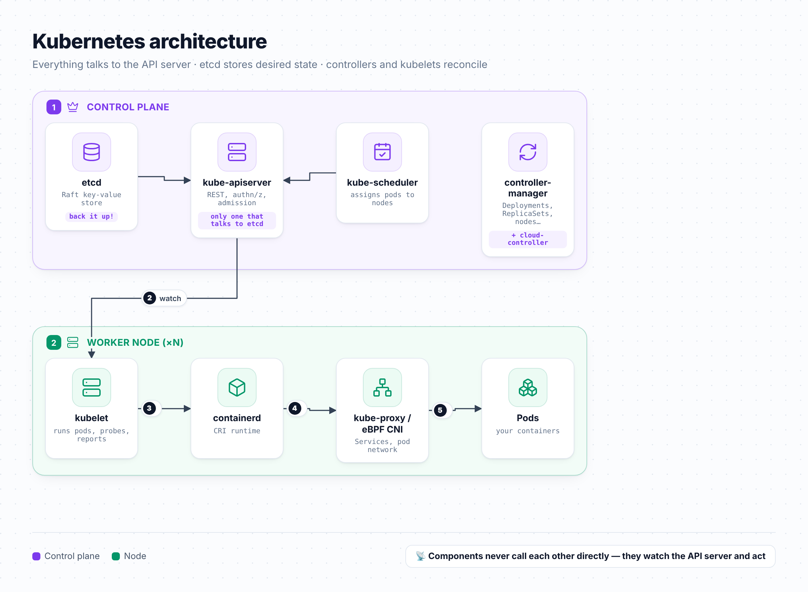
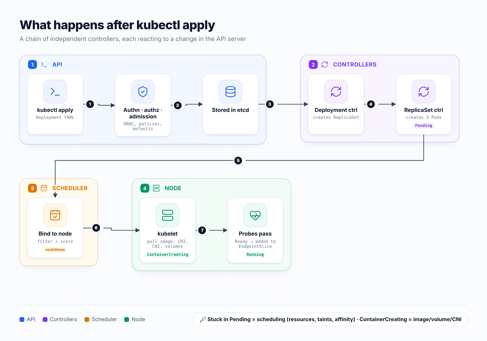

# 9.2 — Kubernetes mimarisi

!!! abstract "Kısaca"
    Kubernetes bir **istenen durum veritabanı** (**API server**'ın arkasındaki etcd) artı onu **izleyip** gerçeği
    eşitleyen çok sayıda bağımsız **controller**'dır. **Scheduler** pod'ları node'lara atar; her node'daki **kubelet**
    onları container runtime üzerinden başlatır. Üst düzey controller'lar (Deployment'lar, StatefulSet'ler, Job'lar,
    **operator**'ler) senin yerine pod oluşturmaya, değiştirmeye ve güncellemeye devam eder.

## 📖 Temel terimler ve kısaltmalar

| Terim | Açılımı | Nedir | Nasıl çalışır (tek satır) |
|---|---|---|---|
| **Control plane** | — | Cluster'ı yöneten bileşenler | API server, etcd, scheduler, controller-manager |
| **kube-apiserver** | — | Tek giriş noktası; REST API | Authn → authz (RBAC) → admission → etcd |
| **etcd** | — | Tutarlı anahtar-değer deposu (Raft) | Tüm cluster durumunu tutar; yedekle |
| **kube-scheduler** | — | Bekleyen her pod için bir node seçer | Filtrele (sığar mı?) sonra puanla (en iyisi?) |
| **Controller** | — | Bir kaynak tipi için uzlaştırma döngüsü | İzle → karşılaştır → harekete geç (9a) |
| **kubelet** | — | Node ajanı | Pod'ları CRI ile çalıştırır, probe'lar, durum bildirir |
| **Pod** | — | En küçük birim: ağ/IPC paylaşan bir ya da daha çok container | Kendi IP'si var |
| **Deployment / ReplicaSet** | — | Rolling update'li durumsuz replikalar | Sürüm başına ReplicaSet |
| **StatefulSet** | — | Replika başına sabit adlar + depolama | Veritabanları, Kafka |
| **DaemonSet / Job / CronJob** | — | Node başına bir pod / bitene kadar çalış / zamanlanmış | Ajanlar, batch, periyodik görevler |
| **Request / limit** | — | Zamanlama rezervasyonu / sert tavan | CPU throttle olur, bellek OOM olur (3.2, 3.3) |
| **QoS sınıfı** | Quality of Service | Guaranteed, Burstable, BestEffort | Node baskısında tahliye sırası |
| **Taint / toleration, affinity** | — | Pod'ları node'lardan uzak tut / çek | Özel node'lar, yayma |
| **CRD / operator** | Custom Resource Definition | API'yi genişlet / bir uygulama için controller | `kind: PostgresCluster` otomatik yönetilir |
| **Admission webhook** | — | Oluşturma/güncellemede nesneleri doğrula ya da değiştir | Politikalar (Kyverno), sidecar enjeksiyonu |

## 🗺️ Büyük resim



---

## 1 · Bildirimsel model

Kubernetes'e *ne yapacağını* değil, *ne istediğini* söylersin (`replicas: 3`, imaj, kaynaklar). Controller'lar sürekli **spec**'i (istenen) **status** ile (gerçek) karşılaştırır ve harekete geçer (9a diagramı). Sonuçları:

- Bir Deployment'ın pod'unu sil → yenisi belirir. Bir pod'u elle düzenle → değiştirilebilir.
- Her şey **nihai olarak tutarlıdır**: `kubectl apply` hemen döner; sistem saniyeler içinde yakınsar.
- Bileşenler birbirini çağırmaz; API server'ı **izler**. API server ve etcd sağlığının kritik olmasının sebebi bu.

## 2 · `kubectl apply`'dan sonra ne olur



1. **API server**: kimliğini doğrular, **RBAC**'i kontrol eder, **admission**'ı çalıştırır (varsayılanlar, politikalar, değiştiren webhook'lar), Deployment'ı doğrular ve **etcd**'ye kaydeder.
2. **Deployment controller** bir **ReplicaSet** oluşturur; **ReplicaSet controller** 3 **Pod** oluşturur (durum `Pending`, node yok).
3. **Scheduler** node'ları filtreler (istenen CPU/bellek yetiyor mu? taint'lere tolerans var mı? affinity? volume zone'u?), kalanları puanlar (yayma, sıkıştırma) ve her pod'u bir node'a **bağlar**.
4. O node'daki **kubelet** pod'u görür: imajı çeker, sandbox'ı oluşturur, **CNI** bir IP atar, volume'ları bağlar, container'ları başlatır (9.1).
5. **Probe'lar**: startup → readiness → pod **Ready** olur ve Service **EndpointSlice**'larına eklenir; trafik başlar (7.1).

## 3 · Zamanlama ve kaynaklar

- Scheduler gerçek kullanıma değil sadece **request**'lere bakar. Çok düşük request → aşırı dolu node'lar, throttling/OOM; çok yüksek → boşa para.
- **Taint/toleration**: genel pod'ları özel node'lardan (GPU, spot) uzak tut. **Node affinity**: belirli node'ları şart koş/tercih et. **Pod (anti-)affinity** ve **topology spread constraint**'leri: replikaları node'lara ve zone'lara yay.
- **QoS**: Guaranteed (tümünde request = limit), Burstable, BestEffort (hiçbiri). Node bellek baskısında kubelet önce BestEffort'u tahliye eder.
- **PriorityClass**'lar + preemption kritik pod'ların daha az önemlileri tahliye etmesini sağlar.
- **Otomatik ölçekleme**: HPA (metriklere göre replika), VPA (request'leri doğru boyutla), Cluster Autoscaler / **Karpenter** (node ekle/çıkar).

## 4 · Kubernetes'i genişletmek: CRD'ler ve operator'ler

Bir **CRD** yeni bir kaynak tipi ekler (`Certificate`, `KafkaTopic`, `PostgresCluster`); bir **operator** onu uzlaştıran ve operasyonel bilgiyi (yedekler, failover, yükseltmeler) kodlayan bir controller'dır. Ekosistemin çoğu (cert-manager, Argo CD, Strimzi, CloudNativePG, KServe) böyle kurulmuştur.

## 🔧 DevOps bağlantısı

- **Sorun giderme sırası**: `kubectl get pod` (durum) → `describe` (olaylar) → `logs --previous` → node ve cluster olayları.
- **Control plane'i koru**: etcd yedekleri, API hız sınırları (APF), her saniye her şeyi listeleyen controller ya da CI işlerinden kaçın.
- **Yükseltmeler**: önce control plane, sonra node'lar; sürüm farkı kurallarına uy; drain'ler tüm replikaları düşürmesin diye **PodDisruptionBudget** kullan.
- **Çok kiracılık**: namespace'ler + RBAC + ResourceQuota'lar + LimitRange'ler + NetworkPolicy'ler + Pod Security Admission.

## 🧪 Kendin dene

```bash
# Yerel bir cluster
kind create cluster --name lab 2>/dev/null || true
kubectl get nodes -o wide
kubectl get pods -n kube-system                      # pod olarak control plane (kind/kubeadm)
kubectl create deployment web --image=nginx:alpine --replicas=3
kubectl get events --sort-by=.lastTimestamp | tail -15   # 2. bölümdeki tüm zincir
kubectl get rs,pods -l app=web -o wide
kubectl delete pod -l app=web --wait=false; kubectl get pods -l app=web -w   # uzlaştırma (Ctrl+C)
kubectl api-resources | head -20; kubectl get crd 2>/dev/null | head
kubectl auth can-i create deployments --as=system:serviceaccount:default:default
kind delete cluster --name lab
```

## 🃏 Hatırlatma kartı

| Pod durumu | Genelde şu demek |
|---|---|
| `Pending` | Zamanlanamıyor: kaynaklar, taint'ler, affinity, PVC zone'u |
| `ContainerCreating` | İmaj çekme, volume bağlama, CNI |
| `ImagePullBackOff` | Ad/etiket/kimlik bilgisi/hız sınırı |
| `CrashLoopBackOff` | Uygulama çıkıyor; `logs --previous`'a bak |
| `OOMKilled` | Bellek limitine takıldı |
| Running ama Ready değil | Readiness probe başarısız |
| `Evicted` | Node baskısı (disk/bellek) |

## ❓ Kendini test et

??? question "1. etcd'ye hangi bileşen yazar?"
    Sadece API server; diğer her şey onun üzerinden okur ve yazar.

??? question "2. Bir pod sonsuza dek Pending'de kalıyor. Neyi kontrol edersin?"
    `kubectl describe pod` olaylarını: yetersiz CPU/bellek request'leri, tolere edilmeyen taint'ler, karşılanamayan affinity, bağlanmamış PVC ya da zone uyumsuzluğu.

??? question "3. Sildiğin bir pod neden geri geldi?"
    ReplicaSet controller'ı istenenden az pod gördü ve bir yenisini oluşturdu.

??? question "4. Scheduler bir pod'un sığıp sığmadığına neyle karar verir: request'ler mi gerçek kullanım mı?"
    Request'lerle.

??? question "5. Operator nedir?"
    Belirli bir uygulamayı çalıştırmayı (oluştur, ölçekle, yedekle, yükselt, failover) bir insan operatörün yapacağı gibi otomatikleştiren bir controller artı CRD'ler.

---

## 📚 Kaynaklar

- [Kubernetes — Components](https://kubernetes.io/docs/concepts/overview/components/)
- [Kubernetes — Scheduling, preemption and eviction](https://kubernetes.io/docs/concepts/scheduling-eviction/)
- [Kubernetes — Operator pattern](https://kubernetes.io/docs/concepts/extend-kubernetes/operator/)
- [Kubernetes — Debug pods](https://kubernetes.io/docs/tasks/debug/debug-application/debug-pods/)

## ✍️ Notlarım

> Bir kind cluster'ında bir Deployment oluştur ve `kubectl get events`'teki her olayı yaz. Her birini bir bileşene eşle.
