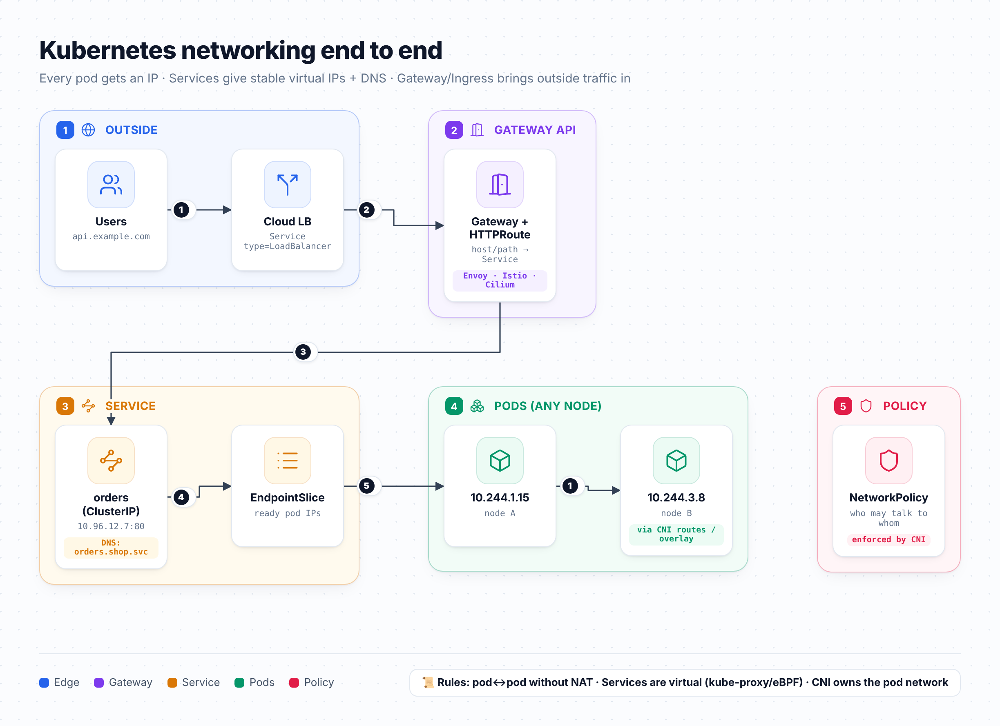

# 9.3 — Kubernetes networking

!!! abstract "In short"
    Kubernetes asks for a simple model: **every pod has its own IP and can reach every other pod without NAT**. A **CNI
    plugin** does the plumbing. **Services** give groups of pods a stable virtual IP and **DNS** name, and **Gateway API
    / Ingress** bring external HTTP traffic in. **NetworkPolicies** decide who may talk to whom, and a **service mesh**
    can add mTLS, retries and telemetry.

## 📖 Key terms & abbreviations

| Term | Stands for | What it is | How it works (one line) |
|---|---|---|---|
| **CNI** | Container Network Interface | Plugin API for pod networking | Called by the runtime when a pod starts |
| **Pod CIDR** | — | IP range for pods (per node) | e.g. `10.244.3.0/24` on node 3 |
| **Overlay** | — | Pod traffic wrapped in node-to-node tunnels | VXLAN / Geneve / IPIP |
| **Native routing** | — | Pod IPs routed directly (no tunnel) | BGP (Calico), cloud routes, VPC CNI |
| **eBPF dataplane** | — | Kernel programs for forwarding and policy | Cilium; can replace kube-proxy |
| **Service (ClusterIP)** | — | Stable virtual IP + port for pods | DNAT to an endpoint (5.3) |
| **EndpointSlice** | — | List of ready pod IPs behind a Service | Updated by readiness |
| **NodePort / LoadBalancer** | — | Expose a Service on node ports / via a cloud LB | For external access |
| **Headless Service** | — | `clusterIP: None` | DNS returns pod IPs directly |
| **CoreDNS** | — | Cluster DNS | `svc.namespace.svc.cluster.local` (6.2) |
| **Ingress / Gateway API** | — | L7 entry into the cluster | Gateway + HTTPRoute is the modern API |
| **NetworkPolicy** | — | Pod-level firewall rules | Label selectors, enforced by CNI |
| **Service mesh** | — | Proxies (sidecar or node/ambient) for service-to-service traffic | mTLS, retries, traffic splitting, metrics |

## 🗺️ Big picture



---

## 1 · The network model and CNI

### How does a pod get on the network?

1. kubelet asks the runtime to create the pod sandbox (its own **network namespace**, 3.5).
2. The runtime calls the **CNI plugin**: create a **veth pair** (one end `eth0` in the pod, the other in the host), assign an IP from the node's pod CIDR (**IPAM**), add routes.
3. Across nodes, the CNI makes pod IPs reachable: **routes** (Calico BGP, cloud route tables), **cloud-native IPs** (AWS VPC CNI gives pods VPC IPs), or an **overlay** tunnel (Flannel VXLAN, Calico/Cilium in tunnel mode).

| CNI | Approach | Notable |
|---|---|---|
| **Cilium** | eBPF, routing or overlay | kube-proxy replacement, L7 policy, Hubble observability, mesh |
| **Calico** | BGP routing / overlay, iptables or eBPF | Mature NetworkPolicy, on-prem friendly |
| **AWS VPC CNI / Azure CNI / GKE dataplane** | Pods get cloud IPs | Direct LB targeting, watch IP exhaustion |
| **Flannel** | Simple VXLAN overlay | No NetworkPolicy by itself |

## 2 · Services and DNS

- A **Service** selects pods by labels; **EndpointSlices** list the **ready** ones.
- **ClusterIP** is virtual: **kube-proxy** (iptables/IPVS/nftables) or an **eBPF** dataplane rewrites `10.96.12.7:80` → a pod IP (5.3). Load balancing is **per connection**.
- **DNS**: `orders` (same namespace), `orders.shop`, `orders.shop.svc.cluster.local` → ClusterIP; headless Services return pod IPs (StatefulSets: `kafka-0.kafka.shop.svc…`).
- **`externalTrafficPolicy: Local`** keeps the client IP for NodePort/LB traffic; **`internalTrafficPolicy`** / **topology-aware routing** keep traffic in the same node/zone to save latency and cross-AZ cost.

## 3 · Getting traffic in: Ingress and Gateway API

| | Ingress | Gateway API |
|---|---|---|
| Resources | `Ingress` (+ controller-specific annotations) | `GatewayClass`, `Gateway`, `HTTPRoute`, `GRPCRoute`, `TLSRoute`… |
| Roles | One object for everything | Infra team owns Gateways; app teams own Routes |
| Features | Host/path routing, TLS | + header matching, weighted traffic splitting, cross-namespace refs, portable across implementations |
| Status | Frozen; community ingress-nginx retired (2026) | The recommended standard |

Implementations: Envoy Gateway, Istio, Cilium, Traefik, NGINX Gateway Fabric, Kong, cloud controllers (GKE, AWS LB Controller).

## 4 · NetworkPolicies and meshes

- **NetworkPolicy**: once a policy selects a pod for ingress/egress, everything not allowed is denied. Start with **default-deny per namespace**, then allow: DNS egress (UDP/TCP 53 to kube-dns), app-to-app flows, egress to specific CIDRs. Cilium/Calico add L7 and FQDN policies.
- **Service mesh** (Istio, Linkerd, Cilium mesh): automatic **mTLS** between workloads (6.4), retries/timeouts/circuit breaking, traffic splitting, golden metrics per call. **Sidecar** mode (proxy per pod) vs **ambient/node** mode (shared node proxy + optional L7 waypoints) trade isolation against resource cost.

## 🔧 DevOps connection

- **Debug in layers**: DNS → Service → EndpointSlice (any ready pods?) → pod IP directly → NetworkPolicy → node routing/CNI → MTU (5.1).
- **Service with no endpoints** = selector doesn't match labels, or pods not Ready.
- **Cross-AZ traffic** is a hidden cost; use topology-aware routing for chatty services.
- **Observability**: Hubble (Cilium), mesh dashboards, or flow logs show who talks to whom and what was dropped.

## 🧪 Try it yourself

```bash
kubectl create deployment echo --image=hashicorp/http-echo -- /http-echo -text=hello -listen=:8080
kubectl expose deployment echo --port 80 --target-port 8080
kubectl get svc echo; kubectl get endpointslices -l kubernetes.io/service-name=echo -o wide
kubectl run -it --rm net --image=nicolaka/netshoot --restart=Never -- bash -c '
  cat /etc/resolv.conf; dig +short echo.default.svc.cluster.local;
  curl -s echo; ip addr show eth0 | grep inet; ip route'

# Default-deny then watch it fail
cat <<'EOF' | kubectl apply -f -
apiVersion: networking.k8s.io/v1
kind: NetworkPolicy
metadata: { name: default-deny }
spec: { podSelector: {}, policyTypes: [Ingress] }
EOF
kubectl run -it --rm t --image=curlimages/curl --restart=Never -- curl -s -m 3 echo || echo "blocked (if your CNI enforces policies)"
kubectl delete networkpolicy default-deny; kubectl delete deploy,svc echo
```

## 🃏 Cheat sheet

| Symptom | Check |
|---|---|
| `could not resolve host` | CoreDNS pods, NetworkPolicy blocking DNS, ndots (6.2) |
| Service times out | EndpointSlice empty? readiness? targetPort? |
| Works pod→pod same node, not cross-node | CNI routes/overlay, security groups, MTU |
| Client IP is a node IP | `externalTrafficPolicy: Local` / proxy protocol |
| 502 from Gateway | Backend Service/port, readiness, timeouts |
| Random drops at scale | conntrack table, SNAT ports (5.3) |

## ❓ Test yourself

??? question "1. What are the three rules of the Kubernetes network model?"
    Every pod gets its own IP; pods can reach all other pods without NAT; agents on a node can reach all pods on that node.

??? question "2. What does the CNI plugin do when a pod starts?"
    Creates the pod's interface (veth), assigns an IP, sets routes, and makes the IP reachable from other nodes.

??? question "3. A Service exists but curl to it times out. First thing to check?"
    Its EndpointSlice: if empty, the selector doesn't match or no pods are Ready.

??? question "4. Why prefer Gateway API over Ingress for new setups?"
    It's the maintained standard with richer, portable features (traffic splitting, header matching, role separation), and the community ingress-nginx controller has been retired.

??? question "5. After applying a default-deny NetworkPolicy, nothing can resolve DNS. Why?"
    Egress to kube-dns (port 53) is now denied too; add an explicit allow rule for DNS.

---

## 📚 Sources

- [Kubernetes — Cluster networking](https://kubernetes.io/docs/concepts/cluster-administration/networking/)
- [Kubernetes — Services, load balancing and networking](https://kubernetes.io/docs/concepts/services-networking/)
- [Gateway API](https://gateway-api.sigs.k8s.io/)
- [Cilium docs](https://docs.cilium.io/) · [Calico docs](https://docs.tigera.io/calico/latest/about/)
- [Istio — Ambient mode](https://istio.io/latest/docs/ambient/overview/)

## ✍️ My notes

> Pick one request path in your cluster (internet → app → DB) and list every networking component it crosses.
