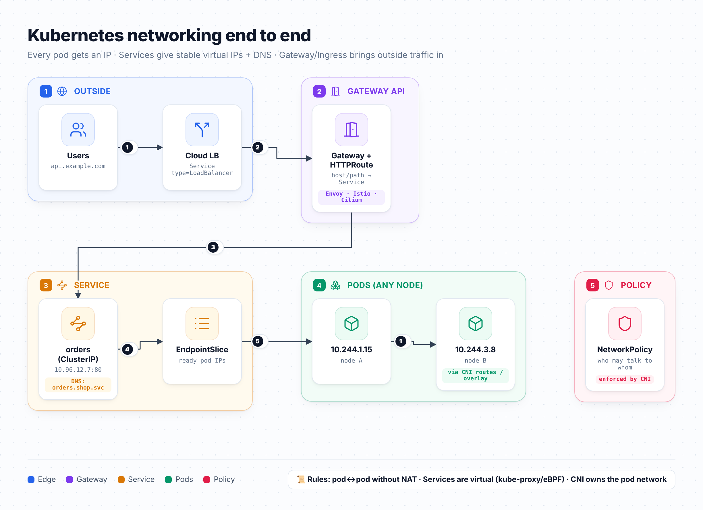

# 9.3 — Kubernetes ağı

!!! abstract "Tek cümlede"
    Kubernetes basit bir model ister: **her pod'un kendi IP'si var ve diğer her pod'a NAT'sız ulaşabilir**; tesisatı bir
    **CNI eklentisine** bırakır. Üstüne, **Service**'ler pod gruplarına sabit bir sanal IP ve **DNS** adı verir (kube-proxy
    ya da eBPF ile uygulanır), **Gateway API / Ingress** dış HTTP trafiğini içeri alır, **NetworkPolicy**'ler kimin kiminle
    konuşabileceğine karar verir, bir **service mesh** de mTLS, yeniden denemeler ve telemetri ekleyebilir.

## 📖 Temel terimler ve kısaltmalar

| Terim | Açılımı | Nedir | Nasıl çalışır (tek satır) |
|---|---|---|---|
| **CNI** | Container Network Interface | Pod ağı için eklenti API'si | Bir pod başlarken runtime çağırır |
| **Pod CIDR** | — | Pod'lar için IP aralığı (node başına) | ör. 3. node'da `10.244.3.0/24` |
| **Overlay** | — | Node'dan node'a tünellere sarılmış pod trafiği | VXLAN / Geneve / IPIP |
| **Native routing** | — | Pod IP'leri doğrudan yönlendirilir (tünel yok) | BGP (Calico), bulut rotaları, VPC CNI |
| **eBPF dataplane** | — | İletim ve politika için kernel programları | Cilium; kube-proxy'nin yerini alabilir |
| **Service (ClusterIP)** | — | Pod'lar için sabit sanal IP + port | Bir endpoint'e DNAT (5.3) |
| **EndpointSlice** | — | Bir Service'in arkasındaki hazır pod IP'leri listesi | Readiness ile güncellenir |
| **NodePort / LoadBalancer** | — | Bir Service'i node portlarında / bir bulut LB'siyle aç | Dış erişim için |
| **Headless Service** | — | `clusterIP: None` | DNS doğrudan pod IP'lerini döner |
| **CoreDNS** | — | Cluster DNS'i | `svc.namespace.svc.cluster.local` (6.2) |
| **Ingress / Gateway API** | — | Cluster'a L7 giriş | Gateway + HTTPRoute modern API'dir |
| **NetworkPolicy** | — | Pod düzeyinde firewall kuralları | Etiket seçicileri, CNI uygular |
| **Service mesh** | — | Servisler arası trafik için proxy'ler (sidecar ya da node/ambient) | mTLS, yeniden deneme, trafik bölme, metrikler |

## 🗺️ Büyük resim



---

## 1 · Ağ modeli ve CNI

### Bir pod ağa nasıl bağlanır?

1. kubelet runtime'dan pod sandbox'ını (kendi **network namespace**'i, 3.5) oluşturmasını ister.
2. Runtime **CNI eklentisini** çağırır: bir **veth çifti** oluştur (bir ucu pod'da `eth0`, diğeri host'ta), node'un pod CIDR'ından bir IP ata (**IPAM**), rotaları ekle.
3. Node'lar arasında CNI pod IP'lerini erişilebilir yapar: **rotalar** (Calico BGP, bulut route table'ları), **bulut native IP'leri** (AWS VPC CNI pod'lara VPC IP'leri verir) ya da bir **overlay** tüneli (Flannel VXLAN, tünel modunda Calico/Cilium).

| CNI | Yaklaşım | Öne çıkan |
|---|---|---|
| **Cilium** | eBPF, routing ya da overlay | kube-proxy yerine geçer, L7 politika, Hubble gözlemlenebilirliği, mesh |
| **Calico** | BGP routing / overlay, iptables ya da eBPF | Olgun NetworkPolicy, şirket içine uygun |
| **AWS VPC CNI / Azure CNI / GKE dataplane** | Pod'lar bulut IP'si alır | Doğrudan LB hedefleme, IP tükenmesine dikkat |
| **Flannel** | Basit VXLAN overlay | Tek başına NetworkPolicy yok |

## 2 · Service'ler ve DNS

- Bir **Service** pod'ları etiketlerle seçer; **EndpointSlice**'lar **hazır** olanları listeler.
- **ClusterIP** sanaldır: **kube-proxy** (iptables/IPVS/nftables) ya da bir **eBPF** dataplane'i `10.96.12.7:80` → bir pod IP'si olarak yeniden yazar (5.3). Yük dengeleme **bağlantı başınadır**.
- **DNS**: `orders` (aynı namespace), `orders.shop`, `orders.shop.svc.cluster.local` → ClusterIP; headless Service'ler pod IP'lerini döner (StatefulSet'ler: `kafka-0.kafka.shop.svc…`).
- **`externalTrafficPolicy: Local`** NodePort/LB trafiğinde istemci IP'sini korur; **`internalTrafficPolicy`** / **topoloji farkında yönlendirme** gecikme ve AZ'ler arası maliyetten tasarruf için trafiği aynı node/zone'da tutar.

## 3 · Trafiği içeri almak: Ingress ve Gateway API

| | Ingress | Gateway API |
|---|---|---|
| Kaynaklar | `Ingress` (+ controller'a özel anotasyonlar) | `GatewayClass`, `Gateway`, `HTTPRoute`, `GRPCRoute`, `TLSRoute`… |
| Roller | Her şey için tek nesne | Gateway'lerin sahibi altyapı ekibi; Route'ların sahibi uygulama ekipleri |
| Özellikler | Host/yol yönlendirme, TLS | + header eşleştirme, ağırlıklı trafik bölme, namespace'ler arası referanslar, uygulamalar arası taşınabilir |
| Durum | Donduruldu; topluluk ingress-nginx'i emekliye ayrıldı (2026) | Önerilen standart |

Uygulamalar: Envoy Gateway, Istio, Cilium, Traefik, NGINX Gateway Fabric, Kong, bulut controller'ları (GKE, AWS LB Controller).

## 4 · NetworkPolicy'ler ve mesh'ler

- **NetworkPolicy**: bir politika bir pod'u ingress/egress için seçince izin verilmeyen her şey reddedilir. **Namespace başına default-deny** ile başla, sonra izin ver: DNS çıkışı (kube-dns'e UDP/TCP 53), uygulamadan uygulamaya akışlar, belirli CIDR'lara çıkış. Cilium/Calico L7 ve FQDN politikaları ekler.
- **Service mesh** (Istio, Linkerd, Cilium mesh): iş yükleri arasında otomatik **mTLS** (6.4), yeniden deneme/zaman aşımı/circuit breaking, trafik bölme, çağrı başına altın metrikler. **Sidecar** modu (pod başına proxy) ile **ambient/node** modu (paylaşımlı node proxy'si + isteğe bağlı L7 waypoint'leri) izolasyonu kaynak maliyetiyle takas eder.

## 🔧 DevOps bağlantısı

- **Katman katman hata ayıkla**: DNS → Service → EndpointSlice (hazır pod var mı?) → doğrudan pod IP'si → NetworkPolicy → node routing/CNI → MTU (5.1).
- **Endpoint'i olmayan Service** = seçici etiketlerle eşleşmiyor ya da pod'lar Ready değil.
- **AZ'ler arası trafik** gizli bir maliyettir; konuşkan servisler için topoloji farkında yönlendirme kullan.
- **Gözlemlenebilirlik**: Hubble (Cilium), mesh panoları ya da flow log'ları kimin kiminle konuştuğunu ve neyin düştüğünü gösterir.

## 🧪 Kendin dene

```bash
kubectl create deployment echo --image=hashicorp/http-echo -- /http-echo -text=hello -listen=:8080
kubectl expose deployment echo --port 80 --target-port 8080
kubectl get svc echo; kubectl get endpointslices -l kubernetes.io/service-name=echo -o wide
kubectl run -it --rm net --image=nicolaka/netshoot --restart=Never -- bash -c '
  cat /etc/resolv.conf; dig +short echo.default.svc.cluster.local;
  curl -s echo; ip addr show eth0 | grep inet; ip route'

# Default-deny uygula ve başarısız olduğunu izle
cat <<'EOF' | kubectl apply -f -
apiVersion: networking.k8s.io/v1
kind: NetworkPolicy
metadata: { name: default-deny }
spec: { podSelector: {}, policyTypes: [Ingress] }
EOF
kubectl run -it --rm t --image=curlimages/curl --restart=Never -- curl -s -m 3 echo || echo "engellendi (CNI'ın politikaları uyguluyorsa)"
kubectl delete networkpolicy default-deny; kubectl delete deploy,svc echo
```

## 🃏 Hatırlatma kartı

| Belirti | Kontrol |
|---|---|
| `could not resolve host` | CoreDNS pod'ları, DNS'i engelleyen NetworkPolicy, ndots (6.2) |
| Service zaman aşımına düşüyor | EndpointSlice boş mu? readiness? targetPort? |
| Aynı node'da pod→pod çalışıyor, node'lar arası değil | CNI rotaları/overlay, security group'lar, MTU |
| İstemci IP'si bir node IP'si | `externalTrafficPolicy: Local` / proxy protocol |
| Gateway'den 502 | Backend Service/port, readiness, zaman aşımları |
| Ölçekte rastgele düşmeler | conntrack tablosu, SNAT portları (5.3) |

## ❓ Kendini test et

??? question "1. Kubernetes ağ modelinin üç kuralı nedir?"
    Her pod kendi IP'sini alır; pod'lar diğer tüm pod'lara NAT'sız ulaşabilir; bir node'daki ajanlar o node'daki tüm pod'lara ulaşabilir.

??? question "2. Bir pod başlarken CNI eklentisi ne yapar?"
    Pod'un arayüzünü (veth) oluşturur, bir IP atar, rotaları ayarlar ve IP'yi diğer node'lardan erişilebilir yapar.

??? question "3. Bir Service var ama ona curl zaman aşımına düşüyor. İlk kontrol?"
    EndpointSlice'ı: boşsa seçici eşleşmiyor ya da hiçbir pod Ready değil.

??? question "4. Yeni kurulumlarda neden Ingress yerine Gateway API tercih edilir?"
    Daha zengin, taşınabilir özelliklere (trafik bölme, header eşleştirme, rol ayrımı) sahip bakımı süren standarttır ve topluluk ingress-nginx controller'ı emekliye ayrıldı.

??? question "5. Default-deny bir NetworkPolicy uyguladıktan sonra hiçbir şey DNS çözemiyor. Neden?"
    kube-dns'e (53 portu) çıkış da artık reddediliyor; DNS için açık bir izin kuralı ekle.

---

## 📚 Kaynaklar

- [Kubernetes — Cluster networking](https://kubernetes.io/docs/concepts/cluster-administration/networking/)
- [Kubernetes — Services, load balancing and networking](https://kubernetes.io/docs/concepts/services-networking/)
- [Gateway API](https://gateway-api.sigs.k8s.io/)
- [Cilium docs](https://docs.cilium.io/) · [Calico docs](https://docs.tigera.io/calico/latest/about/)
- [Istio — Ambient mode](https://istio.io/latest/docs/ambient/overview/)

## ✍️ Notlarım

> Cluster'ında bir istek yolu seç (internet → uygulama → DB) ve geçtiği her ağ bileşenini listele.

-
