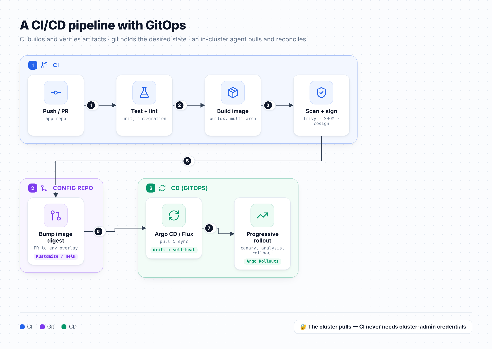

# 9.4 — CI/CD & GitOps

!!! abstract "In one sentence"
    **CI** turns every change into a tested, scanned, signed **artifact** (an image digest); **CD** moves that artifact
    through environments; with **GitOps** the desired state of each environment lives in **git**, and an agent inside
    the cluster (**Argo CD**, **Flux**) continuously **pulls and reconciles** it, so deployments are reviewed, auditable,
    reversible with `git revert`, and rolled out gradually with **canary** or **blue-green** strategies.

## 📖 Key terms & abbreviations

| Term | Stands for | What it is | How it works (one line) |
|---|---|---|---|
| **CI** | Continuous Integration | Build + test every change | Pipeline on each push/PR |
| **CD** | Continuous Delivery / Deployment | Always releasable / automatically released | Promotion through environments |
| **Artifact** | — | The thing you deploy | Image digest, Helm chart, binary |
| **Pipeline** | — | Ordered jobs in CI | GitHub Actions, GitLab CI, Jenkins, Tekton |
| **IaC** | Infrastructure as Code | Infra defined in code | Terraform/OpenTofu, Pulumi, Crossplane |
| **GitOps** | — | Git = source of truth, pulled by an agent | Argo CD, Flux reconcile cluster to git |
| **Drift** | — | Live state ≠ git | Detected and (optionally) auto-corrected |
| **Helm / Kustomize** | — | Templating / overlay tools for manifests | Per-environment configuration |
| **Rolling / blue-green / canary** | — | Deployment strategies | Gradual replace / switch / small % first |
| **Progressive delivery** | — | Automated canary with metric analysis | Argo Rollouts, Flagger |
| **Feature flag** | — | Turn code paths on/off at runtime | Decouple deploy from release |
| **SLSA** | Supply-chain Levels for Software Artifacts | Framework for build integrity | Provenance, hermetic builds |
| **DORA metrics** | DevOps Research and Assessment | Delivery performance | Deploy frequency, lead time, change failure rate, recovery time |

## 🗺️ Big picture



---

## 1 · Continuous integration

### A good pipeline

1. **Fast feedback first**: lint, unit tests, type checks (minutes).
2. **Build once**: produce one image per commit, tagged with the git SHA, pushed by **digest**. Never rebuild for another environment.
3. **Verify**: integration tests (ephemeral environments, Testcontainers), security scans (dependencies, image, IaC, secrets), SBOM generation.
4. **Sign and attest**: cosign signature + build provenance (SLSA), so the cluster can verify the image came from your pipeline.
5. **Speed**: cache dependencies and Docker layers, run jobs in parallel, only build what changed in monorepos.

## 2 · Delivery: pushing vs pulling

| | Push-based CD | GitOps (pull) |
|---|---|---|
| Who applies | CI job runs `kubectl apply`/`helm upgrade` | Agent in the cluster syncs from git |
| Credentials | CI needs cluster admin credentials | Cluster only needs read access to git/registry |
| Drift | Not noticed | Detected, can self-heal |
| Audit / rollback | CI logs, re-run job | Git history, `git revert` |
| Multi-cluster | Script it | ApplicationSets / Flux Kustomizations |

**Typical GitOps flow**: app repo CI builds `api@sha256:…` → opens a PR (or a bot such as Argo CD Image Updater/Renovate does) to the **config repo** updating the digest in `overlays/staging` → merge → Argo CD syncs staging → tests pass → promote the same digest to production via another PR (or with a promotion tool like Kargo).

## 3 · Deployment strategies

| Strategy | How | Pros | Cons |
|---|---|---|---|
| **Recreate** | Stop all old, start new | Simple | Downtime |
| **Rolling** (K8s default) | Replace pods gradually (`maxSurge`, `maxUnavailable`) | No extra capacity, no downtime | Old and new run together; slow rollback |
| **Blue-green** | Run new version fully, switch traffic at once | Instant switch and rollback | Double capacity during switch |
| **Canary** | 1% → 10% → 50% → 100% with checks | Limits blast radius | Needs traffic splitting + metrics |
| **Feature flags** | Deploy dark, enable per user/percentage | Release without deploy | Flag debt, complexity |

**Progressive delivery**: Argo Rollouts/Flagger shift traffic step by step (via Gateway API, mesh or ingress) and query Prometheus/Datadog; if error rate or latency breaches thresholds, they **roll back automatically**.

**Database changes** must be backward compatible across a rollout (expand → migrate → contract, 7.3), because old and new versions run at the same time.

## 4 · Measuring delivery: DORA

| Metric | Elite-ish target |
|---|---|
| Deployment frequency | On demand (many per day) |
| Lead time for changes | < 1 day from commit to production |
| Change failure rate | Low (single-digit to ~15%) |
| Failed deployment recovery time | < 1 hour |

Small, frequent, reversible changes improve **all four** at once.

## 🔧 DevOps connection

- **Secrets in GitOps**: never plain in git; use External Secrets Operator (from Vault/cloud secret managers), Sealed Secrets or SOPS.
- **Environment config**: Kustomize overlays or Helm values per environment; keep differences small and explicit.
- **Policy as code**: Kyverno/Gatekeeper/Conftest in CI *and* at admission (signed images, resource limits, no privileged pods).
- **Pipeline security**: least-privilege tokens, OIDC to cloud (no long-lived keys), pinned actions by SHA, protected branches and required reviews.

## 🧪 Try it yourself

```bash
# Argo CD in a kind cluster, syncing a public example app
kind create cluster --name gitops
kubectl create ns argocd
kubectl apply -n argocd -f https://raw.githubusercontent.com/argoproj/argo-cd/stable/manifests/install.yaml
kubectl -n argocd rollout status deploy/argocd-server --timeout=300s
cat <<'EOF' | kubectl apply -f -
apiVersion: argoproj.io/v1alpha1
kind: Application
metadata: { name: guestbook, namespace: argocd }
spec:
  project: default
  source: { repoURL: https://github.com/argoproj/argocd-example-apps, path: guestbook, targetRevision: HEAD }
  destination: { server: https://kubernetes.default.svc, namespace: default }
  syncPolicy: { automated: { prune: true, selfHeal: true } }
EOF
sleep 30; kubectl get applications -n argocd; kubectl get deploy
kubectl scale deploy guestbook-ui --replicas=5; sleep 20; kubectl get deploy guestbook-ui   # self-heal back to git
kind delete cluster --name gitops
```

## 🃏 Cheat sheet

| Need | Use |
|---|---|
| Same bits in every env | Build once, deploy by digest, promote |
| No cluster creds in CI | GitOps pull (Argo CD / Flux) |
| Undo a bad deploy | `git revert` in config repo (or rollout undo) |
| Limit blast radius | Canary + automated analysis |
| Release ≠ deploy | Feature flags |
| Secrets | External Secrets / Sealed Secrets / SOPS |
| Track improvement | DORA metrics |

## ❓ Test yourself

??? question "1. Why 'build once, promote everywhere' instead of rebuilding per environment?"
    So production runs exactly the bytes that were tested; rebuilding can pull different dependencies or base images.

??? question "2. What's the main security advantage of pull-based GitOps?"
    CI doesn't need cluster credentials; the cluster pulls from git and only needs read access.

??? question "3. Someone runs `kubectl edit` in production. What does Argo CD with selfHeal do?"
    It detects drift from git and reverts the live object to the git state.

??? question "4. When is blue-green better than canary?"
    When you need an instant, all-at-once switch and instant rollback, and can afford double capacity briefly (or can't split traffic finely).

??? question "5. Why must DB migrations be backward compatible during rolling or canary deploys?"
    Old and new app versions run simultaneously against the same database.

---

## 📚 Sources

- [OpenGitOps principles](https://opengitops.dev/)
- [Argo CD docs](https://argo-cd.readthedocs.io/) · [Flux docs](https://fluxcd.io/flux/) · [Argo Rollouts](https://argoproj.github.io/rollouts/)
- [SLSA](https://slsa.dev/) · [Sigstore](https://www.sigstore.dev/)
- [DORA — Four keys metrics](https://dora.dev/guides/dora-metrics-four-keys/)

## ✍️ My notes

> Draw your current path from merge to production. Where are artifacts rebuilt, who holds cluster credentials, and how would you roll back in 5 minutes?

-
