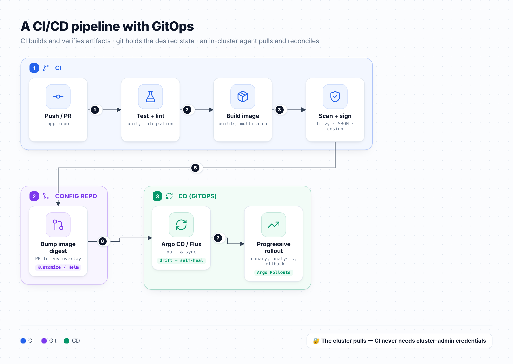

# 9.4 — CI/CD ve GitOps

!!! abstract "Kısaca"
    **CI** her değişikliği test edilmiş, taranmış, imzalanmış bir **artefakta** (bir imaj digest'i) çevirir; **CD** o
    artefaktı ortamlar arasında taşır; **GitOps**'ta her ortamın istenen durumu **git**'te yaşar ve cluster içindeki bir
    ajan (**Argo CD**, **Flux**) onu sürekli **çeker ve uzlaştırır**. Böylece deploy'lar gözden geçirilmiş,
    denetlenebilir, `git revert` ile geri alınabilir olur ve **canary** ya da **blue-green** stratejileriyle kademeli
    yayına alınır.

## 📖 Temel terimler ve kısaltmalar

| Terim | Açılımı | Nedir | Nasıl çalışır (tek satır) |
|---|---|---|---|
| **CI** | Continuous Integration | Her değişikliği derle + test et | Her push/PR'da pipeline |
| **CD** | Continuous Delivery / Deployment | Her an yayınlanabilir / otomatik yayınlanır | Ortamlar arasında terfi |
| **Artefakt** | Artifact | Deploy ettiğin şey | İmaj digest'i, Helm chart'ı, binary |
| **Pipeline** | — | CI'da sıralı işler | GitHub Actions, GitLab CI, Jenkins, Tekton |
| **IaC** | Infrastructure as Code | Kodda tanımlanan altyapı | Terraform/OpenTofu, Pulumi, Crossplane |
| **GitOps** | — | Git = doğruluk kaynağı, bir ajan çeker | Argo CD, Flux cluster'ı git'e uzlaştırır |
| **Sapma** | Drift | Canlı durum ≠ git | Tespit edilir ve (isteğe bağlı) otomatik düzeltilir |
| **Helm / Kustomize** | — | Manifest'ler için şablon / overlay araçları | Ortam başına yapılandırma |
| **Rolling / blue-green / canary** | — | Deploy stratejileri | Kademeli değiştir / anahtarla / önce küçük % |
| **Kademeli teslim** | Progressive delivery | Metrik analizli otomatik canary | Argo Rollouts, Flagger |
| **Feature flag** | — | Kod yollarını çalışma anında aç/kapat | Deploy'u yayından ayır |
| **SLSA** | Supply-chain Levels for Software Artifacts | Build bütünlüğü için çerçeve | Provenance, hermetik build'ler |
| **DORA metrikleri** | DevOps Research and Assessment | Teslim performansı | Deploy sıklığı, teslim süresi, değişiklik hata oranı, kurtarma süresi |

## 🗺️ Büyük resim



---

## 1 · Sürekli entegrasyon

### İyi bir pipeline

1. **Önce hızlı geri bildirim**: lint, birim testleri, tip kontrolleri (dakikalar).
2. **Bir kez üret**: commit başına tek imaj, git SHA'sıyla etiketlenmiş, **digest** ile push edilmiş. Başka bir ortam için asla yeniden üretme.
3. **Doğrula**: entegrasyon testleri (geçici ortamlar, Testcontainers), güvenlik taramaları (bağımlılıklar, imaj, IaC, secret'lar), SBOM üretimi.
4. **İmzala ve onayla**: cosign imzası + build provenance (SLSA); cluster imajın senin pipeline'ından geldiğini doğrulayabilsin.
5. **Hız**: bağımlılıkları ve Docker katmanlarını önbelleğe al, işleri paralel çalıştır, monorepo'larda sadece değişeni derle.

## 2 · Teslim: itmek ve çekmek

| | Push tabanlı CD | GitOps (pull) |
|---|---|---|
| Kim uygular | CI işi `kubectl apply`/`helm upgrade` çalıştırır | Cluster'daki ajan git'ten senkronlar |
| Kimlik bilgileri | CI'ın cluster admin kimlik bilgisine ihtiyacı var | Cluster'ın sadece git/registry okuma erişimine ihtiyacı var |
| Sapma | Fark edilmez | Tespit edilir, kendini düzeltebilir |
| Denetim / geri alma | CI logları, işi yeniden çalıştır | Git geçmişi, `git revert` |
| Çoklu cluster | Script yaz | ApplicationSet'ler / Flux Kustomization'ları |

**Tipik GitOps akışı**: uygulama repo'sunun CI'ı `api@sha256:…` üretir → **config repo**'suna `overlays/staging`'deki digest'i güncelleyen bir PR açar (ya da Argo CD Image Updater/Renovate gibi bir bot açar) → merge → Argo CD staging'i senkronlar → testler geçer → aynı digest'i başka bir PR ile (ya da Kargo gibi bir terfi aracıyla) production'a terfi ettir.

## 3 · Deploy stratejileri

| Strateji | Nasıl | Artıları | Eksileri |
|---|---|---|---|
| **Recreate** | Tüm eskileri durdur, yenileri başlat | Basit | Kesinti |
| **Rolling** (K8s varsayılanı) | Pod'ları kademeli değiştir (`maxSurge`, `maxUnavailable`) | Ek kapasite yok, kesinti yok | Eski ve yeni birlikte çalışır; yavaş geri alma |
| **Blue-green** | Yeni sürümü tamamen çalıştır, trafiği bir anda geçir | Anında geçiş ve geri alma | Geçiş sırasında çift kapasite |
| **Canary** | Kontrollerle %1 → %10 → %50 → %100 | Etki alanını sınırlar | Trafik bölme + metrik ister |
| **Feature flag'ler** | Karanlıkta deploy et, kullanıcı/yüzde bazında aç | Deploy'suz yayın | Flag borcu, karmaşıklık |

**Kademeli teslim**: Argo Rollouts/Flagger trafiği adım adım kaydırır (Gateway API, mesh ya da ingress üzerinden) ve Prometheus/Datadog'u sorgular; hata oranı ya da gecikme eşikleri aşarsa **otomatik geri alır**.

**Veritabanı değişiklikleri** bir rollout boyunca geriye uyumlu olmalı (genişlet → taşı → daralt, 7.3), çünkü eski ve yeni sürümler aynı anda çalışır.

## 4 · Teslimi ölçmek: DORA

| Metrik | Elit düzeye yakın hedef |
|---|---|
| Deploy sıklığı | İstek üzerine (günde çok sayıda) |
| Değişiklik teslim süresi | Commit'ten production'a < 1 gün |
| Değişiklik hata oranı | Düşük (tek haneli ile ~%15 arası) |
| Başarısız deploy'dan kurtarma süresi | < 1 saat |

Küçük, sık, geri alınabilir değişiklikler **dördünü de** aynı anda iyileştirir.

## 🔧 DevOps bağlantısı

- **GitOps'ta secret'lar**: git'te asla düz metin değil; External Secrets Operator (Vault'tan/bulut secret yöneticilerinden), Sealed Secrets ya da SOPS kullan.
- **Ortam yapılandırması**: ortam başına Kustomize overlay'leri ya da Helm values; farkları küçük ve açık tut.
- **Kod olarak politika**: Kyverno/Gatekeeper/Conftest CI'da *ve* admission'da (imzalı imajlar, kaynak limitleri, privileged pod yok).
- **Pipeline güvenliği**: en az yetkili token'lar, buluta OIDC (uzun ömürlü anahtar yok), SHA ile sabitlenmiş action'lar, korumalı branch'ler ve zorunlu incelemeler.

## 🧪 Kendin dene

```bash
# Bir kind cluster'ında, açık bir örnek uygulamayı senkronlayan Argo CD
kind create cluster --name gitops
kubectl create ns argocd
kubectl apply -n argocd -f https://raw.githubusercontent.com/argoproj/argo-cd/stable/manifests/install.yaml
kubectl -n argocd rollout status deploy/argocd-server --timeout=300s
cat <<'EOF' | kubectl apply -f -
apiVersion: argoproj.io/v1alpha1
kind: Application
metadata: { name: guestbook, namespace: argocd }
spec:
  project: default
  source: { repoURL: https://github.com/argoproj/argocd-example-apps, path: guestbook, targetRevision: HEAD }
  destination: { server: https://kubernetes.default.svc, namespace: default }
  syncPolicy: { automated: { prune: true, selfHeal: true } }
EOF
sleep 30; kubectl get applications -n argocd; kubectl get deploy
kubectl scale deploy guestbook-ui --replicas=5; sleep 20; kubectl get deploy guestbook-ui   # git'e geri kendini düzeltir
kind delete cluster --name gitops
```

## 🃏 Hatırlatma kartı

| İhtiyaç | Kullan |
|---|---|
| Her ortamda aynı bitler | Bir kez üret, digest ile deploy et, terfi ettir |
| CI'da cluster kimlik bilgisi yok | GitOps pull (Argo CD / Flux) |
| Kötü bir deploy'u geri al | Config repo'da `git revert` (ya da rollout undo) |
| Etki alanını sınırla | Canary + otomatik analiz |
| Yayın ≠ deploy | Feature flag'ler |
| Secret'lar | External Secrets / Sealed Secrets / SOPS |
| İlerlemeyi izle | DORA metrikleri |

## ❓ Kendini test et

??? question "1. Neden ortam başına yeniden üretmek yerine 'bir kez üret, her yere terfi ettir'?"
    Production tam olarak test edilen byte'ları çalıştırsın diye; yeniden üretmek farklı bağımlılıklar ya da taban imajlar çekebilir.

??? question "2. Pull tabanlı GitOps'un temel güvenlik avantajı ne?"
    CI'ın cluster kimlik bilgisine ihtiyacı yok; cluster git'ten çeker ve sadece okuma erişimine ihtiyaç duyar.

??? question "3. Biri production'da `kubectl edit` çalıştırıyor. selfHeal açık Argo CD ne yapar?"
    Git'ten sapmayı tespit eder ve canlı nesneyi git durumuna geri döndürür.

??? question "4. Blue-green ne zaman canary'den iyidir?"
    Anında, hepsi birden bir geçiş ve anında geri alma gerektiğinde, kısa süre çift kapasiteyi karşılayabildiğinde (ya da trafiği ince bölemediğinde).

??? question "5. Rolling ya da canary deploy'larda DB migration'ları neden geriye uyumlu olmalı?"
    Eski ve yeni uygulama sürümleri aynı veritabanına karşı aynı anda çalışır.

---

## 📚 Kaynaklar

- [OpenGitOps principles](https://opengitops.dev/)
- [Argo CD docs](https://argo-cd.readthedocs.io/) · [Flux docs](https://fluxcd.io/flux/) · [Argo Rollouts](https://argoproj.github.io/rollouts/)
- [SLSA](https://slsa.dev/) · [Sigstore](https://www.sigstore.dev/)
- [DORA — Four keys metrics](https://dora.dev/guides/dora-metrics-four-keys/)

## ✍️ Notlarım

> Merge'den production'a mevcut yolunu çiz. Artefaktlar nerede yeniden üretiliyor, cluster kimlik bilgilerini kim tutuyor ve 5 dakikada nasıl geri alırdın?
