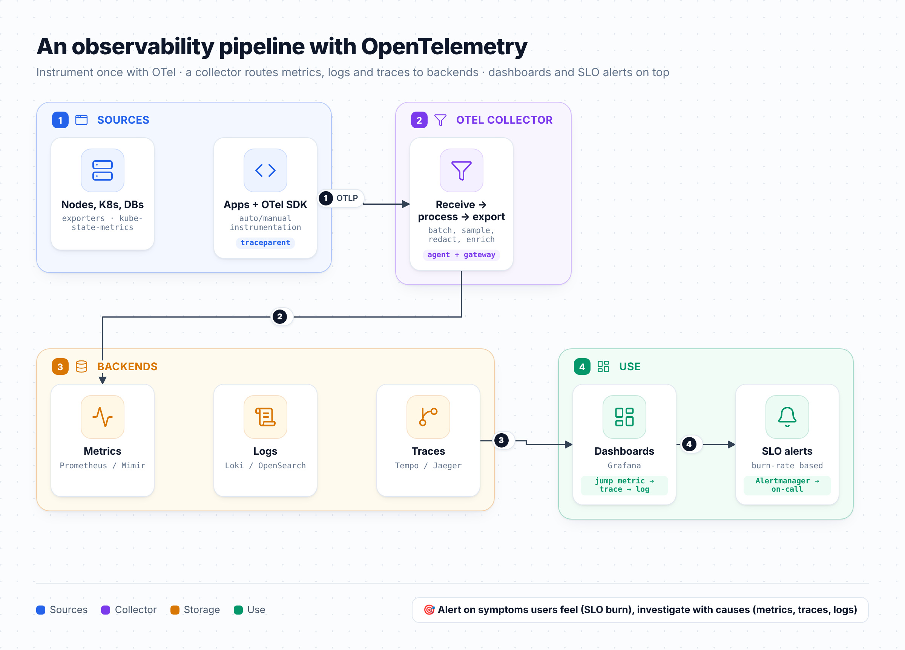

# 9.5 — Observability: metrics, logs, traces & SLOs

!!! abstract "In short"
    Observability means answering "what is wrong and why?" from the outside. **Metrics** tell you *that* something
    changed, **traces** show *where* in a request time or errors come from, and **logs** explain *what exactly*
    happened. **OpenTelemetry** is one standard way to produce all three. **SLOs** with **burn-rate alerts** make sure
    you get paged for what users actually feel.

## 📖 Key terms & abbreviations

| Term | Stands for | What it is | How it works (one line) |
|---|---|---|---|
| **Metric** | — | Numeric time series with labels | `http_requests_total{route="/cart",code="500"}` |
| **Counter / gauge / histogram** | — | Metric types | Only goes up / goes up and down / distribution in buckets |
| **Cardinality** | — | Number of distinct label combinations | High cardinality (user_id) explodes cost |
| **Log** | — | Timestamped event record | Structured (JSON) beats free text |
| **Trace / span** | — | A request's path / one operation in it | Spans share a trace id (`traceparent`, 6.1) |
| **Sampling** | — | Keeping only some traces | Head-based or tail-based (keep errors/slow) |
| **Profile** | — | Where CPU/memory is spent in code | Continuous profiling (Pyroscope, Parca) |
| **OTel** | OpenTelemetry | Vendor-neutral APIs, SDKs, protocol (OTLP), collector | Instrument once, send anywhere |
| **Exemplar** | — | A trace id attached to a metric sample | Jump from a latency spike to an example trace |
| **RED / USE** | Rate, Errors, Duration / Utilization, Saturation, Errors | Checklists for services / resources | What to put on dashboards |
| **SLI** | Service Level Indicator | Measured good events / total events | e.g. % requests < 300 ms and not 5xx |
| **SLO** | Service Level Objective | Target for an SLI over a window | 99.9% over 30 days |
| **Error budget** | — | Allowed unreliability = 1 − SLO | 0.1% of 30 days ≈ 43 minutes |
| **Burn rate** | — | How fast the budget is being consumed | Alert when burning 14× faster than allowed |

## 🗺️ Big picture



---

## 1 · The signals and when to use each

| Signal | Answers | Cost | Example |
|---|---|---|---|
| **Metrics** | Is something wrong? Trends, alerts | Low (aggregated) | p99 latency of `/checkout` jumped |
| **Traces** | Where in the call chain? | Medium (sampled) | 900 ms of 1 s spent in `inventory → postgres` |
| **Logs** | What exactly happened? | High (volume) | `deadlock detected on table orders` |
| **Profiles** | Which code uses the CPU/memory? | Low–medium | 40% CPU in JSON serialization |

Connect them: put **trace ids in logs**, use **exemplars** on metrics, and the same resource labels (`service.name`, `k8s.pod.name`, `deployment.environment`) everywhere.

## 2 · OpenTelemetry

### How does it work?

1. **SDKs / auto-instrumentation** (Java agent, Python, Node, .NET, Go, eBPF-based) create spans for incoming/outgoing HTTP, gRPC, DB calls, and record metrics and logs, propagating `traceparent` across services.
2. Apps export via **OTLP** to an **OpenTelemetry Collector**: usually an **agent** per node (DaemonSet) plus a central **gateway**.
3. The collector **processes**: batching, memory limits, adding Kubernetes metadata, dropping or redacting sensitive attributes, **tail sampling** (keep all errors and slow traces, 5% of the rest).
4. It **exports** to backends: Prometheus/Mimir (metrics), Loki/OpenSearch (logs), Tempo/Jaeger (traces), or a vendor (Datadog, Grafana Cloud, New Relic, Honeycomb…). Switching backends is a config change, not re-instrumentation.

## 3 · Metrics with Prometheus

- Prometheus **scrapes** `/metrics` endpoints (or receives OTLP / remote write) and stores time series.
- **RED** per service: `rate(http_requests_total[5m])`, error ratio, `histogram_quantile(0.99, rate(http_request_duration_seconds_bucket[5m]))`.
- **USE** per resource: CPU utilization, run-queue/throttling (saturation), errors; same for memory, disk, network.
- **Kubernetes**: cAdvisor (container usage), kube-state-metrics (object state: restarts, desired vs available replicas), node-exporter (host).
- **Cardinality** is the #1 cost/performance problem: never put user IDs, request IDs or raw URLs in labels.

## 4 · SLOs and alerting

### How does it work?

1. Choose an **SLI** users feel: "fraction of `/checkout` requests that succeed and take < 500 ms".
2. Set an **SLO**: 99.9% over 30 days → **error budget** = 0.1% ≈ 43 minutes of full outage (or many small bad periods).
3. **Alert on burn rate**, with multiple windows: page if the last 1 h *and* 5 min burn > 14.4× (2% of the monthly budget gone in an hour); ticket if 6 h burn > 6×. This catches fast outages quickly and slow degradations without noisy alerts.
4. **Use the budget**: plenty left → ship faster; exhausted → focus on reliability.

Alert on **symptoms** (SLO burn, user-facing errors), not on every cause (CPU 80%); causes go on dashboards for investigation. Every page should be actionable and link to a **runbook**.

## 🔧 DevOps connection

- **Standardize** service names, labels and log format across teams (OTel semantic conventions); provide auto-instrumentation via the OTel Operator so teams get traces without code changes.
- **Control cost**: sample traces, drop debug logs at the collector, cap cardinality, set retention per signal.
- **On-call hygiene**: few, high-quality alerts; postmortems that are blameless and produce fixes; track MTTR (DORA, 9.4).
- **Correlate deploys**: annotate dashboards with releases (9.4); most incidents start with a change.

## 🧪 Try it yourself

```bash
# Grafana's all-in-one OTel stack: OTLP in, Grafana + Prometheus + Loki + Tempo out (UI on :3000)
docker run -d --rm --name lgtm -p 3000:3000 -p 4317:4317 -p 4318:4318 grafana/otel-lgtm

# Send a test span over OTLP/HTTP
NOW=$(date +%s%N); TID=$(openssl rand -hex 16); SID=$(openssl rand -hex 8)
curl -s -X POST localhost:4318/v1/traces -H 'Content-Type: application/json' -d "{\"resourceSpans\":[{\"resource\":{\"attributes\":[{\"key\":\"service.name\",\"value\":{\"stringValue\":\"demo\"}}]},\"scopeSpans\":[{\"spans\":[{\"traceId\":\"$TID\",\"spanId\":\"$SID\",\"name\":\"checkout\",\"kind\":2,\"startTimeUnixNano\":\"$NOW\",\"endTimeUnixNano\":\"$((NOW+250000000))\"}]}]}]}"
echo "open http://localhost:3000 → Explore → Tempo → search service.name=demo"

# PromQL to try in Explore → Prometheus
#   rate(prometheus_http_requests_total[5m])
#   histogram_quantile(0.99, sum by (le) (rate(prometheus_http_request_duration_seconds_bucket[5m])))
docker stop lgtm
```

## 🃏 Cheat sheet

| Question | Signal / query |
|---|---|
| Are users affected? | SLO burn rate, error ratio, p99 latency |
| Which service is slow? | Trace waterfall, service graph |
| Why did this request fail? | Logs filtered by trace id |
| Which code burns CPU? | Continuous profiling |
| Is the node/pod saturated? | USE: CPU throttling, memory, PSI, network |
| What changed? | Deploy annotations, git history |

## ❓ Test yourself

??? question "1. Why shouldn't you use `user_id` as a Prometheus label?"
    Each distinct value creates a new time series; millions of users = millions of series, exploding memory, storage and query cost.

??? question "2. What's the difference between an SLI and an SLO?"
    The SLI is the measurement (ratio of good events); the SLO is the target for it over a time window.

??? question "3. Your SLO is 99.9% over 30 days. How much full downtime does the error budget allow?"
    0.1% of 30 days ≈ 43.2 minutes.

??? question "4. Why alert on burn rate instead of 'error rate > 1% for 5 minutes'?"
    Burn rate ties alerts to the budget and user impact: fast burns page quickly, slow burns open tickets, and brief harmless blips don't wake anyone.

??? question "5. What does tail-based sampling give you that head-based sampling doesn't?"
    The decision is made after the trace completes, so you can keep all errors and slow traces while dropping most normal ones.

---

## 📚 Sources

- [OpenTelemetry docs](https://opentelemetry.io/docs/) · [Collector](https://opentelemetry.io/docs/collector/)
- [Prometheus — Querying basics](https://prometheus.io/docs/prometheus/latest/querying/basics/)
- [Google SRE Workbook — Alerting on SLOs](https://sre.google/workbook/alerting-on-slos/)
- [Brendan Gregg — The USE method](https://www.brendangregg.com/usemethod.html)
- [grafana/otel-lgtm](https://github.com/grafana/docker-otel-lgtm)

## ✍️ My notes

> Pick your most important user journey. Write its SLI and SLO, calculate the error budget, and define the two burn-rate alerts.
