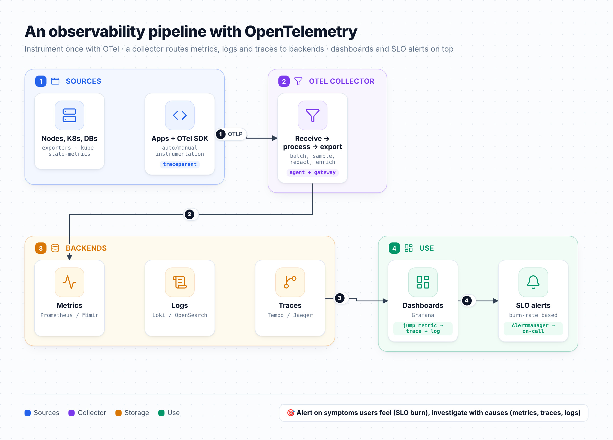

# 9.5 — Gözlemlenebilirlik: metrikler, loglar, trace'ler ve SLO'lar

!!! abstract "Tek cümlede"
    Gözlemlenebilirlik, "ne yanlış ve neden?" sorusunu dışarıdan cevaplayabilmektir: **metrikler** bir şeyin değiştiğini
    söyler (ucuz, toplanmış), **trace**'ler bir isteğin yolunda zamanın ya da hataların *nereden* geldiğini gösterir,
    **loglar** *tam olarak ne* olduğunu açıklar; **OpenTelemetry** üçünü de üretmek için tek bir standart yol sunar,
    **burn-rate alarmlı SLO**'lar da kullanıcıların gerçekten hissettiği şey için uyandırılmanı sağlar.

## 📖 Temel terimler ve kısaltmalar

| Terim | Açılımı | Nedir | Nasıl çalışır (tek satır) |
|---|---|---|---|
| **Metrik** | Metric | Etiketli sayısal zaman serisi | `http_requests_total{route="/cart",code="500"}` |
| **Counter / gauge / histogram** | — | Metrik tipleri | Sadece artar / artar ve azalır / kovalarda dağılım |
| **Kardinalite** | Cardinality | Farklı etiket kombinasyonlarının sayısı | Yüksek kardinalite (user_id) maliyeti patlatır |
| **Log** | — | Zaman damgalı olay kaydı | Yapılandırılmış (JSON) serbest metni yener |
| **Trace / span** | — | Bir isteğin yolu / içindeki tek bir işlem | Span'ler bir trace kimliği paylaşır (`traceparent`, 6.1) |
| **Örnekleme** | Sampling | Trace'lerin sadece bir kısmını tutmak | Baştan ya da kuyruktan (hataları/yavaşları tut) |
| **Profil** | Profile | Kodda CPU/belleğin nereye harcandığı | Sürekli profilleme (Pyroscope, Parca) |
| **OTel** | OpenTelemetry | Sağlayıcıdan bağımsız API'ler, SDK'lar, protokol (OTLP), collector | Bir kez enstrümante et, her yere gönder |
| **Exemplar** | — | Bir metrik örneğine eklenmiş trace kimliği | Gecikme sıçramasından örnek bir trace'e atla |
| **RED / USE** | Rate, Errors, Duration / Utilization, Saturation, Errors | Servisler / kaynaklar için kontrol listeleri | Panolara ne konacağı |
| **SLI** | Service Level Indicator | Ölçülen iyi olaylar / toplam olaylar | ör. 300 ms altı ve 5xx olmayan isteklerin %'si |
| **SLO** | Service Level Objective | Bir pencere için SLI hedefi | 30 günde %99,9 |
| **Hata bütçesi** | Error budget | İzin verilen güvenilmezlik = 1 − SLO | 30 günün %0,1'i ≈ 43 dakika |
| **Burn rate** | — | Bütçenin ne kadar hızlı tüketildiği | İzin verilenden 14× hızlı yanınca alarm |

## 🗺️ Büyük resim



---

## 1 · Sinyaller ve her birinin ne zaman kullanılacağı

| Sinyal | Cevapladığı | Maliyet | Örnek |
|---|---|---|---|
| **Metrikler** | Bir sorun var mı? Trendler, alarmlar | Düşük (toplanmış) | `/checkout`'un p99 gecikmesi fırladı |
| **Trace'ler** | Çağrı zincirinin neresinde? | Orta (örneklenmiş) | 1 sn'nin 900 ms'si `inventory → postgres`'te |
| **Loglar** | Tam olarak ne oldu? | Yüksek (hacim) | `deadlock detected on table orders` |
| **Profiller** | CPU/belleği hangi kod kullanıyor? | Düşük–orta | CPU'nun %40'ı JSON serileştirmede |

Onları bağla: **trace kimliklerini loglara** koy, metriklerde **exemplar** kullan ve her yerde aynı kaynak etiketlerini (`service.name`, `k8s.pod.name`, `deployment.environment`) kullan.

## 2 · OpenTelemetry

### Nasıl çalışır?

1. **SDK'lar / otomatik enstrümantasyon** (Java agent, Python, Node, .NET, Go, eBPF tabanlı) gelen/giden HTTP, gRPC, DB çağrıları için span'ler oluşturur, metrik ve log kaydeder, `traceparent`'ı servisler arasında taşır.
2. Uygulamalar **OTLP** ile bir **OpenTelemetry Collector**'a aktarır: genelde node başına bir **ajan** (DaemonSet) artı merkezi bir **gateway**.
3. Collector **işler**: gruplama, bellek limitleri, Kubernetes üst verisi ekleme, hassas öznitelikleri atma ya da maskeleme, **kuyruk örneklemesi** (tüm hataları ve yavaş trace'leri, gerisinin %5'ini tut).
4. Backend'lere **aktarır**: Prometheus/Mimir (metrikler), Loki/OpenSearch (loglar), Tempo/Jaeger (trace'ler) ya da bir sağlayıcı (Datadog, Grafana Cloud, New Relic, Honeycomb…). Backend değiştirmek yeniden enstrümantasyon değil, bir config değişikliğidir.

## 3 · Prometheus ile metrikler

- Prometheus `/metrics` endpoint'lerini **kazır** (ya da OTLP / remote write alır) ve zaman serilerini saklar.
- Servis başına **RED**: `rate(http_requests_total[5m])`, hata oranı, `histogram_quantile(0.99, rate(http_request_duration_seconds_bucket[5m]))`.
- Kaynak başına **USE**: CPU kullanımı, çalışma kuyruğu/throttling (doygunluk), hatalar; bellek, disk, ağ için de aynısı.
- **Kubernetes**: cAdvisor (container kullanımı), kube-state-metrics (nesne durumu: yeniden başlatmalar, istenen ve mevcut replikalar), node-exporter (host).
- **Kardinalite** bir numaralı maliyet/performans sorunudur: etiketlere asla kullanıcı kimlikleri, istek kimlikleri ya da ham URL'ler koyma.

## 4 · SLO'lar ve alarm

### Nasıl çalışır?

1. Kullanıcıların hissettiği bir **SLI** seç: "başarılı olan ve 500 ms'den kısa süren `/checkout` isteklerinin oranı".
2. Bir **SLO** koy: 30 günde %99,9 → **hata bütçesi** = %0,1 ≈ 43 dakikalık tam kesinti (ya da çok sayıda küçük kötü dönem).
3. Çoklu pencerelerle **burn rate'e alarm kur**: son 1 saat *ve* 5 dakikadaki yanma > 14,4× ise sayfala (aylık bütçenin %2'si bir saatte gitti); 6 saatlik yanma > 6× ise bilet aç. Bu hızlı kesintileri çabuk, yavaş bozulmaları da gürültülü alarm olmadan yakalar.
4. **Bütçeyi kullan**: bol kaldıysa → daha hızlı yayınla; bittiyse → güvenilirliğe odaklan.

**Belirtilere** (SLO yanması, kullanıcıya dönük hatalar) alarm kur, her sebebe (CPU %80) değil; sebepler araştırma için panolara gider. Her sayfa eyleme dönüştürülebilir olmalı ve bir **runbook**'a bağlanmalı.

## 🔧 DevOps bağlantısı

- Ekipler arasında servis adlarını, etiketleri ve log formatını **standartlaştır** (OTel semantik kuralları); ekipler kod değiştirmeden trace alsın diye OTel Operator ile otomatik enstrümantasyon sun.
- **Maliyeti kontrol et**: trace'leri örnekle, debug loglarını collector'da at, kardinaliteyi sınırla, sinyal başına saklama süresi belirle.
- **Nöbet hijyeni**: az sayıda, yüksek kaliteli alarm; suçlamasız ve düzeltme üreten postmortem'ler; MTTR'yi izle (DORA, 9.4).
- **Deploy'ları ilişkilendir**: panolara sürüm notları ekle (9.4); çoğu olay bir değişiklikle başlar.

## 🧪 Kendin dene

```bash
# Grafana'nın hepsi bir arada OTel yığını: OTLP girer, Grafana + Prometheus + Loki + Tempo çıkar (arayüz :3000'de)
docker run -d --rm --name lgtm -p 3000:3000 -p 4317:4317 -p 4318:4318 grafana/otel-lgtm

# OTLP/HTTP ile bir test span'i gönder
NOW=$(date +%s%N); TID=$(openssl rand -hex 16); SID=$(openssl rand -hex 8)
curl -s -X POST localhost:4318/v1/traces -H 'Content-Type: application/json' -d "{\"resourceSpans\":[{\"resource\":{\"attributes\":[{\"key\":\"service.name\",\"value\":{\"stringValue\":\"demo\"}}]},\"scopeSpans\":[{\"spans\":[{\"traceId\":\"$TID\",\"spanId\":\"$SID\",\"name\":\"checkout\",\"kind\":2,\"startTimeUnixNano\":\"$NOW\",\"endTimeUnixNano\":\"$((NOW+250000000))\"}]}]}]}"
echo "http://localhost:3000 aç → Explore → Tempo → service.name=demo ara"

# Explore → Prometheus'ta denenecek PromQL
#   rate(prometheus_http_requests_total[5m])
#   histogram_quantile(0.99, sum by (le) (rate(prometheus_http_request_duration_seconds_bucket[5m])))
docker stop lgtm
```

## 🃏 Hatırlatma kartı

| Soru | Sinyal / sorgu |
|---|---|
| Kullanıcılar etkileniyor mu? | SLO burn rate, hata oranı, p99 gecikme |
| Hangi servis yavaş? | Trace şelalesi, servis grafiği |
| Bu istek neden başarısız oldu? | Trace kimliğine göre filtrelenmiş loglar |
| CPU'yu hangi kod yakıyor? | Sürekli profilleme |
| Node/pod doygun mu? | USE: CPU throttling, bellek, PSI, ağ |
| Ne değişti? | Deploy notları, git geçmişi |

## ❓ Kendini test et

??? question "1. Neden `user_id`'yi bir Prometheus etiketi olarak kullanmamalısın?"
    Her farklı değer yeni bir zaman serisi oluşturur; milyonlarca kullanıcı = milyonlarca seri, bellek, depolama ve sorgu maliyetini patlatır.

??? question "2. SLI ile SLO arasındaki fark ne?"
    SLI ölçümdür (iyi olayların oranı); SLO bir zaman penceresi için onun hedefidir.

??? question "3. SLO'n 30 günde %99,9. Hata bütçesi ne kadar tam kesintiye izin verir?"
    30 günün %0,1'i ≈ 43,2 dakika.

??? question "4. 'Hata oranı 5 dakika boyunca > %1' yerine neden burn rate'e alarm kurulur?"
    Burn rate alarmları bütçeye ve kullanıcı etkisine bağlar: hızlı yanmalar çabuk sayfalar, yavaş yanmalar bilet açar ve kısa zararsız sıçramalar kimseyi uyandırmaz.

??? question "5. Kuyruk tabanlı örnekleme, baş tabanlının vermediği neyi verir?"
    Karar trace tamamlandıktan sonra verilir; tüm hataları ve yavaş trace'leri tutup normallerin çoğunu atabilirsin.

---

## 📚 Kaynaklar

- [OpenTelemetry docs](https://opentelemetry.io/docs/) · [Collector](https://opentelemetry.io/docs/collector/)
- [Prometheus — Querying basics](https://prometheus.io/docs/prometheus/latest/querying/basics/)
- [Google SRE Workbook — Alerting on SLOs](https://sre.google/workbook/alerting-on-slos/)
- [Brendan Gregg — The USE method](https://www.brendangregg.com/usemethod.html)
- [grafana/otel-lgtm](https://github.com/grafana/docker-otel-lgtm)

## ✍️ Notlarım

> En önemli kullanıcı yolculuğunu seç. SLI ve SLO'sunu yaz, hata bütçesini hesapla ve iki burn-rate alarmını tanımla.

-
