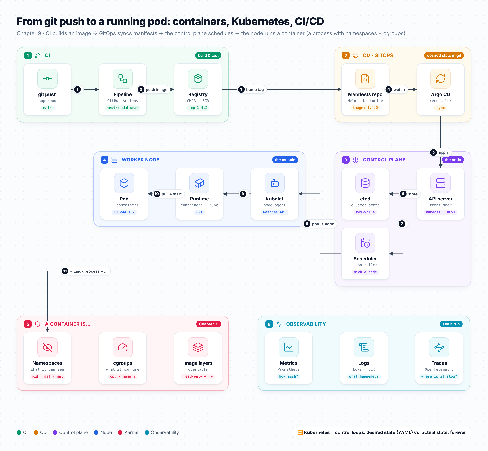
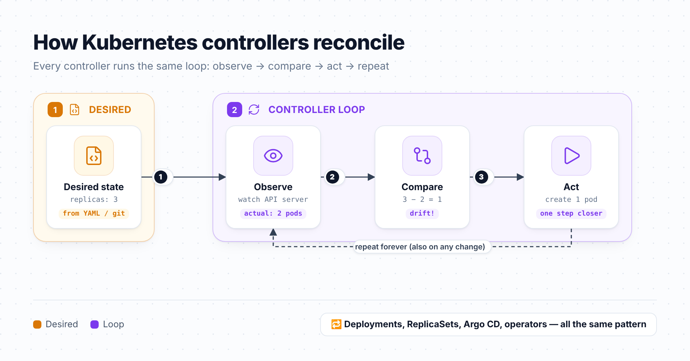

# Chapter 9 — Modern infrastructure

!!! abstract "In one sentence"
    A **container** is just a Linux process (Chapter 3) wrapped in **namespaces** (what it can see) and **cgroups**
    (what it can use), started from a layered **image**. **Kubernetes** keeps comparing the **desired state** you wrote
    in YAML with the **actual state** of the cluster and fixes the difference, forever. **CI/CD** builds the images
    and **GitOps** tells the cluster what should run. **Observability** shows you whether it actually works.

## 📖 Key terms & abbreviations

| Term | Stands for | What it is | How it works (one line) |
|---|---|---|---|
| **Container** | — | A process isolated with namespaces and limited with cgroups | Started from an image by a runtime (containerd/runc) |
| **Namespace** | — | What a process can see | pid, net, mnt, uts, ipc, user, cgroup |
| **cgroup** | control group | What a process can use | CPU quota, memory limit, I/O, pids |
| **OCI image** | Open Container Initiative | Standard container image format | Manifest + layers + config, addressed by digest |
| **CRI / CNI** | Container Runtime Interface / Container Network Interface | Plugin APIs of Kubernetes | kubelet ↔ runtime / pod networking plugins |
| **API server / etcd** | — | Kubernetes front door / its database | Everything reads/writes cluster state through the API |
| **Scheduler / kubelet** | — | Picks a node / runs pods on a node | Filter + score nodes / talk to the runtime |
| **Controller / reconcile** | — | Loop making actual state match desired state | Watch → compare → act → repeat |
| **Service / Ingress** | — | Stable virtual IP for pods / HTTP routing into the cluster | kube-proxy/eBPF load-balances; ingress routes by host/path |
| **CI / CD** | Continuous Integration / Continuous Delivery | Automated build-test / automated release | Pipelines on every push; rollouts to environments |
| **GitOps** | — | Git as the source of truth for deployments | An in-cluster agent (Argo CD, Flux) syncs from git |
| **IaC** | Infrastructure as Code | Cloud resources defined in code | Terraform/OpenTofu, Pulumi, Crossplane plan & apply |
| **SLO** | Service Level Objective | A reliability/latency target | e.g. 99.9% of requests < 300 ms |
| **OTel** | OpenTelemetry | Open standard for metrics, logs, traces | SDKs + collector export to any backend |

## 🗺️ Big picture



---

## 1 · A container is a process with extra walls

| Kernel feature | What it isolates | Examples |
|---|---|---|
| **Namespaces** | What the process can **see** | `pid` (own PID 1), `net` (own network stack and IP), `mnt` (own filesystem view), `uts` (hostname), `ipc`, `user` (root inside ≠ root outside), `cgroup` |
| **cgroups v2** | What the process can **use** | `cpu.max` (CPU quota → throttling), `memory.max` (limit → OOM kill), `io.max`, `pids.max` |
| **Image + overlayfs** | Its **filesystem** | Read-only layers (one per Dockerfile step) stacked with a thin writable layer on top. Shared between containers. |
| **Seccomp, capabilities, AppArmor/SELinux** | What it is **allowed** to do | Block dangerous syscalls, drop root powers |

| | Virtual machine | Container |
|---|---|---|
| Isolation boundary | Hypervisor, separate kernel | Shared host kernel, namespaces |
| Start time | Seconds to minutes | Milliseconds |
| Overhead | A full OS per VM | One process |
| Security isolation | Stronger | Weaker (shared kernel), hardened with gVisor/Kata/microVMs |

An **image** follows the OCI standard: a manifest + layers (tarballs) + config (entrypoint, env), stored in a **registry** and identified by an immutable **digest** (`sha256:…`).

## 2 · Kubernetes: a set of control loops

**Control plane** (the brain):

| Component | Job |
|---|---|
| **kube-apiserver** | The only front door. Every client (`kubectl`, controllers, kubelets) talks to it over REST. Authenticates, authorizes, validates, stores. |
| **etcd** | Consistent key-value store holding the entire cluster state. |
| **kube-scheduler** | Picks a node for each unscheduled pod: **filter** (enough CPU/memory? taints, affinity) then **score**. |
| **kube-controller-manager** | Many control loops: Deployment → ReplicaSet → Pods, node health, endpoints, jobs… |

**Worker nodes** (the muscle):

| Component | Job |
|---|---|
| **kubelet** | Watches the API for pods assigned to its node and makes them real. Runs probes, reports status. |
| **Container runtime** (containerd + runc) | Pulls images and starts containers, via the **CRI** interface. |
| **CNI plugin** (Cilium, Calico, …) | Gives each pod an IP and connects pod networks across nodes. |
| **kube-proxy / eBPF** | Implements **Services**: a stable virtual IP that load-balances to the pods behind it. |

### What happens on `kubectl apply -f deployment.yaml`

| # | Step |
|---|---|
| 5 | `kubectl` sends the Deployment to the **API server**, which validates it. |
| 6 | The API server stores it in **etcd**. Nothing is running yet, only *desired state*. |
| 7 | The **Deployment controller** creates a **ReplicaSet**, the ReplicaSet controller creates **Pod** objects (status `Pending`, no node). The **scheduler** sees them, picks a node for each, and writes the binding back. |
| 8 | The **kubelet** on that node sees a pod assigned to it. |
| 9 | It asks the **runtime** (CRI) to create the pod sandbox. **CNI** assigns the pod IP. |
| 10 | The runtime **pulls the image** and **starts the containers**: `clone()` with new namespaces, put into cgroups, `execve` the entrypoint (Chapters 3–4!). |
| — | **Readiness probe** passes → the pod is added to the Service's **EndpointSlice** → traffic starts flowing. |

!!! tip "Remember this"
    Kubernetes never "runs a command once". Every component **watches** the API and **reconciles**: "Is actual = desired?
    If not, take one step closer." Delete a pod of a Deployment and a new one appears. That's the controller doing its job.

### How does reconciliation work?

Each controller watches the API server, compares the **desired** state (spec) with the **actual** state (status), and takes one step to close the gap — then repeats on every change and periodically. This is why deleting a pod managed by a Deployment just brings it back.



## 3 · CI/CD and GitOps

| Stage | Typical tools | Output |
|---|---|---|
| **CI**: on every push, test, build and scan | GitHub Actions, GitLab CI, Jenkins | An immutable image `app:1.4.2` (or `@sha256:…`) in a registry |
| **Promote**: update the desired version | A commit/PR to the manifests repo (Helm values, Kustomize) | Git = the single source of truth |
| **CD / GitOps**: the cluster pulls changes | **Argo CD**, Flux | The cluster converges to what's in git. Drift is detected and corrected. |
| **Rollout strategy** | Rolling update, blue/green, canary (Argo Rollouts) | Safe, reversible releases (`git revert` = rollback) |

Cloud resources outside the cluster (VPCs, databases, DNS) are managed the same declarative way with **Infrastructure as Code**: Terraform/OpenTofu, Pulumi, Crossplane.

## 4 · Observability: metrics, logs, traces

| Signal | Answers | Tools |
|---|---|---|
| **Metrics** | How much / how often? (rates, latencies, saturation) | Prometheus, Grafana |
| **Logs** | What exactly happened in this request? | Loki, Elasticsearch/OpenSearch |
| **Traces** | Where did the time go across services? | OpenTelemetry, Tempo, Jaeger |

Useful habits: the **RED** method for services (Rate, Errors, Duration), **USE** for resources (Utilization, Saturation, Errors), and **SLOs** ("99.9% of requests < 300 ms") that alert on what users feel.

---

## 🚨 Incident story: the hotfix that kept disappearing

!!! failure "The alarm"
    During an incident, an engineer raises a Deployment's memory limit with `kubectl edit`. The pods restart with the new limit… and two minutes later they're back on the old one and OOMKill again.

Try to diagnose it yourself first, then open the clues one by one.

??? info "🔍 Clue 1"
    `kubectl get deploy -o yaml` shows the annotation of the GitOps tool; the Argo CD UI shows the app as *OutOfSync → Synced* right after the edit.

??? info "🔍 Clue 2"
    The Application has `syncPolicy.automated.selfHeal: true`.

??? success "🎯 Root cause"
    Argo CD continuously reconciles the cluster to git. The manual edit is drift, and self-heal reverts it to the declared state, exactly as designed.

??? tip "🛠️ Fix and lesson"
    Make the change in git (a fast-tracked PR), or temporarily pause auto-sync for that app during the incident and commit afterwards. **Lesson:** with GitOps, git is the only place where changes stick; have a documented break-glass procedure.

## 🧭 Go deeper

| Page | What's inside |
|---|---|
| **[9.1 — Containers & images](01-containers-images.md)** | What an OCI image is (layers, manifests, digests, multi-arch indexes), how builds and caching work, writing small and secure Dockerfiles, registries, tags vs digests, signing and SBOMs, and the runtime chain from kubelet through containerd and runc. |
| **[9.2 — Kubernetes architecture](02-kubernetes-architecture.md)** | The control plane (API server, etcd, scheduler, controllers) and node components, the declarative model and reconciliation, what happens after kubectl apply, scheduling (requests, affinity, taints), workload types, QoS and eviction, operators and CRDs, and how to troubleshoot pods. |
| **[9.3 — Kubernetes networking](03-kubernetes-networking.md)** | The Kubernetes network model, how CNI plugins give pods IPs and connect nodes (routes, overlays, eBPF), Services and kube-proxy, cluster DNS, Ingress and Gateway API, NetworkPolicies, service meshes and how to debug pod connectivity. |
| **[9.4 — CI/CD & GitOps](04-cicd-gitops.md)** | Continuous integration and delivery stages, pipeline design and caching, artifact and supply-chain security (SBOM, signing, SLSA), environments and promotion, GitOps with Argo CD and Flux, deployment strategies (rolling, blue-green, canary), progressive delivery, rollbacks and DORA metrics. |
| **[9.5 — Observability: metrics, logs, traces & SLOs](05-observability.md)** | The three signals (metrics, logs, traces) and profiles, OpenTelemetry and the collector, Prometheus and PromQL basics, RED and USE methods, structured logging, distributed tracing and sampling, SLIs, SLOs, error budgets and burn-rate alerts, and on-call practice. |

## 🧪 Try it yourself (Linux + Docker)

!!! example "🧪 Ready-made lab"
    Run this chapter's experiments with one command: `./labs/run.sh 09-infra` ([scripts](https://github.com/gaskinimbuspro/silicon-to-cloud/tree/main/labs/09-infra/)). No setup? [Open in Codespaces](https://codespaces.new/gaskinimbuspro/silicon-to-cloud). <!-- s2c-lab -->


```bash
# 1) A "container" with nothing but unshare: new PID + mount namespace
sudo unshare --pid --fork --mount-proc bash
ps aux            # you are PID 1 and alone
exit

# 2) A real container is a host process
docker run -d --name web --memory 64m --cpus 0.5 nginx:alpine
PID=$(docker inspect -f '{{.State.Pid}}' web); echo $PID
ps -o pid,cmd -p $PID                      # it's right there on the host
sudo ls -l /proc/$PID/ns                   # its namespaces
cat /sys/fs/cgroup/system.slice/docker-$(docker inspect -f '{{.Id}}' web).scope/memory.max 2>/dev/null   # 67108864 (cgroup v2 + systemd driver)
docker image history nginx:alpine          # the layers
docker rm -f web

# 3) Kubernetes locally with kind, and watch the control loops
kind create cluster
kubectl create deployment hello --image=nginx --replicas=2
kubectl get events -w &                    # Scheduled → Pulling → Created → Started
kubectl delete pod -l app=hello --wait=false && kubectl get pods -w   # new pods appear
kind delete cluster
```

**Exercise:** start a container with `--memory 32m` that tries to use more (`docker run --rm --memory 32m python:3-alpine python -c "x=bytearray(100_000_000)"`). Check the exit code and `docker inspect` for `OOMKilled`. Which kernel feature from Chapter 3 did that?

---

## 🃏 Cheat sheet

```text
Container = process + namespaces (see) + cgroups (use) + image layers (overlayfs) + seccomp/caps
Image = OCI manifest + layers + config, by digest, in a registry
K8s control plane: API server (front door) · etcd (state) · scheduler (pick node) · controllers (loops)
K8s node: kubelet (agent) · containerd/runc (CRI) · CNI (pod IP) · kube-proxy/eBPF (Services)
kubectl apply → API → etcd → controllers create pods → scheduler binds → kubelet → CRI pull+start → ready → endpoints
CI builds immutable images → GitOps (Argo CD) syncs desired state from git → rollouts
Observe: metrics (how much) · logs (what) · traces (where) · SLOs
```

---

## ❓ Test yourself

??? question "1. Is a container a small virtual machine?"
    No. It's a normal Linux process sharing the host kernel, isolated with namespaces and limited with cgroups. A VM runs its own kernel on a hypervisor.

??? question "2. A pod is stuck in `Pending`. Which component hasn't done its job yet, and why might that be?"
    The scheduler hasn't bound it to a node, usually because no node has enough free CPU/memory for its requests, or because of taints, affinity rules or an unbound PersistentVolumeClaim. `kubectl describe pod` shows the reason in the events.

??? question "3. You delete a pod that belongs to a Deployment and a new one appears. Who created it?"
    The ReplicaSet controller (in kube-controller-manager). It saw actual replicas < desired replicas and created a new Pod object, which the scheduler and kubelet then made real.

??? question "4. What's the difference between push-based CD and GitOps?"
    In push-based CD the pipeline runs `kubectl apply`/`helm upgrade` against the cluster with cluster credentials. In GitOps an agent inside the cluster (Argo CD, Flux) pulls the desired state from git and reconciles continuously, so git is the source of truth and drift is corrected.

??? question "5. Your service is slow but CPU and memory look fine. Which signal do you reach for?"
    Traces, to see which downstream call or span is taking the time across services. Then logs for that specific request.

---

## 📚 Sources

- [Kubernetes docs: components](https://kubernetes.io/docs/concepts/overview/components/)
- [man7.org: namespaces(7)](https://man7.org/linux/man-pages/man7/namespaces.7.html) · [cgroups(7)](https://man7.org/linux/man-pages/man7/cgroups.7.html)
- [OCI image spec](https://github.com/opencontainers/image-spec)
- [Argo CD docs](https://argo-cd.readthedocs.io/) · [OpenGitOps principles](https://opengitops.dev/)
- [OpenTelemetry docs](https://opentelemetry.io/docs/) · [Google SRE book: monitoring](https://sre.google/sre-book/monitoring-distributed-systems/)

## ✍️ My notes

> Explain what really happens on `kubectl apply`, and why a container is "just a process", in your own words in 5 lines.

-
