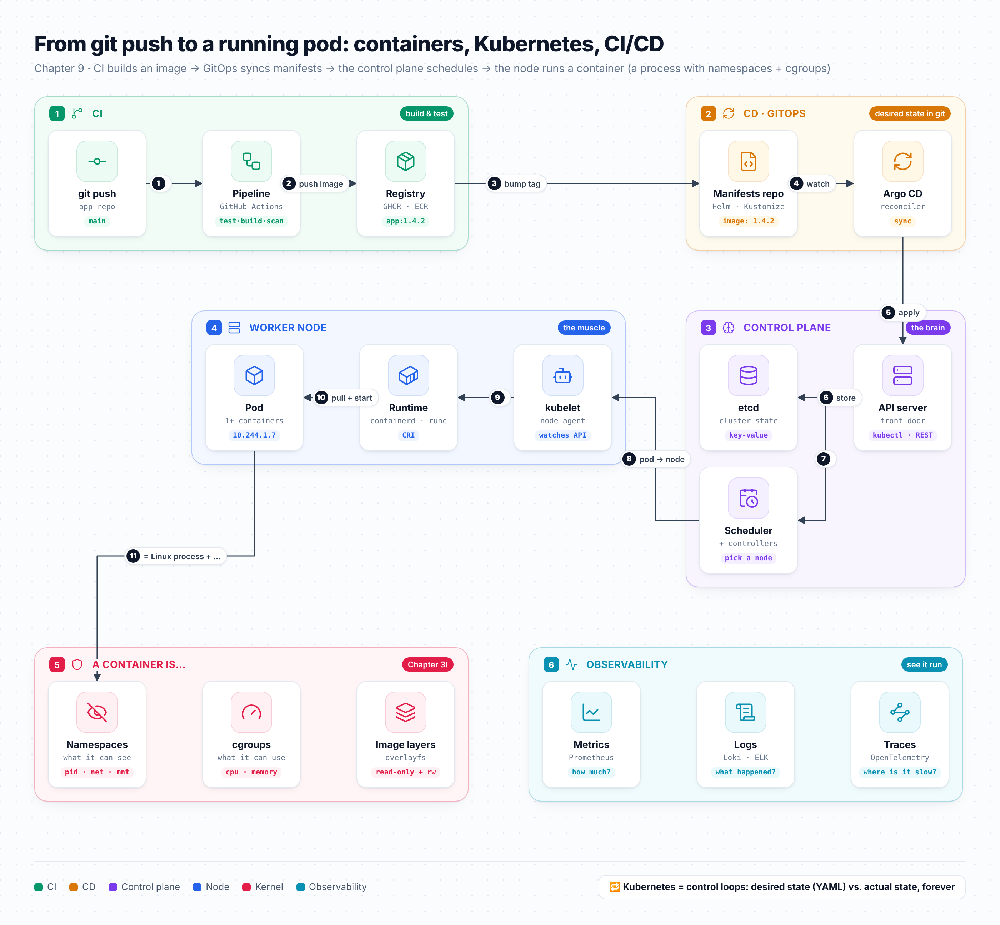
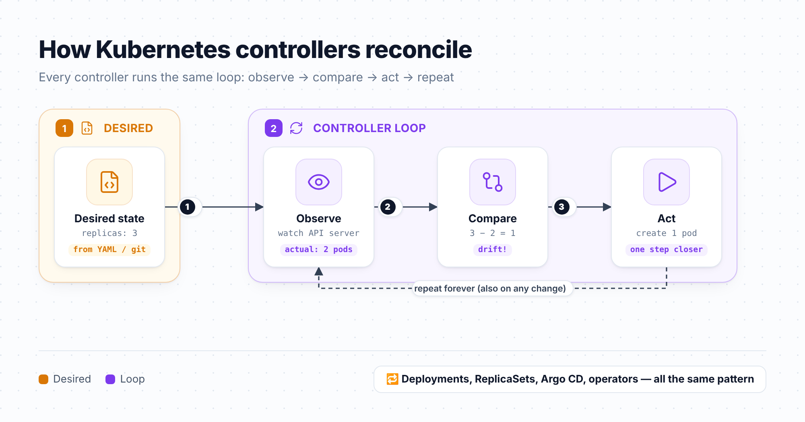

# Bölüm 9 — Modern altyapı

!!! abstract "Tek cümlede"
    Bir **container**, katmanlı bir **imajdan** başlatılmış, **namespace**'lerle (ne görebileceği) ve **cgroup**'larla
    (ne kullanabileceği) sarılmış sıradan bir Linux process'idir (Bölüm 3). **Kubernetes**, YAML'da yazdığın
    **istenen durumu** cluster'ın **gerçek durumuyla** sürekli karşılaştırır ve farkı sonsuza kadar düzeltir. **CI/CD** imajları üretir,
    **GitOps** cluster'a neyin çalışması gerektiğini söyler, **gözlemlenebilirlik** de gerçekten çalışıp çalışmadığını gösterir.

## 📖 Temel terimler ve kısaltmalar

| Terim | Açılımı | Nedir | Nasıl çalışır (tek satır) |
|---|---|---|---|
| **Container** | — | Namespace'lerle izole, cgroup'larla sınırlandırılmış process | Bir runtime (containerd/runc) imajdan başlatır |
| **Namespace** | — | Bir process'in neyi görebileceği | pid, net, mnt, uts, ipc, user, cgroup |
| **cgroup** | control group | Bir process'in neyi kullanabileceği | CPU kotası, bellek limiti, I/O, pid sayısı |
| **OCI image** | Open Container Initiative | Standart container imaj formatı | Manifest + katmanlar + config, digest ile adreslenir |
| **CRI / CNI** | Container Runtime Interface / Container Network Interface | Kubernetes'in eklenti API'leri | kubelet ↔ runtime / pod ağ eklentileri |
| **API server / etcd** | — | Kubernetes'in ön kapısı / veritabanı | Her şey cluster durumunu API üzerinden okur/yazar |
| **Scheduler / kubelet** | — | Node seçer / node'da pod çalıştırır | Node'ları filtrele + puanla / runtime ile konuş |
| **Controller / reconcile** | — | Gerçek durumu istenen duruma eşitleyen döngü | İzle → karşılaştır → harekete geç → tekrar |
| **Service / Ingress** | — | Pod'lar için sabit sanal IP / cluster'a HTTP yönlendirme | kube-proxy/eBPF dağıtır; ingress host/yola göre yönlendirir |
| **CI / CD** | Continuous Integration / Continuous Delivery | Otomatik derle-test et / otomatik sürüm | Her push'ta pipeline; ortamlara rollout |
| **GitOps** | — | Deploy'lar için doğruluk kaynağı olarak git | Cluster içindeki ajan (Argo CD, Flux) git'ten senkronlar |
| **IaC** | Infrastructure as Code | Kodda tanımlanan bulut kaynakları | Terraform/OpenTofu, Pulumi, Crossplane plan & apply |
| **SLO** | Service Level Objective | Bir güvenilirlik/gecikme hedefi | ör. isteklerin %99,9'u < 300 ms |
| **OTel** | OpenTelemetry | Metrik, log, trace için açık standart | SDK'lar + collector, her backend'e aktarır |

## 🗺️ Büyük resim



---

## 1 · Container, ekstra duvarları olan bir process'tir

| Kernel özelliği | Neyi izole eder | Örnekler |
|---|---|---|
| **Namespace'ler** | Process'in neyi **görebileceğini** | `pid` (kendi PID 1'i), `net` (kendi ağ yığını ve IP'si), `mnt` (kendi dosya sistemi görünümü), `uts` (hostname), `ipc`, `user` (içerideki root ≠ dışarıdaki root), `cgroup` |
| **cgroups v2** | Process'in neyi **kullanabileceğini** | `cpu.max` (CPU kotası → kısma), `memory.max` (limit → OOM kill), `io.max`, `pids.max` |
| **İmaj + overlayfs** | **Dosya sistemini** | Salt okunur katmanlar (Dockerfile adımı başına bir tane) ve en üstte ince bir yazılabilir katman. Container'lar arasında paylaşılır. |
| **Seccomp, capabilities, AppArmor/SELinux** | Neyi yapmaya **izni olduğunu** | Tehlikeli syscall'ları engelle, root yetkilerini bırak |

| | Sanal makine | Container |
|---|---|---|
| İzolasyon sınırı | Hypervisor, ayrı kernel | Ortak host kernel'i, namespace'ler |
| Başlama süresi | Saniyeler ile dakikalar | Milisaniyeler |
| Ek yük | VM başına koca bir OS | Tek bir process |
| Güvenlik izolasyonu | Daha güçlü | Daha zayıf (ortak kernel), gVisor/Kata/microVM'lerle sağlamlaştırılır |

Bir **imaj** OCI standardına uyar: bir manifest + katmanlar (tarball'lar) + yapılandırma (entrypoint, env). Bir **registry**'de saklanır ve değişmez bir **digest** (`sha256:…`) ile tanımlanır.

## 2 · Kubernetes: bir dizi kontrol döngüsü

**Control plane** (beyin):

| Bileşen | Görevi |
|---|---|
| **kube-apiserver** | Tek ön kapı. Her istemci (`kubectl`, controller'lar, kubelet'ler) onunla REST üzerinden konuşur. Kimlik doğrular, yetkilendirir, doğrular, kaydeder. |
| **etcd** | Tüm cluster durumunu tutan tutarlı bir key-value deposu. |
| **kube-scheduler** | Yerleştirilmemiş her pod için bir node seçer: önce **filtrele** (yeterli CPU/bellek var mı? taint'ler, affinity), sonra **puanla**. |
| **kube-controller-manager** | Birçok kontrol döngüsü: Deployment → ReplicaSet → Pod'lar, node sağlığı, endpoint'ler, job'lar… |

**Worker node'lar** (kas gücü):

| Bileşen | Görevi |
|---|---|
| **kubelet** | Kendi node'una atanmış pod'lar için API'yi izler ve onları hayata geçirir. Probe'ları çalıştırır, durum bildirir. |
| **Container runtime** (containerd + runc) | **CRI** arayüzü üzerinden imajları çeker ve container'ları başlatır. |
| **CNI eklentisi** (Cilium, Calico, …) | Her pod'a bir IP verir ve node'lar arası pod ağlarını birbirine bağlar. |
| **kube-proxy / eBPF** | **Service**'leri uygular: arkasındaki pod'lara yük dağıtan sabit bir sanal IP. |

### `kubectl apply -f deployment.yaml` dediğinde ne olur

| # | Adım |
|---|---|
| 5 | `kubectl`, Deployment'ı **API server**'a gönderir, API server onu doğrular. |
| 6 | API server onu **etcd**'ye kaydeder. Henüz hiçbir şey çalışmıyor, sadece *istenen durum* var. |
| 7 | **Deployment controller** bir **ReplicaSet** oluşturur, ReplicaSet controller da **Pod** nesnelerini oluşturur (durum `Pending`, node yok). **Scheduler** onları görür, her biri için bir node seçer ve atamayı geri yazar. |
| 8 | O node'daki **kubelet** kendisine atanmış bir pod görür. |
| 9 | **Runtime**'dan (CRI) pod sandbox'ını oluşturmasını ister. **CNI** pod IP'sini atar. |
| 10 | Runtime **imajı çeker** ve **container'ları başlatır**: yeni namespace'lerle `clone()`, cgroup'lara yerleştirme, entrypoint'i `execve` (Bölüm 3–4!). |
| — | **Readiness probe** geçer → pod, Service'in **EndpointSlice**'ına eklenir → trafik akmaya başlar. |

!!! tip "Bunu hatırla"
    Kubernetes asla "bir komutu bir kez çalıştırmaz". Her bileşen API'yi **izler** ve **uzlaştırır (reconcile)**: "Gerçek = istenen mi?
    Değilse bir adım yaklaş." Bir Deployment'ın pod'unu sil, yenisi belirir. Bu, controller'ın işini yapmasıdır.

### Uzlaştırma (reconcile) nasıl çalışır?

Her controller API server'ı izler, **istenen** durumu (spec) **gerçek** durumla (status) karşılaştırır ve farkı kapatmak için bir adım atar; sonra her değişiklikte ve periyodik olarak tekrar eder. Deployment'ın yönettiği bir pod'u silince geri gelmesinin sebebi bu.



## 3 · CI/CD ve GitOps

| Aşama | Tipik araçlar | Çıktı |
|---|---|---|
| **CI**: her push'ta test et, derle, tara | GitHub Actions, GitLab CI, Jenkins | Registry'de değişmez bir imaj: `app:1.4.2` (ya da `@sha256:…`) |
| **Terfi (promote)**: istenen versiyonu güncelle | Manifest reposuna bir commit/PR (Helm values, Kustomize) | Git = tek doğruluk kaynağı |
| **CD / GitOps**: cluster değişiklikleri çeker | **Argo CD**, Flux | Cluster, git'teki duruma yakınsar. Sapmalar (drift) tespit edilir ve düzeltilir. |
| **Rollout stratejisi** | Rolling update, blue/green, canary (Argo Rollouts) | Güvenli, geri alınabilir sürümler (`git revert` = rollback) |

Cluster dışındaki bulut kaynakları (VPC'ler, veritabanları, DNS) da aynı bildirimsel yolla, **Infrastructure as Code** ile yönetilir: Terraform/OpenTofu, Pulumi, Crossplane.

## 4 · Gözlemlenebilirlik: metrikler, loglar, trace'ler

| Sinyal | Cevapladığı soru | Araçlar |
|---|---|---|
| **Metrikler** | Ne kadar / ne sıklıkta? (oranlar, gecikmeler, doygunluk) | Prometheus, Grafana |
| **Loglar** | Bu istekte tam olarak ne oldu? | Loki, Elasticsearch/OpenSearch |
| **Trace'ler** | Servisler arasında zaman nereye gitti? | OpenTelemetry, Tempo, Jaeger |

İşe yarayan alışkanlıklar: servisler için **RED** yöntemi (Rate, Errors, Duration), kaynaklar için **USE** (Utilization, Saturation, Errors) ve kullanıcının hissettiği şeye göre alarm üreten **SLO**'lar ("isteklerin %99,9'u < 300 ms").

---

## 🧭 Daha derine in

| Sayfa | Neler var |
|---|---|
| **[9.1 — Container'lar ve imajlar](01-containers-images.md)** | OCI imajı nedir (katmanlar, manifest'ler, digest'ler, çok mimarili index'ler), build'ler ve önbellek nasıl çalışır, küçük ve güvenli Dockerfile yazmak, registry'ler, etiket ve digest, imzalama ve SBOM'lar, kubelet'ten containerd ve runc'ye runtime zinciri. |
| **[9.2 — Kubernetes mimarisi](02-kubernetes-architecture.md)** | Control plane (API server, etcd, scheduler, controller'lar) ve node bileşenleri, bildirimsel model ve uzlaştırma, kubectl apply'dan sonra ne olduğu, zamanlama (request'ler, affinity, taint'ler), iş yükü tipleri, QoS ve tahliye, operator'ler ve CRD'ler, pod'larda sorun giderme. |
| **[9.3 — Kubernetes ağı](03-kubernetes-networking.md)** | Kubernetes ağ modeli, CNI eklentilerinin pod'lara nasıl IP verdiği ve node'ları bağladığı (rotalar, overlay'ler, eBPF), Service'ler ve kube-proxy, cluster DNS'i, Ingress ve Gateway API, NetworkPolicy'ler, service mesh'ler ve pod bağlantısında hata ayıklama. |
| **[9.4 — CI/CD ve GitOps](04-cicd-gitops.md)** | Sürekli entegrasyon ve teslim aşamaları, pipeline tasarımı ve önbellek, artefakt ve tedarik zinciri güvenliği (SBOM, imzalama, SLSA), ortamlar ve terfi, Argo CD ve Flux ile GitOps, deploy stratejileri (rolling, blue-green, canary), kademeli teslim, geri alma ve DORA metrikleri. |
| **[9.5 — Gözlemlenebilirlik: metrikler, loglar, trace'ler ve SLO'lar](05-observability.md)** | Üç sinyal (metrikler, loglar, trace'ler) ve profiller, OpenTelemetry ve collector, Prometheus ve PromQL temelleri, RED ve USE yöntemleri, yapılandırılmış loglama, dağıtık trace ve örnekleme, SLI, SLO, hata bütçeleri ve burn-rate alarmları, nöbet pratikleri. |

## 🧪 Kendin dene (Linux + Docker)

```bash
# 1) Sadece unshare ile bir "container": yeni PID + mount namespace
sudo unshare --pid --fork --mount-proc bash
ps aux            # PID 1 sensin ve yalnızsın
exit

# 2) Gerçek bir container, host'ta bir process'tir
docker run -d --name web --memory 64m --cpus 0.5 nginx:alpine
PID=$(docker inspect -f '{{.State.Pid}}' web); echo $PID
ps -o pid,cmd -p $PID                      # host'ta tam orada
sudo ls -l /proc/$PID/ns                   # namespace'leri
cat /sys/fs/cgroup/system.slice/docker-$(docker inspect -f '{{.Id}}' web).scope/memory.max 2>/dev/null   # 67108864 (cgroup v2 + systemd sürücüsü)
docker image history nginx:alpine          # katmanlar
docker rm -f web

# 3) kind ile yerelde Kubernetes, kontrol döngülerini izle
kind create cluster
kubectl create deployment hello --image=nginx --replicas=2
kubectl get events -w &                    # Scheduled → Pulling → Created → Started
kubectl delete pod -l app=hello --wait=false && kubectl get pods -w   # yeni pod'lar belirir
kind delete cluster
```

**Görev:** `--memory 32m` ile başlatılmış ve daha fazlasını kullanmaya çalışan bir container çalıştır (`docker run --rm --memory 32m python:3-alpine python -c "x=bytearray(100_000_000)"`). Çıkış koduna ve `docker inspect` çıktısındaki `OOMKilled` alanına bak. Bunu Bölüm 3'teki hangi kernel özelliği yaptı?

---

## 🃏 Hatırlatma kartı

```text
Container = process + namespace'ler (görme) + cgroup'lar (kullanma) + imaj katmanları (overlayfs) + seccomp/caps
İmaj = OCI manifest + katmanlar + config, digest ile, registry'de
K8s control plane: API server (ön kapı) · etcd (durum) · scheduler (node seç) · controller'lar (döngüler)
K8s node: kubelet (ajan) · containerd/runc (CRI) · CNI (pod IP) · kube-proxy/eBPF (Service'ler)
kubectl apply → API → etcd → controller'lar pod oluşturur → scheduler atar → kubelet → CRI çek+başlat → ready → endpoint'ler
CI değişmez imajlar üretir → GitOps (Argo CD) istenen durumu git'ten senkronlar → rollout'lar
Gözlem: metrik (ne kadar) · log (ne oldu) · trace (nerede) · SLO'lar
```

---

## ❓ Kendini test et

??? question "1. Container küçük bir sanal makine midir?"
    Hayır. Host kernel'ini paylaşan, namespace'lerle izole edilmiş ve cgroup'larla sınırlandırılmış normal bir Linux process'idir. VM ise bir hypervisor üzerinde kendi kernel'ini çalıştırır.

??? question "2. Bir pod `Pending`'de takılı kaldı. Hangi bileşen henüz işini yapmadı ve neden olabilir?"
    Scheduler onu bir node'a atamadı. Genelde sebebi, hiçbir node'da isteklerine (requests) yetecek boş CPU/bellek olmaması ya da taint'ler, affinity kuralları veya bağlanmamış bir PersistentVolumeClaim'dir. `kubectl describe pod` sebebi event'lerde gösterir.

??? question "3. Bir Deployment'a ait pod'u siliyorsun ve yenisi beliriyor. Onu kim oluşturdu?"
    ReplicaSet controller (kube-controller-manager içinde). Gerçek replika sayısının istenenden az olduğunu gördü ve yeni bir Pod nesnesi oluşturdu. Scheduler ve kubelet de onu hayata geçirdi.

??? question "4. Push tabanlı CD ile GitOps arasındaki fark ne?"
    Push tabanlı CD'de pipeline, cluster kimlik bilgileriyle cluster'a karşı `kubectl apply`/`helm upgrade` çalıştırır. GitOps'ta cluster içindeki bir ajan (Argo CD, Flux) istenen durumu git'ten çeker ve sürekli uzlaştırır. Böylece git doğruluk kaynağı olur ve sapmalar düzeltilir.

??? question "5. Servisin yavaş ama CPU ve bellek iyi görünüyor. Hangi sinyale başvurursun?"
    Trace'lere: servisler arasında hangi aşağı akış çağrısının ya da span'in zaman aldığını görmek için. Sonra o istek için loglara.

---

## 📚 Kaynaklar

- [Kubernetes dokümanları: bileşenler](https://kubernetes.io/docs/concepts/overview/components/)
- [man7.org: namespaces(7)](https://man7.org/linux/man-pages/man7/namespaces.7.html) · [cgroups(7)](https://man7.org/linux/man-pages/man7/cgroups.7.html)
- [OCI image spec](https://github.com/opencontainers/image-spec)
- [Argo CD dokümanları](https://argo-cd.readthedocs.io/) · [OpenGitOps ilkeleri](https://opengitops.dev/)
- [OpenTelemetry dokümanları](https://opentelemetry.io/docs/) · [Google SRE kitabı: izleme](https://sre.google/sre-book/monitoring-distributed-systems/)

## ✍️ Kendi notlarım

> `kubectl apply` dediğinde gerçekte ne olduğunu ve bir container'ın neden "sadece bir process" olduğunu kendi cümlelerinle 5 satırda anlat.

-
