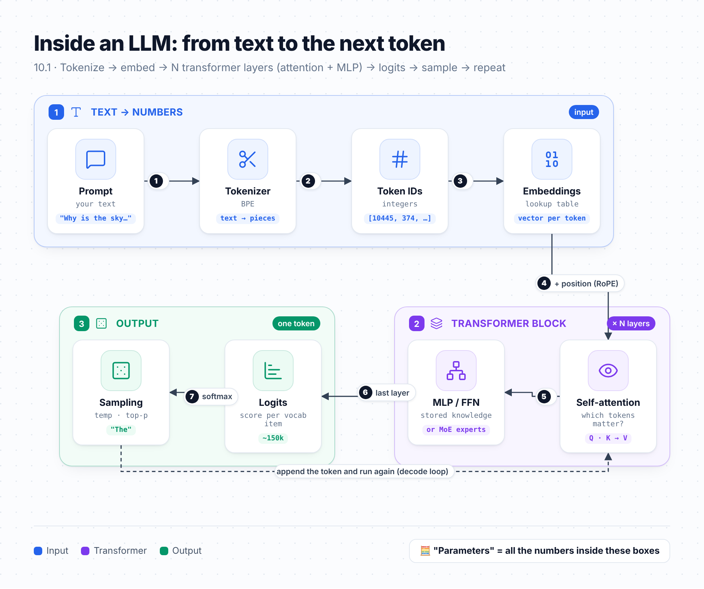
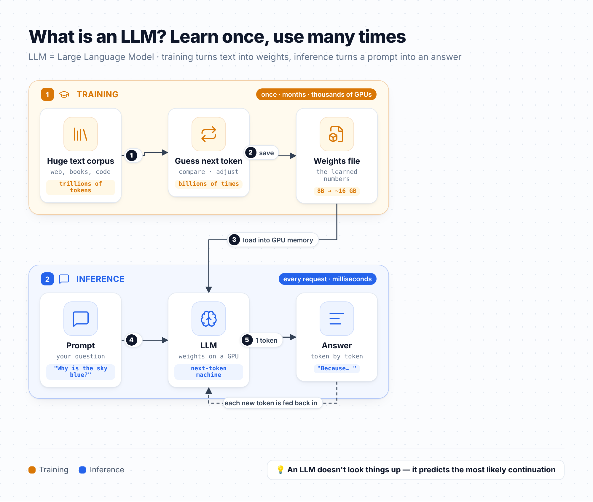
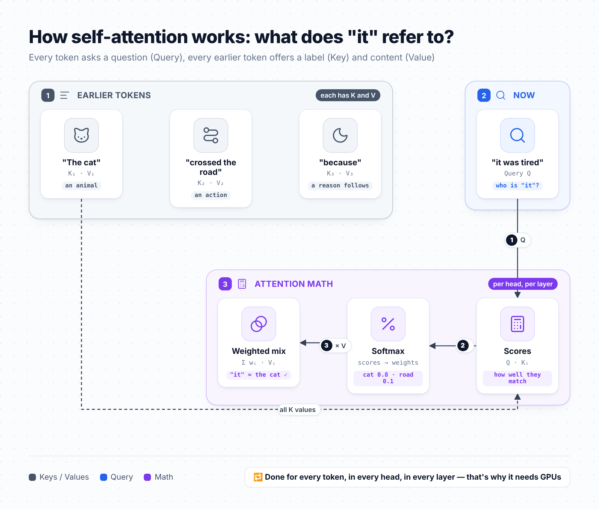
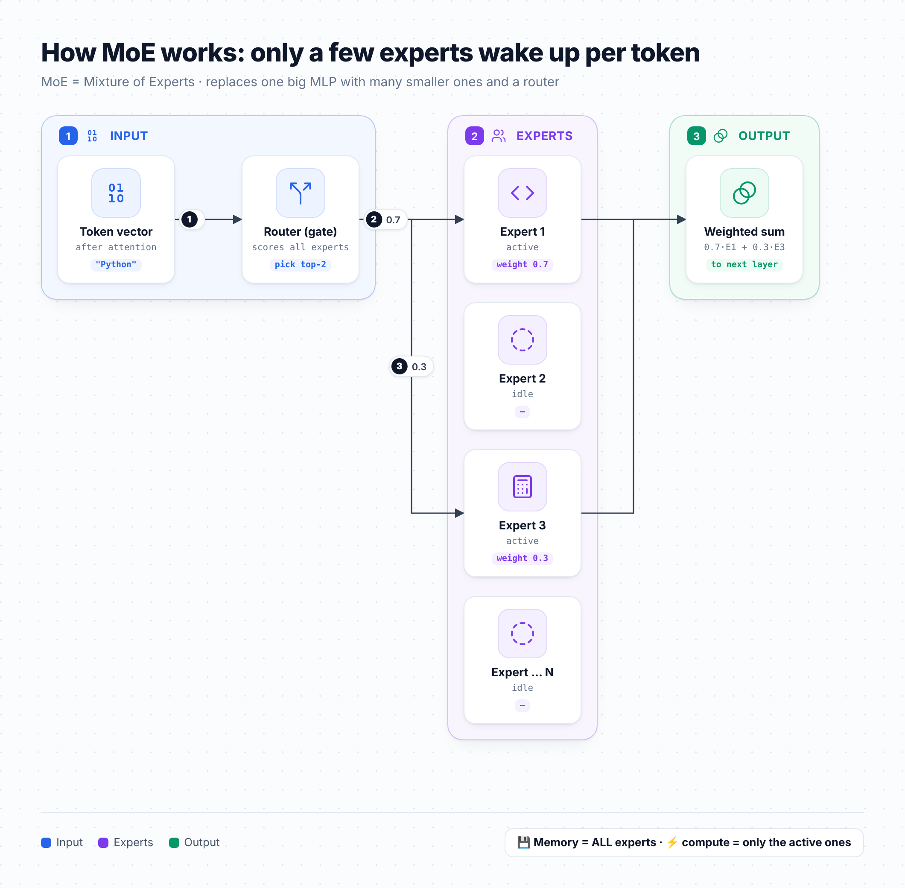

# 10.1 — AI fundamentals for infra people

!!! abstract "In one sentence"
    A model is a **function made of billions of numbers** (parameters). An LLM turns text into **tokens**, tokens into
    **vectors**, pushes them through a stack of **transformer layers** (attention + MLP), gets a **score for every possible
    next token**, picks one, appends it and runs again. Everything in AI infrastructure exists to store those numbers,
    move them fast and do that math cheaply.

## 📖 Key terms & abbreviations

| Term | Stands for | What it is | How it works (one line) |
|---|---|---|---|
| **AI** | Artificial Intelligence | Software that performs tasks that normally need human intelligence | Today mostly means machine-learned models |
| **ML** | Machine Learning | Programs that learn behaviour from data instead of hand-written rules | Adjust numbers (parameters) until outputs match examples |
| **NN** | Neural Network | A model made of layers of simple math units | Each layer multiplies inputs by weights and applies a non-linearity |
| **LLM** | Large Language Model | A huge neural network trained on text to continue text | Predicts the next token, appends it, repeats |
| **GPT** | Generative Pre-trained Transformer | The family name of decoder-only transformer LLMs | Pre-trained on text, then generates token by token |
| **Token** | — | A piece of text (word, part of word, symbol) | The unit the model reads and writes |
| **BPE** | Byte-Pair Encoding | The usual tokenizer algorithm | Repeatedly merges the most frequent character pairs into tokens |
| **Embedding** | — | A vector of numbers that represents a token or text | Similar meanings → nearby vectors |
| **Parameter / weight** | — | One learned number inside the model | Billions of them = the model's "knowledge" |
| **Transformer** | — | The neural-network architecture behind modern LLMs | Stacks of attention + MLP layers |
| **Attention** | — | The mechanism that lets a token look at other tokens | Query·Key scores decide how much of each Value to mix in |
| **Q / K / V** | Query / Key / Value | Three vectors computed for every token | Q asks, K is matched against Q, V is the content passed along |
| **RoPE** | Rotary Position Embedding | How position (word order) is encoded | Rotates Q and K by an angle that depends on the position |
| **MLP / FFN** | Multi-Layer Perceptron / Feed-Forward Network | The per-token neural network inside each layer | Expands, applies a non-linearity, projects back |
| **MoE** | Mixture of Experts | An MLP split into many experts plus a router | Only the top-k experts run for each token |
| **Logits** | — | Raw scores for every possible next token | Softmax turns them into probabilities |
| **Context window** | — | Max tokens the model can handle at once | Prompt + output must fit |
| **SFT** | Supervised Fine-Tuning | Training on example prompt → answer pairs | Teaches the model to follow instructions |
| **RLHF** | Reinforcement Learning from Human Feedback | Training on human preferences | A reward model scores answers, the LLM is tuned to maximize it |
| **DPO** | Direct Preference Optimization | Simpler preference training | Learns directly from "A is better than B" pairs |
| **LoRA / QLoRA** | Low-Rank Adaptation / Quantized LoRA | Cheap fine-tuning | Trains small adapter matrices next to frozen weights (QLoRA: base in 4-bit) |
| **VLM** | Vision-Language Model | A model that reads images and text | Image encoder output is fed in as extra tokens |
| **ASR / TTS** | Automatic Speech Recognition / Text-to-Speech | Speech → text / text → speech | Audio models, usually streaming |
| **KV cache** | Key-Value cache | Stored K and V of past tokens | Avoids recomputing them at every step ([10.5](05-inference.md)) |

## 🗺️ Big picture



---

## 0 · What is an LLM, and how does it work?

### What is it?

An **LLM (Large Language Model)** is a neural network with billions of parameters that has learned, from a huge amount of text, **how text usually continues**. It doesn't search a database. It predicts.

### How does it work?

1. **Training (once):** show it trillions of tokens. At every position it guesses the next token, compares the guess with the real one, and nudges its parameters a tiny bit. Repeat billions of times. The result is a **weights file**.
2. **Inference (every request):** load the weights into GPU memory. Turn your prompt into tokens, run them through the network, get the most likely next token.
3. **Loop:** append that token to the input and run again, one token at a time, until a stop token or the length limit.



## 1 · What is a "model", physically?

| Thing | What it is | Infra meaning |
|---|---|---|
| **Parameters / weights** | Billions of numbers learned during training | Size on disk and in GPU memory. 8B params × 2 bytes = ~16 GB |
| **Architecture** | The code that says how the numbers are used (layers, sizes) | `config.json`: number of layers, hidden size, heads, vocab size, context length |
| **Weights file** | `*.safetensors` (Hugging Face), `*.gguf` (llama.cpp/Ollama) | Downloaded from a model hub or object storage, often tens to hundreds of GB |
| **Tokenizer** | Rules for splitting text into tokens | `tokenizer.json`, ships with the model |
| **Model card / license** | Intended use, limits, license | Can you legally run it commercially? |

## 2 · Tokens: the unit of everything

- The tokenizer (usually **BPE**: byte-pair encoding) splits text into frequent pieces: `"unbelievable"` → `["un", "believ", "able"]`.
- Each piece maps to an **integer ID** in a fixed **vocabulary** (tens of thousands to ~200k entries).
- Rule of thumb for English: **1 token ≈ 4 characters ≈ ¾ of a word**. Turkish is agglutinative and usually needs **more tokens per word**.
- **Context window** = how many tokens (prompt + answer) the model can handle at once: from 8k to 1M+ tokens.
- **Everything is priced and measured in tokens**: API pricing, throughput (tokens/s), latency per token, KV cache size.

## 3 · Embeddings: meaning as coordinates

Each token ID is looked up in an **embedding table** and becomes a vector (e.g. 4,096 numbers). Training arranges these vectors so that things with similar meaning end up **close together**. The same idea, applied to whole sentences by a separate **embedding model**, powers semantic search and RAG ([10.7](07-applications.md)).

## 4 · The transformer, layer by layer

| Part | What it does | Plain-language version |
|---|---|---|
| **Positional encoding** (e.g. RoPE) | Adds word-order information | "This token is the 5th one" |
| **Self-attention** | Each token computes a **query (Q)**, a **key (K)** and a **value (V)**. Q·K scores decide how much of each other token's V to mix in | "Which earlier words matter for understanding this one?" |
| **Multi-head attention** | Several attention "heads" in parallel, each learning different relationships | Grammar, references, topic… |
| **MLP / feed-forward** | A big per-token neural network, about **⅔ of all parameters** | Where most "knowledge" is stored |
| **Residual + normalization** | Keeps signals stable through many layers | Plumbing |
| **× N layers** | The block repeats 30–100+ times | Deeper = more capable, more compute |

### How does attention work?

1. Every token computes three vectors: a **Query** ("what am I looking for?"), a **Key** ("what do I contain?") and a **Value** ("what do I pass on?").
2. The current token's Query is compared with the Key of every earlier token (a dot product) → one **score** per token.
3. **Softmax** turns the scores into weights that sum to 1.
4. The token's new representation is the **weighted sum of the Values**. In the example below, "it" ends up carrying mostly the meaning of "the cat".



Modern LLMs are **decoder-only**: each token can only attend to tokens **before** it. That's what makes generation one token at a time possible, and why keys and values of past tokens can be **cached** (the **KV cache**, [10.5](05-inference.md)).

**Mixture of Experts (MoE):** the MLP is split into many "experts" and a small **router** sends each token to only a few of them. The model has many **total** parameters (all must sit in memory) but only a fraction are **active** per token (less compute). Infra consequence: **memory sized for total, compute sized for active**.



## 5 · From scores to text: sampling

The last layer produces a **logit** (score) for every token in the vocabulary. **Softmax** turns them into probabilities, then:

| Setting | Effect |
|---|---|
| **Greedy** (temperature 0) | Always take the most likely token: deterministic, can be repetitive |
| **Temperature** | < 1 sharper and safer, > 1 more random and creative |
| **Top-p / top-k** | Only sample from the most likely few tokens |
| **Max tokens / stop sequences** | When to stop generating |

## 6 · The model lifecycle

| Stage | What happens | Compute profile |
|---|---|---|
| **Pre-training** | Learn to predict the next token on trillions of tokens of text | Thousands of GPUs for weeks to months ([10.4](04-training.md)) |
| **Post-training** | Instruction tuning (**SFT**), preference tuning (**RLHF**, **DPO**), reinforcement learning for reasoning | Large, but much smaller than pre-training |
| **Fine-tuning** | Adapt to your domain. **LoRA / QLoRA** train small adapter matrices instead of all weights | One to a few GPUs |
| **Distillation / quantization** | Make a smaller or lower-precision version that's cheaper to run | Offline jobs |
| **Inference** | Serve the model to users | 24/7, latency-sensitive, where most money is spent over time ([10.5](05-inference.md)) |

## 7 · Model types you'll meet

| Type | Input → output | Typical infra |
|---|---|---|
| **LLM** (decoder) | text → text | Big GPUs, KV cache, streaming |
| **Embedding model** (encoder) | text → vector | Small, high-throughput, batchable |
| **Reranker** | (query, document) → relevance score | Small, used in RAG |
| **Multimodal / VLM** | image + text → text | LLM + vision encoder |
| **Diffusion** | text → image/video | GPU-heavy per request, no KV cache |
| **Speech** | audio ↔ text (ASR / TTS) | Streaming, real-time |

---

## 🧪 Try it yourself

```bash
pip install tiktoken transformers

# 1) See tokens, compare English vs Turkish
python3 - <<'EOF'
import tiktoken
enc = tiktoken.get_encoding("o200k_base")
for s in ["The weather is very nice today.", "Bugün hava çok güzel."]:
    ids = enc.encode(s)
    print(len(ids), "tokens:", [enc.decode([i]) for i in ids])
EOF

# 2) Read a model's architecture without downloading the weights
curl -sL https://huggingface.co/Qwen/Qwen2.5-0.5B-Instruct/resolve/main/config.json | \
  python3 -c "import json,sys; c=json.load(sys.stdin); print({k:c[k] for k in ['num_hidden_layers','hidden_size','num_attention_heads','num_key_value_heads','vocab_size','max_position_embeddings']})"
```

**Exercise:** from the `config.json`, estimate the parameter count roughly (embeddings ≈ vocab × hidden; each layer ≈ 12 × hidden²) and compare with the model name.

---

## 🃏 Cheat sheet

```text
Model = architecture (config.json) + weights (safetensors/gguf) + tokenizer
Text → tokens (BPE, ~4 chars each in English) → IDs → embeddings (vectors)
→ N × [ self-attention (Q,K,V: what matters?) + MLP (knowledge, ~2/3 of params) ]
→ logits → softmax → sample (temperature, top-p) → append → repeat
Decoder-only → past K/V can be cached (KV cache)
MoE: total params in memory, only active params computed per token
Lifecycle: pre-train → post-train (SFT, RLHF/DPO) → fine-tune (LoRA) → quantize → serve
```

---

## ❓ Test yourself

??? question "1. Why is everything in LLM infrastructure measured in tokens?"
    The model processes tokens, not characters or words. Compute per request, latency per step, KV cache memory and API cost all scale with the number of input and output tokens.

??? question "2. A MoE model has 120B total parameters but only 5B active per token. What do you size memory and compute for?"
    Memory for all 120B (every expert must be loaded), compute for roughly 5B per token. That's why MoE models are cheap to run per token but still need lots of GPU memory.

??? question "3. Why can past keys and values be cached in a decoder-only model?"
    Each token only attends to earlier tokens, and earlier tokens never change once generated. So their K and V vectors stay valid and can be reused for every following step.

??? question "4. What does temperature 0 mean?"
    Greedy decoding: always pick the most likely next token. Output becomes deterministic (given the same inputs and setup).

??? question "5. What's the difference between fine-tuning with LoRA and full fine-tuning, from an infra point of view?"
    LoRA trains small adapter matrices while the base weights stay frozen, so it needs far less GPU memory and produces small files. Many LoRA adapters can even be served on top of one shared base model.

---

## 📚 Sources

- [Attention Is All You Need (Vaswani et al., 2017)](https://arxiv.org/abs/1706.03762)
- [The Illustrated Transformer (Jay Alammar)](https://jalammar.github.io/illustrated-transformer/)
- [Andrej Karpathy: Let's build GPT from scratch (video)](https://www.youtube.com/watch?v=kCc8FmEb1nY)
- [Hugging Face LLM course](https://huggingface.co/learn/llm-course)
- [OpenAI: what are tokens and how to count them](https://help.openai.com/en/articles/4936856-what-are-tokens-and-how-to-count-them)

## ✍️ My notes

> Explain what happens inside an LLM between your prompt and the first output token, in your own words in 5 lines.

-
