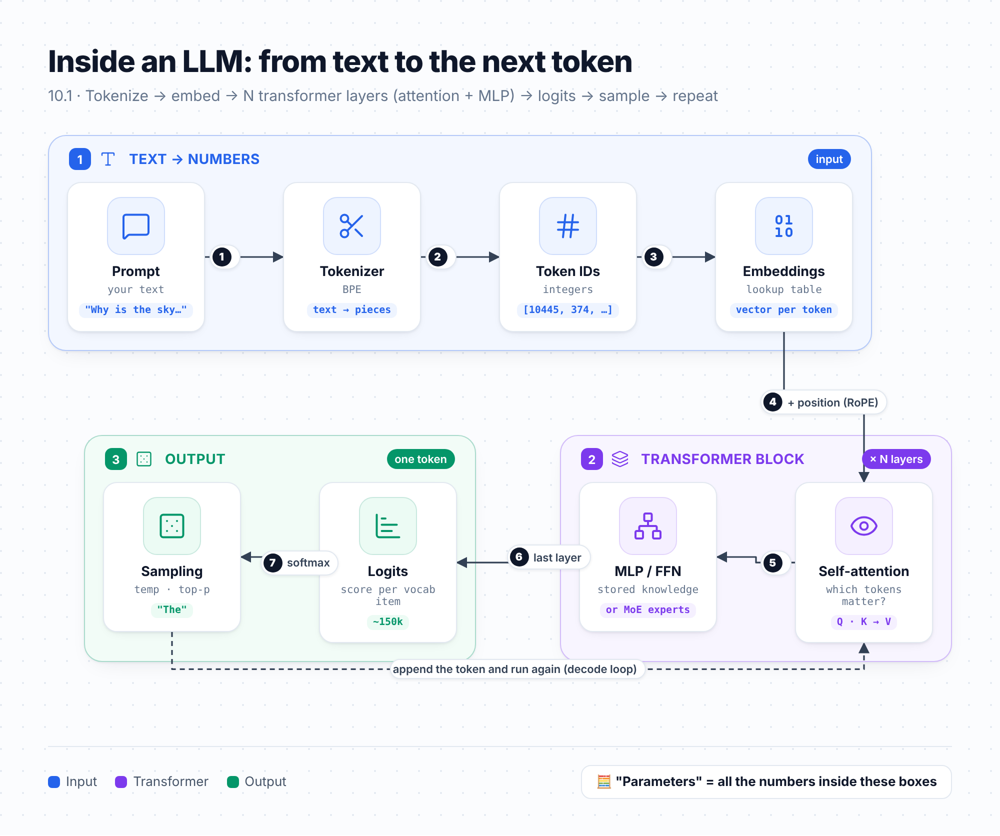
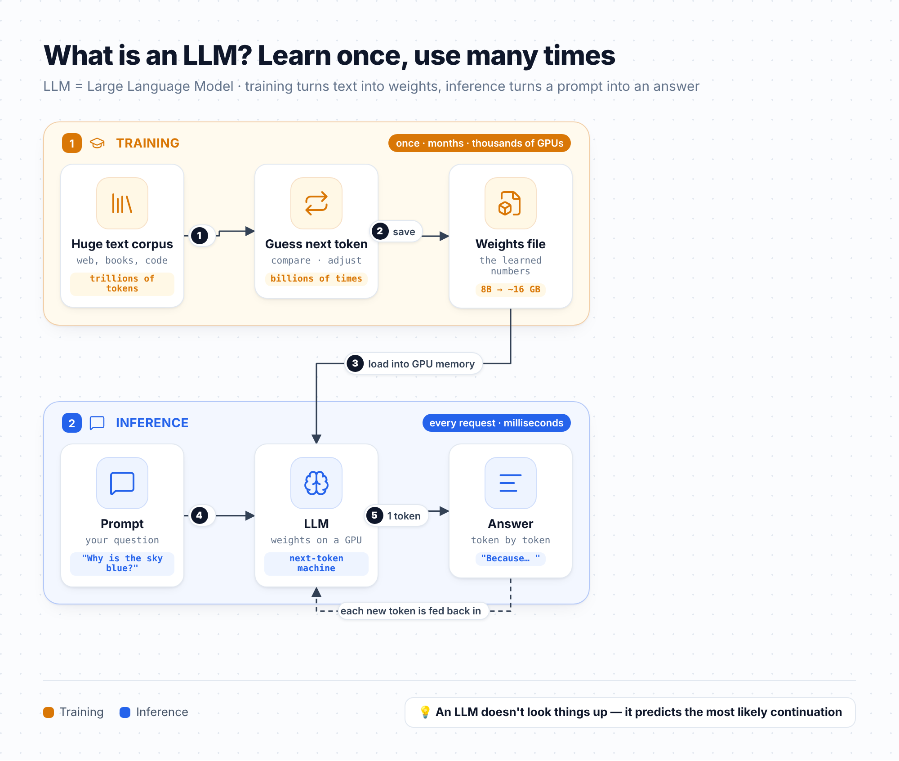
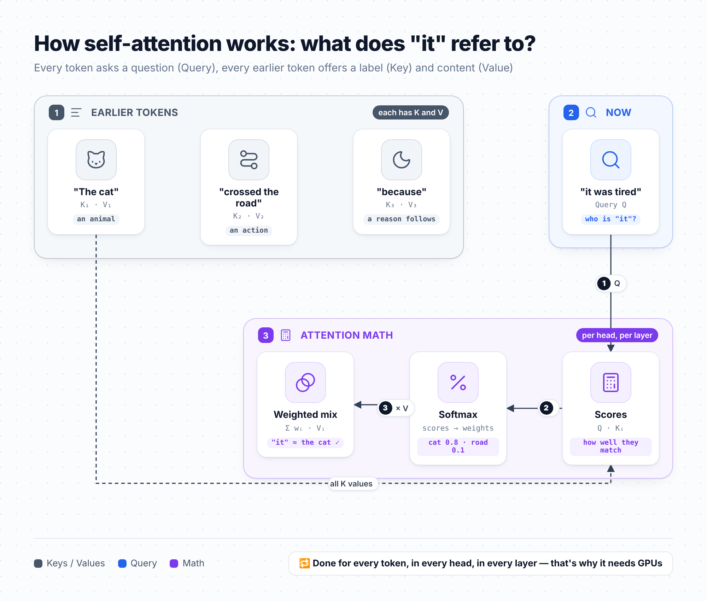
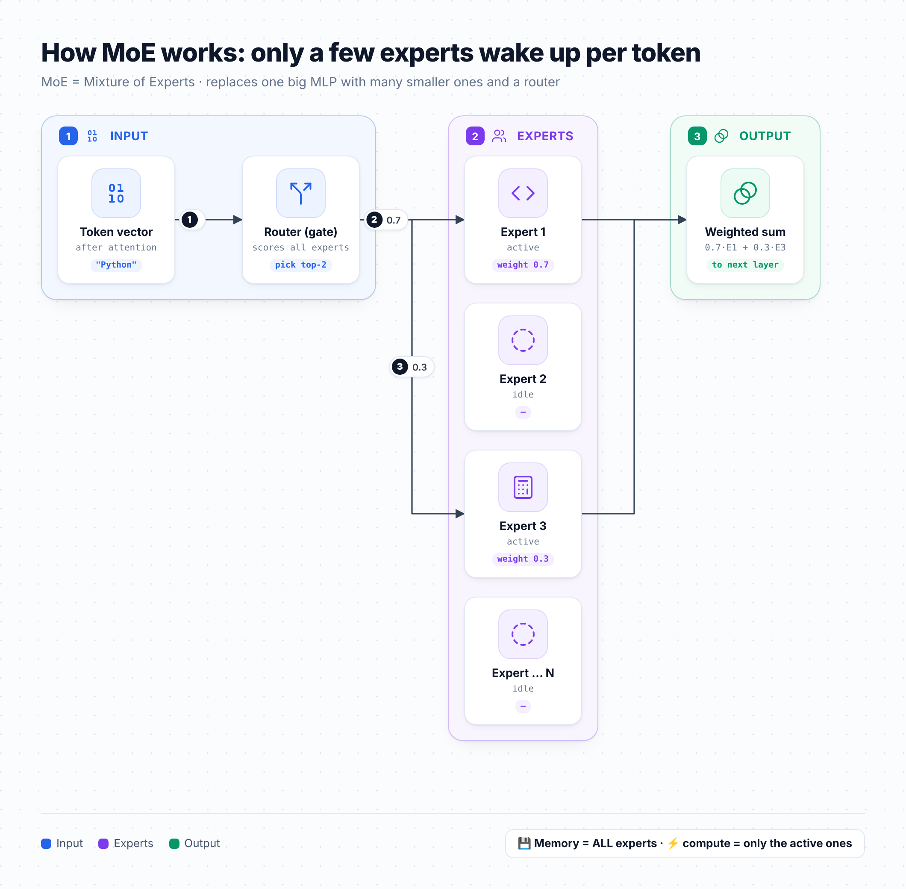

# 10.1 — Altyapıcılar için AI temelleri

!!! abstract "Kısaca"
    Bir model, **milyarlarca sayıdan oluşan bir fonksiyondur** (parametreler). Bir LLM metni **token**'lara, token'ları
    **vektörlere** çevirir. Bunları bir **transformer katmanları** yığınından (attention + MLP) geçirir, **olası her
    sıradaki token için bir skor** üretir, birini seçer, sona ekler ve tekrar çalışır. AI altyapısındaki her şey bu
    sayıları saklamak, onları hızlı taşımak ve bu hesabı ucuza yapmak için vardır.

## 📖 Terimler ve kısaltmalar

| Terim | Açılımı | Nedir | Nasıl çalışır (tek satır) |
|---|---|---|---|
| **AI** | Artificial Intelligence (Yapay Zekâ) | Normalde insan zekâsı gerektiren işleri yapan yazılım | Bugün çoğunlukla makine öğrenmesiyle eğitilmiş modeller demek |
| **ML** | Machine Learning (Makine Öğrenmesi) | Davranışı elle yazılmış kurallar yerine veriden öğrenen programlar | Çıktılar örneklerle eşleşene kadar sayıları (parametreleri) ayarlar |
| **NN** | Neural Network (Sinir Ağı) | Basit matematik birimlerinden oluşan katmanlı bir model | Her katman girdiyi ağırlıklarla çarpar ve doğrusal olmayan bir fonksiyon uygular |
| **LLM** | Large Language Model (Büyük Dil Modeli) | Metni sürdürmek için metin üzerinde eğitilmiş devasa bir sinir ağı | Sıradaki token'ı tahmin eder, sona ekler, tekrarlar |
| **GPT** | Generative Pre-trained Transformer | Decoder-only transformer LLM'lerin aile adı | Metin üzerinde ön eğitilir, sonra token token üretir |
| **Token** | — | Bir metin parçası (kelime, kelime parçası, sembol) | Modelin okuduğu ve yazdığı birim |
| **BPE** | Byte-Pair Encoding | Yaygın tokenizer algoritması | En sık görülen karakter çiftlerini tekrar tekrar birleştirip token yapar |
| **Embedding** | — | Bir token'ı ya da metni temsil eden sayı vektörü | Benzer anlam → yakın vektörler |
| **Parametre / ağırlık** | — | Modelin içinde öğrenilmiş tek bir sayı | Milyarlarcası = modelin "bilgisi" |
| **Transformer** | — | Modern LLM'lerin arkasındaki sinir ağı mimarisi | Attention + MLP katmanları yığını |
| **Attention** | — | Bir token'ın diğer token'lara bakmasını sağlayan mekanizma | Query·Key skorları, her Value'dan ne kadar karıştırılacağına karar verir |
| **Q / K / V** | Query / Key / Value | Her token için hesaplanan üç vektör | Q sorar, K, Q ile eşleştirilir, V aktarılan içeriktir |
| **RoPE** | Rotary Position Embedding | Konumun (kelime sırasının) kodlanma şekli | Q ve K'yi konuma bağlı bir açıyla döndürür |
| **MLP / FFN** | Multi-Layer Perceptron / Feed-Forward Network | Her katmandaki token başına sinir ağı | Genişletir, doğrusal olmayan fonksiyon uygular, geri daraltır |
| **MoE** | Mixture of Experts (Uzmanlar Karışımı) | Birçok uzmana bölünmüş bir MLP ve bir router | Her token için sadece en iyi k uzman çalışır |
| **Logit** | — | Olası her sıradaki token için ham skor | Softmax bunları olasılığa çevirir |
| **Bağlam penceresi** | Context window | Modelin aynı anda işleyebildiği azami token | Prompt + çıktı sığmalı |
| **SFT** | Supervised Fine-Tuning (Gözetimli İnce Ayar) | Örnek prompt → cevap çiftleri üzerinde eğitim | Modele talimat takip etmeyi öğretir |
| **RLHF** | Reinforcement Learning from Human Feedback | İnsan tercihleriyle eğitim | Bir ödül modeli cevapları puanlar, LLM bunu en üst düzeye çıkaracak şekilde ayarlanır |
| **DPO** | Direct Preference Optimization | Daha basit tercih eğitimi | Doğrudan "A, B'den iyi" çiftlerinden öğrenir |
| **LoRA / QLoRA** | Low-Rank Adaptation / Quantized LoRA | Ucuz fine-tuning | Dondurulmuş ağırlıkların yanında küçük adaptör matrisleri eğitir (QLoRA: temel model 4-bit) |
| **VLM** | Vision-Language Model | Görüntü ve metin okuyan model | Görüntü encoder'ının çıktısı ek token'lar olarak verilir |
| **ASR / TTS** | Automatic Speech Recognition / Text-to-Speech | Ses → metin / metin → ses | Ses modelleri, genelde akış halinde |
| **KV cache** | Key-Value cache | Geçmiş token'ların saklanan K ve V'leri | Her adımda yeniden hesaplanmalarını önler ([10.5](05-inference.md)) |

## 🗺️ Büyük resim



---

## 0 · LLM nedir ve nasıl çalışır?

### Nedir?

Bir **LLM (Large Language Model, Büyük Dil Modeli)**, devasa miktarda metinden **metnin genelde nasıl devam ettiğini** öğrenmiş, milyarlarca parametreli bir sinir ağıdır. Bir veritabanında arama yapmaz, tahmin eder.

### Nasıl çalışır?

1. **Eğitim (bir kez):** modele trilyonlarca token gösterilir. Her konumda sıradaki token'ı tahmin eder, tahminini gerçeğiyle karşılaştırır ve parametrelerini çok az düzeltir. Bu milyarlarca kez tekrarlanır. Sonuç bir **ağırlık dosyasıdır**.
2. **Inference (her istekte):** ağırlıklar GPU belleğine yüklenir. Prompt'un token'lara çevrilir, ağdan geçirilir ve en olası sıradaki token elde edilir.
3. **Döngü:** o token girdinin sonuna eklenir ve tekrar çalıştırılır. Durdurma token'ına ya da uzunluk sınırına kadar her seferinde bir token üretilir.



## 1 · Fiziksel olarak "model" nedir?

| Şey | Ne | Altyapı açısından anlamı |
|---|---|---|
| **Parametreler / ağırlıklar** | Eğitim sırasında öğrenilen milyarlarca sayı | Diskteki ve GPU belleğindeki boyut. 8B parametre × 2 byte = ~16 GB |
| **Mimari** | Sayıların nasıl kullanılacağını söyleyen kod (katmanlar, boyutlar) | `config.json`: katman sayısı, gizli boyut, head sayısı, sözlük boyutu, bağlam uzunluğu |
| **Ağırlık dosyası** | `*.safetensors` (Hugging Face), `*.gguf` (llama.cpp/Ollama) | Bir model hub'ından ya da nesne depolamadan indirilir, çoğu zaman onlarca ile yüzlerce GB |
| **Tokenizer** | Metni token'lara bölme kuralları | `tokenizer.json`, modelle birlikte gelir |
| **Model kartı / lisans** | Amaçlanan kullanım, sınırlar, lisans | Ticari olarak çalıştırmaya yasal olarak iznin var mı? |

## 2 · Token: her şeyin birimi

- Tokenizer (genelde **BPE**: byte-pair encoding) metni sık görülen parçalara böler: `"unbelievable"` → `["un", "believ", "able"]`.
- Her parça sabit bir **sözlükte (vocabulary)** bir **tam sayı ID**'ye karşılık gelir (onbinlerce ile ~200 bin girdi).
- İngilizce için pratik kural: **1 token ≈ 4 karakter ≈ ¾ kelime**. Türkçe eklemeli bir dil olduğu için genelde **kelime başına daha fazla token** gerektirir.
- **Bağlam penceresi (context window)** = modelin aynı anda işleyebildiği token sayısı (prompt + cevap): 8k'dan 1M+ token'a kadar.
- **Her şey token cinsinden fiyatlanır ve ölçülür**: API fiyatları, verim (token/sn), token başına gecikme, KV cache boyutu.

## 3 · Embedding: koordinat olarak anlam

Her token ID'si bir **embedding tablosunda** aranır ve bir vektöre dönüşür (ör. 4.096 sayı). Eğitim, bu vektörleri benzer anlamdaki şeyler **birbirine yakın** olacak şekilde yerleştirir. Aynı fikir, ayrı bir **embedding modeli** ile cümlelerin tamamına uygulandığında anlamsal arama ve RAG'ı mümkün kılar ([10.7](07-applications.md)).

## 4 · Katman katman transformer

| Parça | Ne yapar | Sade anlatım |
|---|---|---|
| **Konum kodlaması** (ör. RoPE) | Kelime sırası bilgisini ekler | "Bu token 5. sırada" |
| **Self-attention** | Her token bir **query (Q)**, bir **key (K)** ve bir **value (V)** hesaplar. Q·K skorları, diğer her token'ın V'sinden ne kadar karıştırılacağına karar verir | "Bunu anlamak için önceki hangi kelimeler önemli?" |
| **Multi-head attention** | Paralel çalışan birkaç attention "head"i, her biri farklı ilişkiler öğrenir | Dilbilgisi, referanslar, konu… |
| **MLP / feed-forward** | Token başına büyük bir sinir ağı, **tüm parametrelerin yaklaşık ⅔'ü** | "Bilginin" çoğunun saklandığı yer |
| **Residual + normalizasyon** | Sinyallerin çok sayıda katmanda kararlı kalmasını sağlar | Tesisat |
| **× N katman** | Blok 30–100+ kez tekrarlanır | Daha derin = daha yetenekli, daha çok hesaplama |

### Attention nasıl çalışır?

1. Her token üç vektör hesaplar: bir **Query** ("ne arıyorum?"), bir **Key** ("bende ne var?") ve bir **Value** ("ne aktarıyorum?").
2. Şu anki token'ın Query'si, önceki her token'ın Key'iyle karşılaştırılır (iç çarpım) → token başına bir **skor**.
3. **Softmax** skorları toplamı 1 olan ağırlıklara çevirir.
4. Token'ın yeni temsili, **Value'ların ağırlıklı toplamıdır**. Aşağıdaki örnekte "o", çoğunlukla "kedi"nin anlamını taşır hale gelir.



Modern LLM'ler **decoder-only**'dir: her token sadece kendinden **önceki** token'lara bakabilir. Tek tek token üretmeyi mümkün kılan da, geçmiş token'ların key ve value'larının **önbelleğe alınabilmesinin** sebebi de budur (**KV cache**, [10.5](05-inference.md)).

**Mixture of Experts (MoE):** MLP birçok "uzmana" bölünür ve küçük bir **router** her token'ı sadece birkaçına gönderir. Modelin **toplam** parametresi çoktur (hepsi bellekte durmalı) ama token başına sadece bir kısmı **aktiftir** (daha az hesaplama). Altyapı sonucu: **bellek toplama göre, hesaplama aktife göre boyutlanır**.



## 5 · Skordan metne: örnekleme (sampling)

Son katman sözlükteki her token için bir **logit** (skor) üretir. **Softmax** bunları olasılıklara çevirir, sonra:

| Ayar | Etkisi |
|---|---|
| **Greedy** (temperature 0) | Her zaman en olası token'ı al: deterministik, tekrara düşebilir |
| **Temperature** | < 1 daha keskin ve güvenli, > 1 daha rastgele ve yaratıcı |
| **Top-p / top-k** | Sadece en olası birkaç token arasından örnekle |
| **Max tokens / stop dizileri** | Üretimin ne zaman duracağı |

## 6 · Model yaşam döngüsü

| Aşama | Ne olur | Hesaplama profili |
|---|---|---|
| **Ön eğitim (pre-training)** | Trilyonlarca token metin üzerinde sıradaki token'ı tahmin etmeyi öğren | Haftalar ile aylar boyunca binlerce GPU ([10.4](04-training.md)) |
| **Son eğitim (post-training)** | Talimat ayarı (**SFT**), tercih ayarı (**RLHF**, **DPO**), akıl yürütme için pekiştirmeli öğrenme | Büyük, ama ön eğitimden çok daha küçük |
| **Fine-tuning** | Kendi alanına uyarla. **LoRA / QLoRA** tüm ağırlıklar yerine küçük adaptör matrislerini eğitir | Bir ile birkaç GPU |
| **Distillation / quantization** | Çalıştırması daha ucuz, daha küçük ya da daha düşük hassasiyetli bir versiyon üret | Offline işler |
| **Inference** | Modeli kullanıcılara servis et | 7/24, gecikmeye duyarlı, zamanla paranın çoğunun harcandığı yer ([10.5](05-inference.md)) |

## 7 · Karşılaşacağın model tipleri

| Tip | Girdi → çıktı | Tipik altyapı |
|---|---|---|
| **LLM** (decoder) | metin → metin | Büyük GPU'lar, KV cache, akış (streaming) |
| **Embedding modeli** (encoder) | metin → vektör | Küçük, yüksek verimli, batch'lenebilir |
| **Reranker** | (sorgu, doküman) → alaka skoru | Küçük, RAG'da kullanılır |
| **Multimodal / VLM** | görüntü + metin → metin | LLM + görüntü encoder'ı |
| **Diffusion** | metin → görüntü/video | İstek başına GPU'yu yoğun kullanır, KV cache yok |
| **Konuşma** | ses ↔ metin (ASR / TTS) | Akış halinde, gerçek zamanlı |

---

## 🧪 Kendin dene

```bash
pip install tiktoken transformers

# 1) Token'ları gör, İngilizce ile Türkçe'yi karşılaştır
python3 - <<'EOF'
import tiktoken
enc = tiktoken.get_encoding("o200k_base")
for s in ["The weather is very nice today.", "Bugün hava çok güzel."]:
    ids = enc.encode(s)
    print(len(ids), "token:", [enc.decode([i]) for i in ids])
EOF

# 2) Ağırlıkları indirmeden bir modelin mimarisini oku
curl -sL https://huggingface.co/Qwen/Qwen2.5-0.5B-Instruct/resolve/main/config.json | \
  python3 -c "import json,sys; c=json.load(sys.stdin); print({k:c[k] for k in ['num_hidden_layers','hidden_size','num_attention_heads','num_key_value_heads','vocab_size','max_position_embeddings']})"
```

**Görev:** `config.json`'dan parametre sayısını kabaca tahmin et (embedding'ler ≈ sözlük × gizli boyut; her katman ≈ 12 × gizli²) ve model adıyla karşılaştır.

---

## 🃏 Hatırlatma kartı

```text
Model = mimari (config.json) + ağırlıklar (safetensors/gguf) + tokenizer
Metin → token'lar (BPE, İngilizce'de her biri ~4 karakter) → ID'ler → embedding'ler (vektörler)
→ N × [ self-attention (Q,K,V: ne önemli?) + MLP (bilgi, parametrelerin ~2/3'ü) ]
→ logit'ler → softmax → örnekle (temperature, top-p) → sona ekle → tekrar
Decoder-only → geçmiş K/V önbelleğe alınabilir (KV cache)
MoE: toplam parametre bellekte, token başına sadece aktif parametreler hesaplanır
Yaşam döngüsü: ön eğitim → son eğitim (SFT, RLHF/DPO) → fine-tune (LoRA) → quantize → servis et
```

---

## ❓ Kendini test et

??? question "1. LLM altyapısında neden her şey token cinsinden ölçülür?"
    Model karakterleri ya da kelimeleri değil, token'ları işler. İstek başına hesaplama, adım başına gecikme, KV cache belleği ve API maliyeti, girdi ve çıktı token sayısıyla ölçeklenir.

??? question "2. Bir MoE modelin toplam 120B parametresi var ama token başına sadece 5B'si aktif. Belleği ve hesaplamayı neye göre boyutlandırırsın?"
    Belleği 120B'nin tamamına göre (her uzman yüklenmeli), hesaplamayı token başına kabaca 5B'ye göre. MoE modellerinin token başına ucuz çalışmasına rağmen hâlâ çok GPU belleği istemesinin sebebi budur.

??? question "3. Decoder-only bir modelde geçmiş key ve value'lar neden önbelleğe alınabilir?"
    Her token sadece önceki token'lara bakar ve önceki token'lar üretildikten sonra asla değişmez. Bu yüzden K ve V vektörleri geçerli kalır ve sonraki her adımda yeniden kullanılabilir.

??? question "4. Temperature 0 ne demek?"
    Greedy decoding: her zaman en olası sıradaki token'ı seç. Çıktı deterministik olur (aynı girdi ve kurulum verildiğinde).

??? question "5. Altyapı açısından LoRA ile fine-tuning ve tam fine-tuning arasındaki fark ne?"
    LoRA, temel ağırlıklar dondurulmuşken küçük adaptör matrislerini eğitir. Bu yüzden çok daha az GPU belleği gerektirir ve küçük dosyalar üretir. Hatta birçok LoRA adaptörü, ortak tek bir temel modelin üstünde servis edilebilir.

---

## 📚 Kaynaklar

- [Attention Is All You Need (Vaswani vd., 2017)](https://arxiv.org/abs/1706.03762)
- [The Illustrated Transformer (Jay Alammar)](https://jalammar.github.io/illustrated-transformer/)
- [Andrej Karpathy: Let's build GPT from scratch (video)](https://www.youtube.com/watch?v=kCc8FmEb1nY)
- [Hugging Face LLM kursu](https://huggingface.co/learn/llm-course)
- [OpenAI: token nedir ve nasıl sayılır](https://help.openai.com/en/articles/4936856-what-are-tokens-and-how-to-count-them)

## ✍️ Kendi notlarım

> Prompt'un ile ilk çıktı token'ı arasında bir LLM'in içinde ne olduğunu kendi cümlelerinle 5 satırda anlat.
