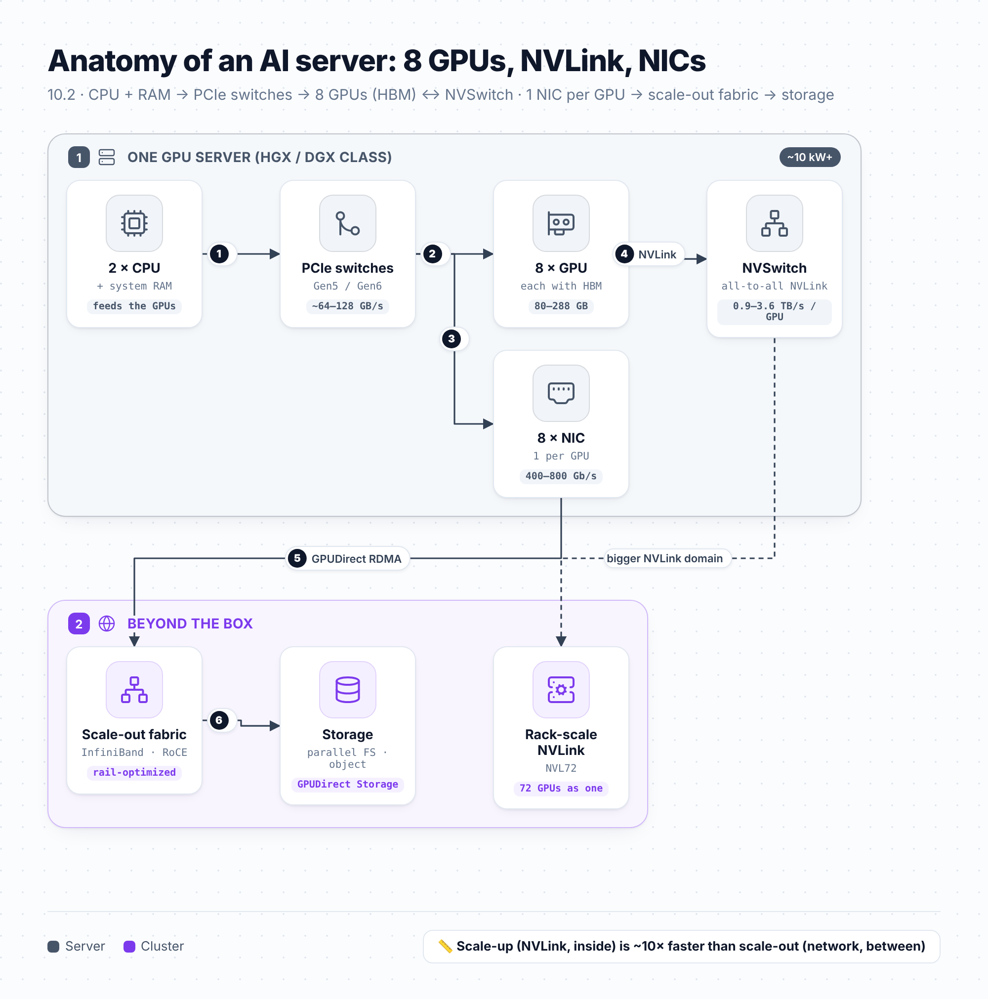
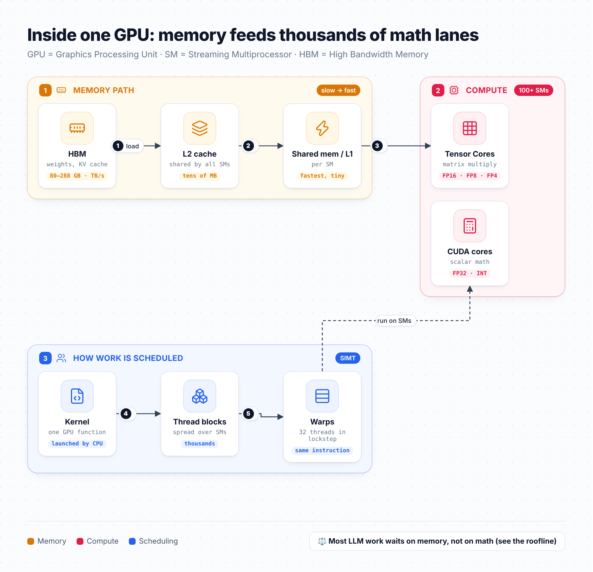
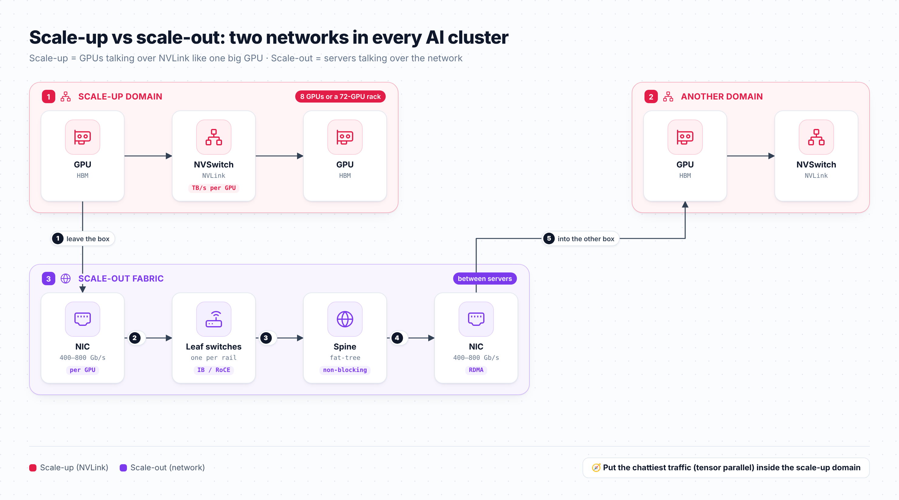

# 10.2 — GPU & accelerator hardware

!!! abstract "In one sentence"
    A data-center GPU is **thousands of small math lanes** (with special **Tensor Cores** for matrix math) fed by a few
    hundred GB of very fast **HBM** memory. Eight of them sit in one server, connected all-to-all with **NVLink** through
    **NVSwitch** (scale-up). Servers talk to each other with **one NIC per GPU** over InfiniBand or RoCE Ethernet
    (scale-out). For LLMs the limit is usually **how fast bytes move**, not how fast math happens.

## 📖 Key terms & abbreviations

| Term | Stands for | What it is | How it works (one line) |
|---|---|---|---|
| **GPU** | Graphics Processing Unit | A massively parallel processor | Runs the same instruction on thousands of data items at once |
| **CPU** | Central Processing Unit | The general-purpose processor (Chapter 2) | Few complex cores, great at branchy sequential code |
| **SM** | Streaming Multiprocessor | One of the GPU's 100+ processing blocks | Holds CUDA cores, Tensor Cores, registers and shared memory |
| **CUDA core** | — (CUDA = Compute Unified Device Architecture) | A simple scalar math lane | FP32/INT operations, one per clock |
| **Tensor Core** | — | A matrix-multiply unit inside each SM | Multiplies small matrix tiles per clock in FP16/BF16/FP8/FP4 |
| **Warp** | — | A group of 32 GPU threads | All 32 execute the same instruction together |
| **SIMT** | Single Instruction, Multiple Threads | NVIDIA's execution model | One instruction drives many threads on different data |
| **HBM** | High Bandwidth Memory | Stacked DRAM next to the GPU die | Very wide bus → TB/s of bandwidth |
| **SRAM / L2** | Static RAM / Level-2 cache | On-chip memory | Tiny but much faster than HBM |
| **FLOP / FLOPS** | Floating-Point Operation (per Second) | Unit of math work / speed | TFLOPS = 10¹², PFLOPS = 10¹⁵ per second |
| **PCIe** | Peripheral Component Interconnect Express | The standard bus between CPU and devices | Lanes of serial links, ~64 GB/s per direction for Gen5 x16 |
| **NVLink** | — | NVIDIA's GPU-to-GPU link | Much faster than PCIe, direct GPU memory access |
| **NVSwitch** | — | A switch chip for NVLink | Connects every GPU to every other GPU at full speed |
| **NVL72** | NVLink 72 | A rack where 72 GPUs share one NVLink domain | Behaves like one giant GPU for communication |
| **HGX / DGX** | — | NVIDIA's 8-GPU baseboard / complete server | Reference design most AI servers are built on |
| **NIC** | Network Interface Card | Network adapter | Typically one 400–800 Gb/s NIC per GPU in AI servers |
| **RDMA** | Remote Direct Memory Access | Reading/writing another machine's memory without its CPU | NIC moves data directly between memories |
| **GPUDirect RDMA** | — | RDMA straight into GPU memory | NIC ↔ GPU HBM, skipping CPU and system RAM |
| **GPUDirect Storage** | — | Storage → GPU memory directly | NVMe / network storage DMA into HBM |
| **IB** | InfiniBand | A low-latency HPC network | Lossless, RDMA-native, credit-based flow control |
| **RoCE** | RDMA over Converged Ethernet | RDMA on Ethernet | Needs lossless tuning (PFC, ECN) |
| **DPU** | Data Processing Unit | A smart NIC with its own cores (e.g. BlueField) | Offloads networking, storage, security from the host |
| **TDP** | Thermal Design Power | How much power/heat a chip is designed for | 700 W–1.4 kW+ per modern GPU |
| **TPU / ASIC** | Tensor Processing Unit / Application-Specific IC | Google's (and others') custom AI chips | Fixed-function hardware for matrix math |
| **ROCm** | Radeon Open Compute | AMD's equivalent of CUDA | Software stack for AMD Instinct GPUs |

## 🗺️ Big picture



---

## 1 · What is a GPU, and how does it work?

### What is it?

A CPU has a few dozen powerful cores built for **complicated, sequential** work. A GPU has **100+ SMs**, each with many simple lanes and a few **Tensor Cores**, built to do **the same simple math on huge arrays** at the same time. Neural networks are mostly matrix multiplications, which is exactly that.

### How does it work?

1. The CPU launches a **kernel** (a GPU function) with thousands of **thread blocks**.
2. The blocks are spread across the SMs. Inside an SM, threads run in **warps of 32** that execute the same instruction together (SIMT).
3. Data flows **HBM → L2 → shared memory/registers → Tensor Cores**. Fast kernels reuse each byte as many times as possible once it's on-chip.
4. Results are written back to HBM. The next kernel (next layer) starts.



## 2 · Number formats (precision)

| Format | Bytes | Where it's used |
|---|---|---|
| **FP32** | 4 | Classic training, optimizer states |
| **TF32** | 4 (stored), 19-bit math | Tensor Core mode for "FP32" matmuls |
| **BF16** | 2 | Default for training and serving: FP32's range, less precision |
| **FP16** | 2 | Inference, older training |
| **FP8** (E4M3 / E5M2) | 1 | Training and inference on Hopper and newer |
| **FP4** (NVFP4 / MXFP4) | 0.5 | Inference on Blackwell and newer |
| **INT8 / INT4** | 1 / 0.5 | Quantized weights for inference |

**Fewer bytes per number = more numbers per second through the same memory bus**, and each step down roughly doubles Tensor Core throughput.

## 3 · Compute-bound or memory-bound? The roofline

**Arithmetic intensity** = FLOPs done per byte read from memory.

```text
GPU "ridge point" ≈ peak FLOPS / memory bandwidth
  e.g. ~1,000 TFLOPS BF16 / ~3.35 TB/s ≈ 300 FLOPs per byte

LLM decode, batch 1: each 2-byte weight is used for ~2 FLOPs → ~1 FLOP/byte → hugely memory-bound
LLM decode, batch 64: each weight is reused 64× → ~64 FLOPs/byte → still memory-bound, much better
LLM prefill (long prompt): each weight reused for every prompt token → compute-bound
```

That gives a useful upper bound: **max tokens/s for one stream ≈ memory bandwidth ÷ bytes of weights**. An 8B model in BF16 (16 GB) on a 3.35 TB/s GPU can't decode faster than ~200 tokens/s per stream, no matter how many FLOPS it has. **Batching** is how you get more total tokens/s out of the same bandwidth ([10.5](05-inference.md)).

## 4 · Generations at a glance (approximate)

| Generation | Example | HBM per GPU | NVLink per GPU | New formats |
|---|---|---|---|---|
| Ampere | A100 | 40/80 GB | 600 GB/s | TF32, BF16 |
| Hopper | H100 / H200 | 80 / 141 GB | 900 GB/s | FP8, Transformer Engine |
| Blackwell | B200 / B300, GB200/GB300 NVL72 | ~180–288 GB | 1.8 TB/s | FP4 |
| Rubin (2H 2026) | Vera Rubin NVL72 | 288 GB HBM4 | 3.6 TB/s | — |

> Numbers move fast. Always check the vendor datasheet for the exact SKU (SXM vs PCIe versions differ a lot).

## 5 · Scale-up vs scale-out: what's the difference?

### What is it?

Every AI cluster has **two networks**:

- **Scale-up**: GPUs inside one NVLink domain (8 GPUs in a server, or 72 in an NVL72 rack) talk over **NVLink + NVSwitch** at TB/s. They can read each other's memory almost like local memory.
- **Scale-out**: everything beyond that domain goes over the **network**: one 400–800 Gb/s NIC per GPU, **InfiniBand** or **RoCE Ethernet**, arranged as a **rail-optimized fat-tree** (GPU #3 of every server is on "rail 3", and so on).

### How does it work?

1. A GPU writes data for a GPU in another server.
2. With **GPUDirect RDMA**, its NIC reads it **straight from HBM**, no CPU copy.
3. Leaf and spine switches forward it. The fabric is designed to be **lossless** and **non-blocking**.
4. The remote NIC writes it **straight into the remote GPU's HBM**.



**Rule of thumb:** keep the most communication-heavy parallelism (tensor parallel) **inside** the scale-up domain. Use the scale-out network for less chatty parallelism (data parallel, pipeline parallel) ([10.4](04-training.md)).

## 6 · Power, cooling, and the rest of the server

- A modern 8-GPU server draws **10 kW or more**. A rack-scale NVL72 system draws over 100 kW and is **liquid-cooled**. Power and cooling, not GPUs, are often the real data-center bottleneck.
- The server also has **2 CPUs** (to feed data, run the driver and the framework), **PCIe switches** linking GPUs, NICs and NVMe drives, and often a **DPU** for storage and north-south traffic.

## 7 · Not only NVIDIA

| Vendor | Chips | Software |
|---|---|---|
| **AMD** | Instinct MI300 series and newer (large HBM) | **ROCm**, HIP (CUDA-like), PyTorch support |
| **Google** | **TPU** generations (pods with their own interconnect) | JAX, PyTorch/XLA, available on Google Cloud |
| **AWS** | **Trainium** (training) / **Inferentia** (inference) | Neuron SDK |
| **Intel** | Gaudi | SynapseAI / PyTorch |

> DevOps connection: hardware choice decides your **software stack** (CUDA vs ROCm vs XLA vs Neuron), your **Kubernetes device plugins/DRA drivers**, and your **capacity planning** (power, cooling, network) — not just your benchmark numbers.

---

## 🧪 Try it yourself (on a machine with an NVIDIA GPU)

```bash
nvidia-smi                                  # GPUs, memory used, utilization, power, driver/CUDA version
nvidia-smi topo -m                          # how GPUs, NICs and CPUs are connected (NV#, PIX, SYS…)
nvidia-smi nvlink --status 2>/dev/null      # NVLink links and speeds
nvidia-smi -q -d MEMORY,CLOCK,POWER | less
lspci | grep -iE "nvidia|mellanox"          # GPUs and NICs on the PCIe bus
ibv_devinfo 2>/dev/null | head              # RDMA-capable NICs (InfiniBand / RoCE)

# Measure matmul TFLOPS and memory bandwidth with PyTorch
python3 - <<'EOF'
import torch, time
x = torch.randn(8192, 8192, device="cuda", dtype=torch.bfloat16)
torch.cuda.synchronize(); t = time.time()
for _ in range(50): y = x @ x
torch.cuda.synchronize(); dt = time.time() - t
print(f"matmul: {50 * 2 * 8192**3 / dt / 1e12:.0f} TFLOPS")
a = torch.empty(2 * 1024**3, dtype=torch.uint8, device="cuda")
torch.cuda.synchronize(); t = time.time()
for _ in range(20): b = a.clone()
torch.cuda.synchronize(); dt = time.time() - t
print(f"copy bandwidth: {20 * 2 * a.numel() / dt / 1e12:.2f} TB/s")
EOF
```

**Exercise:** divide the measured bandwidth by the size of an 8B BF16 model (16 GB). That's the theoretical max tokens/s for a single stream on this GPU.

---

## 🃏 Cheat sheet

```text
GPU = 100+ SMs × (CUDA cores + Tensor Cores) + HBM (80–288 GB, TB/s)
Work: kernel → thread blocks → warps of 32 (SIMT) · data: HBM → L2 → shared mem → Tensor Cores
Formats: FP32 4B · BF16/FP16 2B · FP8 1B · FP4/INT4 0.5B → fewer bytes = faster
Roofline: ridge ≈ FLOPS / bandwidth (~300 FLOP/B) · decode ≈ 1 FLOP/B × batch → memory-bound
Max tokens/s per stream ≈ bandwidth ÷ weight bytes
Server: 2 CPU + PCIe switches + 8 GPU + NVSwitch (scale-up) + 8 NIC (scale-out) · ~10 kW
Scale-up: NVLink/NVSwitch, NVL72 · Scale-out: IB/RoCE, rail-optimized, GPUDirect RDMA
```

---

## ❓ Test yourself

??? question "1. Why are LLMs usually limited by memory bandwidth rather than FLOPS during decode?"
    Each decode step reads every weight once but only does ~2 FLOPs per weight per sequence. That's far below the ~300 FLOPs/byte the GPU needs to be compute-bound, so it waits on HBM.

??? question "2. What's the theoretical max decode speed of a 70B FP8 model on one GPU with 4.8 TB/s?"
    70 GB of weights ÷ 4.8 TB/s ≈ 15 ms per token → ~70 tokens/s for a single stream (ignoring KV cache reads). Batching raises total throughput, not single-stream speed.

??? question "3. What's the difference between NVLink and InfiniBand?"
    NVLink is the scale-up link between GPUs inside a server or rack (TB/s, memory-like). InfiniBand (or RoCE) is the scale-out network between servers (hundreds of Gb/s per NIC).

??? question "4. What does GPUDirect RDMA save?"
    Copies through the CPU and system RAM. The NIC reads from and writes to GPU memory directly, which lowers latency and frees the CPU.

??? question "5. Why does every GPU get its own NIC in an AI server?"
    Collective operations (like all-reduce) make all GPUs send data at the same time. One NIC per GPU, each on its own "rail", gives every GPU full network bandwidth without sharing.

---

## 📚 Sources

- [NVIDIA CUDA C++ Programming Guide: hardware implementation](https://docs.nvidia.com/cuda/cuda-programming-guide/)
- [NVIDIA data center GPU datasheets](https://www.nvidia.com/en-us/data-center/)
- [Making Deep Learning Go Brrrr From First Principles (Horace He)](https://horace.io/brrr_intro.html)
- [Roofline model (Williams et al.)](https://doi.org/10.1145/1498765.1498785)
- [NVIDIA GPUDirect](https://developer.nvidia.com/gpudirect)

## ✍️ My notes

> Explain why "bandwidth ÷ model size" limits decode speed, and what scale-up vs scale-out means, in your own words in 5 lines.

-
