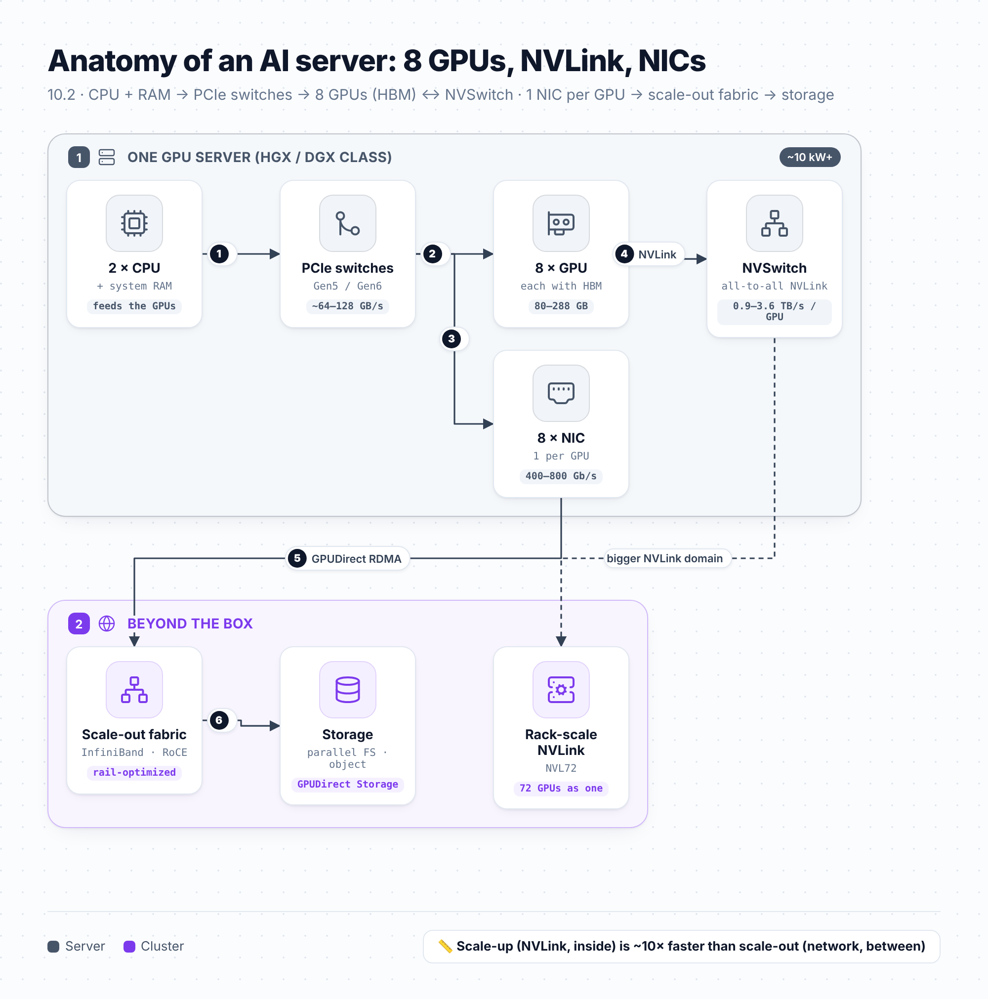
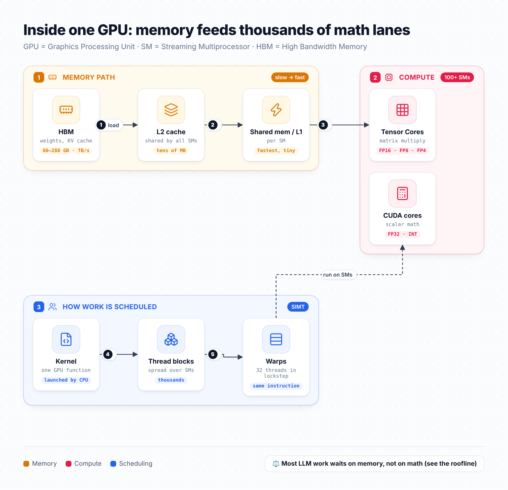
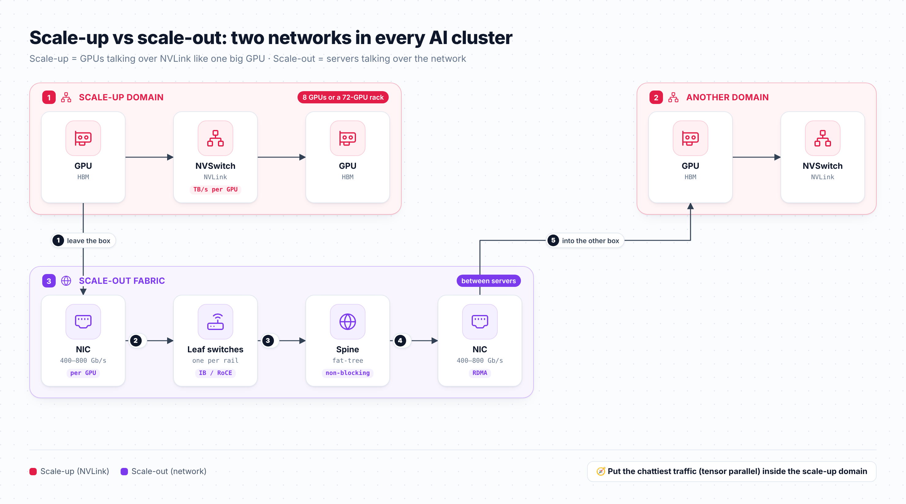

# 10.2 — GPU ve hızlandırıcı donanımı

!!! abstract "Kısaca"
    Bir veri merkezi GPU'su, birkaç yüz GB'lık çok hızlı **HBM** belleğin beslediği **binlerce küçük hesap şeridinden**
    oluşur (matris hesabı için özel **Tensor Core**'larla birlikte). Sekiz tanesi tek bir sunucuda durur ve **NVSwitch**
    üzerinden **NVLink** ile herkes herkese bağlıdır (scale-up). Sunucular birbirleriyle InfiniBand ya da RoCE Ethernet
    üzerinden, **GPU başına bir NIC** ile konuşur (scale-out). LLM'lerde sınırı çoğu zaman hesabın hızı değil,
    **byte'ların ne kadar hızlı taşındığı** belirler.

## 📖 Terimler ve kısaltmalar

| Terim | Açılımı | Nedir | Nasıl çalışır (tek satır) |
|---|---|---|---|
| **GPU** | Graphics Processing Unit (Grafik İşlem Birimi) | Devasa paralel bir işlemci | Aynı komutu aynı anda binlerce veri üzerinde çalıştırır |
| **CPU** | Central Processing Unit (Merkezi İşlem Birimi) | Genel amaçlı işlemci (Bölüm 2) | Az sayıda karmaşık çekirdek, dallanmalı sıralı kodda çok iyi |
| **SM** | Streaming Multiprocessor | GPU'nun 100+ işlem bloğundan biri | CUDA core'ları, Tensor Core'ları, register'ları ve shared memory'yi barındırır |
| **CUDA core** | — (CUDA = Compute Unified Device Architecture) | Basit, skaler bir hesap şeridi | Saat döngüsü başına bir FP32/INT işlemi |
| **Tensor Core** | — | Her SM'nin içindeki matris çarpım birimi | FP16/BF16/FP8/FP4'te saat başına küçük matris parçalarını çarpar |
| **Warp** | — | 32 GPU thread'inden oluşan grup | 32'si birlikte aynı komutu çalıştırır |
| **SIMT** | Single Instruction, Multiple Threads | NVIDIA'nın çalıştırma modeli | Tek bir komut farklı veriler üzerindeki çok sayıda thread'i sürer |
| **HBM** | High Bandwidth Memory (Yüksek Bant Genişlikli Bellek) | GPU çipinin yanına istiflenmiş DRAM | Çok geniş veri yolu → TB/sn bant genişliği |
| **SRAM / L2** | Static RAM / Level-2 cache | Çip üstü bellek | Minik ama HBM'den çok daha hızlı |
| **FLOP / FLOPS** | Floating-Point Operation (per Second) | Hesap işinin / hızının birimi | Saniyede TFLOPS = 10¹², PFLOPS = 10¹⁵ |
| **PCIe** | Peripheral Component Interconnect Express | CPU ile cihazlar arasındaki standart veri yolu | Seri bağlantı şeritleri, Gen5 x16 için yön başına ~64 GB/sn |
| **NVLink** | — | NVIDIA'nın GPU'dan GPU'ya bağlantısı | PCIe'den çok daha hızlı, GPU belleğine doğrudan erişim |
| **NVSwitch** | — | NVLink için bir switch çipi | Her GPU'yu diğer her GPU'ya tam hızda bağlar |
| **NVL72** | NVLink 72 | 72 GPU'nun tek bir NVLink alanını paylaştığı raf | İletişim açısından tek dev bir GPU gibi davranır |
| **HGX / DGX** | — | NVIDIA'nın 8 GPU'luk ana kartı / komple sunucusu | Çoğu AI sunucusunun üzerine kurulduğu referans tasarım |
| **NIC** | Network Interface Card (Ağ Arayüz Kartı) | Ağ adaptörü | AI sunucularında tipik olarak GPU başına bir adet 400–800 Gb/sn NIC |
| **RDMA** | Remote Direct Memory Access | Başka bir makinenin belleğine onun CPU'su olmadan okuma/yazma | NIC veriyi doğrudan bellekler arasında taşır |
| **GPUDirect RDMA** | — | Doğrudan GPU belleğine RDMA | NIC ↔ GPU HBM, CPU'yu ve sistem RAM'ini atlar |
| **GPUDirect Storage** | — | Depolamadan doğrudan GPU belleğine | NVMe / ağ depolamadan HBM'e DMA |
| **IB** | InfiniBand | Düşük gecikmeli bir HPC ağı | Kayıpsız, doğal RDMA, kredi tabanlı akış kontrolü |
| **RoCE** | RDMA over Converged Ethernet | Ethernet üzerinde RDMA | Kayıpsız ayar gerektirir (PFC, ECN) |
| **DPU** | Data Processing Unit | Kendi çekirdekleri olan akıllı bir NIC (ör. BlueField) | Ağ, depolama ve güvenlik işlerini host'tan devralır |
| **TDP** | Thermal Design Power | Bir çipin tasarlandığı güç/ısı miktarı | Modern GPU başına 700 W–1,4 kW+ |
| **TPU / ASIC** | Tensor Processing Unit / Application-Specific IC | Google'ın (ve başkalarının) özel AI çipleri | Matris hesabı için sabit işlevli donanım |
| **ROCm** | Radeon Open Compute | AMD'nin CUDA karşılığı | AMD Instinct GPU'ları için yazılım yığını |

## 🗺️ Büyük resim



---

## 1 · GPU nedir ve nasıl çalışır?

### Nedir?

Bir CPU'da **karmaşık, sıralı** iş için yapılmış birkaç düzine güçlü çekirdek vardır. Bir GPU'da ise her birinde çok sayıda basit şerit ve birkaç **Tensor Core** bulunan **100+ SM** vardır ve **devasa diziler üzerinde aynı basit hesabı** aynı anda yapmak için tasarlanmıştır. Sinir ağları çoğunlukla matris çarpımlarından oluşur, yani tam olarak bu iştir.

### Nasıl çalışır?

1. CPU, binlerce **thread bloğundan** oluşan bir **kernel** (GPU fonksiyonu) başlatır.
2. Bloklar SM'lere dağıtılır. Bir SM'nin içinde thread'ler, aynı komutu birlikte çalıştıran **32'lik warp'lar** halinde çalışır (SIMT).
3. Veri **HBM → L2 → shared memory/register'lar → Tensor Core'lar** yolunu izler. Hızlı kernel'ler her byte çipe geldikten sonra onu mümkün olduğunca çok kez yeniden kullanır.
4. Sonuçlar HBM'e geri yazılır. Sonraki kernel (sonraki katman) başlar.



## 2 · Sayı formatları (hassasiyet)

| Format | Byte | Nerede kullanılır |
|---|---|---|
| **FP32** | 4 | Klasik eğitim, optimizer durumları |
| **TF32** | 4 (saklama), 19 bit hesap | "FP32" matris çarpımları için Tensor Core modu |
| **BF16** | 2 | Eğitim ve servis için varsayılan: FP32'nin aralığı, daha az hassasiyet |
| **FP16** | 2 | Inference, eski eğitimler |
| **FP8** (E4M3 / E5M2) | 1 | Hopper ve sonrasında eğitim ve inference |
| **FP4** (NVFP4 / MXFP4) | 0,5 | Blackwell ve sonrasında inference |
| **INT8 / INT4** | 1 / 0,5 | Inference için quantize edilmiş ağırlıklar |

**Sayı başına daha az byte = aynı bellek yolundan saniyede daha çok sayı.** Ayrıca her adım aşağı inildiğinde Tensor Core verimi kabaca iki katına çıkar.

## 3 · Hesaplama sınırlı mı, bellek sınırlı mı? Roofline

**Aritmetik yoğunluk** = bellekten okunan byte başına yapılan FLOP sayısı.

```text
GPU "kırılma noktası" ≈ tepe FLOPS / bellek bant genişliği
  ör. ~1.000 TFLOPS BF16 / ~3,35 TB/sn ≈ byte başına ~300 FLOP

LLM decode, batch 1: her 2 byte'lık ağırlık ~2 FLOP için kullanılır → ~1 FLOP/byte → aşırı bellek sınırlı
LLM decode, batch 64: her ağırlık 64 kez yeniden kullanılır → ~64 FLOP/byte → hâlâ bellek sınırlı, ama çok daha iyi
LLM prefill (uzun prompt): her ağırlık her prompt token'ı için yeniden kullanılır → hesaplama sınırlı
```

Bu, işe yarar bir üst sınır verir: **tek bir akış için azami token/sn ≈ bellek bant genişliği ÷ ağırlıkların byte'ı**. 3,35 TB/sn'lik bir GPU'da BF16'daki 8B'lik bir model (16 GB), kaç FLOPS'u olursa olsun akış başına ~200 token/sn'den hızlı decode edemez. Aynı bant genişliğinden toplamda daha fazla token/sn almanın yolu **batching**'dir ([10.5](05-inference.md)).

## 4 · Bir bakışta nesiller (yaklaşık)

| Nesil | Örnek | GPU başına HBM | GPU başına NVLink | Yeni formatlar |
|---|---|---|---|---|
| Ampere | A100 | 40/80 GB | 600 GB/sn | TF32, BF16 |
| Hopper | H100 / H200 | 80 / 141 GB | 900 GB/sn | FP8, Transformer Engine |
| Blackwell | B200 / B300, GB200/GB300 NVL72 | ~180–288 GB | 1,8 TB/sn | FP4 |
| Rubin (2026 2. yarı) | Vera Rubin NVL72 | 288 GB HBM4 | 3,6 TB/sn | — |

> Rakamlar hızlı değişir. Tam SKU için her zaman üreticinin veri sayfasına bak (SXM ve PCIe versiyonları arasında büyük fark var).

## 5 · Scale-up ve scale-out: fark ne?

### Nedir?

Her AI cluster'ında **iki ağ** vardır:

- **Scale-up**: tek bir NVLink alanındaki GPU'lar (sunucudaki 8 GPU ya da bir NVL72 rafındaki 72 GPU) **NVLink + NVSwitch** üzerinden TB/sn hızında konuşur. Birbirlerinin belleğini neredeyse yerel bellek gibi okuyabilirler.
- **Scale-out**: o alanın ötesindeki her şey **ağ** üzerinden gider: GPU başına bir 400–800 Gb/sn NIC, **InfiniBand** ya da **RoCE Ethernet**, **rail-optimized fat-tree** şeklinde dizilmiş (her sunucunun 3 numaralı GPU'su "rail 3"te, vb.).

### Nasıl çalışır?

1. Bir GPU, başka bir sunucudaki GPU için veri yazar.
2. **GPUDirect RDMA** ile NIC'i veriyi CPU kopyası olmadan **doğrudan HBM'den** okur.
3. Leaf ve spine switch'ler onu iletir. Ağ **kayıpsız** ve **tıkanmasız** olacak şekilde tasarlanır.
4. Uzaktaki NIC veriyi **doğrudan uzaktaki GPU'nun HBM'ine** yazar.



**Pratik kural:** iletişimi en yoğun paralelliği (tensor parallel) scale-up alanının **içinde** tut. Scale-out ağını daha az konuşkan paralellik türleri (data parallel, pipeline parallel) için kullan ([10.4](04-training.md)).

## 6 · Güç, soğutma ve sunucunun geri kalanı

- Modern bir 8 GPU'lu sunucu **10 kW ya da daha fazlasını** çeker. Raf ölçeğindeki bir NVL72 sistemi 100 kW'ın üzerinde çeker ve **sıvı soğutmalıdır**. Gerçek veri merkezi darboğazı çoğu zaman GPU'lar değil, güç ve soğutmadır.
- Sunucuda ayrıca **2 CPU** (veriyi beslemek, sürücüyü ve framework'ü çalıştırmak için), GPU'ları, NIC'leri ve NVMe diskleri bağlayan **PCIe switch'ler** ve çoğu zaman depolama ile kuzey-güney trafiği için bir **DPU** bulunur.

## 7 · Sadece NVIDIA değil

| Üretici | Çipler | Yazılım |
|---|---|---|
| **AMD** | Instinct MI300 serisi ve sonrası (büyük HBM) | **ROCm**, HIP (CUDA benzeri), PyTorch desteği |
| **Google** | **TPU** nesilleri (kendi bağlantılarıyla pod'lar) | JAX, PyTorch/XLA, Google Cloud'da mevcut |
| **AWS** | **Trainium** (eğitim) / **Inferentia** (inference) | Neuron SDK |
| **Intel** | Gaudi | SynapseAI / PyTorch |

> DevOps bağlantısı: donanım seçimi sadece benchmark sonuçlarını değil, **yazılım yığınını** (CUDA, ROCm, XLA ya da Neuron), **Kubernetes device plugin'lerini/DRA sürücülerini** ve **kapasite planlamanı** (güç, soğutma, ağ) da belirler.

---

## 🧪 Kendin dene (NVIDIA GPU'lu bir makinede)

```bash
nvidia-smi                                  # GPU'lar, kullanılan bellek, kullanım, güç, sürücü/CUDA versiyonu
nvidia-smi topo -m                          # GPU'lar, NIC'ler ve CPU'lar nasıl bağlı (NV#, PIX, SYS…)
nvidia-smi nvlink --status 2>/dev/null      # NVLink bağlantıları ve hızları
nvidia-smi -q -d MEMORY,CLOCK,POWER | less
lspci | grep -iE "nvidia|mellanox"          # PCIe veri yolundaki GPU'lar ve NIC'ler
ibv_devinfo 2>/dev/null | head              # RDMA destekli NIC'ler (InfiniBand / RoCE)

# PyTorch ile matris çarpımı TFLOPS'unu ve bellek bant genişliğini ölç
python3 - <<'EOF'
import torch, time
x = torch.randn(8192, 8192, device="cuda", dtype=torch.bfloat16)
torch.cuda.synchronize(); t = time.time()
for _ in range(50): y = x @ x
torch.cuda.synchronize(); dt = time.time() - t
print(f"matmul: {50 * 2 * 8192**3 / dt / 1e12:.0f} TFLOPS")
a = torch.empty(2 * 1024**3, dtype=torch.uint8, device="cuda")
torch.cuda.synchronize(); t = time.time()
for _ in range(20): b = a.clone()
torch.cuda.synchronize(); dt = time.time() - t
print(f"kopyalama bant genişliği: {20 * 2 * a.numel() / dt / 1e12:.2f} TB/sn")
EOF
```

**Görev:** ölçtüğün bant genişliğini BF16'daki 8B'lik bir modelin boyutuna (16 GB) böl. Bu, bu GPU'da tek bir akış için teorik azami token/sn'dir.

---

## 🃏 Hatırlatma kartı

```text
GPU = 100+ SM × (CUDA core + Tensor Core) + HBM (80–288 GB, TB/sn)
İş: kernel → thread blokları → 32'lik warp'lar (SIMT) · veri: HBM → L2 → shared mem → Tensor Core
Formatlar: FP32 4B · BF16/FP16 2B · FP8 1B · FP4/INT4 0,5B → daha az byte = daha hızlı
Roofline: kırılma ≈ FLOPS / bant genişliği (~300 FLOP/B) · decode ≈ 1 FLOP/B × batch → bellek sınırlı
Akış başına azami token/sn ≈ bant genişliği ÷ ağırlık byte'ı
Sunucu: 2 CPU + PCIe switch + 8 GPU + NVSwitch (scale-up) + 8 NIC (scale-out) · ~10 kW
Scale-up: NVLink/NVSwitch, NVL72 · Scale-out: IB/RoCE, rail-optimized, GPUDirect RDMA
```

---

## ❓ Kendini test et

??? question "1. Decode sırasında LLM'ler neden genelde FLOPS ile değil de bellek bant genişliğiyle sınırlıdır?"
    Her decode adımı her ağırlığı bir kez okur ama dizi başına ağırlık başına sadece ~2 FLOP yapar. Bu, GPU'nun hesaplama sınırlı olması için gereken byte başına ~300 FLOP'un çok altında kalır. Bu yüzden GPU HBM'i bekler.

??? question "2. 4,8 TB/sn'lik tek bir GPU'da FP8'deki 70B'lik bir modelin teorik azami decode hızı nedir?"
    70 GB ağırlık ÷ 4,8 TB/sn ≈ token başına 15 ms → tek akış için ~70 token/sn (KV cache okumalarını saymazsak). Batching tek akış hızını değil, toplam verimi artırır.

??? question "3. NVLink ile InfiniBand arasındaki fark ne?"
    NVLink, bir sunucu ya da raf içindeki GPU'lar arasındaki scale-up bağlantısıdır (TB/sn, bellek benzeri). InfiniBand (ya da RoCE), sunucular arasındaki scale-out ağıdır (NIC başına yüzlerce Gb/sn).

??? question "4. GPUDirect RDMA neyi kazandırır?"
    CPU ve sistem RAM'i üzerinden yapılan kopyaları. NIC doğrudan GPU belleğinden okur ve ona yazar. Bu gecikmeyi düşürür ve CPU'yu serbest bırakır.

??? question "5. Bir AI sunucusunda neden her GPU'nun kendi NIC'i vardır?"
    Toplu işlemler (all-reduce gibi) tüm GPU'ların aynı anda veri göndermesine yol açar. GPU başına bir NIC, her biri kendi "rail"inde olunca, her GPU'ya paylaşmadan tam ağ bant genişliği verir.

---

## 📚 Kaynaklar

- [NVIDIA CUDA C++ Programming Guide: donanım uygulaması](https://docs.nvidia.com/cuda/cuda-programming-guide/)
- [NVIDIA veri merkezi GPU veri sayfaları](https://www.nvidia.com/en-us/data-center/)
- [Making Deep Learning Go Brrrr From First Principles (Horace He)](https://horace.io/brrr_intro.html)
- [Roofline modeli (Williams vd.)](https://doi.org/10.1145/1498765.1498785)
- [NVIDIA GPUDirect](https://developer.nvidia.com/gpudirect)

## ✍️ Kendi notlarım

> "Bant genişliği ÷ model boyutu"nun decode hızını neden sınırladığını ve scale-up ile scale-out'un ne demek olduğunu kendi cümlelerinle 5 satırda anlat.
