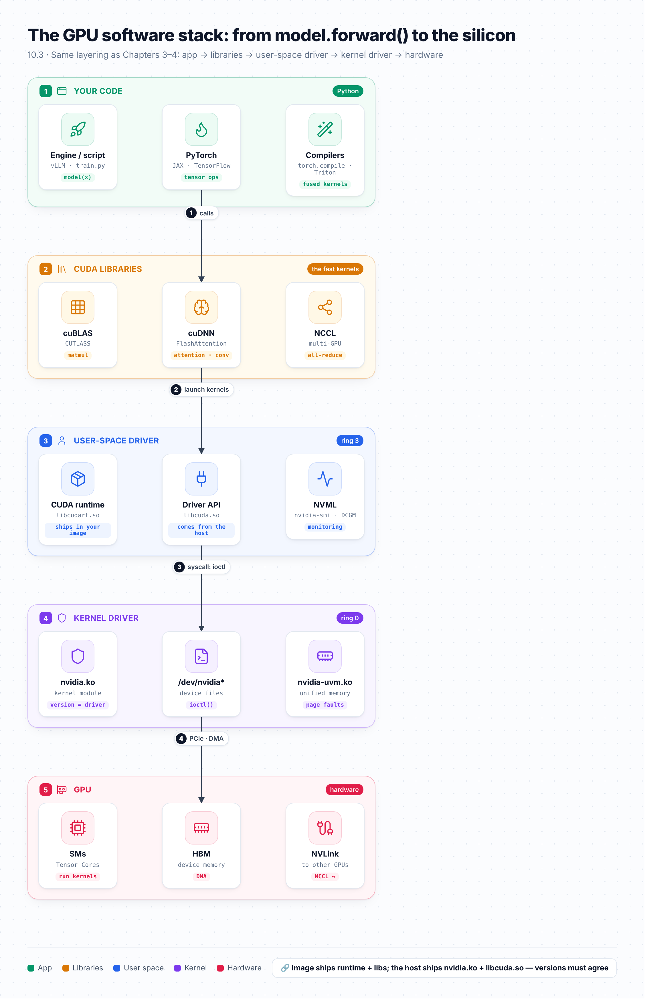
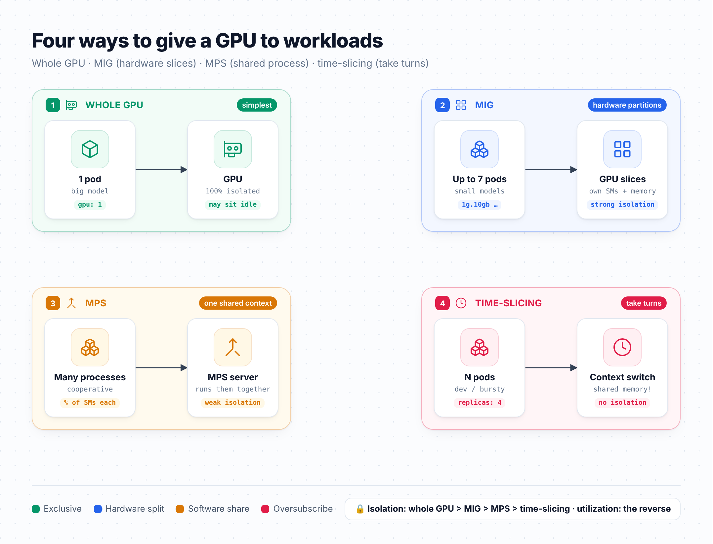

# 10.3 — GPU software stack & sharing

!!! abstract "In one sentence"
    Your PyTorch code calls **CUDA libraries** (cuBLAS for matmul, cuDNN/FlashAttention for attention, NCCL for multi-GPU
    communication), which launch **kernels** through the **user-space driver** (`libcuda.so`), which talks to the
    **kernel driver** (`nvidia.ko`) via `ioctl` syscalls, which programs the GPU. In containers the **image brings the
    libraries**, the **host brings the driver**, and the two must be compatible. One GPU can be given whole, sliced
    in hardware (**MIG**), shared by processes (**MPS**) or time-shared.

## 📖 Key terms & abbreviations

| Term | Stands for | What it is | How it works (one line) |
|---|---|---|---|
| **CUDA** | Compute Unified Device Architecture | NVIDIA's GPU programming platform | Language extensions + runtime + driver to run code on the GPU |
| **Kernel** (GPU) | — | A function that runs on the GPU | Launched by the CPU with a grid of thread blocks |
| **PTX** | Parallel Thread Execution | A portable GPU "assembly" | JIT-compiled by the driver to the exact GPU |
| **SASS** | — (Streaming ASSembler) | The real machine code of a specific GPU generation | What the SMs actually execute |
| **Compute capability** | — | GPU generation number (e.g. 8.0, 9.0, 10.0) | Decides which features and binaries a GPU supports |
| **cuBLAS** | CUDA Basic Linear Algebra Subprograms | Matrix-math library | Highly tuned GEMM (matmul) kernels |
| **GEMM** | General Matrix Multiply | C = A × B (+ C) | The core operation of neural networks |
| **cuDNN** | CUDA Deep Neural Network library | Kernels for convolution, attention, normalization | Called by frameworks automatically |
| **CUTLASS** | CUDA Templates for Linear Algebra Subroutines | C++ templates to build custom GEMM kernels | Used by libraries and engines for fused kernels |
| **FlashAttention** | — | A fast, memory-efficient attention kernel | Tiles the computation so it stays in on-chip SRAM |
| **NCCL** | NVIDIA Collective Communications Library | Multi-GPU / multi-node communication | All-reduce, all-gather over NVLink / InfiniBand |
| **TensorRT** | — | NVIDIA's inference optimizer/compiler | Fuses layers and picks the fastest kernels for a model |
| **Triton** (language) | — | A Python-like language for writing GPU kernels | Used by `torch.compile` to generate fused kernels |
| **torch.compile** | — | PyTorch's compiler | Captures the model graph and generates optimized kernels |
| **CUDA Graphs** | — | Record a sequence of kernel launches once, replay it | Removes CPU launch overhead per step |
| **UMD / KMD** | User-Mode Driver / Kernel-Mode Driver | `libcuda.so` / `nvidia.ko` | User-space half and kernel half of the driver |
| **NVML** | NVIDIA Management Library | API for GPU status and control | What `nvidia-smi` uses |
| **DCGM** | Data Center GPU Manager | Fleet-level GPU monitoring and diagnostics | Exports health/metrics (DCGM exporter → Prometheus) |
| **XID** | — | GPU error codes logged by the driver | `dmesg` shows "NVRM: Xid …" on faults |
| **NVIDIA Container Toolkit** | — | Makes GPUs usable inside containers | Injects device files and host driver libraries |
| **CDI** | Container Device Interface | A standard spec to describe devices for containers | Runtime reads a JSON/YAML spec and mounts the devices |
| **MIG** | Multi-Instance GPU | Hardware partitioning of one GPU | Up to 7 isolated instances with their own SMs and memory |
| **MPS** | Multi-Process Service | Lets processes share one GPU context | Kernels from several processes run concurrently |
| **Time-slicing** | — | Oversubscribing a GPU | Processes take turns; no memory isolation |
| **vGPU** | virtual GPU | GPU sharing for VMs | Hypervisor-level slicing (licensed) |
| **ROCm / HIP** | Radeon Open Compute / Heterogeneous-compute Interface for Portability | AMD's stack / CUDA-like API | Same layering as CUDA, for AMD GPUs |

## 🗺️ Big picture



---

## 1 · What is CUDA, and how does a kernel launch work?

### What is it?

**CUDA** is the platform that lets normal programs run code on NVIDIA GPUs: a C++ extension for writing **kernels**, a **runtime** to manage memory and launches, and **libraries** with pre-optimized kernels. Almost nobody writes raw CUDA for AI; frameworks call the libraries for you.

### How does it work?

1. `y = model(x)` in PyTorch → PyTorch picks an operation, e.g. a matrix multiply.
2. It calls **cuBLAS**, which picks the best **GEMM kernel** for these sizes and this GPU.
3. The kernel launch goes through the **CUDA runtime** (`libcudart`) and **driver API** (`libcuda.so`), which place a command in a queue (**stream**) shared with the GPU.
4. The driver uses **`ioctl` syscalls** on `/dev/nvidia*` (Chapter 3!) when it needs the kernel module, e.g. to allocate memory or map buffers.
5. The GPU's front-end reads the queue, spreads thread blocks over the SMs, results land in HBM.
6. Launches are **asynchronous**: the CPU queues work and moves on. `torch.cuda.synchronize()` waits for the GPU to finish.

> Why `torch.compile` and CUDA Graphs matter: a model step can be thousands of tiny kernels. **Fusing** them (fewer reads/writes of HBM) and **replaying** them as a graph (fewer CPU launches) is often a big speed-up.

## 2 · Versions and compatibility (the classic headache)

| Piece | Where it lives | Rule |
|---|---|---|
| **Kernel driver** `nvidia.ko` + `libcuda.so` | **Host** (node image) | The driver version decides the **maximum CUDA version** it can run (`nvidia-smi` shows "CUDA Version: X") |
| **CUDA runtime + libraries** (cudart, cuBLAS, cuDNN, NCCL) | **Your container image** (or pip wheels like `torch`) | Must be ≤ what the host driver supports (with some forward-compat exceptions) |
| **GPU architecture** (compute capability) | Hardware | Your binaries must include SASS for it, or PTX the driver can JIT |

Typical errors: `CUDA driver version is insufficient for CUDA runtime version` (driver too old), `no kernel image is available for execution on the device` (binary not built for this GPU generation).

## 3 · GPUs in containers

1. The container image contains the **CUDA runtime and libraries** (e.g. a PyTorch image) but **not** the driver.
2. When the container starts, the **NVIDIA Container Toolkit** (via a runtime hook or a **CDI** spec) **mounts** `/dev/nvidia*` device files and the host's **`libcuda.so`** and tools into the container.
3. Inside, the app sees the GPU as if it were local. Isolation is still namespaces + cgroups (Chapter 9) plus device permissions.

On Kubernetes the **GPU Operator** installs the driver, the toolkit and the device plugin / DRA driver on every GPU node ([10.6](06-kubernetes.md)).

## 4 · Sharing a GPU: what are the options, and how do they work?

| Method | How it works | Isolation | Best for |
|---|---|---|---|
| **Whole GPU** | One workload gets the full device | Full | Large models, training |
| **MIG** | The GPU is split **in hardware** into up to 7 instances, each with its own SMs, L2 slice and memory | Strong (memory + fault isolation) | Many small inference models, multi-tenant |
| **MPS** | A server process merges several processes' work into one GPU context, so their kernels run **concurrently** | Weak (shared memory space, one fault can affect all) | Cooperative processes from one team |
| **Time-slicing** | The GPU switches between processes in turns | None (memory is shared, no limits) | Dev/test, bursty low-usage workloads |



## 5 · Monitoring and health

| Tool | What it gives you |
|---|---|
| `nvidia-smi` (NVML) | Utilization, memory, power, temperature, processes, clocks |
| **DCGM** + **DCGM exporter** | Prometheus metrics: SM activity, tensor pipe activity, memory bandwidth, NVLink traffic, XID errors, ECC |
| `dcgmi diag` | Active health tests before you put a node into service |
| `dmesg` / kernel logs | **XID** errors (e.g. memory faults, fallen-off-the-bus) |

> "GPU utilization 100%" in `nvidia-smi` only means **a kernel was running**, not that the SMs were busy. Use DCGM's **SM activity** and **tensor pipe active** metrics to see real usage.

> DevOps connection: treat the **driver + toolkit version as part of the node image**, pin and roll it like a kernel upgrade, and gate new nodes with `dcgmi diag` before they join the pool.

---

## 🧪 Try it yourself

```bash
# 1) Driver and max CUDA version on the host
nvidia-smi | head -5

# 2) GPU inside a container: image brings CUDA, host brings the driver
docker run --rm --gpus all nvidia/cuda:12.6.3-base-ubuntu24.04 nvidia-smi
docker run --rm --gpus all nvidia/cuda:12.6.3-base-ubuntu24.04 bash -c 'ls -l /dev/nvidia*; ldconfig -p | grep libcuda'

# 3) What PyTorch sees
python3 -c "import torch; print(torch.__version__, torch.version.cuda, torch.cuda.is_available(), torch.cuda.get_device_name(0), torch.cuda.get_device_capability(0))"

# 4) Watch syscalls to the driver (Chapter 3 tools still work)
strace -f -e trace=openat,ioctl -o /tmp/trace.txt python3 -c "import torch; torch.ones(1, device='cuda')"
grep -c ioctl /tmp/trace.txt; grep nvidia /tmp/trace.txt | head

# 5) MIG (A100/H100 class and newer, needs admin rights)
nvidia-smi mig -lgip          # available MIG profiles

# 6) Multi-GPU bandwidth with NCCL tests
git clone https://github.com/NVIDIA/nccl-tests && cd nccl-tests && make
./build/all_reduce_perf -b 8M -e 1G -f 2 -g $(nvidia-smi -L | wc -l)
```

**Exercise:** in the strace output, find the `openat("/dev/nvidia…")` calls and count the `ioctl`s needed just to create one tensor on the GPU.

---

## 🃏 Cheat sheet

```text
PyTorch → cuBLAS / cuDNN / FlashAttention / NCCL → CUDA runtime (libcudart)
       → driver API (libcuda.so, from host) → ioctl on /dev/nvidia* → nvidia.ko → GPU
Kernels launch async into streams · torch.compile fuses · CUDA Graphs replay
Host driver sets max CUDA version · image ships runtime + libs · binaries need SASS/PTX for the GPU
Containers: NVIDIA Container Toolkit / CDI mounts devices + libcuda.so
Sharing: whole GPU > MIG (hw slices) > MPS (shared context) > time-slicing (no isolation)
Monitor: nvidia-smi (NVML) · DCGM exporter (SM/tensor activity, XID) · dcgmi diag
```

---

## ❓ Test yourself

??? question "1. Your pod fails with \"CUDA driver version is insufficient for CUDA runtime version\". Where is the problem?"
    The host's driver is older than the CUDA runtime inside the image needs. Either upgrade the node driver (GPU Operator / node image) or use an image built for an older CUDA version.

??? question "2. Why doesn't a CUDA container image contain the GPU driver?"
    The driver includes a kernel module (`nvidia.ko`) that must match the host kernel and is loaded on the host. The toolkit mounts the matching user-space part (`libcuda.so`) from the host into the container at start-up.

??? question "3. When would you choose MIG over time-slicing?"
    When workloads from different teams or tenants share a GPU and need guaranteed memory and fault isolation with predictable performance. Time-slicing gives no isolation and no memory limits.

??? question "4. `nvidia-smi` shows 100% utilization but throughput is low. What do you check?"
    DCGM metrics like SM activity, tensor pipe activity and memory bandwidth. 100% "utilization" only means some kernel was running in the sample period; it may be tiny, memory-bound or waiting.

??? question "5. What does NCCL do, and on which hardware paths?"
    It implements collective communication (all-reduce, all-gather, reduce-scatter…) between GPUs, choosing NVLink/NVSwitch inside a node and InfiniBand/RoCE with GPUDirect RDMA between nodes.

---

## 📚 Sources

- [CUDA C++ Programming Guide](https://docs.nvidia.com/cuda/cuda-programming-guide/)
- [CUDA compatibility guide](https://docs.nvidia.com/deploy/cuda-compatibility/)
- [NVIDIA Container Toolkit docs](https://docs.nvidia.com/datacenter/cloud-native/container-toolkit/latest/index.html)
- [MIG user guide](https://docs.nvidia.com/datacenter/tesla/mig-user-guide/) · [MPS docs](https://docs.nvidia.com/deploy/mps/)
- [DCGM docs](https://docs.nvidia.com/datacenter/dcgm/latest/)
- [FlashAttention paper](https://arxiv.org/abs/2205.14135)

## ✍️ My notes

> Explain which parts of the GPU stack live in the container image and which on the host, and why, in your own words in 5 lines.

-
