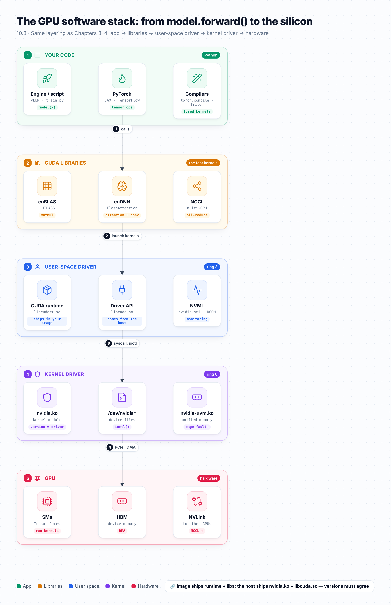
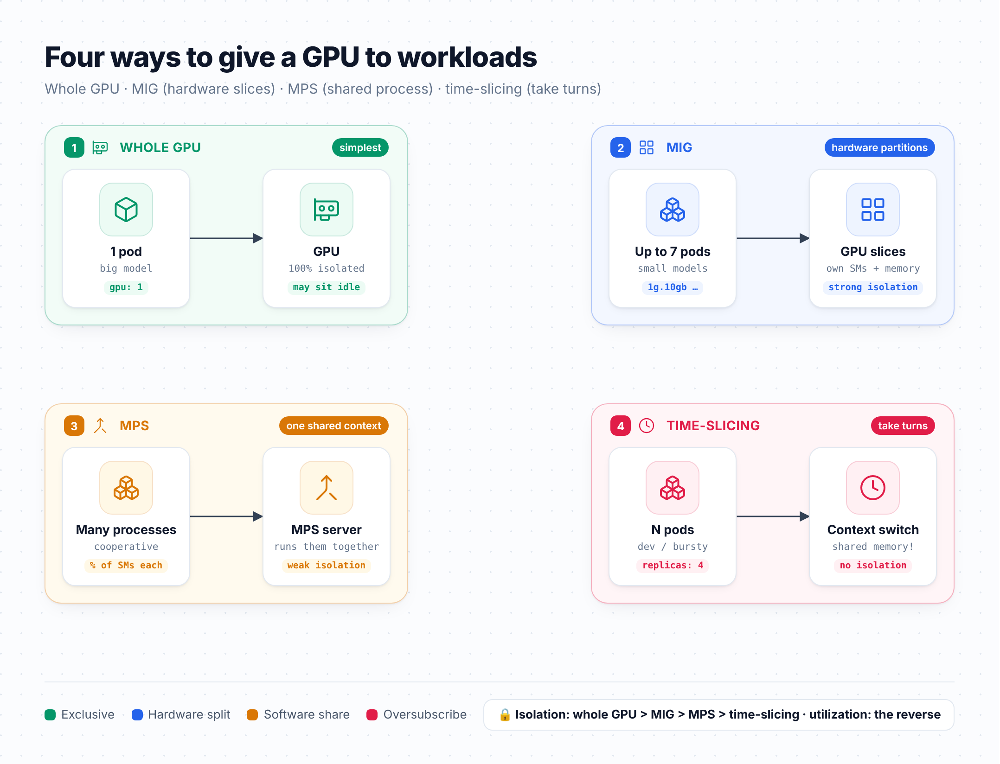

# 10.3 — GPU yazılım yığını ve paylaşım

!!! abstract "Tek cümlede"
    PyTorch kodun **CUDA kütüphanelerini** çağırır: matris çarpımı için cuBLAS, attention için cuDNN/FlashAttention, çoklu GPU
    iletişimi için NCCL. Bunlar **kernel**'leri **user space sürücüsü** (`libcuda.so`) üzerinden başlatır. O da `ioctl`
    syscall'larıyla **kernel sürücüsüyle** (`nvidia.ko`) konuşur, kernel sürücüsü de GPU'yu programlar. Container'larda
    **kütüphaneleri imaj getirir**, **sürücüyü host getirir** ve ikisi uyumlu olmalıdır. Bir GPU bütün olarak verilebilir,
    donanımda dilimlenebilir (**MIG**), process'ler tarafından paylaşılabilir (**MPS**) ya da zaman paylaşımlı kullanılabilir.

## 📖 Terimler ve kısaltmalar

| Terim | Açılımı | Nedir | Nasıl çalışır (tek satır) |
|---|---|---|---|
| **CUDA** | Compute Unified Device Architecture | NVIDIA'nın GPU programlama platformu | GPU'da kod çalıştırmak için dil eklentileri + runtime + sürücü |
| **Kernel** (GPU) | — | GPU'da çalışan bir fonksiyon | CPU tarafından bir thread blokları ızgarasıyla başlatılır |
| **PTX** | Parallel Thread Execution | Taşınabilir bir GPU "assembly"si | Sürücü tarafından tam olarak o GPU'ya JIT ile derlenir |
| **SASS** | — (Streaming ASSembler) | Belirli bir GPU neslinin gerçek makine kodu | SM'lerin gerçekte çalıştırdığı şey |
| **Compute capability** | — | GPU nesil numarası (ör. 8.0, 9.0, 10.0) | GPU'nun hangi özellikleri ve binary'leri desteklediğini belirler |
| **cuBLAS** | CUDA Basic Linear Algebra Subprograms | Matris hesabı kütüphanesi | Çok iyi ayarlanmış GEMM (matris çarpımı) kernel'leri |
| **GEMM** | General Matrix Multiply | C = A × B (+ C) | Sinir ağlarının temel işlemi |
| **cuDNN** | CUDA Deep Neural Network library | Konvolüsyon, attention, normalizasyon kernel'leri | Framework'ler tarafından otomatik çağrılır |
| **CUTLASS** | CUDA Templates for Linear Algebra Subroutines | Özel GEMM kernel'leri kurmak için C++ şablonları | Kütüphaneler ve motorlar birleşik kernel'ler için kullanır |
| **FlashAttention** | — | Hızlı ve bellek dostu bir attention kernel'i | Hesabı parçalara bölerek çip üstü SRAM'de tutar |
| **NCCL** | NVIDIA Collective Communications Library | Çoklu GPU / çoklu node iletişimi | NVLink / InfiniBand üzerinden all-reduce, all-gather |
| **TensorRT** | — | NVIDIA'nın inference optimize edicisi/derleyicisi | Katmanları birleştirir ve bir model için en hızlı kernel'leri seçer |
| **Triton** (dil) | — | GPU kernel'i yazmak için Python benzeri bir dil | `torch.compile` birleşik kernel'ler üretmek için kullanır |
| **torch.compile** | — | PyTorch'un derleyicisi | Model grafiğini yakalar ve optimize kernel'ler üretir |
| **CUDA Graphs** | — | Bir kernel başlatma dizisini bir kez kaydet, tekrar oynat | Adım başına CPU başlatma yükünü kaldırır |
| **UMD / KMD** | User-Mode Driver / Kernel-Mode Driver | `libcuda.so` / `nvidia.ko` | Sürücünün user space yarısı ve kernel yarısı |
| **NVML** | NVIDIA Management Library | GPU durumu ve kontrolü için API | `nvidia-smi`'nin kullandığı şey |
| **DCGM** | Data Center GPU Manager | Filo düzeyinde GPU izleme ve teşhis | Sağlık/metrikleri dışa aktarır (DCGM exporter → Prometheus) |
| **XID** | — | Sürücünün logladığı GPU hata kodları | Hatalarda `dmesg` "NVRM: Xid …" gösterir |
| **NVIDIA Container Toolkit** | — | GPU'ları container içinde kullanılabilir yapar | Cihaz dosyalarını ve host sürücü kütüphanelerini enjekte eder |
| **CDI** | Container Device Interface | Container'lar için cihazları tanımlayan standart bir spec | Runtime bir JSON/YAML spec okur ve cihazları bağlar |
| **MIG** | Multi-Instance GPU | Tek bir GPU'nun donanım düzeyinde bölünmesi | Kendi SM'leri ve belleği olan en fazla 7 izole örnek |
| **MPS** | Multi-Process Service | Process'lerin tek bir GPU bağlamını paylaşmasını sağlar | Birden fazla process'in kernel'leri eşzamanlı çalışır |
| **Zaman dilimleme** | Time-slicing | GPU'ya aşırı abonelik | Process'ler sırayla çalışır, bellek izolasyonu yok |
| **vGPU** | virtual GPU | VM'ler için GPU paylaşımı | Hypervisor düzeyinde dilimleme (lisanslı) |
| **ROCm / HIP** | Radeon Open Compute / Heterogeneous-compute Interface for Portability | AMD'nin yığını / CUDA benzeri API | AMD GPU'ları için CUDA'yla aynı katmanlama |

## 🗺️ Büyük resim



---

## 1 · CUDA nedir ve bir kernel nasıl başlatılır?

### Nedir?

**CUDA**, normal programların NVIDIA GPU'larında kod çalıştırmasını sağlayan platformdur: **kernel** yazmak için bir C++ eklentisi, bellek ve başlatmaları yönetmek için bir **runtime** ve önceden optimize edilmiş kernel'ler içeren **kütüphaneler**. AI için neredeyse kimse ham CUDA yazmaz, framework'ler kütüphaneleri senin yerine çağırır.

### Nasıl çalışır?

1. PyTorch'ta `y = model(x)` → PyTorch bir işlem seçer, örneğin bir matris çarpımı.
2. **cuBLAS**'ı çağırır. cuBLAS bu boyutlar ve bu GPU için en iyi **GEMM kernel**'ini seçer.
3. Kernel başlatma **CUDA runtime** (`libcudart`) ve **driver API** (`libcuda.so`) üzerinden geçer. Bunlar GPU ile paylaşılan bir kuyruğa (**stream**) bir komut koyar.
4. Sürücü, kernel modülüne ihtiyaç duyduğunda (ör. bellek ayırmak ya da tampon eşlemek için) `/dev/nvidia*` üzerinde **`ioctl` syscall'ları** kullanır (Bölüm 3!).
5. GPU'nun ön ucu kuyruğu okur, thread bloklarını SM'lere dağıtır, sonuçlar HBM'e yazılır.
6. Başlatmalar **asenkrondur**: CPU işi kuyruğa koyar ve devam eder. `torch.cuda.synchronize()` GPU'nun bitirmesini bekler.

> `torch.compile` ve CUDA Graphs neden önemli: bir model adımı binlerce minik kernel'den oluşabilir. Onları **birleştirmek** (daha az HBM okuma/yazma) ve bir grafik olarak **tekrar oynatmak** (daha az CPU başlatması) çoğu zaman büyük hız kazandırır.

## 2 · Versiyonlar ve uyumluluk (klasik baş ağrısı)

| Parça | Nerede durur | Kural |
|---|---|---|
| **Kernel sürücüsü** `nvidia.ko` + `libcuda.so` | **Host** (node imajı) | Sürücü versiyonu çalıştırabileceği **azami CUDA versiyonunu** belirler (`nvidia-smi` "CUDA Version: X" gösterir) |
| **CUDA runtime + kütüphaneler** (cudart, cuBLAS, cuDNN, NCCL) | **Container imajın** (ya da `torch` gibi pip wheel'leri) | Host sürücüsünün desteklediğinden ≤ olmalı (bazı ileri uyumluluk istisnalarıyla) |
| **GPU mimarisi** (compute capability) | Donanım | Binary'lerin onun için SASS içermeli ya da sürücünün JIT edebileceği PTX içermeli |

Tipik hatalar: `CUDA driver version is insufficient for CUDA runtime version` (sürücü çok eski), `no kernel image is available for execution on the device` (binary bu GPU nesli için derlenmemiş).

## 3 · Container içinde GPU

1. Container imajı **CUDA runtime'ı ve kütüphaneleri** içerir (ör. bir PyTorch imajı) ama sürücüyü **içermez**.
2. Container başlarken **NVIDIA Container Toolkit** (bir runtime hook'u ya da bir **CDI** spec'i ile) `/dev/nvidia*` cihaz dosyalarını ve host'un **`libcuda.so`**'sunu ve araçlarını container içine **bağlar (mount)**.
3. İçeride uygulama GPU'yu yerelmiş gibi görür. İzolasyon yine namespace + cgroup (Bölüm 9) artı cihaz izinleridir.

Kubernetes'te **GPU Operator**, her GPU node'una sürücüyü, toolkit'i ve device plugin / DRA sürücüsünü kurar ([10.6](06-kubernetes.md)).

## 4 · Bir GPU'yu paylaşmak: seçenekler neler ve nasıl çalışırlar?

| Yöntem | Nasıl çalışır | İzolasyon | En iyi olduğu yer |
|---|---|---|---|
| **Tüm GPU** | Tek bir iş yükü cihazın tamamını alır | Tam | Büyük modeller, eğitim |
| **MIG** | GPU **donanımda** en fazla 7 örneğe bölünür. Her birinin kendi SM'leri, L2 dilimi ve belleği vardır | Güçlü (bellek + hata izolasyonu) | Çok sayıda küçük inference modeli, çok kiracılı ortam |
| **MPS** | Bir sunucu process, birkaç process'in işini tek bir GPU bağlamında birleştirir, kernel'leri **eşzamanlı** çalışır | Zayıf (ortak bellek alanı, bir hata hepsini etkileyebilir) | Tek bir ekibin iş birlikçi process'leri |
| **Zaman dilimleme** | GPU process'ler arasında sırayla geçiş yapar | Yok (bellek ortak, limit yok) | Geliştirme/test, ani ve düşük kullanımlı iş yükleri |



## 5 · İzleme ve sağlık

| Araç | Ne verir |
|---|---|
| `nvidia-smi` (NVML) | Kullanım, bellek, güç, sıcaklık, process'ler, saat hızları |
| **DCGM** + **DCGM exporter** | Prometheus metrikleri: SM etkinliği, tensor pipe etkinliği, bellek bant genişliği, NVLink trafiği, XID hataları, ECC |
| `dcgmi diag` | Bir node'u hizmete almadan önce aktif sağlık testleri |
| `dmesg` / kernel logları | **XID** hataları (ör. bellek hataları, veri yolundan düşme) |

> `nvidia-smi`'deki "GPU utilization %100" sadece **bir kernel'in çalıştığı** anlamına gelir, SM'lerin meşgul olduğu anlamına gelmez. Gerçek kullanımı görmek için DCGM'in **SM activity** ve **tensor pipe active** metriklerini kullan.

> DevOps bağlantısı: **sürücü + toolkit versiyonunu node imajının parçası** olarak gör, bir kernel yükseltmesi gibi sabitle ve kademeli dağıt. Yeni node'ları havuza katılmadan önce `dcgmi diag` ile kontrol et.

---

## 🧪 Kendin dene

```bash
# 1) Host'taki sürücü ve azami CUDA versiyonu
nvidia-smi | head -5

# 2) Container içinde GPU: CUDA'yı imaj, sürücüyü host getirir
docker run --rm --gpus all nvidia/cuda:12.6.3-base-ubuntu24.04 nvidia-smi
docker run --rm --gpus all nvidia/cuda:12.6.3-base-ubuntu24.04 bash -c 'ls -l /dev/nvidia*; ldconfig -p | grep libcuda'

# 3) PyTorch'un gördüğü
python3 -c "import torch; print(torch.__version__, torch.version.cuda, torch.cuda.is_available(), torch.cuda.get_device_name(0), torch.cuda.get_device_capability(0))"

# 4) Sürücüye giden syscall'ları izle (Bölüm 3'ün araçları hâlâ çalışıyor)
strace -f -e trace=openat,ioctl -o /tmp/trace.txt python3 -c "import torch; torch.ones(1, device='cuda')"
grep -c ioctl /tmp/trace.txt; grep nvidia /tmp/trace.txt | head

# 5) MIG (A100/H100 sınıfı ve sonrası, yönetici yetkisi gerekir)
nvidia-smi mig -lgip          # kullanılabilir MIG profilleri

# 6) NCCL testleriyle çoklu GPU bant genişliği
git clone https://github.com/NVIDIA/nccl-tests && cd nccl-tests && make
./build/all_reduce_perf -b 8M -e 1G -f 2 -g $(nvidia-smi -L | wc -l)
```

**Görev:** strace çıktısında `openat("/dev/nvidia…")` çağrılarını bul ve sadece GPU'da tek bir tensör oluşturmak için gereken `ioctl` sayısını say.

---

## 🃏 Hatırlatma kartı

```text
PyTorch → cuBLAS / cuDNN / FlashAttention / NCCL → CUDA runtime (libcudart)
       → driver API (libcuda.so, host'tan) → /dev/nvidia* üzerinde ioctl → nvidia.ko → GPU
Kernel'ler stream'lere asenkron başlatılır · torch.compile birleştirir · CUDA Graphs tekrar oynatır
Host sürücüsü azami CUDA versiyonunu belirler · imaj runtime + kütüphaneleri getirir · binary'ler GPU için SASS/PTX ister
Container'lar: NVIDIA Container Toolkit / CDI cihazları + libcuda.so'yu bağlar
Paylaşım: tüm GPU > MIG (donanım dilimi) > MPS (ortak bağlam) > zaman dilimleme (izolasyon yok)
İzleme: nvidia-smi (NVML) · DCGM exporter (SM/tensor etkinliği, XID) · dcgmi diag
```

---

## ❓ Kendini test et

??? question "1. Pod'un \"CUDA driver version is insufficient for CUDA runtime version\" hatasıyla düşüyor. Sorun nerede?"
    Host'un sürücüsü, imajın içindeki CUDA runtime'ın ihtiyaç duyduğundan daha eski. Ya node sürücüsünü yükselt (GPU Operator / node imajı) ya da daha eski bir CUDA versiyonu için hazırlanmış bir imaj kullan.

??? question "2. Bir CUDA container imajı neden GPU sürücüsünü içermez?"
    Sürücü, host kernel'iyle eşleşmesi gereken ve host'ta yüklenen bir kernel modülü (`nvidia.ko`) içerir. Toolkit, eşleşen user space kısmını (`libcuda.so`) container başlarken host'tan container'a bağlar.

??? question "3. Zaman dilimleme yerine ne zaman MIG seçersin?"
    Farklı ekiplerin ya da kiracıların iş yükleri bir GPU'yu paylaşıyor ve tahmin edilebilir performansla garantili bellek ve hata izolasyonuna ihtiyaç duyuyorsa. Zaman dilimleme ne izolasyon ne de bellek limiti verir.

??? question "4. `nvidia-smi` %100 kullanım gösteriyor ama verim düşük. Neye bakarsın?"
    SM activity, tensor pipe activity ve bellek bant genişliği gibi DCGM metriklerine. %100 "kullanım", örnekleme süresinde bir kernel'in çalıştığı anlamına gelir. O kernel minik olabilir, bellek sınırlı olabilir ya da bekliyor olabilir.

??? question "5. NCCL ne yapar ve hangi donanım yollarını kullanır?"
    GPU'lar arasında toplu iletişimi (all-reduce, all-gather, reduce-scatter…) uygular. Node içinde NVLink/NVSwitch'i, node'lar arasında GPUDirect RDMA ile InfiniBand/RoCE'yi seçer.

---

## 📚 Kaynaklar

- [CUDA C++ Programming Guide](https://docs.nvidia.com/cuda/cuda-programming-guide/)
- [CUDA uyumluluk rehberi](https://docs.nvidia.com/deploy/cuda-compatibility/)
- [NVIDIA Container Toolkit dokümanları](https://docs.nvidia.com/datacenter/cloud-native/container-toolkit/latest/index.html)
- [MIG kullanıcı rehberi](https://docs.nvidia.com/datacenter/tesla/mig-user-guide/) · [MPS dokümanları](https://docs.nvidia.com/deploy/mps/)
- [DCGM dokümanları](https://docs.nvidia.com/datacenter/dcgm/latest/)
- [FlashAttention makalesi](https://arxiv.org/abs/2205.14135)

## ✍️ Kendi notlarım

> GPU yığınının hangi parçalarının container imajında, hangilerinin host'ta durduğunu ve nedenini kendi cümlelerinle 5 satırda anlat.

-
