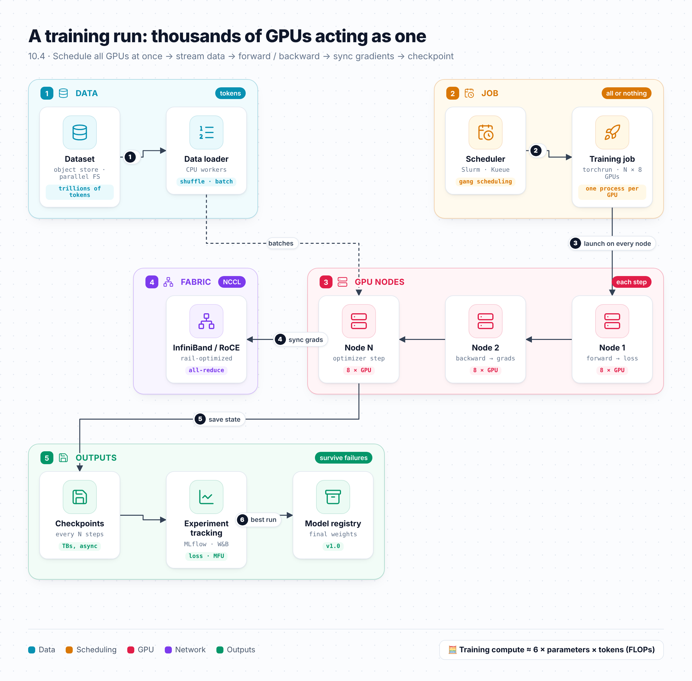
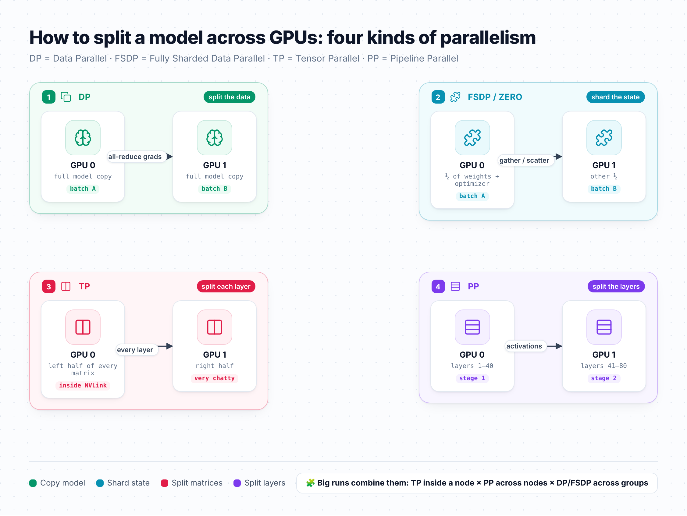
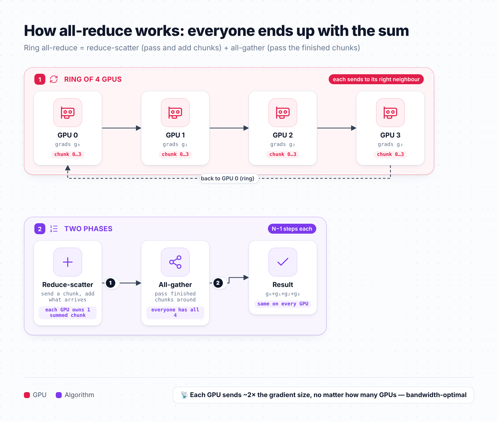

# 10.4 — Distributed training

!!! abstract "In short"
    Training repeats one loop billions of times: **forward** (predict), **loss** (how wrong), **backward** (which way to
    nudge each parameter) and **optimizer step** (nudge). A big model doesn't fit on one GPU, so the work is split
    across thousands of GPUs with several kinds of **parallelism**. **Collectives** like all-reduce keep them in sync
    over NVLink and InfiniBand. Jobs are scheduled **all at once** (gang scheduling) and protected with frequent
    **checkpoints**.

## 📖 Key terms & abbreviations

| Term | Stands for | What it is | How it works (one line) |
|---|---|---|---|
| **Forward / backward pass** | — | Compute predictions / compute gradients | Backward walks the layers in reverse (backpropagation) |
| **Loss** | — | One number measuring how wrong the predictions are | For LLMs: cross-entropy of the real next token |
| **Gradient** | — | Direction and size to change each parameter | Computed by backpropagation for every parameter |
| **Optimizer** (Adam/AdamW) | Adaptive Moment Estimation | The rule that updates parameters from gradients | Keeps 2 running averages per parameter (m, v) |
| **Batch / global batch** | — | Examples processed per step / across all GPUs | Bigger batch = fewer, larger steps |
| **Mixed precision** | — | Compute in BF16/FP8, keep master weights in FP32 | Speed of low precision, stability of high precision |
| **Activation checkpointing** | — | Don't store all activations; recompute in backward | Trades ~30% more compute for much less memory |
| **DP** | Data Parallel | Every GPU has a full model copy, different data | Gradients averaged with all-reduce each step |
| **FSDP / ZeRO** | Fully Sharded Data Parallel / Zero Redundancy Optimizer | DP where weights, grads and optimizer states are sharded | Gather a layer's weights just in time, then free them |
| **TP** | Tensor Parallel | Each layer's matrices split across GPUs | Partial results exchanged every layer → needs NVLink |
| **PP** | Pipeline Parallel | Layers split into stages on different GPUs | Micro-batches flow through stages like an assembly line |
| **EP** | Expert Parallel | MoE experts placed on different GPUs | Tokens sent to their experts with all-to-all |
| **CP / SP** | Context / Sequence Parallel | Long sequences split across GPUs | Each GPU handles part of the tokens, attention exchanges K/V |
| **Collective** | — | A communication pattern among many GPUs | All-reduce, all-gather, reduce-scatter, broadcast, all-to-all |
| **All-reduce** | — | Everyone contributes a tensor, everyone gets the sum | Ring/tree algorithms in NCCL |
| **NCCL** | NVIDIA Collective Communications Library | The library implementing collectives | Uses NVLink inside nodes, RDMA between nodes |
| **Gang scheduling** | — | Start all pods/processes of a job together or none | Prevents half-started jobs holding GPUs forever |
| **Slurm** | Simple Linux Utility for Resource Management | Classic HPC batch scheduler | `sbatch` / `srun` jobs on node allocations |
| **Kueue / JobSet / KAI** | — | Kubernetes queueing, multi-pod jobs, AI scheduler | Quotas, gang admission, topology-aware placement |
| **torchrun** | — | PyTorch's distributed launcher | Starts one process per GPU and wires up ranks |
| **Rank / world size** | — | A process's ID / total number of processes | Rank 0 often logs and saves checkpoints |
| **Checkpoint** | — | A saved snapshot of weights + optimizer + data position | Resume after failures |
| **MFU** | Model FLOPs Utilization | Useful FLOPs achieved ÷ peak FLOPS | 35–55% is typical for large well-tuned runs |
| **Parallel FS** | Parallel File System (Lustre, GPFS…) | Storage striped across many servers | Thousands of clients read/write at high aggregate speed |

## 🗺️ Big picture



---

## 1 · What is the training loop, and how does it work?

### What is it?

Training is optimization: find parameter values that make the loss small on the training data.

### How does it work?

1. **Forward:** run a batch of token sequences through the model, get predictions for every next token.
2. **Loss:** compare predictions with the real next tokens (cross-entropy).
3. **Backward:** backpropagation computes a **gradient** for every parameter.
4. **Sync (if distributed):** average gradients across data-parallel GPUs (**all-reduce**).
5. **Optimizer step:** AdamW updates every parameter a little.
6. Repeat for millions of steps. Every N steps, **checkpoint**.

## 2 · Memory accounting: why one GPU isn't enough

Per parameter, with mixed precision and AdamW:

| Item | Bytes per parameter |
|---|---|
| BF16 weights | 2 |
| BF16 gradients | 2 |
| FP32 master weights | 4 |
| Adam first moment (m) | 4 |
| Adam second moment (v) | 4 |
| **Total (before activations)** | **~16** |

A 70B model → **~1.1 TB** just for this state, plus activations. An 80–288 GB GPU can't hold it, so the state must be **sharded** (FSDP/ZeRO) and the work **split** (TP/PP).

**Compute:** training FLOPs ≈ **6 × parameters × tokens**. Example: 8B parameters × 15T tokens × 6 ≈ 7×10²³ FLOPs. At ~1,000 TFLOPS peak and 40% MFU, that's ~500,000 GPU-hours: about **3 weeks on 1,000 GPUs**.

## 3 · Parallelism: what are the kinds, and how do they work?

| Kind | What gets split | Communication | Where it should run |
|---|---|---|---|
| **DP** | The **data**; each GPU has a full copy | All-reduce gradients once per step | Anywhere (scale-out OK) |
| **FSDP / ZeRO** | Weights, grads, optimizer **state** | All-gather weights per layer, reduce-scatter grads | Anywhere, more traffic than DP |
| **TP** | Each **matrix** inside a layer | Every layer, forward and backward | **Inside the NVLink domain** |
| **PP** | The **layers** into stages | Activations between stages | Across nodes, watch for pipeline "bubbles" |
| **EP** | MoE **experts** | All-to-all token routing | Inside or across nodes |
| **CP / SP** | The **sequence** (long contexts) | K/V exchange in attention | Inside fast domains |

Big runs combine them ("3D/4D parallelism"): e.g. **TP=8 inside each server × PP=4 across servers × DP over the rest**.



## 4 · Collectives: what is all-reduce, and how does it work?

### What is it?

All-reduce takes one tensor from every GPU and gives **every GPU the element-wise sum** (or average). It's how data-parallel GPUs agree on the same gradients.

### How does it work? (ring algorithm)

1. Each GPU splits its gradient into N chunks and the GPUs form a **ring**.
2. **Reduce-scatter** (N−1 steps): each GPU sends one chunk to its neighbour and adds the chunk it receives. At the end, each GPU owns one **fully summed** chunk.
3. **All-gather** (N−1 steps): the finished chunks are passed around until every GPU has all of them.
4. Each GPU sends ~2× the gradient size in total, **independent of the number of GPUs**, so the ring uses bandwidth optimally. NCCL also uses tree and other algorithms for latency.



## 5 · The cluster around the GPUs

| Part | What matters |
|---|---|
| **Network** ([10.2](02-gpu.md)) | Rail-optimized, non-blocking IB/RoCE. One slow link slows **every** step, since collectives wait for the slowest GPU. |
| **Storage** | Datasets streamed from object storage or a parallel FS. Checkpoints can be **TBs** each, so write them asynchronously and in parallel. |
| **Scheduling** | **Gang scheduling** (all-or-nothing), **topology-aware placement** (keep a job's nodes close in the network), quotas and priorities between teams. Slurm in HPC, **Kueue/JobSet/KAI/Volcano** on Kubernetes. |
| **Failures** | At thousands of GPUs, a GPU, NIC or node fails every few hours. Detect it (XID errors, NCCL timeouts, stragglers), replace the node, **restart from the last checkpoint**. |
| **Observability** | Loss curve, tokens/s, step time, **MFU**, per-GPU utilization, NCCL bandwidth. |

> DevOps connection: a training cluster is a **batch system**, not a web service. What matters is **goodput**: the fraction of GPU-hours that actually advanced the model, after failures, restarts, queueing and slow nodes.

## 6 · Fine-tuning: the small-scale version

Most teams don't pre-train. They **fine-tune** an open model:

| Method | Hardware | Notes |
|---|---|---|
| **LoRA** | 1–8 GPUs | Train small adapters, base weights frozen |
| **QLoRA** | 1 GPU | Base model in 4-bit, adapters in BF16 |
| **Full fine-tune** | Multi-node | All weights updated, needs FSDP |

---

## 🧪 Try it yourself

```bash
# 1) Data-parallel training with 2 processes on a CPU (no GPU needed): see ranks and all-reduce
cat > ddp_demo.py <<'EOF'
import os, torch, torch.distributed as dist
dist.init_process_group("gloo")
rank, world = dist.get_rank(), dist.get_world_size()
model = torch.nn.parallel.DistributedDataParallel(torch.nn.Linear(10, 1))
opt = torch.optim.AdamW(model.parameters(), lr=1e-2)
for step in range(3):
    x = torch.randn(32, 10) + rank            # each rank gets different data
    loss = ((model(x) - 1) ** 2).mean()
    opt.zero_grad(); loss.backward(); opt.step()   # backward() all-reduces gradients
    print(f"rank {rank}/{world} step {step} loss {loss.item():.3f} weight[0]={model.module.weight[0,0].item():.4f}")
dist.destroy_process_group()
EOF
torchrun --nproc_per_node=2 ddp_demo.py   # the weights stay identical on both ranks

# 2) A raw all-reduce
cat > allreduce_demo.py <<'EOF'
import torch, torch.distributed as dist
dist.init_process_group("gloo")
t = torch.tensor([float(dist.get_rank())])
dist.all_reduce(t)
print(f"rank {dist.get_rank()}: {t.item()}")   # every rank prints 6.0 (0+1+2+3)
EOF
torchrun --nproc_per_node=4 allreduce_demo.py

# 3) The memory and compute math
python3 -c "
p=70e9; print('training state TB:', p*16/1e12)
print('GPU-hours for 8B x 15T tokens @ 1000 TFLOPS, 40% MFU:', 6*8e9*15e12/(1e15*0.4)/3600)"
```

```bash
# 4) A Slurm job skeleton for multi-node training (for reference)
#SBATCH --nodes=4 --gpus-per-node=8 --ntasks-per-node=1 --exclusive
srun torchrun --nnodes=$SLURM_NNODES --nproc_per_node=8 \
     --rdzv_backend=c10d --rdzv_endpoint=$(hostname):29500 train.py
```

**Exercise:** in the DDP demo, remove `DistributedDataParallel` (use the plain model) and run again. Do the weights on the two ranks still match? Why not?

---

## 🃏 Cheat sheet

```text
Loop: forward → loss → backward (gradients) → all-reduce → optimizer step → repeat · checkpoint every N
Memory: ~16 bytes/param (BF16 w+g, FP32 master, Adam m+v) + activations → shard it
Compute: FLOPs ≈ 6 × params × tokens · MFU 35–55% is good
DP (copy model) · FSDP/ZeRO (shard state) · TP (split matrices, inside NVLink) · PP (split layers) · EP (experts) · CP (sequence)
All-reduce (ring): reduce-scatter + all-gather · ~2× data per GPU regardless of N
Cluster: rail-optimized IB/RoCE · parallel FS / object store · gang scheduling (Slurm, Kueue, KAI) · restart from checkpoints
```

---

## ❓ Test yourself

??? question "1. Why is tensor parallelism usually kept inside one server (or NVLink domain)?"
    TP exchanges partial results in every layer, forward and backward. That needs the TB/s bandwidth and low latency of NVLink; over the network it would make every step wait.

??? question "2. Roughly how much memory does full training state need for a 13B model with AdamW and mixed precision?"
    About 16 bytes per parameter → ~208 GB, before activations. That's more than one GPU, so you'd use FSDP/ZeRO across several GPUs.

??? question "3. What is gang scheduling and why does distributed training need it?"
    Starting all processes of a job together or not at all. If only some ranks start, they block waiting for the others while holding expensive GPUs, and two such jobs can deadlock the cluster.

??? question "4. One node in a 512-GPU job has a slow NIC. What happens to the whole job?"
    Every collective waits for the slowest participant, so every step slows down to that node's speed. Straggler detection and replacing the node matter.

??? question "5. Your 1,000-GPU run checkpoints every 3 hours and a node fails every 4 hours on average. Why is that bad?"
    Each failure loses up to 3 hours × 1,000 GPUs of work plus restart time, and failures happen almost as often as checkpoints. Checkpoint more often (asynchronously) to raise goodput.

---

## 📚 Sources

- [PyTorch distributed overview](https://pytorch.org/tutorials/beginner/dist_overview.html) · [FSDP tutorial](https://pytorch.org/tutorials/intermediate/FSDP_tutorial.html)
- [ZeRO paper](https://arxiv.org/abs/1910.02054) · [Megatron-LM paper (tensor + pipeline parallel)](https://arxiv.org/abs/2104.04473)
- [Hugging Face: The Ultra-Scale Playbook](https://huggingface.co/spaces/nanotron/ultrascale-playbook)
- [NCCL docs](https://docs.nvidia.com/deeplearning/nccl/user-guide/docs/index.html)
- [Kueue](https://kueue.sigs.k8s.io/) · [Slurm](https://slurm.schedmd.com/)

## ✍️ My notes

> Explain why a 70B model needs several kinds of parallelism and what all-reduce does, in your own words in 5 lines.
